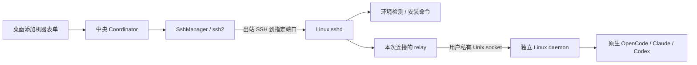
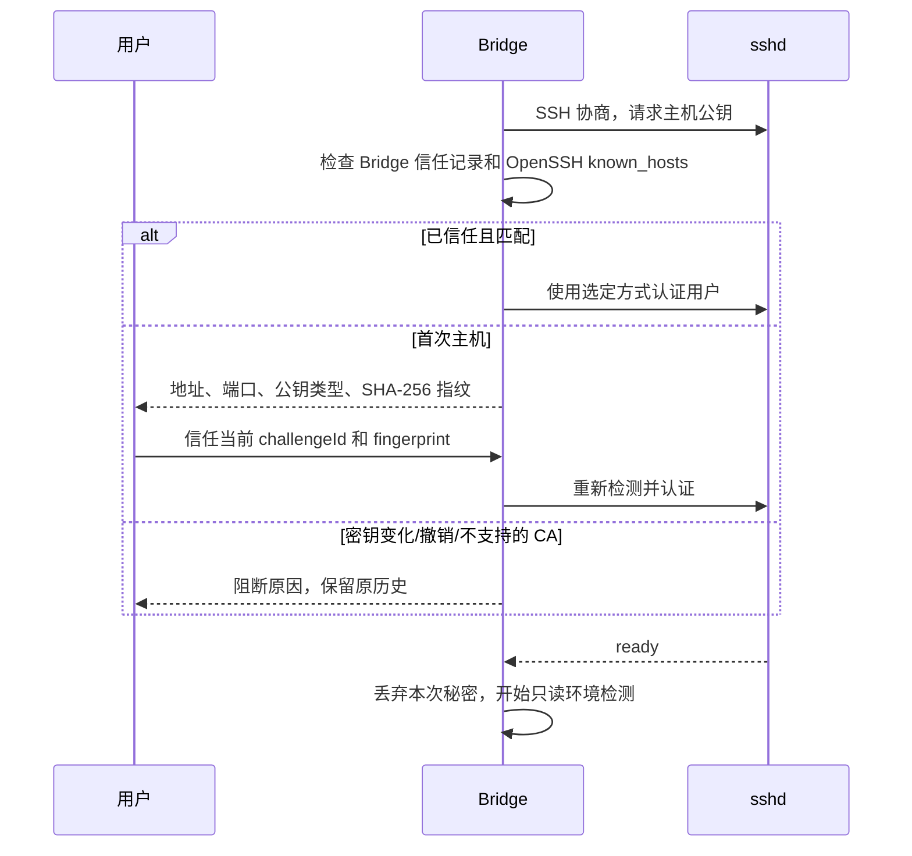
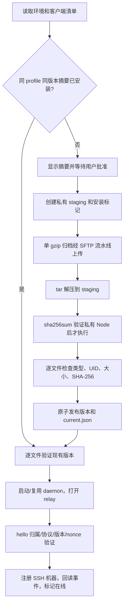
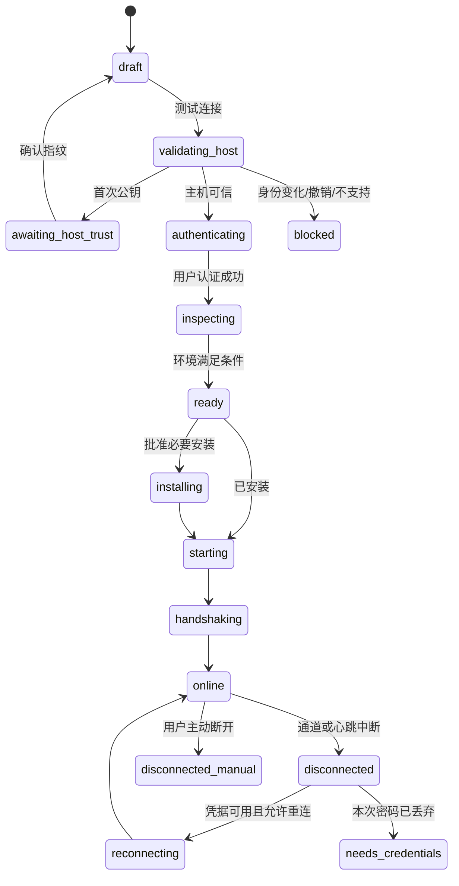

# M04 SSH 机器接入设计

## 2026-10-17：SSH持久拒绝恢复（alpha.28已预发布）

M04-F04/F05/F08：ipc/request裸NOT_CONFIGURED后，仅在同一认证代次只读daemon.receiptRead；内部WeakMap区分可信台账与原生/伪造JSON。既有主机密钥、owner/profile/daemon/协议校验继续适用。为新包收录alpha.27原manifest精确摘要，不自动升级原daemon。 当前源码/GitHub预发布alpha.28；[完整需求、状态与验证](../../iterations/I06/daemon-rejection-recovery.md)。

## 2026-10-17：Windows未派发与持久化恢复

M04-F04/F05/F08：alpha.27客户端收录原alpha.26冻结manifest，digest为6674f37902908e329ce76cb634d6ebae36c55f33f8e7ad836488986b10879c4e；按原文件/归属精确校验复用，不自动升级或派发模型。既有alpha.24/25清单保持原字节。 alpha.27当次源码与预发布；[需求、状态图、验证与交付](../../iterations/I06/windows-start-persistence.md)。
## 2026-10-17：alpha.24 可信升级路径

源码/预发布 alpha.26 在可信索引补收原 alpha.24/alpha.25 冻结 manifest。重连按旧清单逐文件核验，复用原 daemon，不自动替换；在线后用户确认维护升级至当前包。此前 alpha.25 漏收 alpha.24 导致连接与维护入口均被版本校验阻断。本片不放宽未知版本、摘要/归属/路径规则；其他未收录版本的离线维护仍有限制。[实现、升级与验收](../../iterations/I06/ssh-alpha24-upgrade.md)。

更新日期：2026-10-14。基线：桌面源码与维护恢复候选 `0.6.0-alpha.17`，Windows 已发布便携版 `0.5.0`。alpha.2 的主要 Windows/SSH 验收保留；alpha.4 已实际使用用户原凭据核验并重连原 alpha.2 后台。系统 agent 与完整故障覆盖限制保留。详见 [测试报告](test-report.md)。

## 1. 功能与用户操作

本模块把一台已有 SSH 登录能力的 Linux 服务器加入 AgentBridge 的机器列表。用户使用服务器原有账号认证，无需额外申请 Bridge 设备令牌；服务器仍需要 Bridge daemon，由客户端在用户目录自动安装。

| 功能 ID | 用户可验收行为 | 当前状态 |
| --- | --- | --- |
| M04-F01 | 输入地址、端口、用户名，选择密码/本机私钥/ssh-agent 创建连接 | 已实现；密码/DPAPI 的独立 Linux 与加密私钥/命名管道 agent 的隔离协议实测分别有证据，系统 agent 专项保留 |
| M04-F02 | 新主机显示 SHA-256 指纹，用户确认才继续；变化或撤销的密钥阻断 | 校验代码、受控测试和 mock 界面通过 |
| M04-F03 | 默认仅本次使用秘密；选择保存时用 Windows 当前用户加密保护 | 实现、受控存储与实际 Windows DPAPI 认证/恢复有证据；保护失败不回退明文 |
| M04-F04 | 检测系统/用户目录/Node/空间，展示安装摘要，批准后安装并连接 | 密钥真实 Linux 已通过，首次安装 77.8 秒 |
| M04-F05 | 连接后出现独立机器及该机 Agent，机器身份在重连后不变 | 真实 Linux 已通过；不依赖项目文件夹或模型选择 |
| M04-F06 | 断线显示离线/重连/需凭据；重连读取原结果，不重发需求 | 代码、daemon 受控及真实断线记录；完整退避指标未测 |
| M04-F07 | 主动断开只关闭连接，远端已接收任务继续；手动连接恢复观察 | 真实断线记录与 mock 界面通过 |
| M04-F08 | 修改/移除 SSH 机器、升级/停止/卸载 daemon | alpha.11 连接维护、可信升级/回滚、停止/卸载源码已实现；分层验收见当前报告 |

基本操作：添加 Linux 机器 → 测试连接 → 首次指纹确认（已有可信记录可跳过）→ 查看环境及安装摘要 → 安装并连接/连接机器 → 从节点“接入”按钮接入发现的 Agent → 新建会话时指定远端工作目录。连接节点时不配置模型、供应商或文件夹。

## 2. 边界与通信原理



中央后台主动连接服务器 SSH 端口；服务器不需要向 Windows 建立入站连接，也不开放 Bridge 公网 HTTP/WebSocket 端口。SSH 负责链路加密、主机身份和用户登录，daemon 握手负责确认 Bridge profile、后台 UUID、协议和连接代次。这是两层不同的身份校验。

SshManager 的 state 保存本次连接错误；成功转换到无错误状态后，下游必须同时删除机器缓存的 error/connectionError。连接状态不是增量错误补丁，缺失错误字段不表示保留旧报错；新的主机密钥/认证/版本拒绝继续按实际错误展示。

本模块管理 SSH 连接和安装，不决定主从权限，不执行模型推理。业务通过 `SshHost.call()` 交给 [M05 daemon](../05-linux-daemon/design.md)，机器与节点目录由 [M03](../03-machine-network/design.md)管理。界面交互由 [M01](../01-desktop/design.md)管理。

范围是可直接访问的 Linux SSH 地址。当前不支持 ProxyJump/任意 ProxyCommand、SSH 交互式 MFA、主机证书 CA、PTY 登录会话；不自动转发本机 agent，不把 SSH 私钥上传服务器。

工具发现由实际远端 daemon 执行，版本由 inspect/hello 核对。Linux 用户态 Node 版本管理器安装的 CLI 在 alpha.19 增加覆盖；客户端换包或重连不替换兼容旧 daemon。用户须在原机器“后台维护 → 升级后台”加载新扫描代码；不自动维护服务器、不改 SSH 登录用户、原生账号或机器身份。[扫描修复与使用](../../iterations/I06/linux-cli-discovery.md)。

## 3. 连接、主机与凭据对象

| 对象 | 关键字段 | 稳定性/存储 |
| --- | --- | --- |
| SSH 连接草稿 | `connectionId,name,host,port,username,authKind,keyPath?` | `ssh-connections.json`，配置与重连沿用 |
| 可信主机 | 地址+端口、公钥类型/内容、`SHA256:` 指纹 | `ssh-known-hosts.json`，也只读本机 `~/.ssh/known_hosts` |
| 信任挑战 | `challengeId,fingerprint,host,port,keyType` | 内存有效 5 分钟，必须确认当前挑战 |
| 临时秘密 | 密码或私钥口令的 Buffer | 内存有效 5 分钟；成功认证/失败尝试后丢弃并清零 Buffer |
| 已保存秘密 | `credentialRef` 指向 `{kind,ciphertext}` | Windows `ssh-credentials/credential-<UUID>.json`；普通配置只保存引用 |
| 远端机器 | `machineId = 'ssh-' + daemonId` | 首次通过握手才绑定，原任务依赖这一身份 |
| 安装操作 | `operationId,connectionId,previewId,status` | `ssh-connections.json.operations`，与任务 requestId 不混用 |
| 观察位置 | `lastCursor,lastSeenAt,lastSyncedAt` | 保存事件回读位置和时间；不表示模型任务成功 |

草稿按规范化地址、端口和用户名去重。连接同一 daemon UUID 且主机公钥相同的别名时，旧连接停止自动重连；UUID 相同但公钥不同会拒绝，避免复制状态目录冒充原机器。不同 SSH 用户的后台身份不合并。

`credentialAvailable` 仅表示“可尝试获取凭据”。私钥分支仅凭路径就可能显示 available，并不证明私钥可读、无需口令或账号已登录；真正可用以认证结果为准。

## 4. 主机验证与认证



`ssh2` 始终提供 `hostVerifier`，不使用其默认接受策略。OpenSSH 记录支持普通/哈希主机名、通配与否定项；匹配撤销记录优先拒绝，CA 信任明确报未支持，不当作首次未知主机。已保存公钥不能由首次确认流程自动覆盖。

认证方式：

| 方式 | 输入和本地处理 | 重连条件 |
| --- | --- | --- |
| 密码 | 隐藏输入，经本地私有 IPC 传递；不进入 argv、环境变量或普通配置 | 未保存且认证后已丢弃时，断线须重新输入；Windows 已保存时可解密尝试 |
| 私钥文件 | 本地绝对路径，读文件并解析；最多 1 MiB；加密私钥可提供口令 | 原文件仍可读，所需口令仍可获得 |
| ssh-agent | Windows `\\.\pipe\openssh-ssh-agent`；Linux `SSH_AUTH_SOCK` | 本机 agent 在线并能签名；无 agent forwarding |

选择“保存”仅 Windows 支持，使用 DPAPI `CurrentUser`。固定 PowerShell 程序由编码脚本参数传入，秘密从 stdin 输入，stderr 不回显；系统保护失败就报错，没有明文回退。取消保存会移除原引用的密文。JavaScript 字符串及原生库内部副本无法保证全部清零，当前实现只清零自身管理的 Buffer，不宣称内存绝无秘密残留。

## 5. 探测、安装与接入

探测使用无 PTY 的 `/bin/sh -s` 受控脚本，输出带固定起止标识。只接受 Linux x86_64、glibc ≥2.28、可确认 UID 和绝对真实 HOME；Node ≥22.13 优先使用，否则使用离线包的私有 Node。欢迎文本污染检测输出会报 `SSH_BOOTSTRAP_OUTPUT`。

安装目录与状态目录均须位于已认证用户真实 HOME 下。若用户的 `XDG_STATE_HOME` 指向 HOME 外，当前安全检查会拒绝，不能假定所有 XDG 布局都支持。探测检查可用空间至少为解包大小两倍加 32 MiB；缓存的 `ready` 探测结果可能保持 5 分钟，安装中途空间变化仍可能失败。

alpha.14：归档以 0600 创建，保持 24×32 KiB 流水线；每个缓冲区在对应 WRITE 全部确认后才复用，ACK 累加实际成功字节数，CLOSE 成功才解包。通道 error/close/end 或 60 秒无 ACK 明确结束；安全显示权限、通用 Failure、空间/配额、通道关闭和无响应类别，不回显服务器原始文字。仅 `SSH_UPLOAD_FAILED` 表示本次未解包/激活，安装记录为 rejected 并暂停自动重连；用户检测原连接、查看摘要、批准后沿未变化摘要及原 ID 安装。其他已发送步骤失败保持 unknown。见 [诊断与验收](../../iterations/I06/ssh-upload-recovery.md)。



归档由 [M10 发布模块](../10-packaging/design.md)提供的清单普通文件构建，压缩后一次上传，窗口为 24 个 32 KiB WRITE 包。并非逐文件 SFTP 安装；远端需要 `tar` 和 `sha256sum`。不执行远端 npm install、sudo 或修改系统 Node。新版本需要用户确认安装，自动重连禁止自动安装/升级。已有版本可在客户端可信兼容清单中精确匹配时复用；alpha.11 明确收录 alpha.2–alpha.10 的 Linux x64 协议 2 发布；每份清单在收录前与历史包摘要核对。选择本地校验清单后，要求 current 的版本、摘要与规范版本路径一致；未知版本报 `SSH_DAEMON_UPGRADE_REQUIRED`，摘要或别名路径不符报 `SSH_VERSION_CONFLICT`，保留原目录。协议号相同不能自动放行。

兼容复用的 probe 返回实际 `daemonVersion`、客户端包 `clientDaemonVersion`、`reuseCompatible=true`、`installNeeded=false`。旧后台按可信 manifest 逐文件核验，重新检查 HOME 内各路径组件、UID、符号链接、owner/profile/current/release 标记。复用分支无上传/创建目录/chmod/激活/停机；必要时先验证私有 Node 再执行核验。握手继续匹配所选旧版本和原 daemonId；新安装仍使用当前包。详细行为与版本来源见 [本次交付](../../iterations/I06/ssh-compatible-reuse.md)。

首次连接读取事件并建立机器后，Agent 扫描执行各工具 `--version` 等发现流程，不调用模型。任务工作目录通过 RPC 传到远端，并不自动把 Windows 路径转换为 `/mnt/c`，也不自动同步代码。

## 6. 真实 API

这些方法通过 `window.agentbridge.call(method, params)` → Coordinator 传递，不是对公网开放的接口。连接状态与错误随 snapshot 展示。

| 方法 | 必要参数/行为 |
| --- | --- |
| `machine.createSshDraft` | `{host,username,port?,name?,authKind,keyPath?}`；`authKind=password/privateKey/agent`，接受 `key` 别名 |
| `credential.provide` | `{connectionId,secret,save}`；仅受保护本地调用，不写入报告 |
| `machine.testSsh` | `{connectionId}`，返回 ready/probe、信任挑战或需要凭据状态 |
| `machine.trustHost` | `{connectionId,challengeId,fingerprint}`，确认当前未过期挑战 |
| `machine.connectSsh` | `{connectionId,operationId,installIfNeeded}`，需要安装时须明确 true |
| `machine.reconnect` | `{connectionId}` 或 `{machineId}`；尝试复用已安装版本，不创建新任务 |
| `machine.disconnect` | `{connectionId}` 或 `{machineId}`；关闭连接并关闭自动重连 |

```js
const draft = await call('machine.createSshDraft', {
  host: 'linux.example.test', port: 22, username: 'developer', authKind: 'agent'
});
const checked = await call('machine.testSsh', {connectionId: draft.connectionId});
// 新主机必须先显示 checked.trustChallenge 并让用户确认。
// 如 checked.probe.installNeeded，再显示安装摘要并让用户批准。
await call('machine.connectSsh', {
  connectionId: draft.connectionId, operationId: 'connect-example-1', installIfNeeded: true
});
```

实际界面 API 返回 `{ok,result}` 外层，示例中的 `call` 表示已解包并处理错误的辅助函数。`machine.updateSsh` / `machine.remove` / `machine.restore` / `machine.operation` 已纳入当前允许方法集合，契约见下方 I06C 当前说明；daemon 维护入口已实现，当前语义见下节。

## 7. 状态、断线与错误



5 秒一次应用心跳，15 秒无有效回应即离线；SSH 自身也有 keepalive。重试延迟 1/2/4/8 秒，8 秒封顶并使用 80%–100% 抖动；网络恢复目标和 p95 指标仍待完整实测。认证失败/需要凭据停止重试，主机或后台身份变化等 fatal 错误进入 blocked。

断开 relay 不取消远端已接收任务。未返回结果的请求被标记未知，由原 ID/原机器查询；自动重连只启动/检查后台、恢复事件观察，不调用 submit/continue。alpha.10 客户端已兼容 cursorGap/cursorExpired，并在补齐完整快照后按 nextCursor/hasMore 读完全部保留事件；实际验证见下方 6C 说明。

## 8. 代码与维护

主要代码：[ssh-host.cjs](../../../desktop/electron/ssh-host.cjs)（状态、认证、连接与重试）、[ssh-known-hosts.cjs](../../../desktop/electron/ssh-known-hosts.cjs)（信任）、[ssh-credentials.cjs](../../../desktop/electron/ssh-credentials.cjs)（秘密）、[ssh-install.cjs](../../../desktop/electron/ssh-install.cjs)（探测、安装）、[AddMachineDialog.tsx](../../../desktop/src/AddMachineDialog.tsx)（用户流程）。

修改认证/安装/重连时同步本设计、[测试报告](test-report.md)、M02/M05/M10 相关契约和迭代文档。变更来源：[I06 SSH 初始设计](../../iterations/I06/ssh-design.md)、[开发项 A02–A06](../../iterations/I06/development.md)、[当前进度](../../iterations/I06/progress.md)。实现与早期设计有差异时，本节描述当前实现，未来能力单列，不以规划代替交付。

## 2026-10-12：6A 收尾

Windows 实际密码认证与 DPAPI CurrentUser 保存/新实例恢复已验证到独立 Linux OpenSSH。加密 RSA 和命名管道 agent 使用 Windows 真实 TCP/签名协议及隔离服务验证；不把这些结果扩大为每台机器的系统 OpenSSH agent 兼容性。三种认证继承既有 SSH 账户，不修改服务器登录方式。

alpha.9 收录的 alpha.8 Linux manifest 与原 alpha.8 包报告 manifestDigest 逐字节规范 JSON 摘要核对后保存；允许可信旧 daemon 复用，不自动升级远端。当前候选资源和实际验证见 [节点管理交付](../../iterations/I06/node-management.md)，SSH/原生任务沿用原版本证据，本次未重跑独立服务器。

## I06C 当前机器管理与观察恢复

machine.updateSsh/remove/restore/disconnect/reconnect 接收 operationId、connectionId、expectedRevision 和可选原 machineId；operation 查询原收据。updateSsh config 为白名单 name/host/port/username/authKind/keyPath，修订冲突拒绝。绑定 SSH 用户不可变；改认证来源解除旧引用并删除密文，remove 清除保存凭据，known_hosts 与远端安装保留。原主机公钥、daemonId 与 UID 核对跨地址继续有效。配置与 lifecycleOperations 同文件原子提交；状态 removed 不自动重连。cursorGap 后全量快照且 drain 全部分页，无任务重放。 完整接口、事务、当次实际证据与未完成范围见 [6C 首批](../../iterations/I06/machine-management.md)。

## 当前维护与原操作恢复（alpha.13）

machine.daemonPreview 返回可信当前、目标、previous 版本及 previewId；machine.maintainDaemon 校验 expectedRevision、摘要和动作，先完整暂存并验证目标，再持久化原意图、暂停自动重连，发送一次远端维护启动。控制器复制到私有 state/maintenance-runtime/<digest>，使卸载后仍可查询原收据。远端回应丢失仅 machine.operation 查询；中央重开仍保留同一 remoteInput 与操作。凭据失效显示 needs_credentials，输入后继续查询原维护，不能另起升级。暂存/认证明确未发送失败为 DAEMON_STAGE_REJECTED。

实现入口：[ssh-host.cjs](../../../desktop/electron/ssh-host.cjs)。需求、分层证据及未测范围见 [I06C 收尾](../../iterations/I06/final-delivery.md)。

## alpha.16 维护入口会话拒绝恢复边界补强

在 alpha.15 的恢复基础上，只有 `open` 阶段的 SSH 通道拒绝能证明维护输入尚未离开本机。开始获取新连接/凭据前先持久化 `remoteLaunched=false`；只有重新认证成功并即将写入远端时才记录为已启动。新连接认证失败时，操作确定为 rejected，错误映射为 `needs_credentials` / `blocked` / `disconnected_manual`，不能留下远端没有台账而本地仍查询 `not_found` 的 unknown。原 ID 查询遇到该本地确定未发送证据时，同步收据及机器状态并关闭自动重连。版本、修订、operation 冲突与输入校验等语义拒绝原样上抛，不折算为 `DAEMON_STAGE_REJECTED`。stream/timeout 仍可能已发送，维持 unknown 且只允许原 ID 查询。


`machine.daemonPreview` 与 `machine.maintainDaemon` 的只读预检经统一恢复入口：`SSH_EXEC_FAILED` 时先同连接延迟 750ms 重试一次，再换新 TCP 连接重试一次；语义性拒绝原样上抛。新连接重试成功后在线机器置 disconnected 并调度观察重连（维护流程随即自置 autoReconnect=false，该调度自然跳过）。预检期间登录凭据缺口（SSH_AUTH_REQUIRED/SSH_AUTH_FAILED/CREDENTIAL_STORE_UNAVAILABLE）在 maintainDaemon 边界置 needs_credentials 并原样上抛，不再统一折算为 DAEMON_STAGE_REJECTED；`maintenancePreview` 的探测标记与 previous.json 复用同一 SFTP 会话。

维护启动与查询区分失败阶段（错误对象内部标记 open/stream/exit）：通道打开被拒可证明原输入未离开本机，换新连接重试一次不属于二次发送；再次未发出时收据记 rejected（DAEMON_NOT_STARTED、remoteLaunched=false），不产生远端无记录而查询永远 not_found 的 unknown；流中断/超时等可能已发出的失败保持原 unknown 收据，仅按原 ID 查询。`machine.operation` 查询自身通道打开被拒同样换新连接重试一次。`SSH_EXEC_FAILED` 消息携带通道原因码或退出码供诊断。

实现入口：[ssh-host.cjs](../../../desktop/electron/ssh-host.cjs)、[ssh-install.cjs](../../../desktop/electron/ssh-install.cjs)。实际证据与独立服务器边界见 [I06C 收尾 alpha.16](../../iterations/I06/final-delivery.md)。

## alpha.16 未发送证明与机器维护恢复

首次启动通道打开被拒时先原子保存 remoteLaunched=false，再重建认证；新登录失败或再次打开被拒为 rejected/DAEMON_NOT_STARTED，凭据问题另呈现 needs_credentials。准备第二次发送前标记 true，之后流中断/超时保留 unknown。原查询依据持久的 false 拒绝原操作并同步匹配 operationId 的机器维护状态，关闭自动重连，保留信任/凭据阻断；不更新其他操作的占位。MACHINE_BUSY、REVISION_CONFLICT、OPERATION_CONFLICT、INSTALL_PREVIEW_CHANGED、INVALID_INPUT 不折算为暂存拒绝。接口/结构不变；证据见 [增量](../../iterations/I06/maintenance-launch-recovery.md)。

## alpha.17 同次可信输入校验复用

构造原维护输入时只完整校验一次当前 bundle，将该已验证对象传入 from/target 与全部兼容 release()；每份兼容清单仍按固定摘要/格式核验，远端暂存和逐文件校验保持。复用仅限同一次构造，未新增跨操作缓存或改变未知操作恢复规则。理由、实际测量与测试见 [当前交付](../../iterations/I06/maintenance-launch-recovery.md)。
