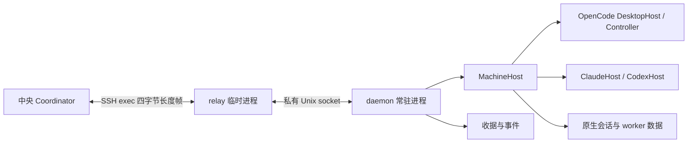
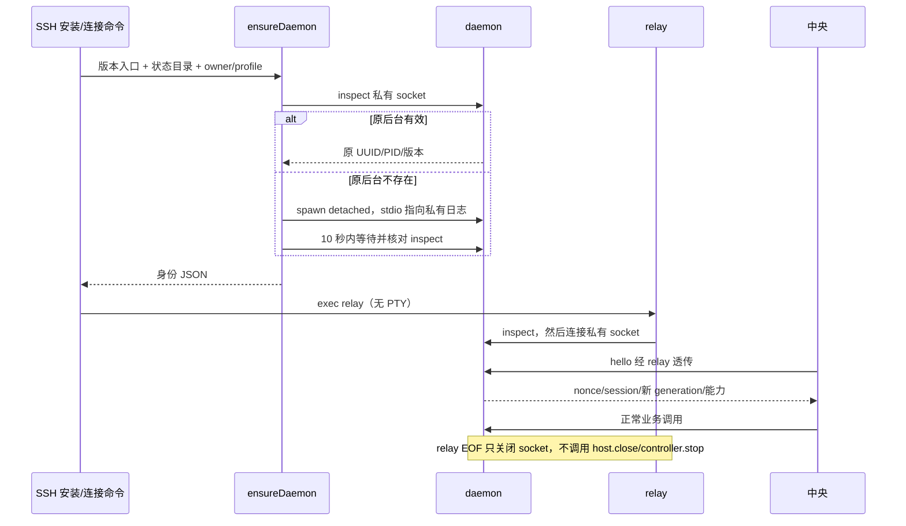
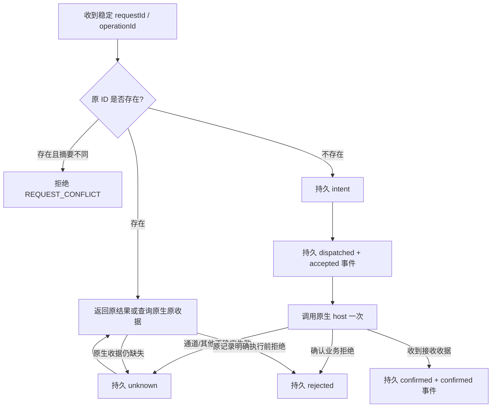

# M05 Linux 机器后台设计

2026-10-20 **0.6.0-alpha.34已预发布**：当前整合源码和新Tag已推送，标签冻结`1af4dab`，EXE与SHA-256附件已上传并通过匿名完整下载核验。包含OpenCode1.x/2.x、独立MCP、CT-04/CT-05及既有alpha.30–33修复；Windows旧后台门禁、包/普通EXE与未测边界分别见[交付记录](../../iterations/I07/alpha34-release.md)。完整I06C/I07C仍未准出。

2026-10-20 alpha.34发布门禁：中央hello增加`opencode-dual-api-v1`与`team-context-mcp-v1`语义能力，新前台遇到仍运行的alpha.33后台时要求显式停止并重开，设置/停止入口保留。避免新EXE复用旧2.x独占后台后仍拒绝1.x或缺MCP/材料方法；原任务、收据和unknown不改。

## 2026-10-20：OpenCode 1.x / 2.x 兼容修复

M05-F02/F04：源码内的 MachineHost/Core 共用新的 V1/V2 适配与 MCP 格式，主协议和认证不变。本次在 WSL 直接验证，不冒充独立 SSH；旧已安装 daemon 需获取含本修复的新包后在原机器维护升级。 [需求、实现、验证与未测边界](../../iterations/I07/opencode-v1-compatibility.md)。

## 当前维护进度与持久化边界

M05-F04/F06：本片不改变daemon原请求或维护协议；完整上传/解包/逐文件校验后仍待中央最终保存，再发送原维护输入，安全失败保留旧版本/身份。 [完整设计、实测与边界](../../iterations/I07/maintenance-persistence.md)。

## 当前版本准入与管理作用域

M05-F02/F04：Linux包包含MachineHost/Core的原OpenCode版本复验与快速API/认证拒绝，hello声明新增能力。旧daemon需在原机器空闲时显式升级；原对象/收据身份和协议2不变。 [完整规则与证据](../../iterations/I07/version-management-recovery.md)。

读取归属已失配的旧会话只允许查看，即使宿主保有原生Session也不宣告可继续；不改其Agent、ID或Session，正常绑定和真正legacy能力保留。

## 当前历史详情读取与错误作用域

M05-F04/F06：生产MachineHost的task/conversation按实际backend快照路由；根legacy只有自身含原对象才接收详情读，多来源冲突或ID不符拒绝，未知来源明确未找到，真实探测/配置失败保留。协议2、原请求去重及控制语义不变。 2026-10-19源码/GitHub预发布alpha.30，GitHub已预发布alpha.30；[设计、兼容与实际证据](../../iterations/I07/history-detail-recovery.md)。

## 独立 MCP 配置与运行契约（2026-10-19）

M05-F04：认证主连接新增四个mcp.*方法，沿原MachineHost处理目标Linux用户的配置。install/export/remove参与维护admissions计数，quiesce后拒绝配置写入，status仍只读。旧包无此方法，客户端不得当作已安装；需要升级原远端后台。独立stdio服务只连同机回环broker，再经原主连接回中央验关系。[配置/数据/失败流程与源码](../../iterations/I07/mcp-installation.md)。

2026-10-18 未发布源码：daemon 的 MachineHost 静态注册增加 Hermes/Pi/DSH，仍在目标用户环境执行；任务属于同机宿主与持久 worker，relay 断开或观察器 close 不取消原任务。协议版本和认证不变；旧已安装 daemon 不因客户端更新自动获得新适配器，需要发布含新增模块的后台再在原机器升级。[扩展范围与证据](../../iterations/I07/native-agent-expansion.md)。

## 2026-10-17：SSH持久拒绝恢复（alpha.28已预发布）

M05-F05/F06：daemon业务/协议不变，既有daemon.receiptRead返回原持久method/op/key/target/fingerprint/state/error。新客户端读取匹配rejected/NOT_CONFIGURED作为恢复证据；confirmed仍返回原任务，unknown缺证明仍保守。无需为本修复升级支持该endpoint的可信旧daemon。 当前源码/GitHub预发布alpha.28；[完整需求、状态与验证](../../iterations/I06/daemon-rejection-recovery.md)。

## alpha.23 / I07A-C首批兼容边界

小队工具及teamContinuation身份续接能力随alpha.23离线资源更新；任务业务由中央负责，daemon帧协议和身份未改变。共享MachineHost提供teamCollaboration能力标志和小队scope回调。旧后台仍可用于旧模式；新小队原生需求要求能力标志，不支持时明确在本轮派发前拒绝，不自动换节点。现有SSH帧协议2、daemon认证/原请求收据不变。新的源码与离线资源包含小队工具；中央自动主协调在WSL真实Claude已实测；用户独立SSH自动小队链尚未实测，不能用本机Linux实测替代。[实际交付](../../iterations/I07/delivery.md)。

原功能基线说明（保留原日期/版本，以下原模式继续适用）：更新日期：2026-10-14。代码基线：新安装 daemon `0.6.0-alpha.19`；可复用可信清单内的 alpha.2–alpha.11，实际运行版本由握手确认、远端协议 `2`。独立进程、私有 socket、收据去重、relay 分离已实现；已有独立服务器断线期间任务继续记录。事件过期补偿已在 alpha.10 实现；完整故障矩阵尚未完成，详见 [测试报告](test-report.md)。

## 1. 用途与功能

**当前整合实现（2026-10-19，M05-F02/F04/F05/F08）**：owned-object-controls-v1随daemon hello公布；对象读控回原MachineHost，独立mcp.*仍经认证原主连接与机器归属，旧daemon不能按同协议号冒充新方法。客户端scoped-management/opencode-v2能力不变成所有旧SSH方法的额外通用门槛。新候选Windows与Linux包同源，未实际部署独立服务器。 [源码/候选/实际证据](../../iterations/I07/integrated-source.md)。

Linux daemon 是目标 Linux 上由 AgentBridge 安装的机器管理进程。它发现本用户可用的原生 Agent、建立执行上下文、接收需求并保存操作收据。SSH 会话内的 relay 只负责数据转发，远端已接收任务的生命周期由 daemon/原生 worker 负责，SSH 断开不等于取消任务。

| 功能 ID | 可验收行为 | 当前状态 |
| --- | --- | --- |
| M05-F01 | 每用户、每 Bridge profile 一个后台；重连复用原身份和进程 | 本模块有真实 detached 集成覆盖，独立服务器已复用 |
| M05-F02 | 只有正确中央/profile/daemon/协议握手后才能访问业务 | 受控测试通过；SSH 层还另行验证主机与用户 |
| M05-F03 | 中文/emoji 消息完整，畸形/过大/拥塞请求明确拒绝 | 分帧、UTF-8、限制与背压测试通过 |
| M05-F04 | 发现 Agent、独立上下文、执行需求、读取任务/会话 | 生产 host 集成与真实远端 OpenCode 新会话通过 |
| M05-F05 | 同 ID 重试不重复原生执行，参数变化拒绝；未知结果只查询原记录 | 10 次并发 = 1 次受控原生调用；重启/取消恢复测试通过 |
| M05-F06 | relay/SSH 消失任务保留，重连读取原结果和续聊 | 受控及真实服务器记录通过；alpha.2 真实两轮 native Session ID 比较通过，完整恢复矩阵仍有限 |
| M05-F07 | 状态事件有持久递增游标，可回读；新通道替代旧通道 | 代次/事件受控通过；alpha.10 生产 SSH/daemon 隔离补偿已验证，独立服务器专项待验 |
| M05-F08 | 原生 Agent 协作工具经当前通道回调中央 | 通道归属/旧回调 fencing 受控通过；I06B 双向核心链已有真实通过，最终包复验与完整故障边界见当次报告 |
| M05-F09 | 安全升级、停机、卸载以及服务器重启后的自启动 | alpha.11 升级/回滚/停止/卸载已实现；服务器重启自启动不在当前支持范围 |

## 2. 对象与相邻模块



daemon 不开放 TCP 监听，也不接受用户密码、私钥或模型设置。认证与安装由 [M04](../04-ssh-access/design.md)负责，任务/会话语义由 [M07](../07-task-session/design.md)负责，工具原生能力由 [M06](../06-native-adapters/design.md)负责，主从允许关系由 [M08](../08-collaboration/design.md)负责。

`productionHost()` 加载根编译产物 `dist/desktop-host.js` 的 `DesktopHost` 和共享 CJS `MachineHost`。OpenCode 使用已有 Controller/driver；Claude 与 Codex 使用各自原生 host。无需另建远端模型 API 层，也不重写原生全局认证/供应商/默认模型。

发现通过共享 tool-discovery 选择本 Linux 用户 PATH 中首个已安装命令，以其 --version 为当前版本；探测失败报告当前入口异常。仅 PATH 无入口时才检查默认目录和常见版本管理器安装目录；不会执行交互 rc 脚本，不依赖 Windows 的安装或客户端 PATH。已验证可复用旧 daemon 继续使用其旧代码；新扫描功能须经原机器受控升级后生效。新增扫描不改变私有 socket/协议、用户/profile 归属或原任务收据。[alpha.19](../../iterations/I06/linux-cli-discovery.md)。

## 3. 身份、目录与单写者

| 字段 | 含义 |
| --- | --- |
| `daemonId` | 首次写入的持久 UUID；`machineId` 在中央映射为 `ssh-<daemonId>` |
| `ownerCoordinatorId` | 归属哪份中央身份，不接受其他中央接管 |
| `profileId` | 中央身份和本地配置目录派生的隔离标识 |
| `uid,stateDirectory` | 原 Linux 用户和绝对状态目录，两者必须匹配 |
| `generation` | 每次业务 hello 持久递增的连接代次 |
| `sessionId,nonce` | 当前 SSH 观察通道身份和一次握手挑战 |
| `pid,pidStart,lockId` | 进程诊断/锁身份；PID 回收不能造成误杀或接管 |

安装与运行数据分开：

```text
~/.local/share/agentbridge/profiles/<profileId>/
  install.json                    # 本安装归属标记
  versions/<version>/             # 已校验后台、依赖、runtime/node
  current.json                    # 原子发布的版本入口
~/.local/state/agentbridge/profiles/<profileId>/
  machine.json                    # daemonId、owner、UID、generation
  daemon.lock                     # 当前进程身份锁
  daemon.pid                      # 诊断信息
  daemon.sock                     # 路径较短时使用
  daemon-receipts.json             # 收据，不随 relay 消失
  daemon-events.jsonl              # 事件游标日志
  logs/daemon.log
  node-contexts/                   # 每节点/目录上下文和原生记录
```

状态目录须当前用户拥有、最终目录权限 `0700`；身份/锁/收据文件和 socket 为 `0600`。Unix socket 在同步 bind 期间临时采用 `0177` umask，创建瞬间即为 `0600`，在让出事件循环前恢复调用者 umask；监听完成后仍显式核定权限。避免并发 inspect 观察到默认 `0755` 而拒绝归属。目录路径不能穿过符号链接；已有非 Bridge 文件、普通文件占用 socket、锁归属不符均保留现场并拒绝。

若 socket 路径超过 100 字节，使用 `/tmp/agentbridge-<uid>/<state-hash>/daemon.sock`，短目录仍验证当前用户与私有权限。深层 OpenCode controller socket 另有 `/tmp/agentbridge-<uid>/controllers/<hash>.sock` 回退，二者不是同一个端点。

锁以排他文件创建。检测已有 PID 时比较 `/proc/<pid>/stat` 的启动标识，而不是看到同号 PID 就清理。后台复用还要通过私有 socket 的 `inspect` 身份检查；有效服务不能覆盖或删除。

## 4. 启动、检查与 relay



`inspect` 只检查，不改变代次，也不挤掉当前 Coordinator。真正 `hello` 成功时，新通道成为唯一 active 通道，旧通道关闭并拒绝其未完成协作回调。新连接不能误用旧回调结果。

alpha.4 客户端可通过本地可信发布清单复用 alpha.2/alpha.3 daemon；握手核验实际选中的版本及原身份，不要求后台版本等于桌面版本。复用不更新旧 daemon 的原生适配代码，不启动替代进程或迁移状态。未知发布仍拒绝，详见 [M04](../04-ssh-access/design.md)。

`ensureDaemon` 分离进程、重定向日志并 `unref()`；它不是 systemd 服务。当前没有探测 `KillUserProcesses` 或启用 linger，不能保证所有服务器退出登录后都保留进程。断 SSH 保活已在当前服务器验证；其他服务器策略和系统重启须单列验收。重新 SSH 可按原身份启动后台，但不能承诺无人登录自动启动。

## 5. 协议与实际方法

远端帧：**4 字节大端正文长度 + UTF-8 JSON 对象**。接收器先验证长度再分配正文，完整帧后严格解码 UTF-8/JSON，支持任意字节边界和多个帧粘连。最大正文 1 MiB、排队输出最多 8 MiB、每通道最多 64 项业务在途请求；单次需求文本最多 64 KiB UTF-8。

```json
{"id":"wire-1","method":"hello","params":{"protocolVersion":2,"coordinatorId":"central-example","profileId":"profile-example","expectedDaemonId":"daemon-example","nonce":"nonce-example","sessionId":"transport-example"}}
```

| 方法 | 参数/行为 |
| --- | --- |
| `inspect` / `hello` | 绑定中央/profile/预期后台/协议；hello 还核对 nonce/session |
| `ping` | `{nonce}`，返回 nonce、generation、时间 |
| `daemon.status` | 返回身份/PID、最新事件游标和 activeSessionId |
| `daemon.eventRead` | `{afterCursor?,limit?}`；limit 1–200；返回 `items,nextCursor,hasMore`，过旧返回 `cursorGap,earliestCursor` |
| `daemon.receiptRead` | 按 requestId/operationId 查记录，或按游标分页；这是 daemon 自己的操作状态 |
| `snapshot,discover,environment` | 转给 MachineHost，只读观测/发现 |
| `context,scope,connect` | 按 MachineHost 契约建立上下文、协作 scope 或连接 Agent |
| `ipc` | `{op,...}`；submit/continue/verify/reply/cancel 经持久收据包裹，task/conversation/request/operation 等用于原记录读取 |

协作回调反向发送 `{bridgeTool:true,id,scope,name,args,callId,generation}`；中央以 `{bridgeReply:id,result}` 或 error 返回。回调最多 64 项，默认等待 60 秒，并绑定当前 active 通道。daemon 不自行判断中央主从授权，中央须按来源与 scope 验证。

## 6. 执行、收据与未知结果



记录包含 ID、method/op、原 task/agent/conversation/execution 目标、规范化参数 SHA-256、状态和结果。JSON 写入先写临时文件、fsync、原子改名。已有内存 job 被相同 ID 调用时共享 Promise；进程重启后仍根据持久 `dispatched/unknown` 记录查询原生收据，不自动再次执行。

`confirmed` 只表示操作接收收据已核对，任务可能仍是 running；任务成功须读取原生终态。取消/权限回复用原 `operationId` 和原目标核对，不能用另一个任务的收据清除警告。原生返回 NOT_FOUND 也不证明操作没有发生，daemon 保留 unknown 并报 `DESKTOP_UNCONFIRMED`。

普通业务读取与上下文创建不全都经过 daemon 执行台账：当前持久去重包裹的是 `ipc` 的五种执行/控制操作。不要假设所有 RPC 都有等价 exactly-once 保证。

执行前 Hub 的 AGENT_UNHEALTHY 在创建任务前拒绝，daemon 保存为 rejected。相同 ID 和原 request 查询返回原拒绝，不重新执行。旧版本将该确切错误持久化为 unknown 时，只在原 request 查询中依据原记录的 AGENT_UNHEALTHY 和 submit/continue/verify 类型改为 rejected；不把缺少原生收据或当前 healthy=false 当作拒绝证据。网络/其他未知失败继续只查询并保留占位。该分类不代表已有任务失败或取消。

## 7. 事件、恢复和当前限制

daemon 每秒观测任务快照，任务状态/序号/摘要变化时写 `task.changed`；操作接收/确认/未知也写事件。事件文件保持严格递增 cursor，内存只保留最新 2,000 条，回读有分页和单帧大小预算。事件用于状态观察，不是全部原生回答 token 的流；具体执行输出仍来自原任务事件/快照。

目前磁盘事件日志没有轮转，启动时读取并解析整个文件；坏 JSON 或非递增游标会拒绝启动并保留现场。大历史和日志截断恢复未完成压力验收。

alpha.10 SSH 客户端已兼容 cursorGap/cursorExpired，以本模块 items/nextCursor/hasMore 分页读完保留事件；游标缺口先完整 snapshot 补偿。生产 daemon 与真实本机 TCP SSH 的隔离验证见 6C 首批，独立物理服务器完整故障恢复仍待后续。

alpha.11 已实现空闲安全升级、健康失败回滚和产品停止/卸载入口；忙或 unknown 明确拒绝，不隐式排队切换。用户态 systemd、服务器重启自启动仍不支持。跨 SSH 主从双向核心链已有 I06B 独立原生记录；控制故障矩阵继续待验，不由文本协作推定通过。

## 8. 代码与维护

实现：[machine-daemon.cjs](../../../desktop/electron/machine-daemon.cjs)、[machine-relay.cjs](../../../desktop/electron/machine-relay.cjs)、[machine-protocol.cjs](../../../desktop/electron/machine-protocol.cjs)；共享原生后台：[machine-host.cjs](../../../desktop/electron/machine-host.cjs)、[desktop-host.ts](../../../src/desktop-host.ts)；测试：[machine-daemon.test.cjs](../../../desktop/tests/machine-daemon.test.cjs)。

修改协议/身份/收据/事件时同步本设计、[测试报告](test-report.md)、M04/M07/M08 的对应契约和迭代记录。变更来源：[I06 SSH/daemon 初始方案](../../iterations/I06/ssh-design.md)、[开发项 A03–A06/C01–C03](../../iterations/I06/development.md)、[进度](../../iterations/I06/progress.md)。

## 2026-10-12：6A 收尾

daemon 握手版本读取其所在发布包的 package.json；源码开发时读取 desktop/package.json。不能在代码中写死旧版本，否则新包的 SSH 握手会拒绝。

实际 Linux 无可发现系统/用户 Node 的隔离 HOME 已验证：生产探测返回空 Node 路径，发布包私有 ELF Node 启动真实 daemon，第二次启动复用同一 PID 和 daemonId。这个验证没有 SSH 安装或模型调用，独立服务器正常安装另有 Windows 实测证据。

alpha.9 收录的 alpha.8 Linux manifest 与原 alpha.8 包报告 manifestDigest 逐字节规范 JSON 摘要核对后保存；允许可信旧 daemon 复用，不自动升级远端。当前候选资源和实际验证见 [节点管理交付](../../iterations/I06/node-management.md)，SSH/原生任务沿用原版本证据，本次未重跑独立服务器。

## I06C 当前机器管理与观察恢复

daemon.eventRead 的 cursorGap/earliestCursor、items/nextCursor/hasMore 由当前 SSH 客户端完整处理：缺事件先补 snapshot，再读完保留页；客户端不猜 latestCursor，事件处理失败不提前推进。连接代次与原 daemon 身份不变，无 Prompt 补发。新候选仍可信复用旧协议 2 发布；alpha.11 维护流程见下节。 完整接口、事务、当次实际证据与未完成范围见 [6C 首批](../../iterations/I06/machine-management.md)。

## 当前维护与原操作恢复（alpha.13）

daemon.quiesce 先建立内存准入门再读取任务与收据；非终态、忙节点、在途创建或未确认原控制均拒绝切换。维护租约持久化到 maintenance.json，daemon.shutdown 仅接受同一操作且无在途任务。独立维护 worker 校验 owner/profile/UID、版本及每文件摘要后切换 current.json，目标健康核对失败回到原版本。旧 daemon 不支持停机 RPC 时使用已经校验的 owned-stop：先取得 pidfd，再核对 UID 与原启动标识，只经内核句柄发送 SIGTERM，拒绝 PID-only 降级。未知 native 控制收据不能被包装为 confirmed；只确认原 operationId 与原目标的有效状态，取消接收与实际终态分开。

实现入口：[remote-maintenance.cjs](../../../desktop/electron/remote-maintenance.cjs)。需求、分层证据及未测范围见 [I06C 收尾](../../iterations/I06/final-delivery.md)。
