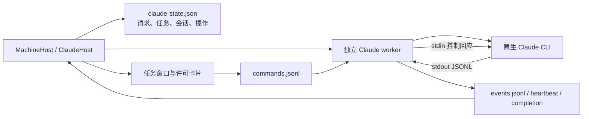
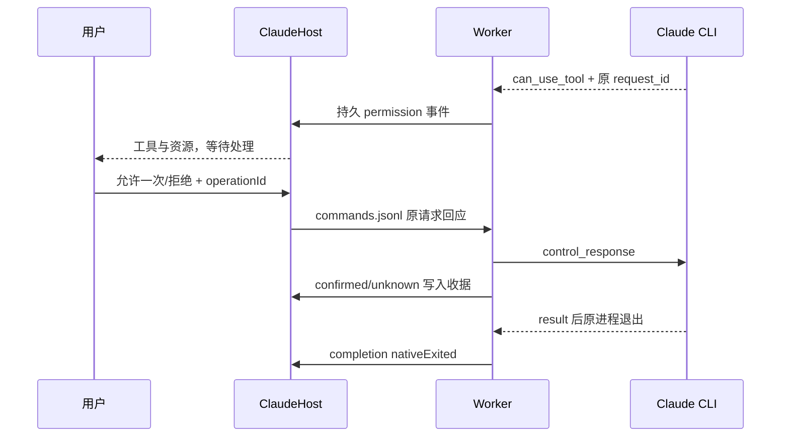

# Claude Code 适配器设计

## 普通子任务的最小上下文

M06-CC-F01：作为普通委派目标时，中央v1固定说明+原始需求作为既有message传入，不新增MCP/TeamScope或更改原生账号、模型、权限、Session。Task.message显示收到的完整输入；历史无版本委派保持原文，主会话/直接请求不包装。统一宿主受控检查证明中央传参，不等于当前原生模型实际消费。[持久版本、大小与未测边界](../../../iterations/I07/delegation-context.md)。

## 经典只读委派发现（M06-CC-F01）

经典MCP的--allowedTools增加mcp__agentbridge__list_delegations，系统追加指引明确只读找原ID、台账非实时；原reply_task不进入自动允许，小队工具集不变。受控CLI参数/原生命周期已验证，不代表当前真实Claude模型或WindowsEXE验收。[完整边界](../../../iterations/I07/delegation-list.md)。

M06-CC-F01：Claude成员scope可发现并调用team_context_packet，明确选择同工作文档/任务/消息/产物版本；只是读取，不发送给目标或改变权限。真实WSL Claude2.1.303一个Task实际消费第1版（当前第2版）、最终正文一致及观察器重开不重放通过；未改驱动、原生配置或Session。[当前API及限定证据](../../../iterations/I07/context-packet.md)。

## 独立 MCP 接入

默认编辑用户.claude.json中的mcpServers.agentbridge，尊重CLAUDE_CONFIG_DIR；独立导出为agentbridge.mcp.json。真实2.1.303在隔离配置中添加、stdio连接和删除通过。托管任务原--mcp-config仍保持原任务授权范围。测试使用WSL隔离配置、无模型调用；Windows生产界面为受控机器，非该工具真实Windows/EXE/独立SSH验证。[完整流程、源码和证据](../../../iterations/I07/mcp-installation.md)。

安装与认证CLI检查在首次缺少check、显式check以及提交前执行；实时snapshot读取既有check和原任务事件，不按30秒定期重新运行版本/auth子进程。check.time仍是原观察时间，发现更新不代表模型可用。[空闲专项](../../../iterations/I07/desktop-polling.md)。

功能 **M06-CC-F01**；对应[模块总设计](../design.md)与[测试报告](test-report.md)。

## 1. 用途与能力

M06-CC-F01 / CT-04：小队 scope 提供 team_materials 与 team_document.revision，沿原Claude MCP注入读取已授权公共材料，不改变Claude驱动/原Session/权限模型。真实WSL Claude2.1.303一个Task已读索引并准确取得旧第1版文档（当前第2版）；完整重开只观察原Task，未重派。该接口尚未进入公开发布包，其他环境不由此验收。[限定证据](../../../iterations/I07/public-materials.md)。

当前WSL版本2.1.302经生产MachineHost真实直接回答、原Session续聊回忆及取消通过；完整观察器重开保留原任务和答案，重复观察不增加执行。此为限定版本/环境的[CT-02证据](../../../iterations/I07/connection-native.md)，不改变协议或继承的原生配置，当前WSL另已通过本工具作为MCP调用方及普通被委派方的[真实六方向链](../../../iterations/I07/connection-delegation.md)，不覆盖当前Windows或独立SSH。

Bridge 调用机器上已有的 Claude Code CLI，让它使用自己的账号和原生配置执行需求。每轮由独立 worker 保持原生 stdin/stdout 和控制通道；窗口或宿主停止观察时，worker 继续执行，重新连接后宿主读取原事件文件。

| 能力 | 状态 | 用户可依赖的边界 |
| --- | --- | --- |
| 发现、版本和认证检查 | 已实现 | 安装可启动与已登录分别显示；未知认证格式显示未核验 |
| 新会话、同会话续聊 | 已实现 | 新 UUID Session；续聊传原 Session ID，保留原目录/配置快照 |
| 文本流与工具过程 | 已实现 | 主回答 delta 逐片到达，GUI 合并；子任务文本不冒充父回答 |
| 原生工具许可 | 已实现 | 展示原 `can_use_tool` 请求，允许一次或拒绝，经原控制通道回应 |
| 结构化提问表单 | 未适配 | `AskUserQuestion` 明确拒绝，提示改用普通文本，不自动代答 |
| 取消、收据、原记录恢复 | 已实现 | 取消后等原进程退出；缺退出证据保留 unknown 和占用 |
| 限工具连接验证 | 已实现 | 禁用工具、随机标记精确匹配、工具使用数为 0 才算通过 |
| 主 Agent MCP 调用 | 已实现 | 只增加 Bridge 受限工具；子关系和调用来源仍由上层授权 |

真实 Windows 验收覆盖 Claude 2.1.296；受控协议夹具使用 2.1.290 标识。没有对全部未来 CLI 版本提供兼容保证。

## 2. 执行结构



宿主按串行队列修改本上下文记录，并周期性同步 worker 文件。多个私有上下文可以使用同一安装程序并行执行；同目录冲突和节点占用由上层保护，不能用创建新上下文绕过 unknown。

worker 使用复制到持久目录的脚本和完整原生运行资源，不依赖便携 EXE 临时解压目录。资源失效导致 worker 在调用原生前退出时，记录可证明“原任务未执行”的启动失败；已有原生调用意图而缺少结束证据时仍须保留不确定性。

## 3. CLI 协议

当前启动参数的关键部分：

```text
claude --print --input-format stream-json --output-format stream-json
       --verbose --include-partial-messages
       --permission-mode default --permission-prompt-tool stdio
       --session-id=<新 Session> 或 --resume=<原 Session>
```

用户需求通过 stdin 的结构化 `user` 消息发送，不经 Shell 拼接。worker 先发送 `initialize` 控制请求，收到支持的初始化回应后才发送该轮需求；初始化超时/错误会结束执行并保存诊断。

| 原生消息 | 适配行为 |
| --- | --- |
| `system` / `assistant` / `result` 的 `session_id` | 绑定原生会话；消息 ID 有则保存 |
| `stream_event` 的 `text_delta` | 主回答 delta → output；带父工具调用的子输出不拼到主回答 |
| `assistant.message.content[].text` | 没有 partial 流时作为文本回退，防止重复输出 |
| `assistant` 的 `tool_use` | 记录工具进度与使用数 |
| `control_request.can_use_tool` | 保存原请求 ID、工具、资源，产生等待 |
| `control_cancel_request` | 移除已经取消的原等待 |
| 原生后台任务/会话状态消息 | 追踪后台工作，避免收到 result 就过早关输入 |
| `result` | 持久保存结果帧；最终状态仍等待 CLI 进程退出 |

`stdout` 按完整 UTF-8 行解析，未完成缓冲受长度限制；协议损坏记录错误。stderr 单独保存并脱敏，不作为可执行指令。

Windows 的 `.cmd/.bat` npm 启动脚本不送给 `cmd.exe` 执行。适配器定位支持的原生 `claude.exe` 或标准 npm 的 `cli.js`，以结构化 argv 启动，避免需求和目录触发 Shell 扩展。未知脚本安装明确报不支持。

## 4. 账号与配置继承

当前节点入口拒绝模型和供应商覆盖，不传 `--model`，不创建 Provider API Key，不修改 Claude 全局设置。CLI 继承原生环境和登录；worker 删除可能妨碍嵌套启动的 `CLAUDECODE`，增加结构化会话状态所需的进程变量。

旧实例接口保留 per-instance 模型覆盖及 revision 检查，这是兼容实现。旧会话保存自己的模型快照，不能随实例改动静默换模型续聊。当前 MachineHost 遇到带模型覆盖的旧上下文会拒绝沿用，应保留历史并新建使用原生配置的会话。

主 Agent 场景写入本任务的 Bridge MCP 配置及协作说明，只预授权 `list_agents/delegate/task_result/cancel_task/task_pending` 这些受后端范围约束的工具，不全局放开文件系统权限。普通原生工具仍经原有许可流程。

## 5. 身份、持久文件与恢复

| 记录 | 内容与用途 |
| --- | --- |
| `claude-state.json` | 安装连接、私有实例、tasks、conversations、稳定请求指纹和操作收据 |
| `runs/<taskId>/job.json` | 该轮原目录、CLI 路径、原/新 Session、需求和协作启动信息 |
| `events.jsonl` | worker 真实事件；宿主保存读取 offset，避免重复应用 |
| `commands.jsonl` | 许可/取消命令，带 operationId；worker 去重消费 |
| `heartbeat.json` | 观察 worker 是否继续运行，不等价于原生终态 |
| `native-starting.json` | 调用原生前持久写入意图，防止启动异常误判成未执行 |
| `result.json` / `completion.json` | 原生结果帧与 `nativeExited` 结束证据，恢复最终状态 |
| worker/native stderr 诊断 | 排查启动和协议故障，已知凭据做脱敏 |

同 requestId、同指纹返回原 taskId；同 ID 不同内容拒绝。续聊找到原 conversation 所属上下文并传原 `sessionId`。缺原生 Session 的启动失败不能直接续聊，必须新建或重新验证。

宿主重开仅重读原状态和 worker 日志，不再次发送该轮需求。worker 心跳超过等待窗口不更新时，任务变 unknown 并保留目录占用；心跳恢复可接回观察，只有结束记录确认后才释放执行。文件原子替换对 Windows 分享锁做有界重试；写诊断失败不能凭空生成原生终态。

## 6. 许可、取消与成功判定



许可 confirmed 表示回应已写入原控制通道，不意味着整个需求已经成功。原等待已消失时拒绝迟到回应。任何工具拒绝会让该轮需求不能算完整成功；AskUserQuestion 未适配也按明确拒绝处理。

取消先持久记录 operationId，worker 向原 stdin 发送 `interrupt`，关闭输入，必要时结束它拥有的进程。任务只有在原进程退出后才变 cancelled，取消收据再补为 confirmed。

成功条件同时包括：没有取消、CLI exitCode 为 0、已收到 result、result 非 error、subtype 为 success、没有工具拒绝。收到 result 但进程还运行不能提前记完成；进程退出而没有成功 result 也不能冒充成功。

## 7. 输出展示和错误

Claude output 事件是 delta，原始碎片按顺序保留。前端把相邻 output 拼成一段回答；工具和等待之间不跨段合并。连接验证的碎片标记在过程列表中隐藏，结束时用结果判定展示。模型输出很碎不意味着重复调用，也不是每个片段一个任务。

| 情况 | 当前处理 |
| --- | --- |
| ENOENT / EACCES / EPERM / 不支持 npm 包装器 | 人类可读安装/访问错误，不拖垮整个机器快照 |
| 认证缺失或状态协议未支持 | 分别显示缺凭据或尚未确认；不误报健康 |
| 原生 Provider/result error | failed，保留原错误，仍等待进程结束 |
| 无 result / 权限拒绝 / 不支持表单 | failed，不按 exitCode 0 误判成功 |
| 观察心跳缺失且无 completion | unknown，原请求只读核对，不重新执行 |
| 许可/取消写入通道不明 | 操作 unknown，按原 operationId 查询 |

## 8. 代码与升级规范

[claude-host.cjs](../../../../desktop/electron/claude-host.cjs) 同时包含宿主和 worker；[worker-runtime.cjs](../../../../desktop/electron/worker-runtime.cjs) 准备持久运行资源；[MachineHost](../../../../desktop/electron/machine-host.cjs) 负责当前节点配置边界；[api.ts](../../../../desktop/src/api.ts) 负责 delta 展示。

升级 Claude 协议时至少核验 initialize、text_delta/assistant 回退、can_use_tool、result/后台任务退出、resume 与取消。不能用关闭权限确认或更换用户原模型来掩盖协议失败。同步本文、[测试报告](test-report.md)、模块能力表与相关迭代材料。
