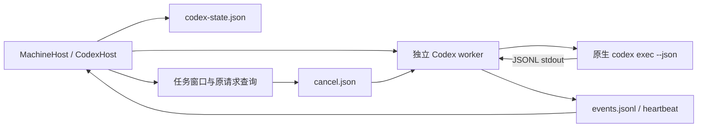
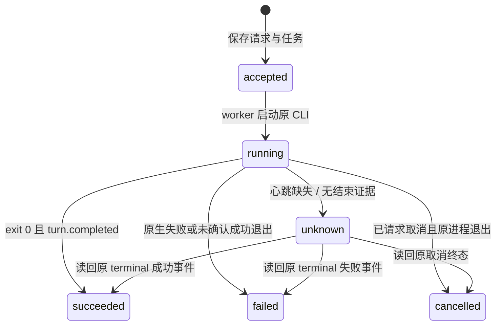

# Codex 适配器设计

当前公开alpha.69已收录当前维护源码，冻结04ee6fe。包内源码/前端/Linux资源与实际EXE载荷匹配；普通EXE合成profile恢复和完整重启通过，真实原生与用户profile仍按各自证据边界。[本轮发布与分层验收](../../../iterations/I08/alpha69-release.md)。

M06-CX-F01：独立MCP只读列表使用共享command解析，Windows npm保持原JS安装身份并启动同包原生程序，不回退其他安装；列表启动错误不构成配置加载或连接证明。exec/resume、原thread、取消与模型配置未改。[实现与验证](../../../iterations/I08/windows-regression-and-native-probes.md)。

原托管临时工具允许策略加入list_connectable/connect_agent/disconnect_agent，后端预授权与用户确认仍是唯一连接授予边界；reply_task审批、原账号/模型/持久原生配置不变。 [本片契约与证据](../../../iterations/I07/connection-policy.md)。

## 普通子任务的最小上下文

M06-CX-F01：作为普通委派目标时，中央v1固定说明+原始需求作为既有message传入，不新增MCP/TeamScope或更改原生账号、模型、权限、Session。Task.message显示收到的完整输入；历史无版本委派保持原文，主会话/直接请求不包装。统一宿主受控检查证明中央传参，不等于当前原生模型实际消费。[持久版本、大小与未测边界](../../../iterations/I07/delegation-context.md)。

## 经典只读委派发现（M06-CX-F01）

经典MCP逐工具approval_mode=auto增加list_delegations，default_tools_approval_mode仍prompt，reply_task未自动允许；指引区分Bridge委派台账与原生内部Agent列表。原Session/模型/目录/权限不变，受控启动参数与旧生命周期回归通过；真实模型另验。[完整边界](../../../iterations/I07/delegation-list.md)。

读取归属已失配的旧会话只允许查看，即使宿主保有原生Session也不宣告可继续；不改其Agent、ID或Session，正常绑定和真正legacy能力保留。

## 历史详情的相邻路由契约

Codex宿主仍按原task/conversation ID读取持久轮次，不修改Session和终态。MachineHost在自身backend快照定位对象，不依赖历史targetAgent还能对应当前row；本实现不改Codex执行、取消或reconcile实现；[归属专项](../../../iterations/I07/history-detail-recovery.md)。

## 独立 MCP 接入

M06-CX-F01：共享配置写入器在并发修改或原子替换失败后准确删除本次临时文件，保留原TOML、标记块与无关文件；中文profile清理修复尚未进入alpha.68冻结包。[当前实现与验证](../../../iterations/I08/mcp-config-temporary-cleanup.md)。

编辑CODEX_HOME/config.toml（默认~/.codex/config.toml）的自有mcp_servers.agentbridge标记块；导出agentbridge.codex.toml。保留其他设置/注释，外来条目或块内无关数据拒绝覆盖。真实0.162.1隔离用户配置增删与mcp list可见性通过，未通过模型调用该长期入口。原托管任务-c覆盖仍保留任务scope隔离。测试使用WSL隔离配置、无模型调用；Windows生产界面为受控机器，非该工具真实Windows/EXE/独立SSH验证。[完整流程、源码和证据](../../../iterations/I07/mcp-installation.md)。

已确认原终态后，同批晚到started/output/native帧不再改变原任务、结果或Session；已观察offset仍完整推进。原生退出事实与准备失败分开，未启动不标nativeExited=true。

原任务核对收据保存在 codex-state.json 的 operations；kind=reconcile 与旧/新 cancel 收据分离，taskId/operationId 绑定不可改。原 ID 重查/重复核对不重新评估派发，观察到原终态才推进 unknown；严格未派发证明继续按既有条件落 failed。unknown 核对不阻首次取消，unknown 取消禁止换 ID 重发。[规则与证据](../../../iterations/I07/native-integration-guards.md)。

Windows官方npm的codex.js会再次spawn原生EXE且未继承外层隐藏参数；Bridge在原选中包内解析optional platform package或bundled vendor，直接启动相同codex.exe，保留原JS安装身份及managed-package提示，缺原二进制拒绝，不跨安装回退。Linux和原Session/request规则保持。[复现与修复](../../../iterations/I07/desktop-polling.md)。

Codex worker 冻结 `tool-discovery.cjs` 时同步复制新发现器依赖的 `builtin-adapters.cjs` 和 `agent-adapter-contract.cjs`；Codex 原生执行协议不变。依赖缺失会导致受控任务超时，补齐后原 Codex 五项宿主回归通过；[原生扩展验证](../../../iterations/I07/native-agent-expansion.md)。

## 启动准备与原任务核对

运行准备/同步spawn及异步启动失败均保存原failed任务、原错误code、脱敏原因和事件；spawn已有child后错误不证明未派发。reconcile沿原task读取已有终态；仅原job存在且只有accepted、无native/offset、无worker.log/心跳/事件时可证明尚未越过启动边界，记failed并释放。worker.log在spawn之前创建，因此即使心跳尚未写出，有该文件仍保留unknown。核对不准备runtime、不启动CLI、不改原requestId/Conversation，无原生Session的旧会话仍不可续问。[完整设计与证据](../../../iterations/I06/windows-start-persistence.md)。
功能 **M06-CX-F01**；对应[模块总设计](../design.md)与[测试报告](test-report.md)；当前发布状态见[迭代发布记录](../../../iterations/release-ledger.md)。

## 1. 用途与当前能力

当前WSL版本0.163.0-alpha.10.2经生产MachineHost真实直接回答、原Session续聊回忆及取消通过；完整观察器重开保留原任务和答案，重复观察不增加执行。此为限定版本/环境的[CT-02证据](../../../iterations/I07/connection-native.md)，不改变协议或继承的原生配置，当前WSL另已通过本工具作为MCP调用方及普通被委派方的[真实六方向链](../../../iterations/I07/connection-delegation.md)，不覆盖当前Windows或独立SSH。

适配器启动机器已有的 Codex CLI `exec --json`，读取真实 JSON 事件，绑定原生 thread 并保存该轮结果。它使用 Codex 原有登录、配置和模型，不通过 OpenAI API 另建推理客户端。

| 功能 | 当前实现 | 真实证据与限制 |
| --- | --- | --- |
| 程序发现与新会话 | 已实现 | WSL 0.161.0 新会话通过；Windows 0.145.0 发现通过但原模型调用被账号拒绝 |
| 输出和工具过程 | JSON stdout 事件 | 回答在 agent_message 完成项产生，未实现 token 级 delta |
| 原生 thread 续聊 | 已实现 `exec resume <threadId>` | 当前WSL0.163.0-alpha.10.2原Session回忆真实通过；历史0.161.0的list_turns失败保留 |
| 取消与原 ID 收据 | 已实现 | 收到取消命令后结束所属进程树/组，等进程退出确认 |
| 观察关闭后继续执行 | detached worker + 持久文件 | 受控恢复测试通过；不是所有服务器注销策略的保证 |
| 原生许可/表单 | 未适配 | pending 返回空，相关操作报不支持；不把它等同原生没有权限策略 |
| 限工具连接验证 | 未实现 | capability.verification=false，不冒充已禁工具的验证 |
| 主 Agent 协作 | 已实现 Bridge MCP | WSL 真实主/子任务链通过；MCP 权限限定 Bridge 工具 |

目前 snapshot 声明 `resume: true` 是调用入口能力。真实原生版本已经出现续聊失败，界面不能据此声称每台机器续聊已验收可用。

Linux 发现不再只依赖非交互 PATH：扫描 fnm/nvm 等常见用户态安装目录及传入的根目录变量，保留已有 PATH 优先级和规范安装路径。只执行 --version，不读取原生登录秘密或修改 rc。相同 CLI 版本在 Windows 可见不代表 SSH daemon 的 PATH 一样；必须由更新后的 Ubuntu 后台执行发现。[alpha.19 证据](../../../iterations/I06/linux-cli-discovery.md)。

## 2. 调用与消息路径

新会话使用 `codex exec --json --skip-git-repo-check -`；续聊使用 `codex exec resume <原 threadId> --json --skip-git-repo-check -`。需求从 stdin 传入，不通过 Shell 插值。工作目录使用目标机器实际目录，当前节点入口拒绝模型覆盖，CodexHost 自身也拒绝 `connect` 中的 model。

| JSON 事件 | Bridge 行为 |
| --- | --- |
| `thread.started` | 保存 `thread_id`，关联 Bridge 原会话 |
| `item.completed` + `agent_message` | 产生 output，保存本完成项文本作为当前回答 |
| 其他 `item.started` / `item.completed` | 记录工具/命令类型进度 |
| `turn.completed` | 设置原生回合完成证据；仍等待进程退出 |
| `turn.failed` / `error` | 保存原生错误，包括模型/账号和续聊协议错误；即使同轮还有完成事件且退出码0，仍判failed |

stdout 使用 UTF-8 JSONL；未完成行缓冲限制为 1 MiB。stderr 保存为独立诊断、做已知凭据脱敏。最终答案取最后一个已完成 agent_message；当前实现没有把多个完成项拼成单个最终答案的契约，也没有接入 token delta。

## 3. 原生配置与 MCP

CLI 使用原有账号、`config.toml`、模型和文件系统策略。适配器不设置 `model`、`model_provider`、`approval_policy` 或 `sandbox_mode`，不改原生 Session 数据库。`--skip-git-repo-check` 让用户可以在非 Git 目录发起任务，不等于放开文件系统权限。

主 Agent 场景通过任务级 `-c` 参数增加 `mcp_servers.agentbridge` 的本地命令、参数和环境；一般工具默认 prompt，`list_agents/delegate/task_result/cancel_task/task_pending` 限定为 auto。后端仍检查来源、父任务和允许子节点关系。`reply_task` 未自动批准，不能据 MCP 能运行就绕过原生权限。

只有带协作 MCP 的原生回合，worker 才在 stdin 原始需求前加入 AgentBridge 协作指引；新会话和 `exec resume` 都应用。指引明确通过 agentbridge MCP `list_agents`（常见完整名 `mcp__agentbridge__list_agents`）查询允许子节点，区分 Codex 原生 `collaboration.list_agents` / `list_agents` 的内部临时 Agent 列表。内部列表只有 `/root` 不能证明 Bridge 无连接子节点。Bridge 工具缺失或报错必须解释为通道故障，不能冒充空列表；模型信息通过实际委派、自报结果和可确认依据汇总，不猜精确型号。

指引在 worker 发给 CLI 时拼接，不修改用户消息、任务标题、请求指纹或持久 `job.message`。普通直接聊天不加指引；不写入原生配置，也不覆盖用户 `developer_instructions`、模型或权限策略。MCP 工具过程显示 `mcp_tool_call · server/tool`，例如 `agentbridge/list_agents`，便于与原生列表调用区分；不输出工具参数、endpoint 或内部 token。

Windows npm 命令包装由共享 `tool-discovery.command()` 解析为受支持程序并传结构化 argv。需求不是命令字符串。

## 4. 身份、持久化与去重

| 字段/文件 | 作用 |
| --- | --- |
| Bridge requestId + 指纹 | agent、conversation、需求的稳定去重；同键不同内容拒绝 |
| conversationId / taskId / executionId | Bridge 会话与该轮执行 |
| 原生 sessionId | `thread.started.thread_id`；续聊必须传原 thread |
| native.messageId | 当前使用 Bridge requestId 作为关联值，并非读取到原生用户 Message ID |
| `codex-state.json` | agents、tasks、conversations、请求与操作收据 |
| `runs/<taskId>/job.json` | 原 CLI/目录/需求/Session/MCP 参数 |
| `events.jsonl` / `heartbeat.json` | worker 真实结果及读取 offset、存活观察 |
| `cancel.json` | 原任务稳定 operationId 的取消意图 |
| `worker.log` / `native-stderr.log` | 运行与原生错误诊断 |

宿主先写 job 和请求任务台账，再 detached 启动持久脚本。重开宿主读取旧文件与事件，不再次发需求；同 requestId 返回原 taskId。每个上下文同时只允许一个未终结任务，unknown 也阻止新执行。

超过心跳窗口没有更新而又缺少终态时标 unknown；原 worker 继续运行不因观察断开被重启。继续会话必须已有原 thread 绑定；绑定缺失时拒绝，不新建 thread 冒充续聊。

## 5. 终态与取消

取消请求先保存 unknown 收据与 `cancel.json`。worker 在 Windows 调用 `taskkill /PID … /T /F`，Linux 对它启动的 detached 原进程组发送 SIGTERM。只有原 child close 后产生 cancelled，宿主据该终态把取消收据更新为 confirmed。已结束任务取消直接返回 confirmed，不覆盖已有历史结果。

成功要求原 child exitCode 为 0 且收到 `turn.completed`。`turn.failed`、`error` 和 stderr 原生错误保存为 failed。当前成功路径可出现空 answer，因此不能把成功状态单独作为非空业务回答证明；真实验收必须核对内容。

原生 resume 报 `list_turns is not supported yet` 时该轮为 failed，保留原 thread/会话和错误；不能重建 Session、改用户数据库或替换模型来掩盖失败。

## 6. 展示与失败诊断

前端读取宿主 task events。Codex 的 output 是完成项全文，不适用 Claude delta 拼接规则；界面按完成项显示逐步答案。工具进度可以先于完成答案出现；这不意味着 token 级文本流已经实现。

| 情况 | 人类可读含义与处理 |
| --- | --- |
| 程序发现成功、模型报错 | 工具已安装；原账号/模型不可调用。该轮失败，请在原生 CLI 检查 |
| CODEX_START | worker/原生启动失败；不能冒充成功 |
| CONVERSATION_UNBOUND | 尚无原生 thread，不能继续 |
| 原生 thread/resume 协议失败 | 保留真实原生错误，不换新会话 |
| REQUEST_CONFLICT / AGENT_BUSY | 稳定 ID 内容冲突或原上下文仍占用 |
| ADAPTER_UNSUPPORTED | 许可/表单等控制尚未适配 |
| 心跳缺失 | 原执行结果待核对，查询原请求，不重发 |

## 7. 代码与扩展规范

[codex-host.cjs](../../../../desktop/electron/codex-host.cjs) 包含宿主与 worker；[tool-discovery.cjs](../../../../desktop/electron/tool-discovery.cjs) 处理程序发现和启动；[worker-runtime.cjs](../../../../desktop/electron/worker-runtime.cjs) 提供持久资源；[MachineHost](../../../../desktop/electron/machine-host.cjs) 提供上下文与来源路由。

Codex CLI 协议升级时须保存实际版本、新会话 thread、resume thread、完成项、取消后的原生退出和 MCP 限制证据。需要 token delta、原生许可或表单时，应单独设计它们的协议与收据，不能凭当前静态 capability 或夹具成功推断真实支持。同步[测试报告](test-report.md)、总能力表与对应迭代。

终态成功必须同时满足退出码0、收到turn.completed且没有明确原生错误；错误优先于完成标记，取消仍等所属进程退出后确认。该规则适用于新会话与续聊，不据失败自动重发请求。当前源码修复与受控证据见[I07C终态专项](../../../iterations/I07/codex-terminal.md)。
