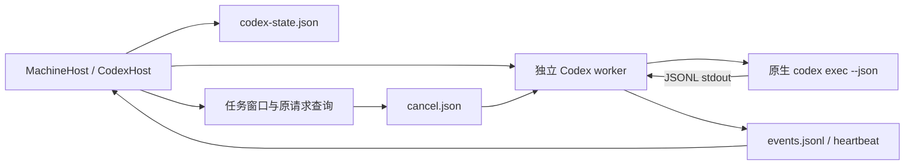
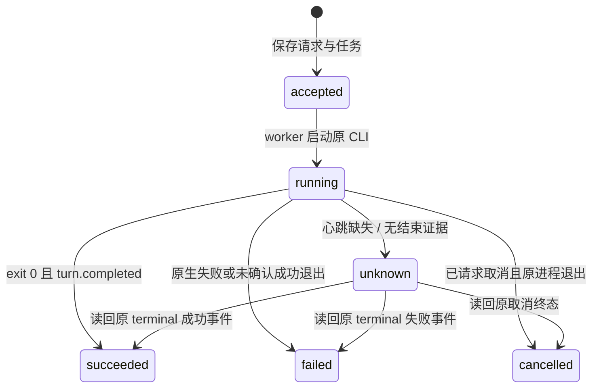

# Codex 适配器设计

更新日期：2026-10-14。当前发现修复源码：0.6.0-alpha.19；旧 0.6.0-alpha.2 包不含本次发现修复。功能 **M06-CX-F01**；对应[模块总设计](../design.md)与[测试报告](test-report.md)。

## 1. 用途与当前能力

适配器启动机器已有的 Codex CLI `exec --json`，读取真实 JSON 事件，绑定原生 thread 并保存本轮结果。它使用 Codex 原有登录、配置和模型，不通过 OpenAI API 另建推理客户端。

| 功能 | 当前实现 | 真实证据与限制 |
| --- | --- | --- |
| 程序发现与新会话 | 已实现 | WSL 0.161.0 新会话通过；Windows 0.145.0 发现通过但原模型调用被账号拒绝 |
| 输出和工具过程 | JSON stdout 事件 | 回答在 agent_message 完成项产生，未实现 token 级 delta |
| 原生 thread 续聊 | 已实现 `exec resume <threadId>` | 受控 Session 不变回归通过；WSL 0.161.0 真实 `list_turns` 失败 |
| 取消与原 ID 收据 | 已实现 | 收到取消命令后结束所属进程树/组，等进程退出确认 |
| 观察关闭后继续执行 | detached worker + 持久文件 | 受控恢复测试通过；不是所有服务器注销策略的保证 |
| 原生许可/表单 | 未适配 | pending 返回空，相关操作报不支持；不把它等同原生没有权限策略 |
| 限工具连接验证 | 未实现 | capability.verification=false，不冒充已禁工具的验证 |
| 主 Agent 协作 | 已实现 Bridge MCP | WSL 真实主/子任务链通过；MCP 权限限定 Bridge 工具 |

目前 snapshot 声明 `resume: true` 是调用入口能力。真实原生版本已经出现续聊失败，界面不能据此声称每台机器续聊已验收可用。

Linux 发现不再只依赖非交互 PATH：扫描 fnm/nvm 等常见用户态安装目录及传入的根目录变量，保留已有 PATH 优先级和规范安装路径。只执行 --version，不读取原生登录秘密或修改 rc。相同 CLI 版本在 Windows 可见不代表 SSH daemon 的 PATH 一样；必须由更新后的 Ubuntu 后台执行发现。[alpha.19 证据](../../../iterations/I06/linux-cli-discovery.md)。

## 2. 调用与消息路径

新会话使用 `codex exec --json --skip-git-repo-check -`；续聊使用 `codex exec resume <原 threadId> --json --skip-git-repo-check -`。需求从 stdin 传入，不通过 Shell 插值。工作目录使用目标机器实际目录，当前节点入口拒绝模型覆盖，CodexHost 自身也拒绝 `connect` 中的 model。

| JSON 事件 | Bridge 行为 |
| --- | --- |
| `thread.started` | 保存 `thread_id`，关联 Bridge 原会话 |
| `item.completed` + `agent_message` | 产生 output，保存本完成项文本作为当前回答 |
| 其他 `item.started` / `item.completed` | 记录工具/命令类型进度 |
| `turn.completed` | 设置原生回合完成证据；仍等待进程退出 |
| `turn.failed` / `error` | 保存原生错误，包括模型/账号和续聊协议错误 |

stdout 使用 UTF-8 JSONL；未完成行缓冲限制为 1 MiB。stderr 保存为独立诊断、做已知凭据脱敏。最终答案取最后一个已完成 agent_message；当前实现没有把多个完成项拼成单个最终答案的契约，也没有接入 token delta。

## 3. 原生配置与 MCP

CLI 使用原有账号、`config.toml`、模型和文件系统策略。适配器不设置 `model`、`model_provider`、`approval_policy` 或 `sandbox_mode`，不改原生 Session 数据库。`--skip-git-repo-check` 让用户可以在非 Git 目录发起任务，不等于放开文件系统权限。

主 Agent 场景通过本次 `-c` 参数增加 `mcp_servers.agentbridge` 的本地命令、参数和环境；一般工具默认 prompt，`list_agents/delegate/task_result/cancel_task/task_pending` 限定为 auto。后端仍检查来源、父任务和允许子节点关系。`reply_task` 未自动批准，不能据 MCP 能运行就绕过原生权限。

只有带协作 MCP 的原生回合，worker 才在 stdin 原始需求前加入 AgentBridge 协作指引；新会话和 `exec resume` 都应用。指引明确通过 agentbridge MCP `list_agents`（常见完整名 `mcp__agentbridge__list_agents`）查询允许子节点，区分 Codex 原生 `collaboration.list_agents` / `list_agents` 的内部临时 Agent 列表。内部列表只有 `/root` 不能证明 Bridge 无连接子节点。Bridge 工具缺失或报错必须解释为通道故障，不能冒充空列表；模型信息通过实际委派、自报结果和可确认依据汇总，不猜精确型号。

指引在 worker 发给 CLI 时拼接，不修改用户消息、任务标题、请求指纹或持久 `job.message`。普通直接聊天不加指引；不写入原生配置，也不覆盖用户 `developer_instructions`、模型或权限策略。MCP 工具过程显示 `mcp_tool_call · server/tool`，例如 `agentbridge/list_agents`，便于与原生列表调用区分；不输出工具参数、endpoint 或内部 token。

Windows npm 命令包装由共享 `tool-discovery.command()` 解析为受支持程序并传结构化 argv。需求不是命令字符串。

## 4. 身份、持久化与去重

| 字段/文件 | 作用 |
| --- | --- |
| Bridge requestId + 指纹 | agent、conversation、需求的稳定去重；同键不同内容拒绝 |
| conversationId / taskId / executionId | Bridge 会话与本轮执行 |
| 原生 sessionId | `thread.started.thread_id`；续聊必须传原 thread |
| native.messageId | 当前使用 Bridge requestId 作为关联值，并非读取到原生用户 Message ID |
| `codex-state.json` | agents、tasks、conversations、请求与操作收据 |
| `runs/<taskId>/job.json` | 原 CLI/目录/需求/Session/MCP 参数 |
| `events.jsonl` / `heartbeat.json` | worker 真实结果及读取 offset、存活观察 |
| `cancel.json` | 原任务稳定 operationId 的取消意图 |
| `worker.log` / `native-stderr.log` | 运行与原生错误诊断 |

宿主先写 job 和请求任务台账，再 detached 启动持久脚本。重开宿主读取旧文件与事件，不再次发需求；同 requestId 返回原 taskId。每个上下文同时只允许一个未终结任务，unknown 也阻止新执行。

超过心跳窗口没有更新而又缺少终态时标 unknown；原 worker 继续运行不因观察断开被重启。继续会话必须已有原 thread 绑定；绑定缺失时拒绝，不新建 thread 冒充续聊。

## 5. 终态与取消

取消请求先保存 unknown 收据与 `cancel.json`。worker 在 Windows 调用 `taskkill /PID … /T /F`，Linux 对它启动的 detached 原进程组发送 SIGTERM。只有原 child close 后产生 cancelled，宿主据该终态把取消收据更新为 confirmed。已结束任务取消直接返回 confirmed，不覆盖已有历史结果。

成功要求原 child exitCode 为 0 且收到 `turn.completed`。`turn.failed`、`error` 和 stderr 原生错误保存为 failed。当前成功路径可出现空 answer，因此不能把成功状态单独作为非空业务回答证明；真实验收必须核对内容。

原生 resume 报 `list_turns is not supported yet` 时本轮为 failed，保留原 thread/会话和错误；不能重建 Session、改用户数据库或替换模型来掩盖失败。

## 6. 展示与失败诊断

前端读取宿主 task events。Codex 的 output 是完成项全文，不适用 Claude delta 拼接规则；界面按完成项显示逐步答案。工具进度可以先于完成答案出现；这不意味着 token 级文本流已经实现。

| 情况 | 人类可读含义与处理 |
| --- | --- |
| 程序发现成功、模型报错 | 工具已安装；原账号/模型不可调用。本轮失败，请在原生 CLI 检查 |
| CODEX_START | worker/原生启动失败；不能冒充成功 |
| CONVERSATION_UNBOUND | 尚无原生 thread，不能继续 |
| 原生 thread/resume 协议失败 | 保留真实原生错误，不换新会话 |
| REQUEST_CONFLICT / AGENT_BUSY | 稳定 ID 内容冲突或原上下文仍占用 |
| ADAPTER_UNSUPPORTED | 许可/表单等控制尚未适配 |
| 心跳缺失 | 原执行结果待核对，查询原请求，不重发 |

## 7. 代码与扩展规范

[codex-host.cjs](../../../../desktop/electron/codex-host.cjs) 包含宿主与 worker；[tool-discovery.cjs](../../../../desktop/electron/tool-discovery.cjs) 处理程序发现和启动；[worker-runtime.cjs](../../../../desktop/electron/worker-runtime.cjs) 提供持久资源；[MachineHost](../../../../desktop/electron/machine-host.cjs) 提供上下文与来源路由。

Codex CLI 协议升级时须保存实际版本、新会话 thread、resume thread、完成项、取消后的原生退出和 MCP 限制证据。需要 token delta、原生许可或表单时，应单独设计它们的协议与收据，不能凭当前静态 capability 或夹具成功推断真实支持。同步[测试报告](test-report.md)、总能力表与对应迭代。
