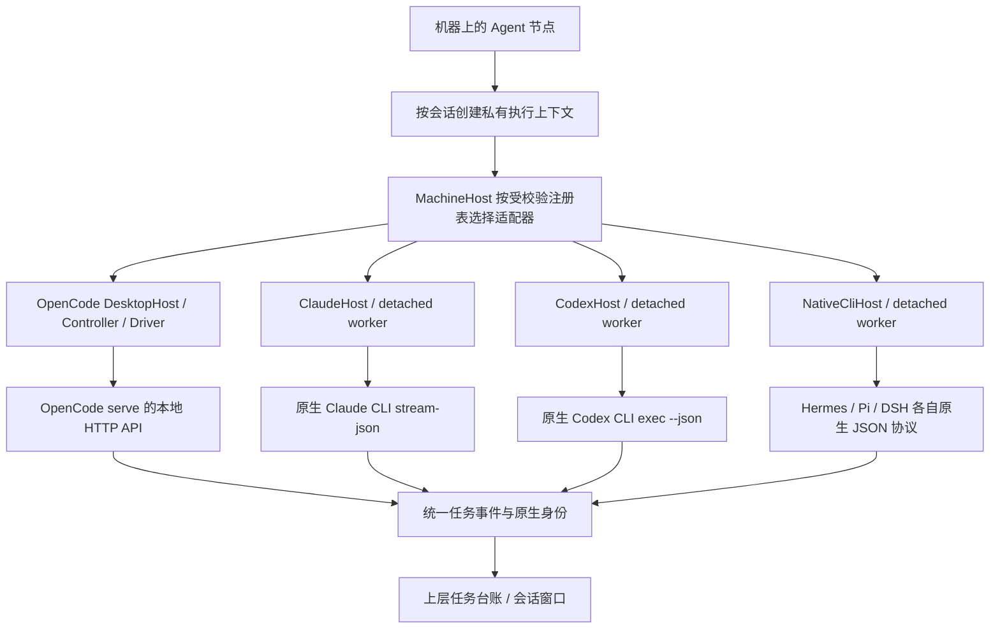
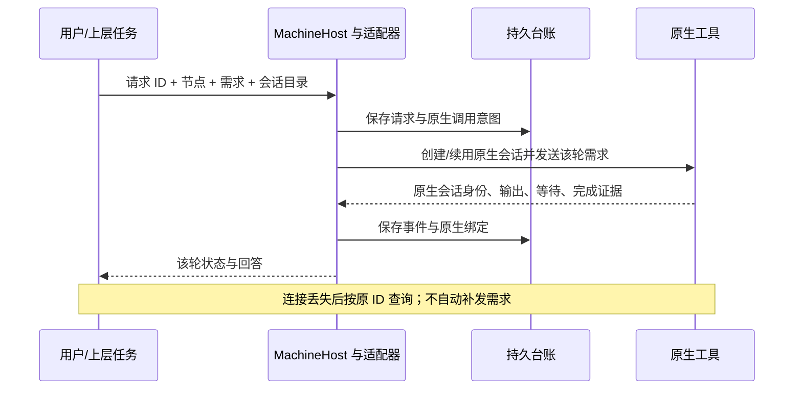

# M06 原生 Agent 适配器设计

## CT-08经典MCP连接工具

M06-F01/F02/F05：经典MCP现10项，小队18项保持；新增list_connectable/connect_agent/disconnect_agent，连接操作绑定原父或独立connectionId与原operationId，不接收用户审批/身份参数。Claude/Codex在原托管临时允许项中加入新3项，reply_task原审批保持；MachineHost指引区分预授权/待确认和原授权收据。未改用户持久原生配置/模型/账号，原生客户端实际消费另验。 [完整契约、验证与边界](../../iterations/I07/connection-policy.md)。

## OpenCode 有界双协议发现

M06-F01：启动、恢复和执行前的只读检查先探 `/global/health`，有效 1.x 直接校验其完整元数据契约，跳过 `/api/info`；其他结果在短预算内检查 2.x。候选端点各 700ms，整次协议/元数据 4000ms，并受剩余启动预算约束。已响应但无兼容契约或探测超时报告 OPENCODE_API_UNSUPPORTED；认证、Agent、配置错误分别保留，未监听才继续启动重试。普通业务请求和原 Session/取消/恢复规则不变。[完整设计与证据](../../iterations/I08/opencode-bounded-probe.md).

## 当前 OpenDesk 生命周期与关系作用域

M06-F05：OpenDesk Desktop 原生配置管理新增 Windows tasklist 进程核对与配置静默窗口，准备端点前和最终原子替换前分别复核。运行、不可核验或退出写回未稳定均拒绝；缺真实 Node 时拒绝安装。移除先撤权，运行中仅保留待清理；原同名冲突、空 headers 默认值、损坏文件与原子归属检查不变。 [需求、流程与失败边界](../../iterations/I08/opendesk-lifecycle-relation-scope.md)。

## 连接身份与节点管理准入

M06-F01/F05：DSH服务配置status公开文件名主体connectionId，configure明确selectedConnectionId。adapter/origin/token/enabled私有文件格式不变，旧origin/原生登录、模型、历史和unknown保持。OpenDesk接入仅应用中央节点准入修复，不启动/重启真实原生服务。 [完整设计与失败流程](../../iterations/I08/connection-identity-node-scope.md)。

M06-F02：Pi管理严格JSON mcpServers.agentbridge；Hermes管理原生Profile YAML mcp_servers.agentbridge，保留其他设置/注释。持久绑定目标，变化后先移除再添加；原生禁用不启用、删除不补装，清理先撤权。Hermes原生列表只证明加载，Pi JSON列表按精确scope/state；托管scope/小队仍false。 [最终实现、原始证据与范围](../../iterations/I08/hermes-mcp-config.md)。

M06-F02：WSL原生MCP配置由所在发行版完整MachineHost处理六项管理方法，CODEX_HOME等继承该Linux环境。alpha.49只调整外层启动就绪，不改原生配置格式、模型或托管scope；尚无完整原生父模型通过证据。 [完整需求、实现、原始证据与限制](../../iterations/I08/wsl-host-readiness.md)。

M06-F02：DSH Desktop的原生MCP适配读取稳定版Desktop数据目录/Profile选择，保存nativeTarget后按原绑定管理用户补丁。选择变化不自动改写，删除先撤权再清理原目标，未知原生选择不回落默认路径。MCP客户端、原生配置和托管scope能力仍独立。 [实现与分层验收](../../iterations/I08/dsh-desktop-mcp.md)。

OpenDesk STDIO 条目归属比较允许原生解析器补入或省略空对象 `headers:{}`；其余字段逐项严格比较，未登记条目不能因此被认领。重复添加保留原生文件及原连接身份；撤权、删除和重启使用同一规则。配置原文变化仍使连接观测失效。[兼容修复与验收](../../iterations/I08/opendesk-mcp-defaults.md)。

## MCP02恢复与观测（2026-10-22）

OpenDesk选择Node后再渲染所有导出格式，恢复保存的launcherPath；OpenCode数组command正确拆成程序/参数。配置绑定和60秒有效期限制观测复用。 [实现、原始证据与未测项](../../iterations/I08/mcp-open-recovery.md)。

I08-MCP02统一开放MCP与双向配置已冻结契约并完成源码第一片：能力三维拆分、状态事实、`mcp.revoke`/`mcp.probe`与DSH Web原生适配，见本页[开放MCP接入：能力、状态事实与原生配置](#开放mcp接入能力状态事实与原生配置)；逐入口真实原生验收（添加/删除/列表/工具/主调用/托管归属）仍待执行，实现与受控测试不改变各入口的真实能力结论。[本轮开发与验收记录](../../iterations/I08/mcp-open-integration.md)。

静态注册opendesk与opendesk-desktop，复用NativeCliHost与Bridge连接持有worker。CLI调用已有HTTP会话接口，Desktop调用已有设备网关；不修改OpenDesk，不复用OpenCode产品身份，未接入ACP。断线/取消无充分终态证据时unknown；完整设计见[OpenDesk](opendesk/design.md)。 [实现与证据边界](../../iterations/I08/opendesk-existing-interfaces.md)。

M06-F01：OpenCode 显式接入遇原服务已退出时，仅启动原 context 内的原生服务，再核验原 Agent；本次新增恢复不放在快照或原请求读取分支。接入准备失败原子记录本地 attach 拒绝收据，原图意图只按匹配证据收敛；不改变原任务、Session 或 unknown 门禁。恢复不改协议或原生模型配置。详见[恢复契约与边界](../../iterations/I08/opencode-oom-recovery.md)。

## alpha.36整合边界

M06-F01：alpha.36整合基线含公开alpha.35执行资源级保护/原查询反馈与所有工作区增量；OpenCode宿主和原管理拒绝恢复并存，原身份/Session/unknown不迁移。精确收录alpha.34/35 daemon清单，客户端升级不自动替换远端。[完整交付](../../iterations/I07/alpha36-delivery.md)。

## 普通被委派输入上下文

M06-F01/F02：新普通子任务在中央按持久contextVersion=1给原需求附固定角色/交回结果/不继续委派的说明；八个目标仍接收普通message，沿用原生模型、账号和权限。collaboration=false且不注入MCP/TeamScope，原有独立工具配置保持。说明不复制父对话或私有身份，不是授权机制；历史无版本输入保持原文。[完整输入、恢复与证据](../../iterations/I07/delegation-context.md)。

## 原生接入配置入口

M06-F01/F02：Claude/Codex/OpenCode在原节点配置弹窗管理Bridge MCP；DSH Desktop/Web在其原节点管理已有服务连接。Hermes/Pi在alpha.50本地候选提供原生配置管理，DSH CLI要求显式profile。均不提供模型表单。配置入口可查看，不推定执行成功；DSH发现/认证错误指向机器页对应Agent配置。MCP所有权、冲突保留、先撤权后删除及原请求恢复契约不变。[当前流程与验证](../../iterations/I07/agent-row-configuration.md)。

## MCP连接视图契约

M06-F02：经典list_agents保留items，增加schema/readOnly/view、relationRevision与安全caller字段；不接受身份/筛选参数。工具说明区分当前委派授权与目标在线/空闲，工具缺失/调用失败不解释为空关系。当前经典10/小队18工具；此只读视图本身不增加原生允许项，未新增原生协议或调用方能力。[完整字段、流程与范围](../../iterations/I07/agent-connections.md)。

## 安装提示与服务就绪

M06-F01/F02：DSH Desktop/Web未保存原生服务连接与程序启动失败分开投影；连接提示DSH_CONNECTION_REQUIRED不是原生模型/账号故障。已保存连接的真实认证、网络或协议失败仍显示工具检查异常。OpenCode宿主须同步提供call/close；失败的管理接入只影响管理收据，不改变原任务终态或原生Session。[完整规则与分层验证](../../iterations/I07/agent-management-recovery.md)。

## 经典MCP只读委派发现（M06-F02）

本地alpha.60源码经典MCP现10项，含list_delegations与上方连接3工具，小队18项保持；服务按原父/connectionId核对并只读列表。Claude --allowedTools及Codex逐工具approval_mode加入该只读项，reply_task保持原审批边界；指引区分台账与实时结果。OpenCode按原MCP发现schema；不增加SDK/ACP，不因增加只读工具改变调用方能力；当前Pi/Hermes/DSH独立MCP声明另按原生配置适配核对，不改原生模型/账号/目录权限。原生实际调用与新EXE另验。[契约和受控证据](../../iterations/I07/delegation-list.md)。

## OpenCode 宿主生命周期

M06-F01：OpenCode 的 stdio 与 daemon 工厂共用 DesktopHost 的 call/close 生命周期；保留同步宿主校验，不用放宽契约掩盖缺失方法。源码与本地 config.2 已包含，公开 alpha.35 的冻结源码未包含；[实现与验证](../../iterations/I07/opencode-host-lifecycle.md)。

## 接入方式与新增Agent开发导航

M06-F01/F05：当前逐Agent路径以[接入矩阵](../../agent-integration-matrix.md)为唯一状态表；[选型指南](../../agent-integration-guide.md)比较CLI/API/MCP/ACP/插件/SDK并给出后续建议，[开发指南](../../custom-agent-development.md)维护八入口、实际Host/静态注册与阶段交付步骤。推荐尚未实现的协议不能据文档开放能力；当前运行契约及所有既有行为保持。

## DSH Desktop / Web 当前行为

M06-F01/F05：新增dsh-desktop/dsh-web静态注册服务适配器，与原dsh headless分开。HTTP认证与Session控制沿用原生登录/模型/权限；直接会话、普通被委派、原Session续聊、取消/只读恢复可用，Bridge MCP/小队/权限和问题回复未声明。原生请求只发一次，逐轮按原requestId与turn持久事件结算。 [完整契约与证据](../../iterations/I07/dsh-desktop-web.md)。公开alpha.34不包含该能力；本地.dsh.3候选已构建并验证真实连接，Desktop模型两轮均RATE_LIMIT，独立SSH未验，见[本地交付](../../iterations/I07/dsh-exe-delivery.md)。

发现阶段排除Distributed Shell/Dancer's shell同名命令，识别stdout/stderr与非零退出中的明确身份；不把无关程序的版本当成DSH，也不改变真正CLI启动失败时的PATH选择。Desktop安装和Linux Web profile是未配置服务的提示，不表示认证、服务在线或模型可用；已有停用配置不会重现为未配置安装。[现场原因与回归](../../iterations/I07/dsh-desktop-web.md#同名程序与服务发现修复)。

当前HTTP客户端接受附Cookie的302/303，不跟随跳转；Typert命名参数list为`_request`，其他已支持Session方法为`request`。原requestId/轮次核对与unknown保护不改。[真实服务发现的问题及修复](../../iterations/I07/dsh-exe-delivery.md)。

## OpenCode 1.x / 2.x 兼容修复

M06-F01/F02/F04：OpenCode 新增独立 V1 原生生命周期和 MCP 配置，保留 V2；CLI 版本可识别与实际契约有效分别检查。不改变其他 Agent 的账号/模型、原生 Session 或台账归属。 [需求、实现、验证与未测边界](../../iterations/I07/opencode-v1-compatibility.md)。

## 历史版本准入与管理作用域

M06-F01：OpenCode接受可识别的1.x与2.x，其他主版本在启动前拒绝；托管启动/旧配置恢复在serve前复验原安装，实际只读API契约继续检查，401/403与契约错误快速透传。安装检测回报的健康状态不代表API或账号推理可用；其他适配器不受此限制。 [版本准入沿革](../../iterations/I07/version-management-recovery.md)、[1.x/2.x 兼容修复](../../iterations/I07/opencode-v1-compatibility.md)。

## 当前历史详情读取与错误作用域

M06-F01/F02：原生adapter不新建模型/API层；历史task/conversation由MachineHost确认实际backend后只读原ID，空/旧targetAgent不把Codex/Claude读误导到根OpenCode。原生Session、返回轮次、取消和原请求规则不变。 [设计、兼容与实际证据](../../iterations/I07/history-detail-recovery.md)。

## 独立 MCP 配置与运行契约

M06-F01/F04：Claude/Codex/OpenCode 2支持独立MCP接入的配置格式适配。Claude改mcpServers.agentbridge，Codex改mcp_servers.agentbridge标记块，OpenCode 2改mcp.servers.agentbridge；尊重各自配置目录变量，仅修改自己拥有的条目。生成JSON/TOML/JSONC独立文件，模型/登录配置保持；当前另有DSH三入口与OpenDesk Desktop适配；Pi/Hermes原生配置已随alpha.50本地候选交付。Bridge托管任务仍用任务scope覆盖同名MCP，长期入口面向外部会话。[配置/数据/失败流程与源码](../../iterations/I07/mcp-installation.md)。

## 开放MCP接入：能力、状态事实与原生配置

### 能力三维（已冻结）

每个入口分别回答“能否管理其原生MCP条目”“是否实现MCP客户端”“能否注入单次托管任务scope”，三者不互相推断；缺省`null`表示未确认，`false`表示已核对不可用。旧投影名`bridgeMcp`（=`mcpClient`）与`teamCollaboration`（=`hostManagedTask`）保留给旧快照与旧planner，只能收窄不能启用。旧的“三产品白名单”和“`teamCollaboration=false` 即不能调用MCP”的折算已删除。

| 入口 | `nativeMcpConfig` | `mcpClient` | `hostManagedTask` |
| --- | --- | --- | --- |
| claude / codex / opencode | true | true | true |
| opendesk（CLI） | false（0.3.8 无 MCP 管理面，只可导出片段） | true | false |
| opendesk-desktop | true（原生可读取；需 Node 启动器且必须完全重开） | true | false |
| dsh-web | true | true | false |
| dsh-desktop | false | true | false |
| dsh | true（需显式 `profile`） | true | false |
| hermes / pi | false | 未确认（null） | false |

实现落点：[静态注册表](../../../desktop/electron/builtin-adapters.cjs#L71)（`connectionCapabilities`投影、`supportsTeamCollaboration`只看托管维度、`supportsIndependentMcp`只看调用维度）、[契约校验器](../../../desktop/electron/agent-adapter-contract.cjs#L45)。远端daemon能力只能收窄，不能启用；未知适配器全部为未知。

### 状态事实与所有权

`mcp.status` 返回 `state`（`absent`/`exported`/`installed`/`conflict`/`revoked_config_pending`/`unsupported`）+ 六项独立事实 `config`/`nativeLoad`/`connection`/`tools`/`authorization`/`ownership` + `evidence`（`configPath`/`nativeProbe`/`toolsProbe`/`configError`）+ `nativeSupport`（不可管理时的代码与原因）。

- 归属按“原生条目是否等于Bridge写入内容”逐字段比较，**不按显示名**；外部手写同名条目为 `config:conflict`+`ownership:external`，Bridge保留原条目、不静默接管。
- 已撤权但条目仍是Bridge写入的那份读作“配置存在+授权已撤销”，不是冲突。
- 探测失败返回“未知/具体失败”，不写配置、不重新启用、不重新注册、不启动模型。
- `mcp.probe` 的原生列表侧只对 `claude`/`codex`/`opencode` 可用（各自有 `mcp list`；Claude 做健康检查，Codex 只列配置）。可执行文件按“调用方候选→本机发现→`PATH`命令名”解析，不下载、不启动UI；探测子进程沿用目标环境变量。其余入口显示“无法核验”，不因此否定其MCP能力。

### DSH 原生补丁层适配（Web 固定 profile，CLI 显式 profile）

Bridge 管理 `$DSH_HOME/profiles/web/cordis.patch.yml` 中**一行** `- insert:` 行，插件为已安装的 `@deepseek-ai/dsh-mcp-client`（`serverName: agentbridge`，stdio）。编辑通过 YAML 文档进行，保留用户注释、锚点与其他补丁行；profile目录 `$DSH_HOME/profiles/web` 不存在时安装以 `MCP_PROFILE_MISSING` 拒绝并提示先启动一次DSH Web，不创建任何文件；该文件不存在视为“无该层”，仅含注释/空文档则报 `MCP_CONFIG_INVALID` 并保留原文件；重复的 `agentbridge-mcp` 行报 `MCP_CONFIG_CONFLICT`。安装后Bridge只报 `nativeLoad:'reload_required'`（DSH自己应用补丁层，HMR开启时即时），不宣称已加载或已连接。实现落点：[mcp-config.cjs](../../../desktop/electron/mcp-config.cjs#L109)（`dshPatchFile`/`dshDocument`/`dshRows`/`dshInspect`）。

**DSH CLI**：原生配置跟着启动时选择的 profile 走，Bridge 不猜默认值，由用户显式指定 `profile`（六个 `mcp.*` 方法都接受该参数，仅 `dsh` 使用；DSH Web 固定 `web` 且不暴露参数）。原生目标是 `$DSH_HOME/profiles/<profile>/cordis.patch.yml`，写入形状与 DSH Web 相同；名称必须匹配 `^[a-z0-9][a-z0-9-]{0,63}$`（`../escape`、`a/b`、空串、大写、前导 `-` 拒绝，不拼接逃逸路径）。未指定时 `mcp.status` 返回 `nativeSupport:false`+`MCP_DSH_PROFILE_REQUIRED`+`profile:null`，`install`/`remove` 同码拒绝，`mcp.export` 仍出片段；连接行落 `profile`，省略参数时用登记值，`remove` 只清理登记的那个 profile，其他 profile 逐字节不变；安装后只报 `nativeLoad:'reload_required'`。桌面 `dsh` 行提供“DSH 原生 profile”输入框，CLI 提供 `--profile NAME`（`MCP_DSH_PROFILE_REQUIRED` 映射退出码2）。

DSH Desktop 使用应用保留 profile，Bridge 没有已核对的落点，因此 `nativeMcpConfig:false`，只可导出片段。真实原生证据：DSH Web 在真实 `dsh --profile web` 启动中完成 `server/discover`回退→`initialize`→`tools/list`（7工具）；DSH CLI 家族在 shipped `acp` profile 的真实 `dsh --profile acp` 启动中同样观测到加载与握手（模型0，受控 scratch profile）。仍未观测 TUI 启动、用户自建 profile 与真实用户 profile，也未做真实 ACP 客户端会话或模型委派。见[本轮§12](../../iterations/I08/mcp-open-integration.md#12-真实原生探测补充2026-10-22-晚)。

### stdio 服务握手与原生启动器（M06-F02）

**握手**：Bridge 作为 MCP 服务端对协议修订 2026-07-28 的 `server/discover` 探测返回 `{supportedVersions:['2024-11-05','2025-03-26','2025-06-18','2025-11-25'], capabilities:{tools:{}}}`，不再返回 JSON-RPC 错误。此前只有宽松客户端（DSH）会回退到 `initialize` 继续，严格客户端（OpenDesk 0.3.9）会直接判定连接失败——这就是“原生列表看不到 AgentBridge”的根因之一。`initialize`/`tools/list`/`tools/call` 与工具集合不变。实现落点：[mcp-client.cjs](../../../desktop/electron/mcp-client.cjs#L11)。

**启动器**：原生客户端用条目里的 `command` 启动 stdio 服务。Bridge 默认写自身 Electron 运行时，但 OpenDesk 的 mcpmgr 启动不了它（`命令未找到`／`MCP error -32000: Connection closed`），而系统 `node` 可以。因此 `mcp.install`/`export` 对 OpenDesk 两个入口**优先使用 PATH 中真实存在的 Node**（`nodeLauncher()`，不下载、不猜安装目录），连接行与 `mcp.status` 增加 `launcher:'node'|'electron'`：`node` 表示原生能启动，`electron` 表示需要先安装 Node（界面显示对应提示）。这是启动器选择，不改变工具授权或任务归属。见[本轮§14](../../iterations/I08/mcp-open-integration.md#14-opendesk-原生-mcp-可见性修复2026-10-22alpha45)。

### 方法与持久字段

`mcp.status`（只读）、`mcp.export`（只生成片段与登记身份）、`mcp.install`（写自己拥有的条目）、`mcp.revoke`（只持久撤权，绝不改原生条目）、`mcp.probe`（只读探测）、`mcp.remove`（先撤权再删自己的条目；清理失败返回 `revoked_config_pending`+`cleanupError`，绝不恢复授权）。重启恢复只重建私有endpoint描述文件，不写原生配置；外部删除永不补回；重新添加轮换 `connectionId`。

`mcp-connections/connections.json` 行字段：`nodeId`/`adapter`/`connectionId`/`enabled`/`nativeProtocol`/`configuration`（Bridge写入条目快照，用于归属比较）/`probe`（最近只读探测，不参与授权）/`profile`（仅 DSH CLI 的原生 profile 名称）。实现落点：[mcp-integration.cjs](../../../desktop/electron/mcp-integration.cjs#L14)、[machine-host.cjs](../../../desktop/electron/machine-host.cjs#L110)。

### 未适配入口与本轮边界

OpenDesk **CLI** 在 0.3.8 上**没有 MCP 管理面**：`opendesk plugins list` 的 11 个 builtin 插件无 MCP 管理插件、`opendesk plugins tools` 无插件工具、`opendesk tools list` 无 MCP 分区，且启动会重写 `setting.json` 的 `applications` 丢弃未识别 app 段；因此 `nativeMcpConfig=false`，`mcp.install` 以 `MCP_NATIVE_CONFIG_UNSUPPORTED` 拒绝，只可 `mcp.export` 出片段。**Desktop** 的原生条目已可用：写入 `%APPDATA%\opendesk\setting.json` 的 `applications.mcpmgr.servers`，用真实 Node 启动器，**必须完全退出并重开 OpenDesk** 才会读取；在用户真实 Desktop 0.3.9 上已观察到原生连接并 `discovered 7 tools`，但真实授权后的工具调用未验。CLI 的 MCP 调用方状态为“未确认”；Pi1.4.0与固定Hermes官方源码的真实原生MCP组件已通过，alpha.50本地候选已交付；完整自主父模型仍未验。所有入口的真实添加/删除/工具调用/主调用链/托管归属仍待按验收表逐项执行。[本轮开发与验收记录](../../iterations/I08/mcp-open-integration.md)、[模块报告](test-report.md)。

[Projects/Dots/Grok Bot研究](../../iterations/I07/projects-dots-bots-research.md)核对产品入口与公开驱动区别：Grok Build的headless/ACP列为CT-03候选，尚未注册；Claude Projects协调器、Dots和Grok Bot也没有因已有CLI适配而成为可直接操控入口。未增加原生协议或产品代码。

当前适配方式和后续目标统一见[接入矩阵](../../agent-integration-matrix.md)：六种内置实际为原CLI或自写HTTP客户端，没有采用厂家SDK或ACP；MCP是Agent调用Bridge的方向。可选ACP试点、公共材料与上下文建议见[研究](../../iterations/I07/connectivity-research.md)，未增加驱动。

Windows官方Codex npm启动器直接解析原包内原生EXE，隐藏参数不再丢失于JS二次spawn；节点仍记录原JS身份，缺原二进制拒绝，未改账号/模型。Claude空闲snapshot不定期重跑版本/auth，显式检查与提交前检查保留。[复现与验收](../../iterations/I07/desktop-polling.md)。

Windows 的 Core Controller、显式安装版本检查及 OpenCode serve 子进程使用 windowsHide 隐藏后台控制台；机器快照不定期重跑安装探测，任务前原安装核验保留。适配能力、模型与原请求语义不变。[空闲黑窗专项](../../iterations/I07/desktop-polling.md)。

原生Session字段只在非空白字符串且满足既有长度约束时作为绑定/变化证据；空值不建立绑定，也不清除已观察的有效Session。真实非空Session变化仍拒绝协作/后续激活，缺绑定仍不能自动续接。此alpha.28后源码增量未入EXE，[实际规则与验证](../../iterations/I07/blank-native-session.md)。

## Windows未派发与持久化恢复

M06-F01：Codex运行准备失败落原failed任务并保留原始错误；reconcile核对原job/accepted事件/worker.log启动边界，证据完整且未派发才结束原任务。其他原生适配、原账号/模型配置与MCP权限不变。 [需求、状态图、验证与交付](../../iterations/I06/windows-start-persistence.md)。
## Windows原请求上下文恢复

M06-F01：MachineHost按原身份选择后端时，缺少agentId/owner.targetAgent不能与准备失败留下的空agentId上下文匹配；原请求仍只读查询原收据，既有原生账号/模型配置继承不变。[完整修复与证据](../../iterations/I06/windows-context-recovery.md)。

## 小队MCP与自动续接

源码已随 GitHub 预发布交付（版本与包摘要见[历史发布登记](../../iterations/release-ledger.md)）；I07A/B基础继续适用，完整I07C与I06C未准出。

| 功能 ID | 功能 | 当前状态 |
| --- | --- | --- |
| M06-F02 | 小队MCP接入与手动原生执行 | 已发布；小队基础行为继续适用 |
| M06-F03 | 任务作用域与版本报告工具 | 源码已实现；实际分层证据见本模块报告 |
| M06-F04 | 原生会话能力分级与自动续接 | 源码已实现；证据层级见本模块报告 |

Claude适配已开放自动新轮/原会话续接，真实CLI2.1.299三轮自动主协调和重启原Session核对通过；运行中收信不支持，重要事项排队。Codex/OpenCode保留手动，不根据resume参数推定新小队已通过。工具扩展至16项，主角色可待该轮终态完成业务验收；新一轮注入新scope/指引，旧终态token失效。外部MCP仍自启动，不新增模型API或接管业务功能。

I07A/B的登记、成员/文档权限、公共消息、版本任务和授权交接继续按[I07B完整行为](../../iterations/I07/task-handoff.md)执行；新流程、异常、预算、接口和源码见[I07C首批交付](../../iterations/I07/automation.md)。以下原功能继续适用。

稳定历史 Windows 便携包为 `0.5.0`，当前发布状态见[历史发布登记](../../iterations/release-ledger.md)；早期版本的主要 Windows/SSH 证据与自然语言发现证据保留，兼容范围沿革见 [交付](../../iterations/I06/ssh-compatible-reuse.md)。

本模块把用户机器上已有的 OpenCode、Claude Code、Codex CLI、Nous Research Hermes、Pi Coding Agent 和 DeepSeek Harness（DSH）接入 AgentBridge，使上层能统一提交需求、读取真实回答、管理会话，并在各工具允许的范围内处理取消和等待。后三种已包含现有适配；原生配置版本及真实模型边界见[扩展专项](../../iterations/I07/native-agent-expansion.md)。模型、供应商、账号和原生配置仍由原工具管理。

## 1. 用户看到的功能与边界

M06-F01/F02：OpenCode接受可识别的1.x与2.x，其他主版本在启动前拒绝；显示版本/启动成功不代表API/账号推理可用。旧已派发收据先查询，不按当前兼容状态隐藏；小队工具与经典MCP工具、长期MCP作用域保持分开。Codex用户配置由smol-toml1.9.1读写，JSONC不变；解析器无原型表保留，原文件冲突/损坏仍拒绝覆盖。 [实现与实际证据](../../iterations/I07/integrated-source.md)。

用户先在机器中接入一个已安装的 Agent 节点，再对该节点新建会话。接入节点不需要文件夹、模型或供应商；需要处理已有文件时，在新会话阶段填写目标机器上的目录。留空使用该节点默认执行目录，同节点/目录/模式/当前安装复用上下文；安装路径更新后新工作建立独立上下文，旧上下文的 executable、agentId 与原会话归属保持原值；不同新会话不保证文件隔离。

工具“已安装”、机器“在线”和模型“能回复”是三项不同检查。`--version` 成功只证明程序能启动。真实任务仍可能因为原生登录、模型访问、额度或接口版本失败。AgentBridge 保留这个失败，不能另选模型、换账号或自动重发来制造成功。

| 功能 ID | 功能 | 当前设计与状态 | 详细设计 |
| --- | --- | --- | --- |
| M06-F01 | 原生配置继承与能力边界 | 源码已实现；六种工具静态注册；当前节点入口拒绝模型和供应商覆盖；能力按工具分别声明 | 本文及各子模块 |
| M06-F05 | 三种原生扩展与自定义适配接口 | 源码已实现；Hermes/Pi/DSH 直接会话；代码内受校验注册、宿主接口与示例；未进入公开发布包 | 本文及[开发指南](../../custom-agent-development.md) |
| M06-OC-F01 | OpenCode 真实执行 | 已发布；HTTP API 创建/续用原生会话，轮询输出、工具和等待；支持经证据确认的取消与恢复 | [OpenCode](opencode/design.md) |
| M06-CC-F01 | Claude Code 真实执行 | 已发布；CLI `stream-json`、增量文本、工具许可、原生会话恢复和独立 worker | [Claude Code](claude/design.md) |
| M06-CX-F01 | Codex 真实执行 | 已发布；CLI `exec --json`、完成项输出、原生 thread 绑定和独立 worker；真实续聊存在原生版本限制 | [Codex](codex/design.md) |

本模块不负责 SSH 登录、机器身份或主/子节点关系。机器通信交给机器连接层；允许委派哪些节点交给协作层。工具被选为主 Agent 时，适配器注入受限的 AgentBridge MCP 连接和协作指引，实际推理由该工具完成。

## 2. 模块内部结构

### 小队材料MCP（M06-F02，CT-04/05）

当前team-tools小队集合18项，新增只读team_context_packet；原生scope/权限注入机制不变，工具schema要求目标成员与明确四类版本引用，缺材料通过原工具回查。每类8项、总JSON/Markdown256 KiB；正文属于外部材料，不当作系统指令。调用不启动/续接/取消原生任务、不改原生配置，经典MCP工具与长期MCP分开；Hermes/Pi/DSH不因此获得小队能力。真实Claude2.1.303一次旧版包消费和重开只观察已验证，其他工具/Windows EXE/SSH未验。[完整当前契约](../../iterations/I07/context-packet.md)。下方CT-04记录保留原冻结范围。

`team-tools.cjs` 通过 tools/list 公布小队工具，其中含只读 `team_materials`；`team_document` 支持可选正整数 revision。原生新scope沿原机制复制描述/指令和stdio MCP，经典主从六工具不变，未赋予Hermes/Pi/DSH小队MCP能力。成员先读短索引，再按文档ID/revision取正文；新字段须核对实际响应，旧后台忽略字段不能冒充历史读取。

入口只读，不启动/续接/取消原生任务，不注入厂商SDK/模型配置。实际WSL Claude2.1.303一个Task成功调用两种新读取，其他原生工具和Windows/SSH尚未验；未构建新EXE。[契约与证据](../../iterations/I07/public-materials.md)。

当前有两套实现接口，维护时必须区分：

- 核心 CLI 路径的 `AgentDriver` 是 TypeScript 接口，运行在 Edge 内。当前配置支持 Mock 和 OpenCode；Hub 不加载 Driver。
- 桌面及 Linux daemon 的 `MachineHost` 是 CommonJS 路由宿主，支持六种工具。`builtin-adapters.cjs` 使用 `agent-adapter-contract.cjs` 注册发现元数据和宿主工厂；Claude/Codex/NativeCliHost 提供与桌面任务相容的 `call(method, params)` 接口，并不实现 TypeScript `AgentDriver`。未知 adapter 明确拒绝，不回落为 Codex。

这两套接口共享任务概念。自定义原生适配器有[源码注册契约、示例与指南](../../custom-agent-development.md)，通过静态代码注册后构建部署；不通过 RPC 或任意模块路径动态加载第三方代码。

共享发现器选择当前 PATH 中首个已安装入口，版本探测失败不切换其他安装；仅 PATH 无入口时检查默认及 Linux 用户态版本管理器/包管理器目录，不 source rc；Codex npm JS 启动器仍用原有结构化启动规则与后台 Node 调用，不新增模型覆盖。真实 CLI 版本通过只说明安装可调用，不证明原生推理、续聊或权限能力。SSH 场景需要更新远端后台。[alpha.19](../../iterations/I06/linux-cli-discovery.md)。

OpenCode 的 DesktopHost 二次发现与机器节点使用相同安装扫描规则，并只核验原选中 executable；原安装不可调用不回退到另一套程序。安装成功仍不代表原生身份、服务或模型就绪。Windows Core 设置文件刷新/替换适配平台，不改变任务/原生身份核验。[完整范围](../../iterations/I06/opencode-discovery.md)。

## 3. 能力矩阵

### 当前连接能力与恢复

M06-F01/F05：注册描述显式声明execution/delegation/bridgeMcp，以及resume/cancellation/permissions/forms/verification。六工具可执行/被普通委派，原三工具可调用MCP，新三工具bridgeMcp=false；权限/表单/验证按[连接矩阵](../../agent-integration-matrix.md)分别声明。driver只可为native-cli或cli-http；源代码注册为能力上限，缺字段未知，不接受远端任意模块/命令或伪造声明扩权。自研适配器需实现并通过生命周期验证后才声明true。 当前为未发布源码；[完整能力/错误/兼容契约](../../iterations/I07/connection-capabilities.md)及[本模块报告](test-report.md)记录实际范围。

“已实现”表示本地实现存在；真实工具证据范围见[测试报告](test-report.md)。原生版本、登录和模型可用性可能让已经实现的操作失败。

| 能力 | OpenCode | Claude Code | Codex |
| --- | --- | --- | --- |
| 获取回答 | HTTP 轮询文本快照 | stdout 文本增量 | JSON 完成项文本 |
| 原生会话绑定 | Session + 用户 Message | Session，消息 ID 视原生帧而定 | thread ID；Bridge requestId 用作消息关联值 |
| 继续同会话 | 已实现；核验目录、配置和输入时间线 | 已实现；传原 Session ID，保留会话快照 | 已实现 `exec resume`；WSL 0.161.0 的真实续聊未通过 |
| 工具许可 | 原生 permission 接口 | `can_use_tool` 控制消息 | 未适配为 Bridge 许可表单 |
| 结构化表单 | 原生 form 接口；受支持字段校验 | `AskUserQuestion` 当前拒绝 | 未适配 |
| 取消 | interrupt 收据 + 该轮 interrupted 证据 | 原控制通道 interrupt + 原进程退出 | 终止所属进程树/进程组 + 原进程退出 |
| 观察断开后继续执行 | Controller 原生服务 + 原记录恢复 | worker 持久运行，宿主重读日志 | worker 持久运行，宿主重读日志 |
| 限工具连接验证 | 仅对 2.0.24 的禁止工具契约放行 | `--tools ""`，同时核对标记与工具使用数 | 未实现 |

Codex 的快照当前声明 `resume: true`，表示已实现调用入口，不是每个安装版本都已验证成功。上层与测试报告必须继续显示实际原生失败，不能把能力字段当作验收结果。

## 4. 原生配置继承

### Hermes、Pi 与 DSH 直接会话

| 工具 | 原生协议与绑定 | 完成证据与限制 |
| --- | --- | --- |
| Hermes | `chat --query-file - --format stream-json --no-restore-cwd`；原生 `session_id`，续聊传原 `--resume` | 原生 result 与进程退出共同核对；不指定模型/provider |
| Pi | `--mode json --print --session-dir`；观察 session header ID，续聊先定位并核验唯一原会话文件，再传完整 `--session` 路径 | assistant 结果、原生轮次结束与退出共同核对；缺原文件不能静默创建替代会话 |
| DSH | `--profile headless --json`；观察 `sessionId`，续聊使用原 `--session-id` | 该轮 completed、final 与退出共同核对；headless 使用原生环境/.env 配置，不搬运 web profile 凭据 |

三个适配器共用持久 `NativeCliHost` 及独立 worker，使用不同事件解析器。首批声明续聊/取消能力，Bridge permissions/forms/verification/teamCollaboration 为 false；不支持的协作 scope 在派发前拒绝。取消收据与原任务终态分开，原生结束/取消与原进程退出必须核对。宿主重开只恢复原事件观察；原 worker/终态无法确认时保留 unknown 与占用，不重发。能力声明表示实现入口，真实原生版本及模型验收以报告为准。

原生协议错误、原 Session 不匹配、缺文件或配置不匹配不能伪造成新会话成功。原生工具自己的权限策略仍适用；没有 Bridge 许可表单不代表自动允许工具。

`MachineHost.context()` 拒绝 `model` 和 `providerID`，按已发现的 adapter/executable 选择宿主，创建私有上下文。Agent 节点本身不绑定项目或模型。

| 工具 | 继承方式 | Bridge 允许增加的运行信息 |
| --- | --- | --- |
| OpenCode | 原生配置源优先；没有原生模型配置时读取 CLI 最近模型偏好；不写原生配置/偏好文件 | 本机受保护服务认证、会话目录、需要协作时的 MCP 和指令 |
| Claude Code | 当前节点流程不传模型参数，使用 CLI 自有登录、设置和环境 | 结构化协议参数、Session ID、必要的 MCP、有限 Bridge 工具授权 |
| Codex | 不传模型或 provider 覆盖，不改 `config.toml`、登录或原生状态数据库 | `exec` JSON 输出、Session ID、必要的 Bridge MCP 局部配置 |

旧项目实例 API 和 ClaudeHost 仍保留模型覆盖兼容代码、对应回归测试。它们不构成当前节点界面的模型功能；旧上下文带覆盖时，MachineHost 拒绝静默复用，要求保留原记录并新建原生配置会话。

Bridge 的原生服务密码、MCP 内部令牌是进程间认证，不是用户 Provider API Key。上层界面不要求用户复制模型凭据。

## 5. 生命周期与身份

CodexHost 与 NativeCliHost 的取消/核对收据持久保存 kind、taskId、operationId、state 与 data。相同 ID 同任务同类型读取原收据，跨任务/类型复用拒绝；历史无 kind 的取消收据按 cancel 兼容。unknown 核对不阻首次取消，unknown 取消只查原 ID；观察到原任务终态时推进原收据，不重新执行。confirmed 核对与任务成功/取消分开。[实际变更](../../iterations/I07/native-integration-guards.md)。

| 身份 | 含义与约束 |
| --- | --- |
| machineId / nodeId | 工具所在机器与安装节点；跨机器路由由上层保护 |
| contextId | 节点 + 真实目录 + 直接/协作上下文形成的私有执行上下文 |
| conversationId / taskId / executionId | Bridge 会话、该轮任务和该次执行，不等于原生 ID |
| requestId / operationId | 需求和取消/回复的稳定去重键；同 ID 不同内容必须拒绝 |
| native Session/thread/message | 原工具返回或预绑定的身份；查结果和续聊必须回到原宿主 |

只读查原请求可以搜索所属宿主的记录；续聊、取消和回复必须路由到原会话/任务的宿主。不能在原收据缺失时换一个适配器提交同一需求。unknown 保留占用，缺少结束证据时不自动释放节点。

每个上下文串行执行；多个互不冲突的上下文可并行。跨上下文的节点/目录占用由上层统一保护；工作目录不构成对原生工具新增的文件系统沙箱。

## 6. 消息获取与展示

原始事件保存于任务记录，带顺序号与时间。前端当前通过快照刷新获取事件，而非直接连接原生 stdout。`taskEvents()` 只合并相邻的可见输出段：Claude 追加 delta；OpenCode 新快照包含旧快照前缀时替换；Codex 保留完成项。工具和状态事件会断开合并，原始台账不被改写。

因此“流式输出”在三个适配器中含义不同。Claude 能逐个 token/片段到达；OpenCode 是周期性读取已经生成的文本；Codex 当前主要在 `item.completed` 时产生可见回答，不是 token 级流式。

连接验证的标记不逐片显示在执行过程里；验证和实际需求会话分开。最终回答以适配器确认的该轮结果为准。

## 7. 错误与不确定性

| 情况 | 处理与人类可读含义 |
| --- | --- |
| 可执行文件/启动失败 | 显示安装或运行资源错误；能证明原生尚未执行时记 failed |
| 原生明确拒绝、Provider 报错 | 保存真实失败，提示在原生工具核对账号/模型 |
| 接口响应、绑定或输入时间线不符 | 拒绝继续控制，保留证据与占位 |
| 请求已派发但收据/观察中断 | unknown；查询原 ID，不自动重发 |
| 取消请求已被接收 | 不立即等同 cancelled；等待原轮中断或原进程退出 |
| 用户拒绝工具 | 不宣称完整需求成功；已发生的文件修改不自动撤销 |

错误消息做已知凭据脱敏和长度限制。日志是诊断证据，不能把原生错误正文当作新的指令执行。

共享 Electron 运行缓存不追踪 runtime.json 自身；新缓存逐文件 SHA-256 校验，旧自引用清单只忽略自身，其余资源异常时保留旧目录并准备完整新副本。Windows OpenCode 子后台启动前的 INVALID/MISSING 不代表原生模型失败；仅中央原未派发证据完备时记明确拒绝。Claude/Codex 的任务与原生终态仍按各适配器，不根据共享错误码泛化解除占位。见 [资源与原请求修复](../../iterations/I06/runtime-recovery.md)。

## 8. 代码入口与扩展规则

| 入口 | 责任 |
| --- | --- |
| [driver.ts](../../../src/drivers/driver.ts) | 核心 Driver 接口及能力 |
| [machine-host.cjs](../../../desktop/electron/machine-host.cjs) | 注册适配器选择、私有上下文与原宿主路由 |
| [builtin-adapters.cjs](../../../desktop/electron/builtin-adapters.cjs)、[契约](../../../desktop/electron/agent-adapter-contract.cjs) | 六种内置描述、源码扩展接口与宿主形状验证 |
| [native-cli-host.cjs](../../../desktop/electron/native-cli-host.cjs)、[协议解析](../../../desktop/electron/native-cli-protocols.cjs) | Hermes/Pi/DSH 持久宿主、独立 worker 与各自终态规则 |
| [tool-discovery.cjs](../../../desktop/electron/tool-discovery.cjs) | 程序发现、版本探测和安全启动命令 |
| [api.ts](../../../desktop/src/api.ts) | 三种输出的可见段聚合 |
| [worker-runtime.cjs](../../../desktop/electron/worker-runtime.cjs) | worker 使用持久运行资源，避免便携解压资源清理 |
| [OpenCode](opencode/design.md)、[Claude](claude/design.md)、[Codex](codex/design.md) | 各原生协议、状态文件和具体测试 |

新增工具或升级原生版本时，先记录版本与协议契约，再分别验证：发现、真实回复、同会话续聊、等待/取消、原 ID 去重、观察丢失恢复、原生配置不被替换。只声明已实现的能力；真实失败保留在报告。修复或更改本模块时，同时更新本页、涉及的子模块设计/测试报告、对应迭代需求与验收记录。

## 9. 验证入口

当前WSL三工具已有[直接生命周期](../../iterations/I07/connection-native.md)及[六个普通委派方向](../../iterations/I07/connection-delegation.md)真实证据：实际回答、原Session回忆、取消终态、MCP调用方/被调用方及完整观察重开。能力静态声明不因这些指定版本通过而变成所有环境保证；新三工具、其他运输环境与新包仍分别验收。验收工具开发未改变本模块产品行为。

[模块测试报告](test-report.md)汇总当前受控检查与历史真实工具证据。使用 OpenCode 的读写控制、Claude 的真实权限或 Codex 的新原生协议时，还须阅读各自子模块报告中的未验证项。

共享 MachineHost 在 OpenCode 新上下文就绪阶段在 10 秒观察预算内轮询原生健康快照，期间零用户 Prompt；未健康在执行前拒绝。原生 Driver、账号/模型继承与权限仍由各适配器负责，不新增模型 API 层。I06B 受控就绪证据见 [M03 报告](../03-machine-network/test-report.md)，真实链范围见 [迭代验收](../../iterations/I06/graph-implementation.md)。

## 当前维护与原操作恢复

原生 Driver 与账号/模型继承方式不变。daemon/Coordinator 只接受原控制操作和原 execution/task 的可核对收据；原生 unknown、外来 operationId、缺收据不会变成成功。表单秘密答案在 UI 遮罩、中央台账脱敏；适配器自身原生能力仍以各子模块报告为准，未支持交互不假成功。

实现入口：[machine-daemon.cjs](../../../desktop/electron/machine-daemon.cjs)。需求、分层证据及未测范围见 [I06C 收尾](../../iterations/I06/final-delivery.md)。

## Codex终态约束

Codex原生明确error/turn.failed不能被同轮turn.completed与退出码0覆盖。源码成功条件增加无明确原生错误；取消和原请求去重不变。未代表原生续聊或自动激活已验收；[实现与验证](../../iterations/I07/codex-terminal.md)。
