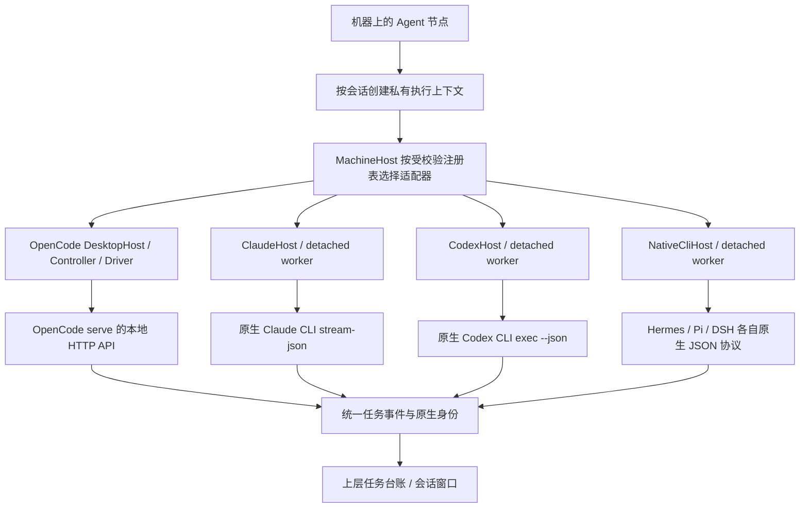
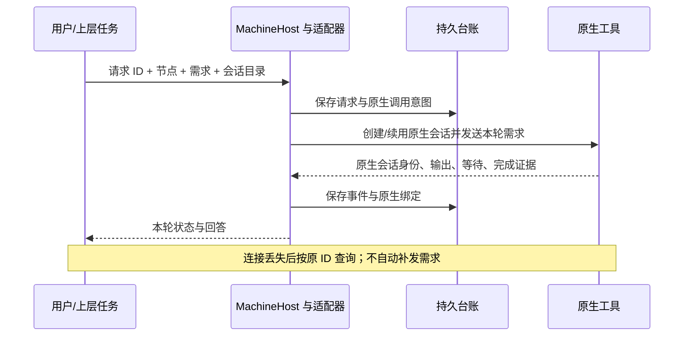

# M06 原生 Agent 适配器设计

## 当前历史详情读取与错误作用域

M06-F01/F02：原生adapter不新建模型/API层；历史task/conversation由MachineHost确认实际backend后只读原ID，空/旧targetAgent不把Codex/Claude读误导到根OpenCode。原生Session、返回轮次、取消和原请求规则不变。 2026-10-19源码/GitHub预发布alpha.30，GitHub已预发布alpha.30；[设计、兼容与实际证据](../../iterations/I07/history-detail-recovery.md)。

2026-10-19[Projects/Dots/Grok Bot研究](../../iterations/I07/projects-dots-bots-research.md)核对产品入口与公开驱动区别：Grok Build的headless/ACP列为CT-03候选，尚未注册；Claude Projects协调器、Dots和Grok Bot也没有因已有CLI适配而成为可直接操控入口。本轮无原生协议或产品代码变化。

2026-10-18当前适配方式和后续目标统一见[接入矩阵](../../agent-integration-matrix.md)：六种内置实际为原CLI或自写HTTP客户端，没有采用厂家SDK或ACP；MCP是Agent调用Bridge的方向。可选ACP试点、公共材料与上下文建议见[研究](../../iterations/I07/connectivity-research.md)，本轮仅文档核对，未增加驱动。

2026-10-18能力补验：已验证同WSL三个独立Claude宿主的真实公共文档交付/独立复核/原主会话协调；开发与复核成员各一轮，主协调三轮，成员原生成功后才逐项验收，主原生成功后才总完成。原既有权限/事件/预算与接口不变；代码编译返修/独立SSH仍待验证。[范围与真实证据](../../iterations/I07/native-members.md)。

Windows官方Codex npm启动器直接解析原包内原生EXE，隐藏参数不再丢失于JS二次spawn；节点仍记录原JS身份，缺原二进制拒绝，未改账号/模型。Claude空闲snapshot不定期重跑版本/auth，显式检查与提交前检查保留。[复现与验收](../../iterations/I07/desktop-polling.md)。

Windows 的 Core Controller、显式安装版本检查及 OpenCode serve 子进程使用 windowsHide 隐藏后台控制台；机器快照不定期重跑安装探测，任务前原安装核验保留。适配能力、模型与原请求语义不变。[空闲黑窗专项](../../iterations/I07/desktop-polling.md)。

原生Session字段只在非空白字符串且满足既有长度约束时作为绑定/变化证据；空值不建立绑定，也不清除已观察的有效Session。真实非空Session变化仍拒绝协作/后续激活，缺绑定仍不能自动续接。此alpha.28后源码增量未入EXE，[实际规则与验证](../../iterations/I07/blank-native-session.md)。

## 2026-10-17：Windows未派发与持久化恢复

M06-F01：Codex运行准备失败落原failed任务并保留原始错误；reconcile核对原job/accepted事件/worker.log启动边界，证据完整且未派发才结束原任务。其他原生适配、原账号/模型配置与MCP权限不变。 alpha.27当次源码与预发布；[需求、状态图、验证与交付](../../iterations/I06/windows-start-persistence.md)。
## 2026-10-17：Windows原请求上下文恢复

M06-F01：MachineHost按原身份选择后端时，缺少agentId/owner.targetAgent不能与准备失败留下的空agentId上下文匹配；原请求仍只读查询原收据，既有原生账号/模型配置继承不变。[完整修复与证据](../../iterations/I06/windows-context-recovery.md)。

2026-10-17能力补验：本机WSL Claude2.1.299自动主角色首轮及原Conversation/原生Session续接后的独立权限等待、观察后台重启、精确隔离Write允许和真实终态已验证；首轮拒绝证据保留于上一专项。不扩大为真实执行成员交接、Windows或独立SSH。见[最新权限证据](../../iterations/I07/resume-native-permission.md)。

## alpha.23 / I07C首批当前实现

2026-10-16：源码及GitHub预发布alpha.23；I07A/B基础继续适用，完整I07C与I06C未准出。

| 功能 ID | 功能 | 当前状态 |
| --- | --- | --- |
| M06-F02 | 小队MCP接入与手动原生执行 | I07A基础继续适用 |
| M06-F03 | 任务作用域与版本报告工具 | I07B源码已实现，实际分层证据见报告 |
| M06-F04 | 原生会话能力分级与自动续接 | I07C首批源码实现，证据层级见本模块报告 |

本批对Claude适配开放自动新轮/原会话续接，真实CLI2.1.299三轮自动主协调和重启原Session核对通过；运行中收信不支持，重要事项排队。Codex/OpenCode保留手动，不根据resume参数推定新小队已通过。工具扩展至16项，主角色可待本轮终态完成业务验收；新一轮注入新scope/指引，旧终态token失效。外部MCP仍自启动，不新增模型API或接管业务功能。

I07A/B的登记、成员/文档权限、公共消息、版本任务和授权交接继续按[I07B完整行为](../../iterations/I07/task-handoff.md)执行；新流程、异常、预算、接口和源码见[I07C首批交付](../../iterations/I07/automation.md)。以下原功能继续适用。

原功能基线说明（保留原日期/版本，以下原模式继续适用）：更新日期：2026-10-12。当时实现基线：源码 `0.6.0-alpha.19`。稳定历史 Windows 便携包为 `0.5.0`，最新修复候选为 `0.6.0-alpha.18`；alpha.2 的主要 Windows/SSH 证据保留，alpha.3 的自然语言发现证据保留，历史 alpha.4 兼容范围见 [交付](../../iterations/I06/ssh-compatible-reuse.md)。

本模块把用户机器上已有的 OpenCode、Claude Code、Codex CLI、Nous Research Hermes、Pi Coding Agent 和 DeepSeek Harness（DSH）接入 AgentBridge，使上层能统一提交需求、读取真实回答、管理会话，并在各工具允许的范围内处理取消和等待。后三种是 2026-10-18 的未发布源码增量；真实模型和发布包边界见[扩展专项](../../iterations/I07/native-agent-expansion.md)。模型、供应商、账号和原生配置仍由原工具管理。

## 1. 用户看到的功能与边界

用户先在机器中接入一个已安装的 Agent 节点，再对该节点新建会话。接入节点不需要文件夹、模型或供应商；需要处理已有文件时，在新会话阶段填写目标机器上的目录。留空使用该节点默认执行目录，同节点/目录/模式/当前安装复用上下文；安装路径更新后新工作建立独立上下文，旧上下文的 executable、agentId 与原会话归属保持原值；不同新会话不保证文件隔离。

工具“已安装”、机器“在线”和模型“能回复”是三项不同检查。`--version` 成功只证明程序能启动。真实任务仍可能因为原生登录、模型访问、额度或接口版本失败。AgentBridge 保留这个失败，不能另选模型、换账号或自动重发来制造成功。

| 功能 ID | 功能 | 当前设计与状态 | 详细设计 |
| --- | --- | --- | --- |
| M06-F01 | 原生配置继承与能力边界 | 六种工具静态注册；当前节点入口拒绝模型和供应商覆盖；能力按工具分别声明 | 本文及各子模块 |
| M06-F05 | 三种原生扩展与自定义适配接口 | Hermes/Pi/DSH 直接会话；代码内受校验注册、宿主接口与示例；当前未发布源码 | 本文及[开发指南](../../custom-agent-development.md) |
| M06-OC-F01 | OpenCode 真实执行 | HTTP API 创建/续用原生会话，轮询输出、工具和等待；支持经证据确认的取消与恢复 | [OpenCode](opencode/design.md) |
| M06-CC-F01 | Claude Code 真实执行 | CLI `stream-json`、增量文本、工具许可、原生会话恢复和独立 worker | [Claude Code](claude/design.md) |
| M06-CX-F01 | Codex 真实执行 | CLI `exec --json`、完成项输出、原生 thread 绑定和独立 worker；真实续聊存在原生版本限制 | [Codex](codex/design.md) |

本模块不负责 SSH 登录、机器身份或主/子节点关系。机器通信交给机器连接层；允许委派哪些节点交给协作层。工具被选为主 Agent 时，适配器注入受限的 AgentBridge MCP 连接和协作指引，实际推理由该工具完成。

## 2. 模块内部结构

当前有两套实现接口，维护时必须区分：

- 核心 CLI 路径的 `AgentDriver` 是 TypeScript 接口，运行在 Edge 内。当前配置支持 Mock 和 OpenCode；Hub 不加载 Driver。
- 桌面及 Linux daemon 的 `MachineHost` 是 CommonJS 路由宿主，支持六种工具。`builtin-adapters.cjs` 使用 `agent-adapter-contract.cjs` 注册发现元数据和宿主工厂；Claude/Codex/NativeCliHost 提供与桌面任务相容的 `call(method, params)` 接口，并不实现 TypeScript `AgentDriver`。未知 adapter 明确拒绝，不回落为 Codex。

这两套接口共享任务概念。自定义原生适配器有[源码注册契约、示例与指南](../../custom-agent-development.md)，通过静态代码注册后构建部署；不通过 RPC 或任意模块路径动态加载第三方代码。

共享发现器选择当前 PATH 中首个已安装入口，版本探测失败不切换其他安装；仅 PATH 无入口时检查默认及 Linux 用户态版本管理器/包管理器目录，不 source rc；Codex npm JS 启动器仍用原有结构化启动规则与后台 Node 调用，不新增模型覆盖。真实 CLI 版本通过只说明安装可调用，不证明原生推理、续聊或权限能力。SSH 场景需要更新远端后台。[alpha.19](../../iterations/I06/linux-cli-discovery.md)。

OpenCode 的 DesktopHost 二次发现与机器节点使用相同安装扫描规则，并只核验原选中 executable；原安装不可调用不回退到另一套程序。安装成功仍不代表原生身份、服务或模型就绪。Windows Core 设置文件刷新/替换适配平台，不改变任务/原生身份核验。[完整范围](../../iterations/I06/opencode-discovery.md)。

## 3. 能力矩阵

### 当前连接能力与恢复

M06-F01/F05：注册描述显式声明execution/delegation/bridgeMcp，以及resume/cancellation/permissions/forms/verification。六工具可执行/被普通委派，原三工具可调用MCP，新三工具bridgeMcp=false；权限/表单/验证按[连接矩阵](../../agent-integration-matrix.md)分别声明。driver只可为native-cli或cli-http；源代码注册为能力上限，缺字段未知，不接受远端任意模块/命令或伪造声明扩权。自研适配器需实现并通过生命周期验证后才声明true。 当前为未发布源码；[完整能力/错误/兼容契约](../../iterations/I07/connection-capabilities.md)及[本模块报告](test-report.md)记录实际范围。

“已实现”表示本地实现存在；真实工具证据范围见[测试报告](test-report.md)。原生版本、登录和模型可用性可能让已经实现的操作失败。

| 能力 | OpenCode | Claude Code | Codex |
| --- | --- | --- | --- |
| 获取回答 | HTTP 轮询文本快照 | stdout 文本增量 | JSON 完成项文本 |
| 原生会话绑定 | Session + 用户 Message | Session，消息 ID 视原生帧而定 | thread ID；Bridge requestId 用作消息关联值 |
| 继续同会话 | 已实现；核验目录、配置和输入时间线 | 已实现；传原 Session ID，保留会话快照 | 已实现 `exec resume`；WSL 0.161.0 的真实续聊未通过 |
| 工具许可 | 原生 permission 接口 | `can_use_tool` 控制消息 | 未适配为 Bridge 许可表单 |
| 结构化表单 | 原生 form 接口；受支持字段校验 | `AskUserQuestion` 当前拒绝 | 未适配 |
| 取消 | interrupt 收据 + 本轮 interrupted 证据 | 原控制通道 interrupt + 原进程退出 | 终止所属进程树/进程组 + 原进程退出 |
| 观察断开后继续执行 | Controller 原生服务 + 原记录恢复 | worker 持久运行，宿主重读日志 | worker 持久运行，宿主重读日志 |
| 限工具连接验证 | 仅对 2.0.24 的禁止工具契约放行 | `--tools ""`，同时核对标记与工具使用数 | 未实现 |

Codex 的快照当前声明 `resume: true`，表示已实现调用入口，不是每个安装版本都已验证成功。上层与测试报告必须继续显示实际原生失败，不能把能力字段当作验收结果。

## 4. 原生配置继承

### Hermes、Pi 与 DSH 直接会话

| 工具 | 原生协议与绑定 | 完成证据与限制 |
| --- | --- | --- |
| Hermes | `chat --query-file - --format stream-json --no-restore-cwd`；原生 `session_id`，续聊传原 `--resume` | 原生 result 与进程退出共同核对；不指定模型/provider |
| Pi | `--mode json --print --session-dir`；观察 session header ID，续聊先定位并核验唯一原会话文件，再传完整 `--session` 路径 | assistant 结果、原生轮次结束与退出共同核对；缺原文件不能静默创建替代会话 |
| DSH | `--profile headless --json`；观察 `sessionId`，续聊使用原 `--session-id` | 本轮 completed、final 与退出共同核对；headless 使用原生环境/.env 配置，不搬运 web profile 凭据 |

三个适配器共用持久 `NativeCliHost` 及独立 worker，使用不同事件解析器。首批声明续聊/取消能力，Bridge permissions/forms/verification/teamCollaboration 为 false；不支持的协作 scope 在派发前拒绝。取消收据与原任务终态分开，原生结束/取消与原进程退出必须核对。宿主重开只恢复原事件观察；原 worker/终态无法确认时保留 unknown 与占用，不重发。能力声明表示实现入口，真实原生版本及模型验收以报告为准。

原生协议错误、原 Session 不匹配、缺文件或配置不匹配不能伪造成新会话成功。原生工具自己的权限策略仍适用；没有 Bridge 许可表单不代表自动允许工具。

`MachineHost.context()` 拒绝 `model` 和 `providerID`，按已发现的 adapter/executable 选择宿主，创建私有上下文。Agent 节点本身不绑定项目或模型。

| 工具 | 继承方式 | Bridge 允许增加的运行信息 |
| --- | --- | --- |
| OpenCode | 原生配置源优先；没有原生模型配置时读取 CLI 最近模型偏好；不写原生配置/偏好文件 | 本机受保护服务认证、会话目录、需要协作时的 MCP 和指令 |
| Claude Code | 当前节点流程不传模型参数，使用 CLI 自有登录、设置和环境 | 结构化协议参数、Session ID、必要的 MCP、有限 Bridge 工具授权 |
| Codex | 不传模型或 provider 覆盖，不改 `config.toml`、登录或原生状态数据库 | `exec` JSON 输出、Session ID、必要的 Bridge MCP 局部配置 |

旧项目实例 API 和 ClaudeHost 仍保留模型覆盖兼容代码、对应回归测试。它们不构成当前节点界面的模型功能；旧上下文带覆盖时，MachineHost 拒绝静默复用，要求保留原记录并新建原生配置会话。

Bridge 的原生服务密码、MCP 内部令牌是进程间认证，不是用户 Provider API Key。上层界面不要求用户复制模型凭据。

## 5. 生命周期与身份

CodexHost 与 NativeCliHost 的取消/核对收据持久保存 kind、taskId、operationId、state 与 data。相同 ID 同任务同类型读取原收据，跨任务/类型复用拒绝；历史无 kind 的取消收据按 cancel 兼容。unknown 核对不阻首次取消，unknown 取消只查原 ID；观察到原任务终态时推进原收据，不重新执行。confirmed 核对与任务成功/取消分开。[实际变更](../../iterations/I07/native-integration-guards.md)。

| 身份 | 含义与约束 |
| --- | --- |
| machineId / nodeId | 工具所在机器与安装节点；跨机器路由由上层保护 |
| contextId | 节点 + 真实目录 + 直接/协作上下文形成的私有执行上下文 |
| conversationId / taskId / executionId | Bridge 会话、本轮任务和本次执行，不等于原生 ID |
| requestId / operationId | 需求和取消/回复的稳定去重键；同 ID 不同内容必须拒绝 |
| native Session/thread/message | 原工具返回或预绑定的身份；查结果和续聊必须回到原宿主 |

只读查原请求可以搜索所属宿主的记录；续聊、取消和回复必须路由到原会话/任务的宿主。不能在原收据缺失时换一个适配器提交同一需求。unknown 保留占用，缺少结束证据时不自动释放节点。

每个上下文串行执行；多个互不冲突的上下文可并行。跨上下文的节点/目录占用由上层统一保护；工作目录不构成对原生工具新增的文件系统沙箱。

## 6. 消息获取与展示

原始事件保存于任务记录，带顺序号与时间。前端当前通过快照刷新获取事件，而非直接连接原生 stdout。`taskEvents()` 只合并相邻的可见输出段：Claude 追加 delta；OpenCode 新快照包含旧快照前缀时替换；Codex 保留完成项。工具和状态事件会断开合并，原始台账不被改写。

因此“流式输出”在三个适配器中含义不同。Claude 能逐个 token/片段到达；OpenCode 是周期性读取已经生成的文本；Codex 当前主要在 `item.completed` 时产生可见回答，不是 token 级流式。

连接验证的标记不逐片显示在执行过程里；验证和实际需求会话分开。最终回答以适配器确认的本轮结果为准。

## 7. 错误与不确定性

| 情况 | 处理与人类可读含义 |
| --- | --- |
| 可执行文件/启动失败 | 显示安装或运行资源错误；能证明原生尚未执行时记 failed |
| 原生明确拒绝、Provider 报错 | 保存真实失败，提示在原生工具核对账号/模型 |
| 接口响应、绑定或输入时间线不符 | 拒绝继续控制，保留证据与占位 |
| 请求已派发但收据/观察中断 | unknown；查询原 ID，不自动重发 |
| 取消请求已被接收 | 不立即等同 cancelled；等待原轮中断或原进程退出 |
| 用户拒绝工具 | 不宣称完整需求成功；已发生的文件修改不自动撤销 |

错误消息做已知凭据脱敏和长度限制。日志是诊断证据，不能把原生错误正文当作新的指令执行。

共享 Electron 运行缓存不追踪 runtime.json 自身；新缓存逐文件 SHA-256 校验，旧自引用清单只忽略自身，其余资源异常时保留旧目录并准备完整新副本。Windows OpenCode 子后台启动前的 INVALID/MISSING 不代表原生模型失败；仅中央原未派发证据完备时记明确拒绝。Claude/Codex 的任务与原生终态仍按各适配器，不根据共享错误码泛化解除占位。见 [资源与原请求修复](../../iterations/I06/runtime-recovery.md)。

## 8. 代码入口与扩展规则

| 入口 | 责任 |
| --- | --- |
| [driver.ts](../../../src/drivers/driver.ts) | 核心 Driver 接口及能力 |
| [machine-host.cjs](../../../desktop/electron/machine-host.cjs) | 注册适配器选择、私有上下文与原宿主路由 |
| [builtin-adapters.cjs](../../../desktop/electron/builtin-adapters.cjs)、[契约](../../../desktop/electron/agent-adapter-contract.cjs) | 六种内置描述、源码扩展接口与宿主形状验证 |
| [native-cli-host.cjs](../../../desktop/electron/native-cli-host.cjs)、[协议解析](../../../desktop/electron/native-cli-protocols.cjs) | Hermes/Pi/DSH 持久宿主、独立 worker 与各自终态规则 |
| [tool-discovery.cjs](../../../desktop/electron/tool-discovery.cjs) | 程序发现、版本探测和安全启动命令 |
| [api.ts](../../../desktop/src/api.ts) | 三种输出的可见段聚合 |
| [worker-runtime.cjs](../../../desktop/electron/worker-runtime.cjs) | worker 使用持久运行资源，避免便携解压资源清理 |
| [OpenCode](opencode/design.md)、[Claude](claude/design.md)、[Codex](codex/design.md) | 各原生协议、状态文件和具体测试 |

新增工具或升级原生版本时，先记录版本与协议契约，再分别验证：发现、真实回复、同会话续聊、等待/取消、原 ID 去重、观察丢失恢复、原生配置不被替换。只声明已实现的能力；真实失败保留在报告。修复或更改本模块时，同时更新本页、涉及的子模块设计/测试报告、对应迭代需求与验收记录。

## 9. 验证入口

2026-10-19当前WSL三工具已有[直接生命周期](../../iterations/I07/connection-native.md)及[六个普通委派方向](../../iterations/I07/connection-delegation.md)真实证据：实际回答、原Session回忆、取消终态、MCP调用方/被调用方及完整观察重开。能力静态声明不因这些指定版本通过而变成所有环境保证；新三工具、其他运输环境与新包仍分别验收。验收工具开发未改变本模块产品行为。

[模块测试报告](test-report.md)汇总当前受控检查与历史真实工具证据。使用 OpenCode 的读写控制、Claude 的真实权限或 Codex 的新原生协议时，还须阅读各自子模块报告中的未验证项。

共享 MachineHost 在 OpenCode 新上下文就绪阶段在 10 秒观察预算内轮询原生健康快照，期间零用户 Prompt；未健康在执行前拒绝。原生 Driver、账号/模型继承与权限仍由各适配器负责，不新增模型 API 层。I06B 受控就绪证据见 [M03 报告](../03-machine-network/test-report.md)，真实链范围见 [迭代验收](../../iterations/I06/graph-implementation.md)。

## 当前维护与原操作恢复（alpha.13）

原生 Driver 与账号/模型继承方式不变。daemon/Coordinator 只接受原控制操作和原 execution/task 的可核对收据；原生 unknown、外来 operationId、缺收据不会变成成功。表单秘密答案在 UI 遮罩、中央台账脱敏；适配器自身原生能力仍以各子模块报告为准，未支持交互不假成功。

实现入口：[machine-daemon.cjs](../../../desktop/electron/machine-daemon.cjs)。需求、分层证据及未测范围见 [I06C 收尾](../../iterations/I06/final-delivery.md)。

## Codex终态约束

Codex原生明确error/turn.failed不能被同轮turn.completed与退出码0覆盖。源码成功条件增加无明确原生错误；取消和原请求去重不变。未代表原生续聊或自动激活已验收；[本次实现与验证](../../iterations/I07/codex-terminal.md)。
