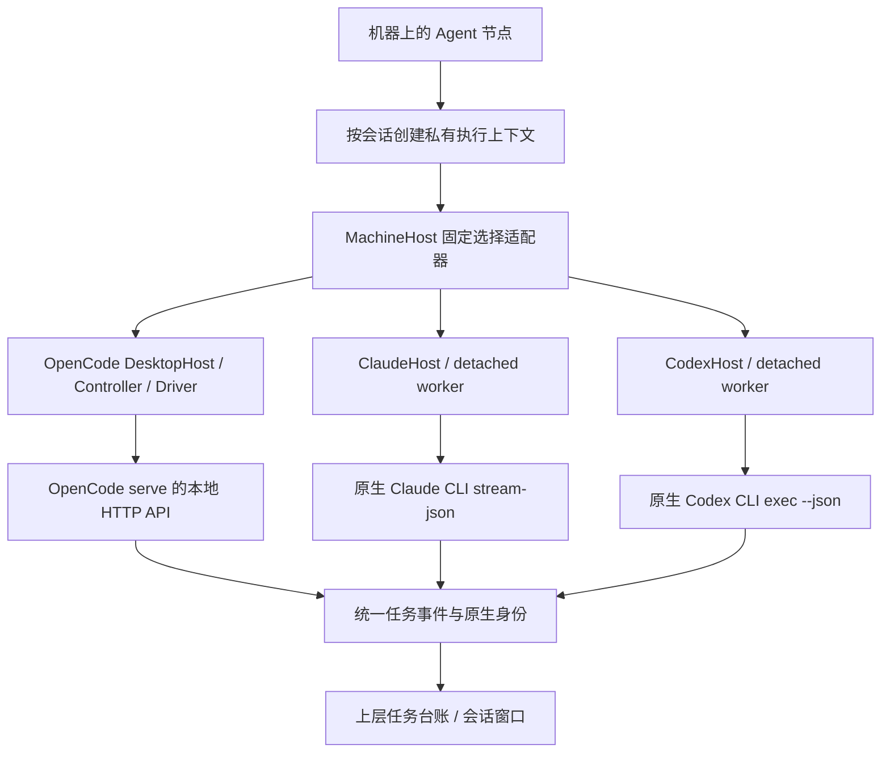
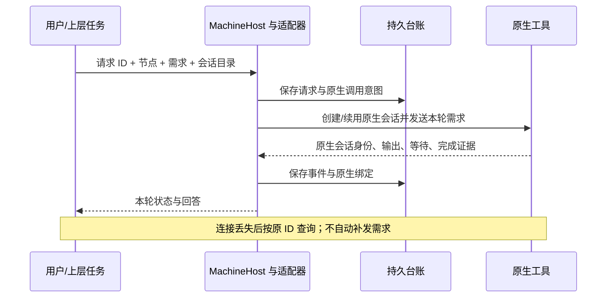

# M06 原生 Agent 适配器设计

更新日期：2026-10-12。当前实现基线：源码 `0.6.0-alpha.4`。稳定历史 Windows 便携包为 `0.5.0`，最新修复候选为 `0.6.0-alpha.4`；alpha.2 的主要 Windows/SSH 证据保留，alpha.3 的自然语言发现证据保留，最新 alpha.4 兼容范围见 [交付](../../iterations/I06/ssh-compatible-reuse.md)。

本模块把用户机器上已有的 OpenCode、Claude Code 和 Codex CLI 接入 AgentBridge，使上层能统一提交需求、读取真实回答、管理会话，并在各工具允许的范围内处理取消和等待。模型、供应商、账号和原生配置仍由原工具管理。本文是当前设计；变更过程保留在迭代文档中。

## 1. 用户看到的功能与边界

用户先在机器中接入一个已安装的 Agent 节点，再对该节点新建会话。接入节点不需要文件夹、模型或供应商；需要处理已有文件时，在新会话阶段填写目标机器上的目录。留空使用该节点默认执行目录，同节点/目录/模式复用上下文；不同新会话不保证文件隔离。

工具“已安装”、机器“在线”和模型“能回复”是三项不同检查。`--version` 成功只证明程序能启动。真实任务仍可能因为原生登录、模型访问、额度或接口版本失败。AgentBridge 保留这个失败，不能另选模型、换账号或自动重发来制造成功。

| 功能 ID | 功能 | 当前设计与状态 | 详细设计 |
| --- | --- | --- | --- |
| M06-F01 | 原生配置继承与能力边界 | 已实现固定工具适配；当前节点入口拒绝模型和供应商覆盖；能力按工具分别声明 | 本文及各子模块 |
| M06-OC-F01 | OpenCode 真实执行 | HTTP API 创建/续用原生会话，轮询输出、工具和等待；支持经证据确认的取消与恢复 | [OpenCode](opencode/design.md) |
| M06-CC-F01 | Claude Code 真实执行 | CLI `stream-json`、增量文本、工具许可、原生会话恢复和独立 worker | [Claude Code](claude/design.md) |
| M06-CX-F01 | Codex 真实执行 | CLI `exec --json`、完成项输出、原生 thread 绑定和独立 worker；真实续聊存在原生版本限制 | [Codex](codex/design.md) |

本模块不负责 SSH 登录、机器身份或主/子节点关系。机器通信交给机器连接层；允许委派哪些节点交给协作层。工具被选为主 Agent 时，适配器注入受限的 AgentBridge MCP 连接和协作指引，实际推理由该工具完成。

## 2. 模块内部结构

当前有两套实现接口，维护时必须区分：

- 核心 CLI 路径的 `AgentDriver` 是 TypeScript 接口，运行在 Edge 内。当前配置支持 Mock 和 OpenCode；Hub 不加载 Driver。
- 桌面及 Linux daemon 的 `MachineHost` 是 CommonJS 路由宿主，支持 OpenCode、Claude Code 和 Codex。Claude/Codex 宿主提供与桌面任务相容的 `call(method, params)` 接口，并不实现 TypeScript `AgentDriver`。

这两套接口共享任务概念，尚未统一为插件 SDK。当前不能通过任意模块路径动态加载第三方适配器。

## 3. 能力矩阵

“已实现”表示本地实现存在；真实工具证据范围见[测试报告](test-report.md)。原生版本、登录和模型可用性可能让已经实现的操作失败。

| 能力 | OpenCode | Claude Code | Codex |
| --- | --- | --- | --- |
| 获取回答 | HTTP 轮询文本快照 | stdout 文本增量 | JSON 完成项文本 |
| 原生会话绑定 | Session + 用户 Message | Session，消息 ID 视原生帧而定 | thread ID；Bridge requestId 用作消息关联值 |
| 继续同会话 | 已实现；核验目录、配置和输入时间线 | 已实现；传原 Session ID，保留会话快照 | 已实现 `exec resume`；WSL 0.161.0 的真实续聊未通过 |
| 工具许可 | 原生 permission 接口 | `can_use_tool` 控制消息 | 未适配为 Bridge 许可表单 |
| 结构化表单 | 原生 form 接口；受支持字段校验 | `AskUserQuestion` 当前拒绝 | 未适配 |
| 取消 | interrupt 收据 + 本轮 interrupted 证据 | 原控制通道 interrupt + 原进程退出 | 终止所属进程树/进程组 + 原进程退出 |
| 观察断开后继续执行 | Controller 原生服务 + 原记录恢复 | worker 持久运行，宿主重读日志 | worker 持久运行，宿主重读日志 |
| 限工具连接验证 | 仅对 2.0.24 的禁止工具契约放行 | `--tools ""`，同时核对标记与工具使用数 | 未实现 |

Codex 的快照当前声明 `resume: true`，表示已实现调用入口，不是每个安装版本都已验证成功。上层与测试报告必须继续显示实际原生失败，不能把能力字段当作验收结果。

## 4. 原生配置继承

`MachineHost.context()` 拒绝 `model` 和 `providerID`，按已发现的 adapter/executable 选择宿主，创建私有上下文。Agent 节点本身不绑定项目或模型。

| 工具 | 继承方式 | Bridge 允许增加的运行信息 |
| --- | --- | --- |
| OpenCode | 原生配置源优先；没有原生模型配置时读取 CLI 最近模型偏好；不写原生配置/偏好文件 | 本机受保护服务认证、会话目录、需要协作时的 MCP 和指令 |
| Claude Code | 当前节点流程不传模型参数，使用 CLI 自有登录、设置和环境 | 结构化协议参数、Session ID、必要的 MCP、有限 Bridge 工具授权 |
| Codex | 不传模型或 provider 覆盖，不改 `config.toml`、登录或原生状态数据库 | `exec` JSON 输出、Session ID、必要的 Bridge MCP 局部配置 |

旧项目实例 API 和 ClaudeHost 仍保留模型覆盖兼容代码、对应回归测试。它们不构成当前节点界面的模型功能；旧上下文带覆盖时，MachineHost 拒绝静默复用，要求保留原记录并新建原生配置会话。

Bridge 的原生服务密码、MCP 内部令牌是进程间认证，不是用户 Provider API Key。上层界面不要求用户复制模型凭据。

## 5. 生命周期与身份

| 身份 | 含义与约束 |
| --- | --- |
| machineId / nodeId | 工具所在机器与安装节点；跨机器路由由上层保护 |
| contextId | 节点 + 真实目录 + 直接/协作上下文形成的私有执行上下文 |
| conversationId / taskId / executionId | Bridge 会话、本轮任务和本次执行，不等于原生 ID |
| requestId / operationId | 需求和取消/回复的稳定去重键；同 ID 不同内容必须拒绝 |
| native Session/thread/message | 原工具返回或预绑定的身份；查结果和续聊必须回到原宿主 |

只读查原请求可以搜索所属宿主的记录；续聊、取消和回复必须路由到原会话/任务的宿主。不能在原收据缺失时换一个适配器提交同一需求。unknown 保留占用，缺少结束证据时不自动释放节点。

每个上下文串行执行；多个互不冲突的上下文可并行。跨上下文的节点/目录占用由上层统一保护；工作目录不构成对原生工具新增的文件系统沙箱。

## 6. 消息获取与展示

原始事件保存于任务记录，带顺序号与时间。前端当前通过快照刷新获取事件，而非直接连接原生 stdout。`taskEvents()` 只合并相邻的可见输出段：Claude 追加 delta；OpenCode 新快照包含旧快照前缀时替换；Codex 保留完成项。工具和状态事件会断开合并，原始台账不被改写。

因此“流式输出”在三个适配器中含义不同。Claude 能逐个 token/片段到达；OpenCode 是周期性读取已经生成的文本；Codex 当前主要在 `item.completed` 时产生可见回答，不是 token 级流式。

连接验证的标记不逐片显示在执行过程里；验证和实际需求会话分开。最终回答以适配器确认的本轮结果为准。

## 7. 错误与不确定性

| 情况 | 处理与人类可读含义 |
| --- | --- |
| 可执行文件/启动失败 | 显示安装或运行资源错误；能证明原生尚未执行时记 failed |
| 原生明确拒绝、Provider 报错 | 保存真实失败，提示在原生工具核对账号/模型 |
| 接口响应、绑定或输入时间线不符 | 拒绝继续控制，保留证据与占位 |
| 请求已派发但收据/观察中断 | unknown；查询原 ID，不自动重发 |
| 取消请求已被接收 | 不立即等同 cancelled；等待原轮中断或原进程退出 |
| 用户拒绝工具 | 不宣称完整需求成功；已发生的文件修改不自动撤销 |

错误消息做已知凭据脱敏和长度限制。日志是诊断证据，不能把原生错误正文当作新的指令执行。

## 8. 代码入口与扩展规则

| 入口 | 责任 |
| --- | --- |
| [driver.ts](../../../src/drivers/driver.ts) | 核心 Driver 接口及能力 |
| [machine-host.cjs](../../../desktop/electron/machine-host.cjs) | 固定适配器选择、私有上下文与原宿主路由 |
| [tool-discovery.cjs](../../../desktop/electron/tool-discovery.cjs) | 程序发现、版本探测和安全启动命令 |
| [api.ts](../../../desktop/src/api.ts) | 三种输出的可见段聚合 |
| [worker-runtime.cjs](../../../desktop/electron/worker-runtime.cjs) | worker 使用持久运行资源，避免便携解压资源清理 |
| [OpenCode](opencode/design.md)、[Claude](claude/design.md)、[Codex](codex/design.md) | 各原生协议、状态文件和具体测试 |

新增工具或升级原生版本时，先记录版本与协议契约，再分别验证：发现、真实回复、同会话续聊、等待/取消、原 ID 去重、观察丢失恢复、原生配置不被替换。只声明已实现的能力；真实失败保留在报告。修复或更改本模块时，同时更新本页、涉及的子模块设计/测试报告、对应迭代需求与验收记录。

## 9. 验证入口

[模块测试报告](test-report.md)汇总当前受控检查与历史真实工具证据。使用 OpenCode 的读写控制、Claude 的真实权限或 Codex 的新原生协议时，还须阅读各自子模块报告中的未验证项。

共享 MachineHost 在 OpenCode 新上下文就绪阶段在 10 秒观察预算内轮询原生健康快照，期间零用户 Prompt；未健康在执行前拒绝。原生 Driver、账号/模型继承与权限仍由各适配器负责，不新增模型 API 层。I06B 受控就绪证据见 [M03 报告](../03-machine-network/test-report.md)，真实链范围见 [迭代验收](../../iterations/I06/graph-implementation.md)。

## 当前维护与原操作恢复（alpha.13）

原生 Driver 与账号/模型继承方式不变。daemon/Coordinator 只接受原控制操作和原 execution/task 的可核对收据；原生 unknown、外来 operationId、缺收据不会变成成功。表单秘密答案在 UI 遮罩、中央台账脱敏；适配器自身原生能力仍以各子模块报告为准，未支持交互不假成功。

实现入口：[machine-daemon.cjs](../../../desktop/electron/machine-daemon.cjs)。需求、分层证据及未测范围见 [I06C 收尾](../../iterations/I06/final-delivery.md)。
