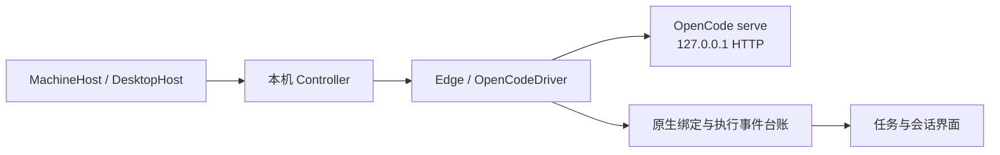
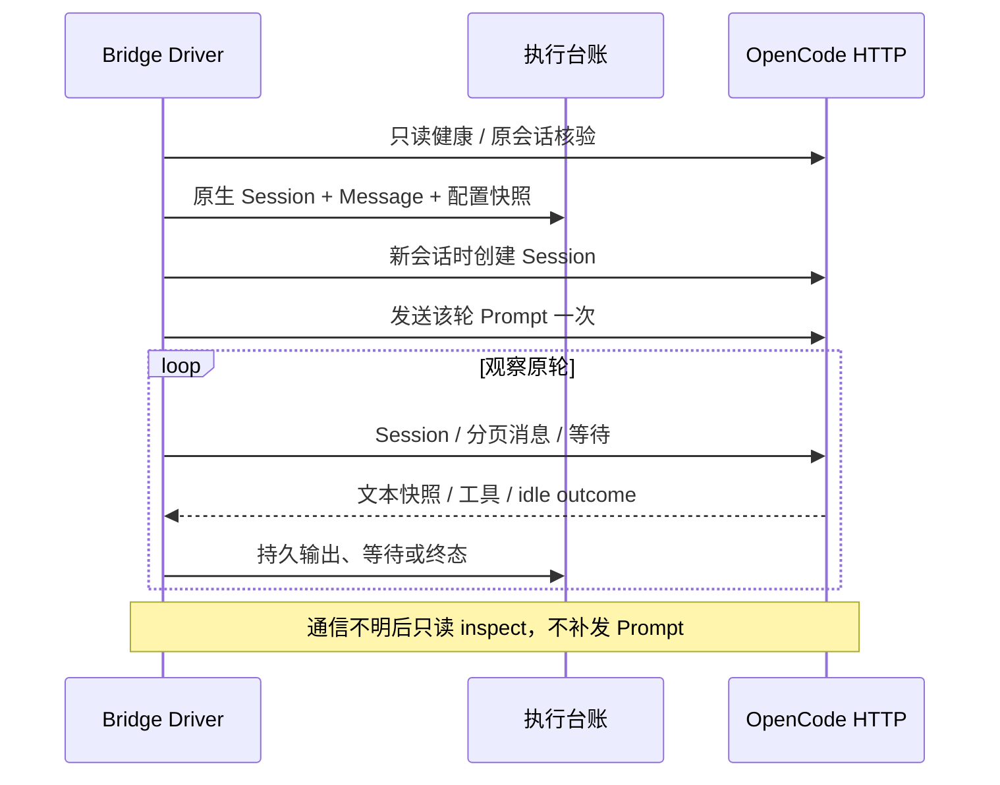

# OpenCode 适配器设计

## 有界协议发现

M06-OC-F01：只读协议发现首先请求 `/global/health`，仅 healthy=true 且版本为有效 1.x 时直接进入 V1 元数据检查；保留 agent/config/providers/status/permission/question 全量校验，不再请求会在早期 1.x 上挂起的 `/api/info`。否则以短探测请求 `/api/info`，须为 2.x 并通过其 agent/model/config 契约。每个候选入口 700ms，整个发现含响应体与元数据最多 4000ms；启动调用还受剩余 20 秒预算限制。不缓存跨服务探测结果，失败复验清除内存协议选择。

已响应但契约无效、候选或元数据超时返回 `OPENCODE_API_UNSUPPORTED`；401/403、版本、认证文件、原生 Agent/配置错误保持具体错误。两个入口均连接不可达才保留 `NATIVE_UNAVAILABLE` 供启动重试。普通业务请求仍为 15 秒，不改变其异常、Prompt、Session、取消、恢复或模型来源。既有 NATIVE_START_TIMEOUT unknown 不由新探测结算，原 executable 不替换。[需求、流程与分层验证](../../../iterations/I08/opencode-bounded-probe.md).

M06-OC-F01：OpenCode 显式接入遇原服务已退出时，仅启动原 context 内的原生服务，再核验原 Agent；本次新增恢复不放在快照或原请求读取分支。接入准备失败原子记录本地 attach 拒绝收据，原图意图只按匹配证据收敛；不改变原任务、Session 或 unknown 门禁。恢复不改协议或原生模型配置。详见[恢复契约与边界](../../../iterations/I08/opencode-oom-recovery.md)。

## alpha.36当前包验证

M06-OC-F01：公开alpha.36包含完整call/close工厂与公开alpha.35管理恢复；2026-10-21包内WSL stdio/daemon两入口2/2，普通EXE7组含原宿主拒绝恢复与真实MCP stdio通过。原Session/请求不迁移，用户实际模型/故障profile未验。[完整交付与文件](../../../iterations/I07/alpha36-delivery.md)。

## 普通子任务的最小上下文

M06-OC-F01：作为普通委派目标时，中央v1固定说明+原始需求作为既有message传入，不新增MCP/TeamScope或更改原生账号、模型、权限、Session。Task.message显示收到的完整输入；历史无版本委派保持原文，主会话/直接请求不包装。统一宿主受控检查证明中央传参，不等于当前原生模型实际消费。[持久版本、大小与未测边界](../../../iterations/I07/delegation-context.md)。

## 发现与其他原生服务共存

M06-OC-F01：通用扫描可包含健康的DSH Desktop/Web；OpenCode专用发现与原安装复核必须先限定adapter=opencode，再判断健康和版本。缺失/损坏原OpenCode时不得以同机其他健康工具代替，1.x/2.x版本与API检查保持。[同机共存回归与本轮交付](../../../iterations/I07/agent-row-configuration.md)。

## 宿主错误与原接入核对

M06-OC-F01：ADAPTER_HOST发生在API检查之前，不能据此判原生API或账号损坏。新宿主工厂具备call/close后，仍须核对原失败的接入operationId；仅符合中央持久准入拒绝条件时解除管理锁，之后用户可显式重新接入。普通API超时或原请求未知不自动重试。[恢复规则与验证](../../../iterations/I07/agent-management-recovery.md)。

## 后台宿主生命周期

M06-OC-F01：WSL/Linux stdio 与 SSH daemon 创建上下文时直接返回具备 call/close 的 DesktopHost。close 只释放无自有资源的门面，不发送停止、取消或新需求；原生 Controller 独立运行。此修复已在源码与本地config.2候选中，公开alpha.35的冻结源码未包含，[根因与验证](../../../iterations/I07/opencode-host-lifecycle.md)。

## OpenCode 1.x / 2.x 兼容修复

M06-OC-F01：当前工作源码支持官方 1.x 和原 2.x；实际 API/配置/等待接口只读握手必需。V1 会话与消息、终态证据和恢复规则见专项；2.x 行为保留。 [需求、实现、验证与未测边界](../../../iterations/I07/opencode-v1-compatibility.md)。

## 版本复验与来源归属

M06-OC-F01：新接入与旧配置恢复都在启动 `serve` 前复验；原生 executable 启动器按规范解析，不回退到其他安装。确定 API 或认证错误快速失败，不消耗 20 秒等待；历史 Session、密码与未知占用保留。准入规则随版本演进的过程见[版本管理与准入修复](../../../iterations/I07/version-management-recovery.md)，当前双协议支持的规则见[1.x/2.x 兼容修复](../../../iterations/I07/opencode-v1-compatibility.md)。

## 独立 MCP 接入

仅支持V2的mcp.servers.agentbridge、local command数组/environment/codemode=false；尊重OPENCODE_CONFIG_DIR/XDG目录，保留既有JSONC。独立导出agentbridge.opencode.jsonc。真实2.0.24添加、stdio连接、删除通过；原生常驻服务异步加载/删除，列表可能延后，必要时重启其后台。V1布局或双配置同名冲突拒绝。测试使用WSL隔离配置、无模型调用；Windows生产界面为受控机器，非该工具真实Windows/EXE/独立SSH验证。[完整流程、源码和证据](../../../iterations/I07/mcp-installation.md)。

Windows 启动 OpenCode serve、Core Controller 与显式版本检查时设置 windowsHide，避免后台控制台干扰桌面。安装发现改为首次使用或明确扫描，执行前仍核验原安装。[空闲黑窗专项](../../../iterations/I07/desktop-polling.md)。

所属功能 **M06-OC-F01**。对应[模块总设计](../design.md)与[测试报告](test-report.md)。

## 1. 用途、边界与当前状态

新接入与旧配置恢复在 `serve` 前校验，认证或确定 API 错误快速失败。MCP 配置管理与原生执行方向分开，原已派发请求继续按原收据查询。逐版本冻结范围与本地候选边界见[整合源码范围](../../../iterations/I07/integrated-source.md)，不沿用旧开发机版本推定真实推理/SSH验收。

当前WSL版本2.0.24经生产MachineHost真实直接回答、原Session续聊回忆及取消通过；完整观察器重开保留原任务和答案，重复观察不增加执行。此为限定版本/环境的[CT-02证据](../../../iterations/I07/connection-native.md)，不改变协议或继承的原生配置，当前WSL另已通过本工具作为MCP调用方及普通被委派方的[真实六方向链](../../../iterations/I07/connection-delegation.md)，不覆盖当前Windows或独立SSH。

适配器将机器上已有 OpenCode CLI 的本地 `serve` 服务接入 Bridge。它使用原生 HTTP API，新会话创建原生 Session；续聊沿用原 Session、为该轮生成新用户 Message。每轮答案从该用户消息之后、下一条用户消息之前的原生时间线提取。

| 子能力 | 当前实现 | 验证边界 |
| --- | --- | --- |
| 版本/模型健康检查 | `/api/info`、默认与可用模型、原生配置源读取 | 当前源码接受 1.x/2.x 各自契约；安装检查不是模型可调用证明 |
| CLI 默认配置继承 | 原生配置优先，否则 CLI 最近可用模型；不写原文件 | 2.0.24 真实默认与受控回归；远端 2.0.26 已有真实回复 |
| 新会话/原会话续聊 | Session/Message 预绑定、只发一次 Prompt、原时间线核验 | 2.0.24 真实三轮；2.0.26 两轮缺 native ID 比较产物 |
| 输出/工具/等待 | HTTP 轮询已生成的文本和工具状态，permission/form 接口 | 不是原生 token 流订阅 |
| 取消/恢复 | interrupt + 该轮 idle 证据；只读查原轮恢复 | 取消不撤销已执行文件或命令 |
| 禁工具连接验证 | 2.0.24 特殊禁止工具契约 + 随机标记 | 其他版本返回 VERIFICATION_CONTRACT；普通任务不受此限制 |

## 2. 结构与调用协议

当前 V1 协议表及安全约束见[双协议专项](../../../iterations/I07/opencode-v1-compatibility.md)；以下 `/api/*` 表为继续保留的 V2 路径。

| 操作 | 原生接口 | Bridge 行为 |
| --- | --- | --- |
| 服务类型/版本 | `GET /api/info` | info版本须2.x；info/agent/model及所需config契约须通过 |
| 原生模型来源 | `GET /api/model/default`、`/api/model`、`/api/config` | 使用 `location[directory]`；确定当前执行目录的默认 |
| 新建 Session | `POST /api/session` | Bridge 指定 Session ID、原目录/agent，附 Bridge 关联 metadata |
| 该轮需求 | `POST /api/session/{id}/prompt` | 指定 Message ID；校验返回 ID 与所属 Session |
| 会话与消息 | `GET /api/session/{id}`、`.../message` | 分页读取，每页 100；原输入、先前输入和该轮 idle 必须匹配 |
| 原生等待 | `GET .../permission`、`.../form` | 校验每条等待属于原 Session |
| 回复 | `POST .../permission/{id}/reply`、`.../form/{id}/reply` | 持久 operationId，校验原等待与表单字段 |
| 取消 | `POST .../interrupt?resume=false` | 保存操作收据，之后等待原轮 interrupted，不据 HTTP 成功直接结束 |

每个 HTTP 请求从受保护密码文件读取服务认证；Basic 用户名为 `opencode`。禁止重定向，单请求 15 秒超时，响应最大 16 MiB，必须是完整 UTF-8 JSON。消息历史最多 10,000 条并拒绝循环 cursor。

Windows OpenCode 的 DesktopHost 先用共享 workerRuntime 准备 Electron/ICU 资源，再创建本机后台。缓存复制排除 runtime.json，兼容旧自引用清单；真正资源损坏时发布完整新副本、保留旧目录。若在派发前仍失败，中央依据原意图保存明确拒绝，并可严格核对 alpha.9 旧 unknown；不把查不到 Task 当作未执行。详见 [alpha.18](../../../iterations/I06/runtime-recovery.md)。

OpenCode 创建上下文前复用共享 tool-discovery 对原 executable 版本核验，支持 Windows exe/cmd/npm 解析与共享 Linux 目录规则，当前允许可识别 1.x/2.x，连接分别核对其 API 契约。原安装删除/损坏时明确拒绝，不能由 PATH 变化换另一安装；Windows 私有 SettingsStore 保留可写文件 flush、原子替换与修订锁，Linux 另刷新目录。实际 Windows 版本/配置/受控退出证据不代表真实模型或原生 Session 恢复。[专项](../../../iterations/I06/opencode-discovery.md)。

## 3. 原生服务与配置来源

托管服务只允许 `127.0.0.1` 和明确端口，执行 `opencode serve --hostname 127.0.0.1 --port …`。服务认证由 Bridge 生成，不改变用户 Provider 登录。服务类型、PID、出生时间、可执行文件、目录和受保护身份记录用于确认归属；仅凭端口可连或 PID 存在不能接管。

控制器异常退出后，可以复用已经确认归属、原认证仍有效的服务。只有证据确认旧服务已死亡并端口空闲，才重新启动；无法证明归属时保留服务与凭据并报错。明确停止 Controller 是资源生命周期操作，与关闭 GUI/SSH 观察通道有区别。

当前节点上下文启用 `inheritNativeCli: true`：原生配置源含模型时沿用；否则只读 `$XDG_STATE_HOME/opencode/model.json`，或默认 `~/.local/state/opencode/model.json`，按 recent 顺序选择仍在原生可用列表中的模型，并继承 variant。找不到可用模型时不虚构默认值。该字段只解决 CLI 与后台默认选择差异，不增加 Bridge 模型选择界面。

需要协作时，在该上下文的进程级 `OPENCODE_CONFIG_CONTENT` 中合并 Bridge MCP 和指令，保留既有字段；不写原生全局配置。旧项目上下文的模型覆盖兼容能力不用于当前节点新建流程。

## 4. 身份与恢复

NativeReference 保存 `sessionId`、`messageId`、`serverUrl`、真实 workspace、先前 Message ID 列表和配置快照。恢复/续聊核验：服务与目录一致、配置指纹/认证文件一致、原 native agent/模型/权限一致、原用户输入仍存在、先前输入无外部插入。该轮未结束时出现后续用户输入属于干扰，拒绝控制并保留占位。

成功需要原轮 `idle.outcome=succeeded` 和非空文本答案；`failed` 保存原生错误，`interrupted` 才给出 cancelled。观察超时、缺绑定或原输入、冲突时间线属于未确认，不能转换成“没有执行”。

## 5. 输出与交互

Driver 按 `pollMs` 周期读取原生消息；文本 part 的内容变化时发 `output`，内容是该 part 当前全文。工具状态变化发 `progress`。本实现限制观察期间输出/进度数量，终态仍读取该轮完整答案并限制保存长度。

前端只在相邻 output 且新文本以前文为前缀时替换显示；不把完整快照当作 delta 逐次追加。原始事件不修改。它因此能逐步展示已生成内容，但不是连接 `/event` 的实时推流。

permission/form 变化发等待事件；回复前重新核验原轮和原请求。表单支持字符串、布尔、数字、整数、多选、隐藏/条件字段等原生约束；外部交互字段不在 Bridge 中代答。接口链路和文本表单已有证据，模型自主产生复杂表单不能一概宣称已验收。

## 6. 关键错误

| 错误 | 处理 |
| --- | --- |
| NATIVE_AUTH_UNAVAILABLE / OPENCODE_HTTP_401/403 | 检查 Bridge 原生服务认证；不输出密码 |
| 原生明确 HTTP 400/401/403/404/422 拒绝 | 该次执行失败；保留原消息/绑定 |
| NATIVE_UNAVAILABLE / 超时 / 观察中断 | 原执行可能仍在；unknown 并查原记录 |
| NATIVE_BINDING / NATIVE_INTERFERENCE / NATIVE_INPUT_MISSING | 身份或时间线不符，拒绝续聊/取消并保留占位 |
| NATIVE_CONTRACT / NATIVE_VERSION | 原生版本或响应不满足已实现契约 |
| OPENCODE_FAILED | 原生明确完成为失败，包括 Provider 调用错误 |
| VERIFICATION_CONTRACT / VERIFICATION_TOOL | 禁工具验证版本不适配或异常用工具，不宣称验证成功 |

## 7. 源码与维护

- [OpenCodeDriver](../../../../src/drivers/opencode.ts)：执行、预绑定、轮次观察和恢复核验。
- [OpenCodeClient](../../../../src/drivers/opencode-client.ts)：HTTP、健康和原生 CLI 默认读取。
- [native-server.ts](../../../../src/native-server.ts)、[native-identity.ts](../../../../src/native-identity.ts)：托管服务启动/重用和进程归属。
- [edge.ts](../../../../src/edge.ts)：执行/事件持久化与 permission/form/cancel 操作收据。
- [forms.ts](../../../../src/drivers/forms.ts)：原生表单字段校验。
- [controller.ts](../../../../src/controller.ts)、[desktop-host.ts](../../../../src/desktop-host.ts)：本机生命周期和 IPC。

原生 API 或 CLI 最近模型格式变化时，同时补充契约夹具和真实版本验收；检查新 Session、原 Session 续聊、取消、等待、崩溃恢复与不改原配置。只在明确禁止工具契约经过验证后扩大连接验证版本白名单。

## 收尾行为

会话列表与详情中的 canContinue 由 Hub 按原生 Session、上一轮状态、验证标识、配置/资源绑定和轮次上限计算。原生续聊仍使用原 conversationId/native Session；没有新建会话兜底。详见 [M07](../../07-task-session/design.md)。
