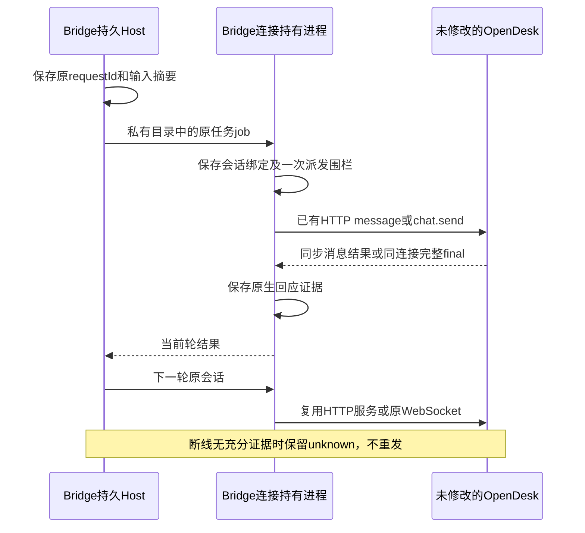

# OpenDesk 原生适配设计

## 连接身份与节点管理准入

M06-F05：同机其他安装的管理unknown不再永久禁用健康独立OpenDesk Desktop接入；中央可信blockedNodeIds、概览、关系图和run保持同一规则。共享安装/目录、原节点、机器/关系及缺身份仍阻止写入；只新增B的管理意图，不查询/重放A。原生协议和能力不变。 [完整设计与失败流程](../../../iterations/I08/connection-identity-node-scope.md)。

原生 MCP 配置解析器会为 STDIO 条目补入 `headers:{}`。Bridge 比较已登记归属时仅将该空对象与缺省等价；非空值、错误类型、其他新增字段或其他修改仍保留冲突。重复添加不重写等价条目、不轮换有效连接；移除仍先撤权，随后只清理可核对归属的条目。原始配置字节仍参与探测绑定，默认值变化不会被当成连接成功。[实现与验收](../../../iterations/I08/opendesk-mcp-defaults.md)。

alpha.46在所有导出格式渲染前统一选择Node启动器，并保存launcherPath用于后台恢复；恢复只刷新私有端点，不改变原生命令或补回外部删除。未登记的同名诊断条目视为冲突，不能覆盖。[本轮证据与边界](../../../iterations/I08/mcp-open-recovery.md)。

所属M06-F05、AB-F02/F07/F08/F10/F11/F13，复用M03/M07/M08/M10。实现只修改AgentBridge，使用OpenDesk已有接口，不构建或替换OpenDesk。原生接口基线已随alpha.46公开；本页新增节点准入修复尚未公开，验收层级见[测试报告](test-report.md)和[本轮记录](../../../iterations/I08/opendesk-existing-interfaces.md)。

## 产品、入口和归属

独立 MCP 文件写入前必须先从托盘完全退出 OpenDesk，确认原生进程停止，写入后再启动。运行中的原生设置实例会在退出保存整份配置，覆盖外部改盘；不能以“写入后再退出”保证生效。操作与真实原生发现证据见[诊断条目恢复](../../../iterations/I08/opendesk-mcp-diagnostic-repair.md)。

`opendesk`代表目标机器当前PATH中的CLI；`opendesk-desktop`代表Windows上已运行的原生桌面网关。账号、模型、Skills、权限和业务工具均由OpenDesk负责，两个入口不互相替代。独立MCP用于OpenDesk主动调用Bridge；其能力不等于Bridge能控制原生执行。

CLI由Bridge以已有命令`serve --mode opencode --hostname 127.0.0.1 --port 0`启动，设置随机HTTP Basic密码，经环境变量传递。命令和原生配置均使用选定安装，不传模型/provider覆盖。HTTP接口虽兼容OpenCode，但节点身份仍是OpenDesk。

Desktop只读本用户`setting.json`中的`applications.devicemgr`设置和`apps/devicemgr/identity/device.json`的设备身份。按原生host/port连接loopback WebSocket；支持本机通配监听映射回loopback，不连接远程地址，不修改网关设置。握手后调用已有`gateway.identity.get`核对本用户网关身份。扫描只连接、核对和关闭，不发消息、不新建会话。

## 执行与会话

| 入口 | 原有调用 | Bridge的映射 |
| --- | --- | --- |
| CLI | `/global/health`、`POST /session`、`GET /session/:id`、`GET /session/:id/message` | 健康、原会话与消息边界检查 |
| CLI | `POST /session/:id/message` | 同步等待该次原生消息执行回应，并读取结果；不使用仅返回204的异步提交推定完成 |
| CLI | `POST /session/:id/abort` | 一次取消请求，ACK不推定任务已取消 |
| Desktop | `chat.send`、`chat.history`、`chat.abort` | 原连接上的发送/历史/停止；`idempotencyKey`仅用于事件关联，不能假设原生去重 |

Bridge保存requestId与输入摘要、原生Session/连接、派发围栏和收到的原生回应。CLI保存提交前消息ID集合，结果必须属于唯一的新用户消息及其父子关系；同步响应与当前Session相符才可结束。读取接口生成的completed时间和idle不是断线恢复的完成证明。原生将错误压平为文本而不能可靠区分时保持unknown。

Desktop的`sessionKey`按**原WebSocket连接**划分。Bridge独立后台连接持有进程在多轮间保留同一连接，使用Bridge会话ID作为sessionKey。原生会话绑定是连接ID与sessionKey的组合，不冒充持久原生Task ID。只接受匹配runId/sessionKey的事件；普通文本分片的final状态不算完整响应，处理器结束时带timestamp的final帧才作为完整回应。错误帧和取消后的含糊结束保持unknown。

桌面网关使用OpenDesk自身的有效工作目录，接口不支持每次传入目录。Bridge不填写目录时读取原生默认目录；显式指定其他目录在提交前拒绝，不把目录放进Prompt。原生目录设置变化后需重启网关，Bridge不控制原生设置。

## 后台与恢复

连接持有进程在Bridge窗口/宿主重开后仍可复用，使用私有owner锁、PID与心跳；空闲30分钟退出。它只停止自己启动的CLI服务，从不退出桌面程序。每个任务先wx领取再写派发围栏，恢复不重新领取或执行原任务。Host显式核对只能启动只读观察器，不能启动原生服务或替代WebSocket。

CLI服务或Desktop原连接丢失后，旧会话停止宣称可续聊；Desktop重连会产生新connId，不复用旧sessionKey恢复原会话。原输入、原结果和unknown占位保留。已保存的严格匹配原生回应可用于只读恢复；只有历史、空查询、idle或时间戳时保持unknown。旧alpha.41控制协议的历史保留，不能按新协议解释或自动迁移执行。

## 能力、配置和兼容

执行、普通被委派、原连接可用时续聊、发送取消请求已实现。**MCP 配置管理按入口分开**：OpenDesk CLI 0.3.8 **没有 MCP 管理面**（`opendesk plugins list` 的 11 个 builtin 插件无 MCP 管理插件、`opendesk plugins tools` 显示无插件工具、`opendesk tools list` 无 MCP 分区，启动还会重写 `setting.json` 的 `applications` 丢弃未识别 app 段），因此 CLI 的 `nativeMcpConfig=false`：`mcp.install` 以 `MCP_NATIVE_CONFIG_UNSUPPORTED` 拒绝，`mcp.status` 为 `state:'unsupported'`，`mcp.export` 仍生成标准片段供 Desktop 或后续版本手动添加。**OpenDesk Windows Desktop 的原生 MCP 条目已可用**：Bridge 按 `%APPDATA%\opendesk\setting.json` 的 `applications.mcpmgr.servers` 写入（原生解析 `this.config?.servers||[]`，字段 `id/name/transport/enabled/command/args/cwd/env/url/headers`），保留其他条目与原模型设置，结构/同名/并发冲突拒绝、移除先撤权。两条硬约束：**(a) 条目必须用真实 Node 启动器**——OpenDesk 的 mcpmgr 无法启动 Bridge 的 Electron 运行时（`命令未找到`／`MCP error -32000: Connection closed`），所以写入时优先使用 PATH 中的真实 `node`，并在状态与连接行报告 `launcher:'node'|'electron'`，Electron 回退时界面明确提示先安装 Node；**(b) 必须完全退出并重开 OpenDesk**——原生只在启动时读取该配置。用户真实 Desktop 0.3.9 上已观察到原生连接并 `discovered 7 tools`（“MCP 管理 → 已安装 MCP”可见 AgentBridge/STDIO/已连接/7 工具），但**真实授权后的工具调用未验**。CLI 的 MCP 调用方状态为“未确认”，Desktop 为“原生可见/已连接/工具可见、调用未验”。见[§14](../../../iterations/I08/mcp-open-integration.md#14-opendesk-原生-mcp-可见性修复2026-10-22alpha45)与[§12.7](../../../iterations/I08/mcp-open-integration.md#127-opendesk-cli-038-无-mcp-管理面结论升级与代码收敛2026-10-22-晚补)。配置由用户操作触发，执行和扫描不修改原生设置。托管scope、小队、Bridge权限/表单/连接验证未开放，能力false并提前拒绝。

原API没有持久request lookup，不要求OpenDesk补充；去重和派发记录属于Bridge。取消ACK缺少当前轮终态语义，取消后不伪造cancelled或succeeded。Windows Desktop 0.3.9原实例真实回复/续聊和窗口重开已完成限定现场验证；真实取消、CLI模型及独立SSH仍须单独实测，不由兼容接口或协议夹具推定。[现场范围](../../../iterations/I08/opendesk-desktop-live.md)。

## 源码

[静态注册](../../../../desktop/electron/builtin-adapters.cjs)、[持久Host](../../../../desktop/electron/native-cli-host.cjs)、[原接口连接](../../../../desktop/electron/opendesk-connection.cjs)、[连接持有worker](../../../../desktop/electron/opendesk-worker.cjs)、[机器目录选择](../../../../desktop/electron/machine-host.cjs)。Bridge包收录这些模块，用户无需安装OpenDesk定制包。

机器页对opendesk/opendesk-desktop使用已注册原生能力门禁，执行能力明确为true时可接入并直接会话；前端未知来源或显式false/null继续拒绝。前端与生产注册表一致性通过遍历回归保证，见[界面门禁修复](../../../iterations/I08/opendesk-ui-admission.md)。
