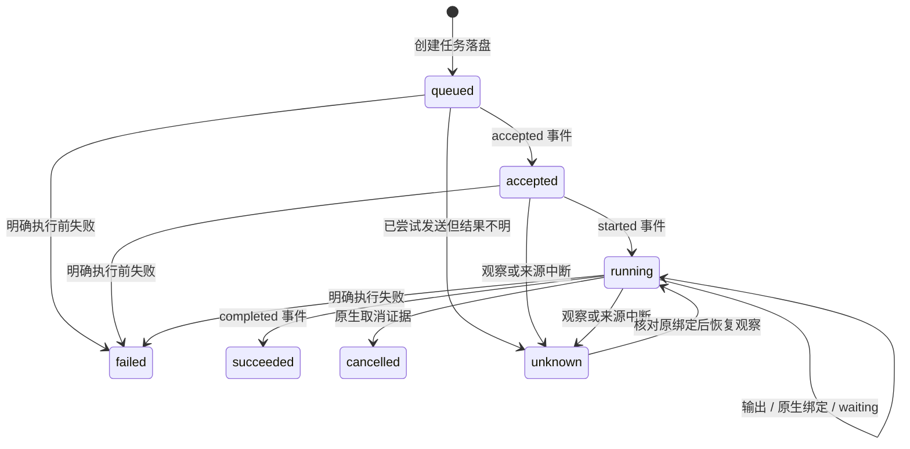
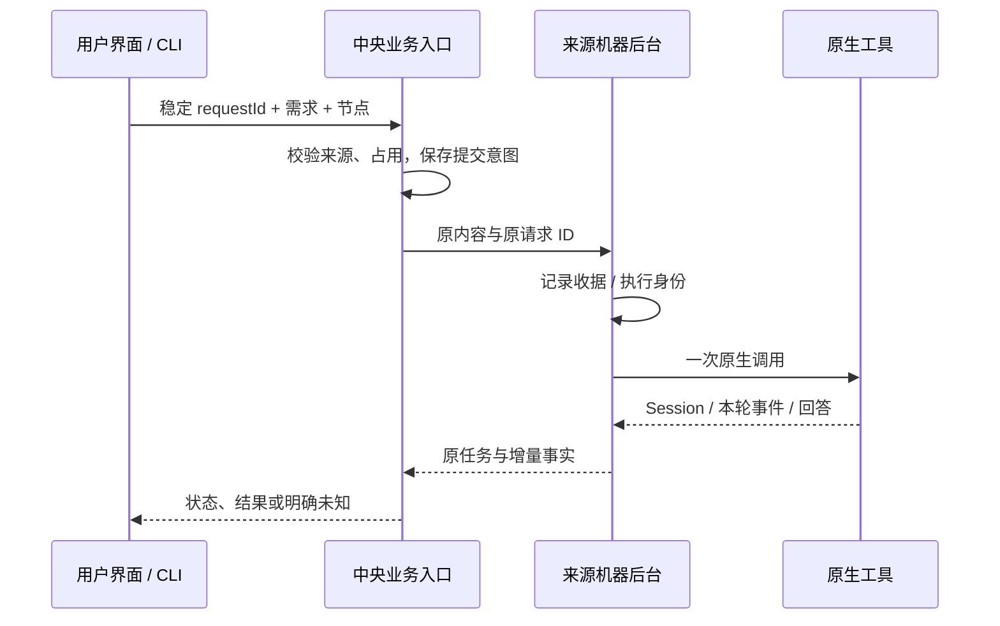

# M07 任务、会话、交互控制与恢复设计

读取归属已失配的旧会话只允许查看，即使宿主保有原生Session也不宣告可继续；不改其Agent、ID或Session，正常绑定和真正legacy能力保留。

## 当前历史详情读取与错误作用域

M07-F02/F06/F07：task/conversation实时未找到只回同机器同ID保留历史，已有轮次及native Session保留，historical=true/canContinue=false；非终态仅在历史投影显示unknown。配置/来源冲突不伪装不存在；不重发/迁移或修改原任务终态。 2026-10-19源码候选alpha.30，GitHub仍alpha.29；[设计、兼容与实际证据](../../iterations/I07/history-detail-recovery.md)。

2026-10-18能力补验：已验证同WSL三个独立Claude宿主的真实公共文档交付/独立复核/原主会话协调；开发与复核成员各一轮，主协调三轮，成员原生成功后才逐项验收，主原生成功后才总完成。原既有权限/事件/预算与接口不变；代码编译返修/独立SSH仍待验证。[范围与真实证据](../../iterations/I07/native-members.md)。

2026-10-18 未发布源码：Hermes/Pi/DSH 原生宿主沿用本模块 Task/Conversation/原请求语义；独立 worker 持久记录原 Session、输出与终态，宿主重开只观察不重放。Pi 续聊必须找到同上下文、原 ID 的唯一原生会话文件；协议/绑定不匹配或在途/unknown 不允许另建会话续接。取消操作先保存原 operationId，原生终态与控制收据分别核对。[设计与验证](../../iterations/I07/native-agent-expansion.md)。

业务验收除原生成功终态外，还须当前有效执行没有continuationError：工作项按当前业务轮次最后一次尝试，独立协调按每成员最后一次尝试。旧轮次/已被后续执行取代的异常保留历史但不永久阻塞。任务验收、直接总验收及延后提议生效前均核对，不改写Core原生终态。此为alpha.28后未发布源码增量，[规则与验证](../../iterations/I07/acceptance-native-binding.md)。

原生Session字段只在非空白字符串且满足既有长度约束时作为绑定/变化证据；空值不建立绑定，也不清除已观察的有效Session。真实非空Session变化仍拒绝协作/后续激活，缺绑定仍不能自动续接。此alpha.28后源码增量未入EXE，[实际规则与验证](../../iterations/I07/blank-native-session.md)。

## 2026-10-17：SSH持久拒绝恢复（alpha.28已预发布）

M07-F01/F06/F07：原SSH节点请求持久拒绝必须匹配认证来源、request/op和原参数摘要，无任务绑定才结算rejected；不把它当成功任务。续聊只绑定原父会话，原任务/会话终态不改，原ID/历史/time/params保留；裸配置查询错误保持unknown。 当前源码/GitHub预发布alpha.28；[完整需求、状态与验证](../../iterations/I06/daemon-rejection-recovery.md)。

## 2026-10-17：Windows未派发与持久化恢复

M07-F06/F07：区分原操作收据和原生任务终态。Codex未派发证明只使原任务failed，中央本地持久化失败证明使原操作rejected；无job、已有worker.log/心跳/事件或已派发均继续unknown并占用。不重发、取消或删除原记录。 alpha.27当次源码与预发布；[需求、状态图、验证与交付](../../iterations/I06/windows-start-persistence.md)。
自动续接的首次任务回应必须匹配持久意图resumeConversationId，不能等待接收外来Conversation后才建立校验；已有conversationId绑定继续严格匹配。错误回应保持待核对，只查原请求恢复。该补强已随alpha.27预发布交付，[实测与边界](../../iterations/I07/intended-conversation.md)。

## 2026-10-17：Windows原请求上下文恢复

M07-F06/F07：Windows原请求恢复不再被另一个没有agentId的未完成上下文遮挡。有身份匹配的原收据才确认；缺收据保留unknown，修复查询路由不构成原任务未派发证明。[完整修复与证据](../../iterations/I06/windows-context-recovery.md)。

原生任务回应须有非空白字符串taskId/conversationId且匹配原request及已有绑定，才可更新小队执行事实；首次不完整回应保持unknown，后续仅查原请求，不能凭succeeded字段撤权、解除占用或验收。该完整身份校验已随alpha.25发布。[完整规则与验证](../../iterations/I07/incomplete-receipt.md)。

2026-10-17能力补验：本机WSL Claude2.1.299自动主角色首轮及原Conversation/原生Session续接后的独立权限等待、观察后台重启、精确隔离Write允许和真实终态已验证；首轮拒绝证据保留于上一专项。不扩大为真实执行成员交接、Windows或独立SSH。见[最新权限证据](../../iterations/I07/resume-native-permission.md)。

## 当前停止工作行为

[停止协调层](../../../desktop/electron/team-stop.cjs)将取消收据与原执行状态分开保存。unknown/未绑定继续占位，原请求匹配后才首次取消；已记录发送但回应不明只查原操作，最后一个原尝试真实终态后归档，不改写原任务成功/失败或业务验收。

停止工作状态为stopping → closed，不向Core Task.status增加stopping；等待字段继续仅公开类别/数量，所有新行为和原请求规则见[停止专项](../../iterations/I07/native-stop.md)。

## alpha.24本地候选 / I07C停止协调

2026-10-16：源码/本地候选alpha.24，GitHub预发布仍alpha.23；I07A/B基础继续适用，完整I07C与I06C未准出。

| 功能 ID | 功能 | 当前状态 |
| --- | --- | --- |
| M07-F08 | 小队工作容器与原执行尝试 | I07A基础继续适用 |
| M07-F09 | 工作项、依赖、版本轮次与业务验收 | I07B源码已实现，实际分层证据见报告 |
| M07-F10 | 原生激活关联、原会话恢复与延后验收 | I07C首批源码实现，证据层级见本模块报告 |
| M07-F11 | 原生取消意图与真实终态后停止 | alpha.24源码实现，实际证据与边界见[停止专项](../../iterations/I07/native-stop.md) |

激活关联持久事件、原attempt/Conversation、实际原生Session私有绑定；没有绑定或明确失败时停止新激活，不暗换会话。unknown仅查原请求，旧scope终态失效。主角色运行中提出总验收仅为awaiting_leader_terminal且accepted=false，原生真实成功且任务/工作修订、权限、新重要事件与其他在途事实均未变化后才completed。暂停/停止调度不取消原任务，不把时间/次数到限当原生终态。

本次源码在小队原执行记录中展示原生权限/输入等待类别和数量，并追加去重系统通知。通知不触发自动激活、不批准权限，也不复制原生问题、工具参数或权限ID。unknown保留上次观察到的等待；只有已核对的非unknown状态才能清除。相同等待跨重启不重复通知，原任务终态清除等待。详见[等待可见性专项](../../iterations/I07/native-waiting.md)。

I07A/B的登记、成员/文档权限、公共消息、版本任务和授权交接继续按[I07B完整行为](../../iterations/I07/task-handoff.md)执行；新流程、异常、预算、接口和源码见[I07C首批交付](../../iterations/I07/automation.md)。以下原功能继续适用。

原功能基线说明（保留原日期/版本，以下原模式继续适用）：更新日期：2026-10-14。本文是当时功能基线，涵盖桌面节点入口和 CLI/Core 兼容入口。它们共享“保留原执行、查询原回执”的原则；不同原生适配器的能力与存储格式不能假设完全一致。

## 1. 功能目标与验收口径


用户发出需求后，应能看到真实执行状态、回答、需要人工处理的权限或表单，以及断线后原任务的结果。继续会话应接续原生会话；无法确认时显示未知，不重复执行来获得一个看似成功的答案。

| 功能 ID | 可验收功能 | 当前状态 |
| --- | --- | --- |
| M07-F01 | 向已接入节点提交需求，保存稳定请求 ID 和一轮任务 | 已实现；Claude/OpenCode 真实验证，Codex 依原生环境 |
| M07-F02 | 在上一轮结束后续聊，保持来源节点及原生会话 | 已实现；Claude/OpenCode 已验证，WSL Codex 原生续聊未通过 |
| M07-F03 | 展示真实状态、增量输出、最终回答和历史轮次 | 已实现；底层增量、前端快照观察，非浏览器直连原工具 |
| M07-F04 | 查询原权限/表单，授权或填写后用原交互 ID 回复 | 已实现但分适配器；不把所有工具能力声明为一致 |
| M07-F05 | 显式取消原任务，分别显示操作回执和任务终态 | 已实现；确认回执不等同原生执行已退出 |
| M07-F06 | 同 ID 同内容去重；内容改变拒绝；未知提交只查询 | 已实现；普通请求及远端 daemon 十次重复受控验证 |
| M07-F07 | 读取原任务、回执、会话；重启和断线后只读对账 | 已实现；无绑定保留 unknown 和占用，不补发 Prompt |

## 2. 对象和身份

Codex/Hermes/Pi/DSH 的 reconcile 沿原 operations 台账保存 kind=reconcile，原 ID 可在观察后台重启后查询；缺 kind 的旧条目按取消解释。同 ID 不同 taskId 或控制类型拒绝，空白 ID 无效。核对 unknown 继续占用原执行，不等于待取消；只有 unknown cancel 阻止换 ID 再发取消。原生终态可推进核对收据，不能从 confirmed 反推任务 succeeded/cancelled。[契约](../../iterations/I07/native-integration-guards.md)。

| 对象 / ID | 用途 | 约束 |
| --- | --- | --- |
| requestId | 一次新需求或续聊的业务幂等键 | 原内容保持不变；桌面按来源机器隔离，Core 按 owner 隔离 |
| conversationId | 用户看见的会话 | 绑定 owner、targetAgent、目录/配置与原生会话 |
| taskId | 会话中的一轮任务 | 每轮新任务，复用同请求 ID 返回原任务 |
| executionId | 一轮的执行身份 | 事件、原生绑定、控制操作必须与它一致 |
| native Session / Message | 原工具真正创建的会话和本轮输入 | 不能为恢复换一个 Session；每轮结果与本轮输入隔离 |
| operationId | 权限回复、表单回复、取消等控制的幂等键 | 与原 taskId、executionId 和交互内容绑定 |
| waiting.requestIds | 原生尚待处理的权限或输入请求 | 不是新的业务 requestId；必须查询原 pending 后处理 |

中央视图为后端对象添加 `machineId::` 前缀，用于路由；原生 Session ID 不因此改变。节点和上下文身份见 [M03](../03-machine-network/design.md)。

## 3. 当前状态机

Core 的任务状态只有下列七种。`waiting` 是任务上的附加对象，通常任务仍为 running；取消进度通过操作回执表示，没有 `waiting_input` 或 `cancel_requested` 状态枚举。

| 状态 | 人类含义 | 是否保留执行占用 |
| --- | --- | --- |
| queued | 已持久化，准备发送 | 是 |
| accepted | 执行端已接收 | 是 |
| running | 驱动已开始，可能等待权限/输入 | 是 |
| succeeded | 已有本轮最终结果 | 否 |
| failed | 已有明确执行前拒绝或执行失败 | 否 |
| cancelled | 已有本轮取消终态证据 | 否 |
| unknown | 缺少足够证据确认结果 | 是 |



终态不能被后续事件改写。普通 unknown 不能直接随意改成 succeeded；Core 对经证实的传输中断会用 lastKnownStatus 接续原事件，对主动对账使用原绑定 `reconciled` 事件。无法证实原执行的记录继续 unknown。

## 4. 新任务和续聊流程



新会话按节点、真实目录、直接/协作模式和当前安装创建或复用私有上下文。安装变化只为新工作建立独立上下文，原上下文的 executable、agentId、Conversation/Session 和请求归属不改写；当前节点汇总历史安装的未知与在途占用。用户未指定目录时后台创建默认目录；上下文不覆盖用户原生模型和供应商。

续聊先读取原 conversation，并验证节点及后端归属。Core 还核对 owner、resourceKey、配置 fingerprint、上一轮终态和 native 绑定。前一轮未知或忙碌，禁止续聊。验证连接的任务不作为普通工作会话续聊。

Core 当前会话轮次上限为 1001；该上限是兼容核心实现约束，不应假设所有原生适配器都有同样上限。

历史上下文曾覆盖模型时，节点入口保留记录并返回 `CONVERSATION_CONFIG`，要求新建沿用原工具配置的会话；不得默默修改旧会话绑定。

## 5. 流式输出与最终结果

原生适配器获取事件或进程标准输出，后台累计输出并保存任务记录。桌面 UI 读取聚合快照和任务详情，当前定时刷新约 1.5 秒；它没有直接订阅原工具的公共流。

因此“支持流式”表示执行期间可观察增量事实，不保证每个 token 立即到界面。最终 `result.message` 与过程日志分别呈现，不应该把逐 token 碎片当成独立完整回答。

Core 事件按 executionId 和连续 seq 接收。重复同 seq 同内容不重复记账；同 seq 内容变化拒绝，跨执行事件拒绝。文本裁剪按 UTF-8 字节且不拆字符，并标记 truncated；超出保留量不能伪装为完整输出。

## 6. 权限、表单和取消

| 操作 | 前置校验 | 实际语义 |
| --- | --- | --- |
| pending | 原任务仍绑定原生执行 | 读取真实尚待处理的权限与表单 |
| reply permission | 原 task/execution、原 requestId、有效 decision | 当前桥接支持 reject 或 once；需要用户真实授权 |
| reply form | 同上，字段类型与必填项校验 | 发送用户填写的回答，不能自动编造缺失信息 |
| cancel | 原 task/execution、稳定 operationId | 请求中断本轮；继续观察才能知道终态 |
| operation | 原任务与原 operationId | 查询已经保存的控制收据，不重新发控制动作 |

操作回执状态为 `attempted`、`confirmed`、`unknown`、`rejected`。Core 重启会将未完成的 attempted 转为 unknown。

同一原生等待请求已经被另一 operationId 占用时，返回 `REQUEST_CLAIMED`。重复原 operationId 同内容只读原收据，改内容返回 `OPERATION_CONFLICT`。一个 execution 的取消不能通过更换 ID 重复发出。

confirmed 表示原控制 API 已给出有效回应；任务 cancelled 需要中断终态证据。原任务已经自然完成时取消回执也可能 confirmed，而任务保持原 succeeded。Codex 取消尤其需要观察原进程退出。

## 7. 持久化与一致性

### 当前连接能力与恢复

M07-F06/F07：新准入不截获已有原requestId或委派收据；普通子任务collaboration:false，不要求被调用方支持MCP。原提交回应丢失仍保留unknown与原占位，观察器重开只读原请求。确定能力拒绝仅结算原操作，不改任务终态；取消收据confirmed与原Task成功/取消分别观察。原关系pending只凭匹配原ID持久拒绝结算，外来收据和裸码不释放。 当前为未发布源码；[完整能力/错误/兼容契约](../../iterations/I07/connection-capabilities.md)及[本模块报告](test-report.md)记录实际范围。

| 记录 | 位置 / 所有者 | 目的 |
| --- | --- | --- |
| `agent-network.json.requests` | 中央 Coordinator | 请求 fingerprint、dispatched、节点/上下文/任务绑定 |
| `pending.json` | 中央 Coordinator | 桌面有副作用操作的原输入、来源与确认状态 |
| `hub.sqlite` | Core Hub | conversations、tasks、events、interactions |
| `edge.sqlite` | Core Edge | executions、payload、invocations、native_bindings、事件 outbox、interactions |
| `daemon-receipts.json` / `daemon-events.jsonl` | 远端 Linux daemon | SSH 原操作回执、顺序事件与重连读取 |
| 原生适配器任务记录 | 各机器上下文目录 | Claude/Codex 等真实进程、会话与本轮记录 |

Core SQLite 使用 WAL、FULL 同步、事务和独立的服务生命周期锁。任务与会话创建在同一事务中；Edge 在驱动调用前保存执行身份、输入和 invocation 标记。写失败不能返回成功 ACK。

这提供“已有证据不重放”的保证，不宣称跨原生进程、网络和多数据库的全局事务恰好一次。极端断点缺少证据时允许保持未知，用保守占用避免二次执行。

## 8. 查询与恢复示例

```json
{"method":"nodeRequest","params":{"op":"continue","nodeId":"node-demo","conversationId":"local-demo::conv-001","requestId":"followup-001","message":"继续解释第二点"}}
```

```json
{"method":"ipc","params":{"op":"request","machineId":"local-demo","requestId":"followup-001"}}
```

```json
{"method":"ipc","params":{"op":"operation","machineId":"local-demo","taskId":"local-demo::task-002","operationId":"cancel-001"}}
```

recoverPending 的本地结果包含 resolved 和可选 remaining/items；未解决原因使用固定脱敏描述，NOT_CONFIGURED 明确表示原后台执行配置未就绪，不表示原任务仍在执行或从未执行。Windows OpenCode 原 submit 的已保存资源 INVALID/MISSING，与完全匹配且无在途执行的原 intent.dispatched===false 共同构成执行前拒绝证明；落盘前再次核验，原 unknown 可记 rejected 并保留原参数/ID/历史。不能仅凭错误码或 not_found 放行。具体兼容范围见 [alpha.18](../../iterations/I06/runtime-recovery.md)。

响应超时后，先用原 requestId / operationId 到原机器查询。其他机器的同名回执不解除本记录的不确定。仅 NOT_FOUND 不足以证明原动作未执行。

关闭观察、关闭窗口、断开机器连接和取消原生任务是不同操作。窗口关闭后中央继续运行；SSH 断开后远端 daemon 继续持有任务。显式停止 Core controller 会停止其拥有的 Hub/Edge/托管原生服务，不能承诺与断开 SSH 相同的生存语义。

## 9. 已知限制与后续设计

- Windows Codex 默认模型被账号拒绝的环境不能成功推理；WSL Codex `thread/resume` 的 `list_turns` 不支持，续聊不能通过桥接补齐。
- Claude 表单存在原生既有限制，Codex 代答表单未完整适配；权限/表单界面按实际能力和真实错误呈现。
- I06A Linux 两轮真实测试证明同桥接会话续聊，原始 JSON 没保留两轮 native Session ID 对比；不能据此宣称独立核验原生 ID 相等。
- 通用 Webhook、外部任意 JSONL 工具和其他 Harness 不是当前已完成任务入口。

## 10. 实现入口与共同维护

原请求/原Session/控制规则在2026-10-19经当前WSL三工具[直接生命周期](../../iterations/I07/connection-native.md)及[MCP六方向委派](../../iterations/I07/connection-delegation.md)补验。新增的是可恢复验收脚本与证据，本模块生产代码/数据/协议未改变；不会用新脚本重放已有未知动作。

状态与类型从 [core.ts](../../../src/core.ts) 开始，Core 数据规则见 [hub-store.ts](../../../src/storage/hub-store.ts)、[edge-journal.ts](../../../src/storage/edge-journal.ts)、[operations.ts](../../../src/storage/operations.ts)。桌面意图、恢复见 [agent-network.cjs](../../../desktop/electron/agent-network.cjs)、[pending-journal.cjs](../../../desktop/electron/pending-journal.cjs)、[coordinator-service.cjs](../../../desktop/electron/coordinator-service.cjs)。各原生能力见 [M06](../06-native-adapters/design.md)。

修改状态、请求去重、续聊、原生绑定或恢复时，同时更新本文、[测试报告](test-report.md)与对应迭代设计/验收。新增状态不能只改 UI 文案；必须核对存储、事件、原生适配器、占用释放和历史兼容。

历史依据：[I03B 会话与恢复](../../iterations/I03B/design.md)、[I04G 原请求恢复](../../iterations/I04G/report.md)、[I05 验收](../../iterations/I05/acceptance.md)、[I06A 进度](../../iterations/I06/progress.md)。

## 2026-10-12：6A 收尾

OpenCode 的 Hub 会话列表和详情增加计算字段 canContinue 与 kind。可续聊要求：已持久绑定原生 Session、上一轮为 succeeded/failed/cancelled、不是验证任务、未达到轮次上限、原配置指纹与目录资源归属仍匹配当前连接。字段只用于告知界面，提交续问仍走原有后端校验。

字段从持久记录计算，不新增数据库记录，也不因为查询而创建原生会话。等待、unknown、无绑定和配置改变不会被显示为可继续。之前原生续聊接口存在，但会话 API 缺少字段，导致 NetworkApp 的发送按钮一直禁用；本次修复的是这一真实使用缺陷。

## I06B 原父与节点呈现

协作 scope 生命周期仍跟随原父 Task。换主/清主不会迁移、重发或取消已委派子任务；活跃原父仍按其 requestId/taskId/conversationId 和来源账本读取、回复或取消旧子，新主不能接管。父终态后该 MCP scope 失效，桌面按原来源核对；同会话后续轮次不自动继承另一个父任务的子权限，详见 [M08](../08-collaboration/design.md)。

图中 uncertain/waiting/lastError 是原 Task 的投影；unknown 仍保持节点占用。布局/授权保存及其 confirmed 收据不改 Task.status、原执行 ID 或执行次数。


alpha.6 原请求恢复接受原 daemon 的持久执行前 AGENT_UNHEALTHY 拒绝，核对为 rejected；仅表示该需求没有被接收，不产生任务失败/取消。原读取缺收据或网络不确定仍 unknown，不释放占位。[恢复实现](../../../desktop/electron/pending-journal.cjs)。

## alpha.9 节点管理与历史续聊

断开/移除只改变 Bridge 接入与可见性，保留请求/任务/会话/上下文/原生 Session 及原来源，原任务仍可读。新 submit/continue/verify 需节点已接入，旧 IPC 同样检查，并在刚导入实例归属后再次核对。界面历史名称从包含 removed 的快照目录读取，不能改指同机器另一同名节点；断开/移除会话暂停续问，原机器重新接入后再按原绑定校验。运行/等待/unknown/原控制回应未确认时禁止节点变更，不把 confirmed 元数据当作取消。详见 [当次节点管理](../../iterations/I06/node-management.md)。

## I06C 当前机器管理与观察恢复

机器编辑/移除不能释放任务、等待、unknown 或原 pending 占位；重连允许原意图未知且只读对账。中央私有已观察历史跨窗口/后台重开保留，后续分页不删除旧项；离线/移除下 task/conversation 可回 historical 快照，非终态 unknown，canContinue=false 且控制暂停。request/operation 收据不使用历史快照确认，恢复沿用原生 Session。 完整接口、事务、当次实际证据与未完成范围见 [6C 首批](../../iterations/I06/machine-management.md)。

## 当前维护与原操作恢复（alpha.13）

原生 request/operation 的确认必须匹配原 ID、来源机器、Task/execution 绑定及明确状态。旧 confirmed 外壳内包含 native unknown 时恢复为 unknown；原 native rejected 收据可读且不重放。缺收据或缺原生终态继续占位。维护拒绝正在运行、等待或未知任务，停止/卸载保留原记录；台账损坏拒绝新写入，表单秘密值不落中央恢复台账。

实现入口：[pending-journal.cjs](../../../desktop/electron/pending-journal.cjs)。需求、分层证据及未测范围见 [I06C 收尾](../../iterations/I06/final-delivery.md)。

## 未派发拒绝与独立会话（alpha.20 已预发布）

同节点或共享目录的未知操作继续占位，不再仅因同属一台机器而阻断独立节点上的新会话/续聊。缺少原资源归属时保留旧保护；后端在真实目录解析后再次检查。窗口显示范围只是后端投影，不能作为原任务结束证明。

submit/continue 的上下文、原会话读取或协作 scope 准备错误，会在原意图保存 preparationRejection；只有原始台账与未派发意图匹配、无任务/会话绑定及在途 job 时才记 rejected。同 ID 不重新执行，修好配置后发新请求。旧记录必须有最初保存的 NOT_CONFIGURED 和同样未派发依据，或符合原 Windows OpenCode 资源错误规则；本次查询失败不能替代这些证据。[专项](../../iterations/I06/pending-isolation.md)。
