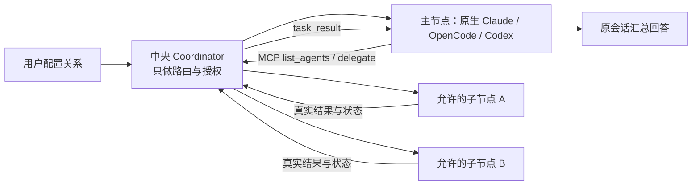
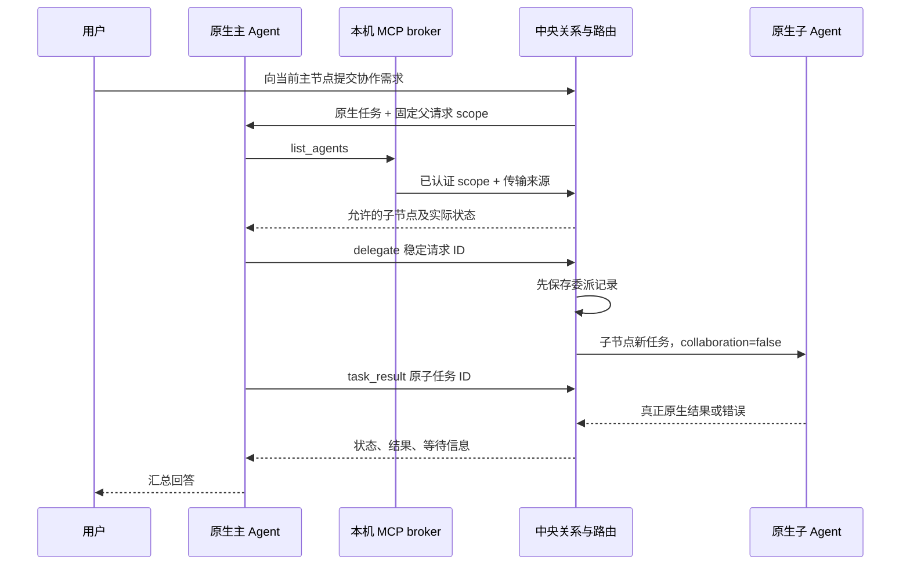

# M08 主 Agent、子 Agent 与协作通道设计

当前公开alpha.71，冻结1b2e371。226产品输入与实际EXE3406资源匹配；SSH只读维护入口、原ID查询和明确确认替换分层验收，源码/EXE/SHA公开且匿名完整下载一致。[当前发布与边界](../../iterations/I08/alpha71-release.md)。


M08-F01/F02：Hermes仍可接收collaboration=false的普通委派，独立MCP调用不变，hostManagedTask仍false。Hermes取消能力收窄为false；原任务失联保持unknown，不换ID、节点或目录重派。新增发现与原生网关兼容不扩大其他Agent或小队能力。 [完整需求、源码和验证](../../iterations/I08/alpha65-hermes-windows.md)。

M08-F02/F03/F04/F05：保持主节点且提交严格更小的成员集合，或清空主节点与全部成员，属于纯撤权。它不重新准入移除/保留的旧角色，不因节点离线或能力失效而拒绝。其余保存只对新增成员与新主做准入；换主不会自动给其他节点授权。关系自身unknown、不可信台账和修订/原ID冲突保持；撤权不取消旧任务或迁移原父读控。已随alpha.64公开，[关系撤权与目标作用域](../../iterations/I08/relation-revocation-scope.md)。

### CT-05原包传递与接收声明

新增同工作原包持久传递、目标读取/匹配收据和桌面按需只读审计；小队MCP22项，经典10不变。原state版本3/receipts结构保持，独立SQLite表与写收据原子提交；无调度、任务或权限副作用。当前本地alpha.63已打包交付，Pi→固定源码Hermes原生组件传递7组已验；真实父模型消费待验。完整字段、当前身份/可见性、原ID恢复、容量/错误和源码见[原包传递设计](../../iterations/I07/context-delivery.md)。

## 配置与审计控制台

M08-F02/F05/F07/F08/F09/F10：桌面仅负责用户配置与审计，成员日常任务、消息、文档正文、报告、返修与验收通过已有工作MCP按原身份执行。建立工作作用域只保存目标/标准/成员，不调用模型；用户独占成员访问、文档编辑者、自动预算和直接交接授权，保留暂停/停止/归档。原生工具目录及后台授权规则保持，隐藏日常UI不扩大成员权限。team.operation投影已有原actor收据的ID/内容指纹；不同原方法/参数不能复用操作ID，params.method不能覆盖实际方法，撤权后不能读缓存证明。[本片完整流程与验证](../../iterations/I07/configuration-console.md)。

M08-F02/F03/F05：当前连接/预授权与原ID收据语义已补Pi/Linux、Pi/Windows、固定源码Hermes/Linux原生客户端组件证据；每链7组，明确允许/拒绝及撤权后旧confirmed不恢复权限已验，模型0。原关系/协议不改，[证据与未完成](../../iterations/I08/native-policy-components.md)。

## CT-08当前关系模型

M08-F02/F03/F05：索引v3含envelope.version1/revision/allowedNodeIds；v1/v2按原成员迁移，不自动扩大范围或启用原非selected行。各主一个启用出站关系，成员可兼任其他主。Agent仅在自己范围内连接/断开，范围外原请求须用户明确确认；断开保留预授权，用户撤权删范围防自动重连，原任务读控/unknown不变。各主策略/确认/安全审计页面已实现，旧图仍编辑selected；完整真实原生多主未准出。 [完整契约、验证与边界](../../iterations/I07/connection-policy.md)。

## 当前 OpenDesk 生命周期与关系作用域

M08-F02/F03/F04/F05：无关节点管理 unknown 不再全局禁用独立 MCP 主节点草稿；保存只核对新增成员与新主的资源；未变化旧成员不重新准入。原关系 unknown及缺失来源/范围仍拒绝，可信node/machine未知仅在命中新目标的原节点/同安装/共享目录或机器范围时阻止。设置草稿不写后台；保存使用一个原 operationId，同 ID 幂等，原 A 的参数、时间、错误与占用保留，不附加查询/重派。MCP客户端、托管scope、原生加载与工具事实仍独立。 [需求、流程与失败边界](../../iterations/I08/opendesk-lifecycle-relation-scope.md)。

M08-F01/F02/F05：十入口均有独立MCP客户端声明，OpenDesk CLI仍无Bridge原生写入适配；Pi/Hermes可按独立MCP维度作主，旧来源未知/false不放宽。托管scope/小队仅原三种工具；角色资格与原生父模型实测分开。原生禁用/删除不会自动撤销旧缓存授权，revoke/remove才撤权，原关系/台账保持。 [最终实现、原始证据与范围](../../iterations/I08/hermes-mcp-config.md)。

M08-F02/F05：DSH Desktop独立接入保存原生目标绑定，仅影响配置归属与清理。原生选择切换不迁移授权或原委派，安装竞态拒绝时回滚登记；撤权先于原目标清理，unknown与旧台账不变。 [实现与分层验收](../../iterations/I08/dsh-desktop-mcp.md)。

独立 OpenDesk MCP 的已登记 STDIO 条目仅兼容空 `headers` 默认值差异；状态、安装和清理共享归属判断，未登记或其他字段变化仍拒绝覆盖。此兼容不授予新关系、不修改原委派台账、不延长探测有效期。[当前规则与验收](../../iterations/I08/opendesk-mcp-defaults.md)。

## MCP02恢复与观测（2026-10-22）

MCP连接和工具目录观测不授予主角色，不证明原生调用或委派。撤权后已连接stdio客户端立即被拒绝，外部配置删除只改变配置事实。 [实现、原始证据与未测项](../../iterations/I08/mcp-open-recovery.md)。

I08-MCP02统一开放MCP与双向配置已完成源码第一片：主角色准入与托管任务scope注入分开判定，独立MCP调用方可以作主而托管绑定单独显示为未适配，见本页[主角色准入与托管scope](#主角色准入与托管scope注入的分离)；逐入口真实原生验收仍待执行。[本轮开发与验收记录](../../iterations/I08/mcp-open-integration.md)。

OpenDesk可以接收普通委派。独立原生MCP连接以单独connectionId按已保存的关系委派和读取结果，撤权先于配置删除；托管会话scope与小队未适配，在业务意图落盘和原生派发前拒绝。独立MCP能力不推导临时scope能力。 [实现与证据边界](../../iterations/I08/opendesk-existing-interfaces.md)。

## alpha.36整合边界

M08-F01：alpha.36整合基线含公开alpha.35执行资源级保护/原查询反馈与所有工作区增量；OpenCode宿主和原管理拒绝恢复并存，原身份/Session/unknown不迁移。精确收录alpha.34/35 daemon清单，客户端升级不自动替换远端。[完整交付](../../iterations/I07/alpha36-delivery.md)。

## 普通子会话最小协作上下文

M08-F03/F05：仅新delegate在既有当前授权检查后选择固定v1说明，要求执行单项需求、在本会话报告结果/证据/未完成项并交回主Agent，需要额外信息/权限时说明。上下文不含父对话、Task/Conversation/connectionId/节点或机器身份，不注入MCP/TeamScope，不改变现有独立工具授权。新台账可选contextVersion=1在派发前保存，message保持原需求；缺字段历史原文，不支持版本DELEGATION_CONTEXT_UNSUPPORTED保留unknown。原准备拒绝仅按原机器/节点/ID、明确未派发和该版本完整输入指纹严格结算。文本是感知说明，不是访问控制或模型遵守证明；当前经典10/小队22工具与原结果/取消/权限规则保持，关系读取已按当前调用方出站关系处理。[完整输入、恢复与证据](../../iterations/I07/delegation-context.md)。

## 按当前调用方查看连接

M08-F02/F03/F05/F06：list_agents只接受空参数，身份由原机器/原父或独立enabled连接确定。返回caller的nodeId/machineId、native-parent或external-connection、leader/member/unassigned；delegationAuthorized与not_leader/parent_unknown/caller_unsupported解释新委派授权，允许时block=null，不替代状态/资源准入。各主沿原snapshot观察，await后按原nodeId读取自己的最新启用关系再筛选当前memberIds，排除自身；非主返回空items且不查其他节点。保留原items字段并加schema=1/readOnly=true/view=authorized-connections/relationRevision。原父终态、外来机器及独立连接撤权沿原入口拒绝，不公开私有连接ID或父Task/Conversation，不列incoming主或全网。原父查询完成后才为既有新委派准入取当前关系，防止旧主副本绕过等待期间的撤权；角色模型、原委派读控和去重/原请求策略保持。[完整字段、流程与范围](../../iterations/I07/agent-connections.md)。

## 原委派发现与作用域（M08-F04/F05）

源码新增list_delegations({limit?,after?})，默认20/最多50；原生按leader和原父request/task/conversation交集，独立接入按非空connectionId/原父范围且parentTaskId=null过滤，不能以空身份匹配。游标只允许当前作用域原委派ID，额外身份参数拒绝；移除子关系保留原父读控，失效父/撤销独立接入仍拒绝。

只投影原ID、已有taskId、ledgerState和安全元数据，无Prompt/目录/结果/秘密，不查子工具或写/恢复台账。ledgerState非实时，已有taskId再用task_result；无taskId保留unknown与原请求，不补发。多主共享存储不改变既有六工具的原父读控语义，完整CT-07未完成。[完整当前契约](../../iterations/I07/delegation-list.md)。

## DSH Desktop / Web 当前行为

M08-F01：DSH Desktop/Web与headless同为普通被委派目标；静态execution/delegation为true，bridgeMcp/teamCollaboration为false。不因出现图标或接入成功使其成为主Agent或小队执行成员；原关系授权与经典delegate作用域保持，方向准入测试覆盖新增两入口。 [完整契约与证据](../../iterations/I07/dsh-desktop-web.md)。公开alpha.34不包含该能力；本地.dsh.3候选已构建并验证真实连接，Desktop模型两轮均RATE_LIMIT，独立SSH未验，见[本地交付](../../iterations/I07/dsh-exe-delivery.md)。

## OpenCode 1.x / 2.x 兼容修复

M08-F01：OpenCode 1.x 托管 scope 使用原生 mcp.agentbridge，不写 V2 codemode；独立连接安装/导出记录其协议，删除用原布局。Bridge scope、connectionId、原请求与 token 撤销规则保持，配置格式兼容不代表真实模型协作验收。 [需求、实现、验证与未测边界](../../iterations/I07/opencode-v1-compatibility.md)。

## 当前版本准入与管理作用域

M08-F02/F03/F04：OpenCode版本不兼容时执行/委派能力关闭，关系与原历史保留。relation未知仍阻断非布局元数据；node/machine管理未知按新增成员与新主资源判断，来源不明仍阻止授权编辑；原请求/派生ID及确定拒绝证明规则保持。 [完整规则与证据](../../iterations/I07/version-management-recovery.md)。

## 独立 MCP 配置与运行契约

M08-F02/F05：McpIntegration登记长期外部接入并导出独立三格式文件，通过McpConfig合入原生用户配置。broker核对接入仍enabled，中央核对来源机器、节点、当前主从关系和原委派范围。移除先撤权后删自己拥有的条目；被外部修改则保留并报冲突，重装换新connectionId。长期接入不冒充原生父Task；托管任务/小队仍沿用原scope和权限。[配置/数据/失败流程与源码](../../iterations/I07/mcp-installation.md)。

[Projects/Dots/Grok Bot研究](../../iterations/I07/projects-dots-bots-research.md)补充公共索引、产物目录、可见交接与按需读取上下文的建议。当前仍为既有登记/工作/文档/消息/任务契约；没有新增私信RPC、实体MD同步或跨工作自动记忆。原生上下文和公共协作材料继续分开。

连接核心、各Agent方向能力与后续目标见[接入矩阵](../../agent-integration-matrix.md)，通信负载、可选ACP、Multica及公共MD/上下文方案见[研究](../../iterations/I07/connectivity-research.md)。未新增协议、原生执行或公开能力。

Hermes/Pi/DSH 直接会话尚未实现 Bridge MCP 注入（`hostManagedTask=false`），MachineHost 在配置协作 scope 前明确拒绝；Hermes/Pi/DSH均已声明独立MCP客户端，相关原生配置已随alpha.51.recovery.2公开，真实自主父模型未验。托管scope能力与独立MCP调用能力分开判定：能独立调用不等于能接收Bridge注入的托管scope，反之亦然。经典delegate以`collaboration:false`提交普通子任务，其被调用源码路径可达，但未进行三种真实Agent委派/最终包验收；不能把不能注入MCP等同于不能被委派。CT-01已按调用方/被调用方分别统一关系、任务与界面门禁，受控完整普通委派链通过；真实工具与最终包仍未验。自定义原生适配器要另行实现作用域注入并验收后才声明调用方能力。[扩展范围](../../iterations/I07/native-agent-expansion.md)、[开发指南](../../custom-agent-development.md)。

业务验收除原生成功终态外，还须当前有效执行没有continuationError：工作项按当前业务轮次最后一次尝试，独立协调按每成员最后一次尝试。旧轮次/已被后续执行取代的异常保留历史但不永久阻塞。任务验收、直接总验收及延后提议生效前均核对，不改写Core原生终态。该规则尚未进入公开 EXE，[规则与验证](../../iterations/I07/acceptance-native-binding.md)。

原生Session字段只在非空白字符串且满足既有长度约束时作为绑定/变化证据；空值不建立绑定，也不清除已观察的有效Session。真实非空Session变化仍拒绝协作/后续激活，缺绑定仍不能自动续接。该规则尚未进入公开 EXE，[实际规则与验证](../../iterations/I07/blank-native-session.md)。

## Windows未派发与持久化恢复

M08-F02：关系/布局/图操作与普通网络保存共享有界原子替换，EPERM/EACCES/EBUSY最多6次，ENOSPC等不重试。原revision、稳定操作ID、磁盘成功后更新事务状态及unknown权限保护不变；没有扩大Agent权限。 [需求、状态图、验证与交付](../../iterations/I06/windows-start-persistence.md)。
自动续接的首次任务回应必须匹配持久意图resumeConversationId，不能等待接收外来Conversation后才建立校验；已有conversationId绑定继续严格匹配。错误回应保持待核对，只查原请求恢复。[实测与边界](../../iterations/I07/intended-conversation.md)。

原生任务回应须有非空白字符串taskId/conversationId且匹配原request及已有绑定，才可更新小队执行事实；首次不完整回应保持unknown，后续仅查原请求，不能凭succeeded字段撤权、解除占用或验收。[完整规则与验证](../../iterations/I07/incomplete-receipt.md)。

## 当前停止工作行为

仅本机用户可通过[TeamSpace](../../../desktop/electron/team-space.cjs)发起整项工作停止；要求原revision，原子关闭自动授权、撤销所有成员scope并清除待生效总验收。成员MCP无停止工具，正文不能授权停止其他工作；既有材料保留。外部成员访问已撤销不代表自身进程已取消。

停止工作状态为stopping → closed，不向Core Task.status增加stopping；等待字段继续仅公开类别/数量，所有新行为和原请求规则见[停止专项](../../iterations/I07/native-stop.md)。

## 停止协调

I07A/B基础继续适用，完整I07C与I06C未准出；当前发布状态见[迭代发布记录](../../iterations/release-ledger.md)。

| 功能 ID | 功能 | 当前状态 |
| --- | --- | --- |
| M08-F07 | 小队、公共文档、群消息与成员授权 | 公开基础保留；本地63新增同工作明确选材传递/目标接收声明，当前授权每次重验，撤权不清历史或恢复访问 |
| M08-F08 | 成员直接授权交接与主角色验收 | 源码已实现；63选材传递不构成交接或主角色业务验收，不触发自动事件 |
| M08-F09 | 用户授权的事件协作和主角色持续跟进 | 源码已实现；证据层级见本模块报告 |
| M08-F10 | 用户停止工作并撤销协作访问 | 源码已实现；实际证据与边界见[停止专项](../../iterations/I07/native-stop.md) |

用户独占自动成员/预算设置权，主角色只在目标与任务范围内分配/交接/验收，不能自我唤醒或给自己分配执行任务。就绪、成员报告、成员原轮结束及明确协调请求形成去重事件；普通群消息/已读不触发模型，合并重要事件后原会话继续。失败并立即返修也保留主角色事件；外部接手和旧轮过期事件及时结算。无进展检查每个进展位置一次，原生权限仍走用户原机制。

小队原执行记录展示原生权限/输入等待类别和数量，并追加去重系统通知。通知不触发自动激活、不批准权限，也不复制原生问题、工具参数或权限ID。unknown保留上次观察到的等待；只有已核对的非unknown状态才能清除。相同等待跨重启不重复通知，原任务终态清除等待。详见[等待可见性专项](../../iterations/I07/native-waiting.md)。

I07A/B的登记、成员/文档权限、公共消息、版本任务和授权交接继续按[I07B完整行为](../../iterations/I07/task-handoff.md)执行；新流程、异常、预算、接口和源码见[I07C首批交付](../../iterations/I07/automation.md)。以下原功能继续适用。

当前是单默认组、单层委派。真实 Windows/WSL 协作已发布；节点图与旧父权限修复已实现；独立设备与 EXE 验收状态以 I06B 报告为准，不能由源码或同宿主链推定。

## 1. 功能目标

M08-F02/F05/F07：scopedCollaborationTool同时接受原生父owner与长期MCP owner；共享原ID派生、持久准备拒绝、目标成员权限及原结果/控制归属。长期接入无伪造父Task，撤权不删除原历史或取消任务；材料引用/MD不扩大权限。TOML升级仅处理配置解析，不增加模型/Agent接入能力。 [实现与实际证据](../../iterations/I07/integrated-source.md)。

用户指定哪个已安装工具作为主 Agent，以及它可以连接哪些子 Agent。真正推理和规划的是用户选定的原生主工具，中央 Coordinator 只管理关系、身份、路由、回执和结果，不内置另一个默认大模型。

主 Agent 在当前原生会话中发现允许的子节点、委派真实任务、等待或查询结果，最后汇总给用户。子 Agent 不会因为收到任务就获得继续扩张节点网络的权力。

| 功能 ID | 用户可验收功能 | 当前状态 |
| --- | --- | --- |
| M08-F01 | 按主身份保存多条出站授权，重开保留，各行过期修订拒绝覆盖 | 默认单组已发布；本地A2已支持后台多主，旧图仍编辑selected；CT-01新关系按主MCP调用/子普通委派能力准入，确定拒绝可原ID恢复 |
| M08-F02 | 主 Agent 只发现用户允许的子节点，显示机器和忙碌状态 | 源码已实现；来源机器和主执行 scope 后台校验 |
| M08-F03 | 委派真实子任务，稳定 ID 去重，子节点不继续委派 | 源码已实现；Windows/WSL 四条真实链通过 |
| M08-F04 | 主会话读取/等待子结果，查询 pending、回复和取消自己委派的任务 | 源码已实现；原父会话及活跃 scope 限制 |
| M08-F05 | 在原生工具中接入 MCP，通过本机 broker 转到中央路由 | 源码已实现；真实 stdio MCP 验证 |
| M08-F06 | 撤销子关系阻止新委派，并在明确边界内保留旧任务读取 | 已发布；活跃原父可按原账本读控旧子，新委派仍检查当前关系 |

任务本身、取消回执和不确定恢复见 [M07](../07-task-session/design.md)，节点身份见 [M03](../03-machine-network/design.md)。

## 2. 一个协作组如何运行

I07A/B当前边界和I07C后续设计（以下旧流程不变）：

| 事项 | 当前行为或后续设计 |
| --- | --- |
| 公共空间 | 群消息追加、共享文档修订、任务状态分开；小队内公共，不是互联网公开 |
| 权限 | 用户控制成员/授权；主角色分工/验收；队员修改本人工作，其他交接需明确规则 |
| 通知 | 持久保存/交付/已读/接手/完成分开，接收人独立游标；普通发言不自动执行 |
| 直接协作 | 交接任务变化与通知同一持久操作；编译错误引用原任务/版本报告，主角色全程可见 |
| 持续跟进 | I07C待实现：重要事件激活且预算有效才续接；一个在途激活，unknown先查原请求 |
| 作用域 | 新工作成员授权+每次手动原生回合，不能扩大旧父scope；旧在途记录不自动迁移 |

细节与正常/失败流程维护在[完整候选设计](../../iterations/I07/design.md)，参考出处见[调研](../../iterations/I07/claude-projects-research.md)。



关系里的主/子是 Agent 节点，不是项目目录或模型。节点可以处于不同执行环境；主节点不需要在 Windows，但必须拥有当前已提交主任务的协作身份。

直接聊天与协作聊天使用不同上下文键。开启协作时，原生工具获得当前上下文的 MCP 配置和主 Agent 指令；普通直接任务不会自动获得协作权限。Codex 每个带 MCP 的新会话/续聊回合在原始需求前收到协作指引，明确先查 agentbridge MCP 的允许子节点，不能以 Codex 内部 Agent 列表只有 `/root` 判断 Bridge 无连接。工具缺失或报错应报告协作通道故障；实现见 [Codex 设计](../06-native-adapters/codex/design.md)。

## 3. 数据和身份

| 记录 | 字段与作用 |
| --- | --- |
| collaboration | `leaderId`、`memberIds`、`revision`；当前只有 default 组 |
| 主请求 | nodeId、machineId、requestId、contextId、collaboration、dispatched |
| scope | broker 固定绑定 `nodeId`、`parentRequestId`；不能由工具参数冒充 |
| delegation | delegationId、派生 requestId、leaderId、memberId、parentRequestId、parentTaskId、parentConversationId、子 taskId / conversationId、state |
| MCP endpoint | 本机环回 URL 和随机内部 token，写入私有描述文件 |

中央的关系、主请求和委派在 `agent-network.json`。每台机器的 broker scope 在 `bridge-scopes.json`，上下文描述在 `node-contexts/<contextId>/bridge-endpoint.json`；MCP 客户端副本放入机器后台的 `runtime/`。

内部 token 用于本机回调认证，不是用户需要录入的设备接入凭据。SSH 接入仍使用既有系统账号认证。

## 4. 保存关系

## 主角色准入与托管scope注入的分离

M08-F01/F02/F05：本轮把“能否调用Bridge MCP”和“能否把一次托管任务绑定到单次scope”拆成两个独立答案，二者不再互相代替：

| 判定 | 依据 | 用途 |
| --- | --- | --- |
| 可作主Agent | `execution=true` 且 `mcpClient=true`（旧投影`bridgeMcp`） | 设为主、发现获准子节点、发起新委派 |
| 可接收普通委派 | 目标 `delegation=true` | 经典`delegate`（`collaboration:false`） |
| 可注入托管scope | `hostManagedTask=true` 且节点未显式声明不支持 | 由Bridge托管的单次任务注入 |

因此OpenDesk/DSH Web这类“有MCP客户端但托管注入未适配”的入口可以作主并保存子节点授权，只是不能走Bridge托管的scope注入；被拒绝的只是该执行场景，返回明确的“独立MCP接入可用、托管注入未适配”，不回退成“不能调用MCP”。Pi/Hermes在alpha.50本地候选按独立MCP维度可作主，托管scope仍未适配；旧来源未知的mcpClient不能被推断为可作主。

任务归属规则不变：托管任务保留原`parentRequestId`/Task/Conversation作用域；独立会话以`connectionId`归属，不伪造父Task、不降级到无任务绑定的全局身份。原生删除/禁用只改变配置事实，不撤销仍有效的缓存客户端授权；显式revoke/remove后新调用被阻止并说明原因。主角色历史、原关系、旧任务和unknown占位不自动清空。前端、中央、MachineHost与daemon使用同一套语义。

实现落点：[builtin-adapters.cjs](../../../desktop/electron/builtin-adapters.cjs#L119)（`supportsTeamCollaboration`/`supportsIndependentMcp`/`connectionCapabilities`）、[agent-network.cjs](../../../desktop/electron/agent-network.cjs#L225)（协作派遣前的能力准入）、[machine-host.cjs](../../../desktop/electron/machine-host.cjs#L117)（`scope` 只按托管维度拒绝）、[connection-capabilities.ts](../../../desktop/src/connection-capabilities.ts#L1)（界面同一口径与理由文案）。受控用例见[本模块报告](test-report.md)；真实独立主调用链与托管委派仍未验收。

### 当前连接能力与恢复

M08-F01/F02/F03/F05/F06：保存新关系要求主节点execution=true且具备MCP调用能力（`mcpClient`；旧快照的`bridgeMcp`为同一投影），子节点delegation=true；本机静态注册与明确元数据收窄共同决定。托管任务scope注入是独立维度（`hostManagedTask`），不再是作主的前提，见[主角色准入与托管scope注入的分离](#主角色准入与托管scope注入的分离)。经典delegate子任务使用collaboration:false，Hermes/Pi/DSH可被普通委派；Pi与DSH的独立MCP声明不等于小队注入，Hermes/Pi独立MCP调用方已声明但完整自主父模型未验。已有原操作/委派先查询，不让新能力检查阻断恢复；历史关系展示保留但不能据历史主身份新发协作任务。MCP list_agents追加能力/来源，不泄漏执行/模型/认证配置。 当前为未发布源码；[完整能力/错误/兼容契约](../../iterations/I07/connection-capabilities.md)及[本模块报告](test-report.md)记录实际范围。

用户提交 operationId、expectedRevision、完整主/成员集合，指定其他关系时另带relationId并强制原operationId。后台先查原收据，同 ID 同内容返回原结果；改变内容返回 OPERATION_CONFLICT。新保存校验新增成员/新主存在、已接入及各自执行/委派/MCP能力，同时校验每行唯一主/启用主身份无重复、无重复成员/自连与该行期望修订，随后在 agent-network.json 同一次原子替换中提交关系 revision+1 和 relationOperations 收据。坐标/状态不能成为授权。过期修订返回 REVISION_CONFLICT，前端保留草稿；收据最多 4096 项，到限明确拒绝，不删除未确认历史来释放占位。兼容旧内部调用不带 operationId 时返回原 collaboration 形状；新图入口总使用稳定 ID 和中央图意图台账。

```json
{"method":"saveCollaboration","params":{"operationId":"relation-save-example","leaderId":"node-main","memberIds":["node-child-a","node-child-b"],"expectedRevision":3}}
```

关系与 relationOperations 收据在同一临时文件写入、fsync 后原子替换；先持久化图意图，再执行保存。稳定 operationId 对同内容返回原收据，对不同内容拒绝；新操作独立核对 expectedRevision。回应未知只查询原 collaborationOperation，不能靠重读关系、换 ID 或重放保存解除占位。

关系修改不会迁移原任务到新主节点，不会取消子任务，也不会把旧任务结果复制为新主的委派记录。

## 5. 主任务与真实委派流程



后台从主节点、父 conversationId 和 Agent 提供的稳定委派 requestId 派生中央子请求 ID。同 ID 同内容查询原委派；目标、消息或目录改变返回 `REQUEST_CONFLICT`。跨主会话即便使用同一个短 requestId，也不会串成同一子任务。

先记委派意图，再调用节点提交。收到忙碌等明确执行前拒绝记为 rejected；无法确认是否执行记为 unknown。子节点原请求台账再次保证查询原任务，不能为“重试”换新 requestId 绕过占用。

## 6. 当前工具 API

### 公共工作材料读取（M08-F07/F08，CT-04/05）

当前小队MCP有22项，增加 `team_context_packet({targetAgentId,selections})`。只允许原工作有效成员作目标，先核对调用者原scope，再对文档准确revision、任务当前revision/round、消息ID/seq、产物ID/version作白名单投影；单类8项、完整响应256 KiB。输出包返回调用者，不发消息、不转已读、不派发/交接、不授予目标权限；引用与包ID都不是访问凭据。职责与外部正文不能覆盖原授权。旧后台不支持时明确失败，不用当前索引伪造包。[完整当前流程、错误和验证](../../iterations/I07/context-packet.md)。

CT-04桌面原索引/文档MD入口保持；CT-05现已补明确目标/四类材料选材、核对预览及本机MD/JSON副本。客户端核对原引用/报告来源/摘要，从结构化字段重建Markdown；观察到撤权/所选任务变化或切工作时失效。该消费者不改变工具授权或产生发送/交接/已读，实体同步与自动推送仍未实现；显式持久传递/接收声明见本页CT-05新契约。[当前桌面行为与证据](../../iterations/I07/context-packet-ui.md)。下方CT-04记录不能作为新包/CT-05全部验收。

桌面M01已复用这些只读方法提供按需索引、精确修订及当前页/单份文档MD下载。它核对响应身份/修订/正文摘要，丢弃旧工作迟到结果；文件只是阅读副本，不授予成员资格、不写小队操作/任务/收据或验证引用可达。该桌面实现没有增加MCP/IPC方法或交接授权；后续整合与CT-05按上方当前范围，不把历史测试当新接口验收。[桌面限定证据](../../iterations/I07/public-materials-ui.md)。

CT-04 实现范围：小队MCP有17项，包含新增 `team_materials({limit?,documentAfter?})`，工作来自原成员scope；不属于下方经典主从六工具。用户入口 `team.materials` 另需runId。limit默认20/最大50，游标须属于该工作；JSON/Markdown同源，文档只含标题/修订/摘要/版本引用，无正文和私有接入字段。目标/成员职责/当前任务报告/产物/原生状态与消息观察位置只读投影，未读不转已读，引用不代表可达。

`team_document({documentId,revision?})` 指定revision时返回准确的title/content/authorId/time、revision/currentRevision及contentSha256，不附全部history；正整数非法报TEAM_INPUT，不存在报TEAM_DOCUMENT_REVISION，不回退。无revision保持原完整当前文档响应。先授权再查文档，引用不授予成员资格；跨工作/撤权/无效原生尝试继续拒绝。旧后台/旧工具表须按实际schema/返回revision辨别，不假定支持新字段。普通委派不强制建立公共工作；当前已有CT-04桌面MD副本及上方CT-05瞬时只读包，实体同步仍未实现；显式持久传递见本页CT-05新契约。[完整当前契约与验证](../../iterations/I07/public-materials.md)。

经典主从MCP在本地alpha.60暴露十个操作（公开alpha.53仍七个），与上方小队工具集合分开；原生客户端可按自己的命名空间显示为 `agentbridge_*`。

| 工具 | 关键参数 | 输出与限制 |
| --- | --- | --- |
| list_connectable | 无身份参数 | 只读自己的预授权目标，非全网络发现 |
| connect_agent | nodeId/operationId/queryOnly? | 范围内连接，范围外只登记待用户确认，原ID查收据 |
| disconnect_agent | 同上 | 仅断开该主当前授权，保留预授权及原任务 |
| list_delegations | 可选limit/after，身份来自原scope | 只读列自己的原委派ID/台账状态，不查询实时任务或结算unknown |
| list_agents | 无节点身份参数 | 返回当前关系允许的子节点、machine、status、busy、能力 |
| delegate | nodeId、message、requestId，可选 workspace | 返回真实子任务与 delegationId；目标必须已授权 |
| task_result | taskId，可选 waitMs | 最多等待 45 秒；终态、unknown、waiting 或超时立即返回实际状态 |
| task_pending | taskId | 查询本父会话委派任务的真实权限/表单 |
| reply_task | taskId、operationId、原 requestId、action 与回答 | 只处理原 pending；权限只有 reject / once，需要用户授权 |
| cancel_task | taskId、operationId | 请求取消自己的子任务；回执不等同进程已结束 |

```json
{"name":"delegate","arguments":{"nodeId":"node-child-a","requestId":"review-001","message":"检查此项目的测试覆盖并报告","workspace":"/home/user/project"}}
```

```json
{"name":"task_result","arguments":{"taskId":"ssh-demo::task-child-001","waitMs":30000}}
```

工具请求的 callId 是一次 RPC 调用标识，不是业务去重依据；委派依靠 requestId，控制依靠 operationId。

## 7. 权限判定和重要当前边界

新原生小队登记以及历史已登记成员的新执行，必须支持注册表 teamCollaboration，并且节点没有显式声明不支持。Hermes/Pi/DSH 当前支持普通原生执行/接收委派，尚不支持MCP小队注入，拒绝为 TEAM_CAPABILITY，发生在认领工作项/持久尝试之前。自动激活能力同样区分“小队不支持”和“支持手动但自动续接未支持”；不能对前三种新工具提示手动小队执行。原 operationId 的幂等分支先读取原尝试，继续仅核对原请求；外部 MCP 的独立入口与原三种工具手动流程保持。[设计与验收](../../iterations/I07/native-integration-guards.md)。

每次协作调用先校验传输来源机器与 scope.nodeId 的真实归属，再验证父 requestId 的持久主请求、collaboration=true、已提交及原父仍活跃。原父终态使其 MCP scope 失效。新委派另查当前 leader 与实时 memberIds；父状态 unknown 不允许新委派。旧子查询/控制按 leaderId、原 parentRequestId、parentTaskId、parentConversationId 的委派账本核验，不因换主转给新父。

| 情况 | 当前行为 |
| --- | --- |
| 伪造节点/来源、未授权目标、自我或递归委派 | 拒绝 |
| 另一个父请求/任务或新主接管原子任务 | 拒绝；同 Conversation 也不替代原父任务归属 |
| 当前主撤销某子关系 | 新委派拒绝；活跃原父仍可读控原账本内已委派子 |
| 换主/清主后旧父仍活跃 | list_agents 返回空，新委派拒绝；原子结果/等待/回复/取消仍按原归属核验 |
| 父任务已终态 | 原 MCP scope 全部拒绝；人类从桌面按来源查询原任务 |
| 父状态 unknown | 保留归属与原子只读/控制边界，不新委派 |

收据 confirmed 不代表子任务成功或取消；控制仍依 M07 原执行/交互 ID。具体反例与真实覆盖见 [报告](test-report.md)。

## 8. MCP 与机器通信

`mcp-client.cjs` 是 stdio JSON-RPC 客户端，响应 initialize、ping、tools/list、tools/call。每次工具调用重新读取私有 endpoint 描述，使用 bearer token 请求本机 `127.0.0.1` broker 的 `/tools`。

broker 将 token 对应 scope 与业务参数分开，中央宿主/远端 relay 提供真实传输来源。节点身份和父任务身份不由 Agent 自报参数决定。broker 仅监听环回地址，单请求上限 128 KiB，超时约 65 秒。

原生账号、模型、工作区文件权限继续由原工具控制。MCP 接入和针对桥接工具的审批适配不意味着开放普通文件系统或任意终端权限；主 Agent 不可通过终端绕过关系去控制其他节点。

## 9. 当前边界与后续设计

机器分组节点图、草稿与稳定关系收据、独立布局、原操作台账以及旧父权限已实现，来源见 [实施说明](../../iterations/I06/graph-implementation.md)。原生 MCP 工具集合、父子需求 requestId、来源路由及协议版本未改变。

双向独立 Linux 的真实验收须分别记录实际 list_agents/delegate/task_result、子原生回复与父汇总；Windows/WSL 同宿主历史不能替代。完整网络故障、daemon 升级回滚、所有原生权限类型及最终 0.6.0 准出继续属于 I06C。多组、多层委派、模型管理和外部 Harness 未纳入本默认组。

## 10. 实现入口与维护

当前WSL三工具的生产MCP发现、普通委派、真实结果读取与汇总已完成[六个有向组合验证](../../iterations/I07/connection-delegation.md)：每链一个真实主Task与两个真实子Task，原父/机器/派生ID/消息精确核对；子任务collaboration:false，原父终态后scope失效。新增仅为验收脚本/保护测试，本模块生产协议、权限和行为无改动，历史Windows/SSH证据保持各自范围。

关系与权限从 [agent-network.cjs](../../../desktop/electron/agent-network.cjs) 的 `saveCollaboration`、`collaborationTool` 阅读；MCP 接入见 [machine-host.cjs](../../../desktop/electron/machine-host.cjs)、[collaboration-broker.cjs](../../../desktop/electron/collaboration-broker.cjs)、[mcp-client.cjs](../../../desktop/electron/mcp-client.cjs)。

变更关系、scope、委派 ID、查询权限或图交互时，同步本文、[测试报告](test-report.md)、对应迭代设计及验收；特别保留换主、清空关系、父任务终态的反例。

历史依据：[I05 协作设计](../../iterations/I05/collaboration-design.md)、[I05 验收](../../iterations/I05/acceptance.md)、[I06B 图与权限设计](../../iterations/I06/graph-design.md)。

## 节点生命周期对授权的影响

配置入口合并到机器图同页。断开/移除节点撤销其在所有关系中的成员身份，并清空其所有出站授权；每条受影响关系的revision单独增一，并与节点状态和原操作收据原子提交。接回原节点不恢复已撤销权限。relation未确认写入仍阻断节点管理，node未确认只阻断命中的新增授权角色；纯撤权独立，图位置不参与授权。节点必须空闲且来源可核对才能变更；任何原父对旧任务的读控仍按原账本及活跃 scope 校验，不转交给新主。详见 [节点管理说明](../../iterations/I06/node-management.md)。

## 当前机器管理与观察恢复

机器移除根据原 machineId 的全部节点撤销当前授权：主节点在该机则清主及所有当前子边，仅子节点在该机则删对应成员。removedMachines、collaboration 与 machineOperations 原收据同网络文件原子提交；SSH 配置提交与此文件间用原收据补齐，未知屏障阻止新元数据写入。历史父子任务保留，恢复不重新授予协作权限。 完整接口、事务、实际证据与未完成范围见 [6C 首批](../../iterations/I06/machine-management.md)。

## 当前维护与原操作恢复

协作 scope 与旧父归属不变，维护屏障也作用于 MCP 对目标机器的新原生准入，避免仅锁界面仍可委派。所属机器 maintenance unknown 时不换地址/节点绕过；其他来源机器的已有会话仍可执行。卸载明确确认后撤销当前新委派权限，历史父子任务与结果保留，控制 confirmed 不能替代子任务终态。

实现入口：[agent-network.cjs](../../../desktop/electron/agent-network.cjs)。需求、分层证据及未测范围见 [I06C 收尾](../../iterations/I06/final-delivery.md)。


M08-F02/F03/F05：关系冲突保持严格只读；新增连续原收据链核验、明确确认后的逐字节备份与原子恢复，selected/envelope 同步且历史不变。缺顺序的机器撤权收据不猜测恢复。[完整行为与边界](../../iterations/I08/relation-conflict-diagnostic.md)。

## 当前源码：#27/#28 的观察与恢复边界

M08-F02/F03/F05：[关系恢复器](../../../desktop/electron/relation-recovery.cjs)逐修订验证唯一真实变更；attach及无关节点无变更的disconnect只作观察，须与已证明的同修订状态一致，不能另算候选或授予权限。已在selected基线内的确定策略/连接收据不阻止后续链；基线后的无完整授权结果仍拒绝。图unknown仅在原方法、允许字段、完整参数指纹及原operationId的持久confirmed结果准确匹配时可作为已核对观察，不修改unknown行，不重发操作。其余未知、来源缺失、矛盾、跳号、多个真实候选和无顺序的机器撤权仍只读。恢复前逐字节备份/摘要核对，原子提交只改selected/envelope并追加恢复收据；其他关系与原任务/收据保持。

完整流程、受控反例与未测边界见[本轮记录](../../iterations/I08/issues27-28-current-state.md)。
