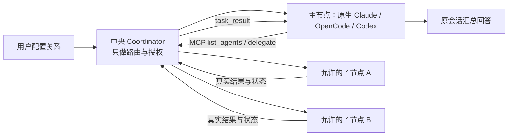
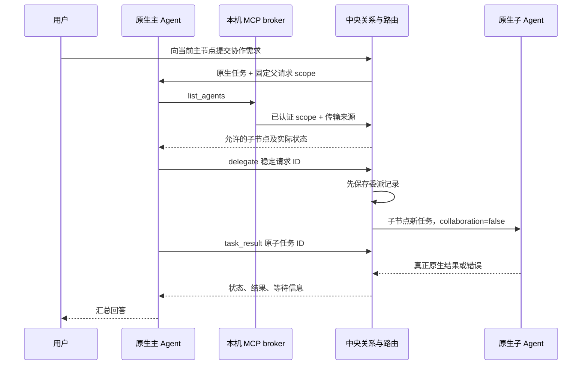

# M08 主 Agent、子 Agent 与协作通道设计

## 2026-10-17：Windows未派发与持久化恢复

M08-F02：关系/布局/图操作与普通网络保存共享有界原子替换，EPERM/EACCES/EBUSY最多6次，ENOSPC等不重试。原revision、稳定操作ID、磁盘成功后更新事务状态及unknown权限保护不变；没有扩大Agent权限。 alpha.27当次源码与预发布；[需求、状态图、验证与交付](../../iterations/I06/windows-start-persistence.md)。
自动续接的首次任务回应必须匹配持久意图resumeConversationId，不能等待接收外来Conversation后才建立校验；已有conversationId绑定继续严格匹配。错误回应保持待核对，只查原请求恢复。该补强已随alpha.27预发布交付，[实测与边界](../../iterations/I07/intended-conversation.md)。

原生任务回应须有非空白字符串taskId/conversationId且匹配原request及已有绑定，才可更新小队执行事实；首次不完整回应保持unknown，后续仅查原请求，不能凭succeeded字段撤权、解除占用或验收。该完整身份校验已随alpha.25发布。[完整规则与验证](../../iterations/I07/incomplete-receipt.md)。

2026-10-17能力补验：本机WSL Claude2.1.299自动主角色首轮及原Conversation/原生Session续接后的独立权限等待、观察后台重启、精确隔离Write允许和真实终态已验证；首轮拒绝证据保留于上一专项。不扩大为真实执行成员交接、Windows或独立SSH。见[最新权限证据](../../iterations/I07/resume-native-permission.md)。

## 当前停止工作行为

仅本机用户可通过[TeamSpace](../../../desktop/electron/team-space.cjs)发起整项工作停止；要求原revision，原子关闭自动授权、撤销所有成员scope并清除待生效总验收。成员MCP无停止工具，正文不能授权停止其他工作；既有材料保留。外部成员访问已撤销不代表自身进程已取消。

停止工作状态为stopping → closed，不向Core Task.status增加stopping；等待字段继续仅公开类别/数量，所有新行为和原请求规则见[停止专项](../../iterations/I07/native-stop.md)。

## alpha.24本地候选 / I07C停止协调

2026-10-16：源码/本地候选alpha.24，GitHub预发布仍alpha.23；I07A/B基础继续适用，完整I07C与I06C未准出。

| 功能 ID | 功能 | 当前状态 |
| --- | --- | --- |
| M08-F07 | 小队、公共文档、群消息与成员授权 | I07A基础继续适用 |
| M08-F08 | 成员直接授权交接与主角色验收 | I07B源码已实现，实际分层证据见报告 |
| M08-F09 | 用户授权的事件协作和主角色持续跟进 | I07C首批源码实现，证据层级见本模块报告 |
| M08-F10 | 用户停止工作并撤销协作访问 | alpha.24源码实现，实际证据与边界见[停止专项](../../iterations/I07/native-stop.md) |

用户独占自动成员/预算设置权，主角色只在目标与任务范围内分配/交接/验收，不能自我唤醒或给自己分配执行任务。就绪、成员报告、成员原轮结束及明确协调请求形成去重事件；普通群消息/已读不触发模型，合并重要事件后原会话继续。失败并立即返修也保留主角色事件；外部接手和旧轮过期事件及时结算。无进展检查每个进展位置一次，原生权限仍走用户原机制。

本次源码在小队原执行记录中展示原生权限/输入等待类别和数量，并追加去重系统通知。通知不触发自动激活、不批准权限，也不复制原生问题、工具参数或权限ID。unknown保留上次观察到的等待；只有已核对的非unknown状态才能清除。相同等待跨重启不重复通知，原任务终态清除等待。详见[等待可见性专项](../../iterations/I07/native-waiting.md)。

I07A/B的登记、成员/文档权限、公共消息、版本任务和授权交接继续按[I07B完整行为](../../iterations/I07/task-handoff.md)执行；新流程、异常、预算、接口和源码见[I07C首批交付](../../iterations/I07/automation.md)。以下原功能继续适用。

原功能基线说明（保留原日期/版本，以下原模式继续适用）：更新日期：2026-10-14。当时是单默认组、单层委派。真实 Windows/WSL 协作已发布；alpha.6 已实现节点图和旧父权限修复；独立设备与 EXE 验收状态以 I06B 报告为准，不能由源码或同宿主链推定。

## 1. 功能目标


用户指定哪个已安装工具作为主 Agent，以及它可以连接哪些子 Agent。真正推理和规划的是用户选定的原生主工具，中央 Coordinator 只管理关系、身份、路由、回执和结果，不内置另一个默认大模型。

主 Agent 在当前原生会话中发现允许的子节点、委派真实任务、等待或查询结果，最后汇总给用户。子 Agent 不会因为收到任务就获得继续扩张节点网络的权力。

| 功能 ID | 用户可验收功能 | 当前状态 |
| --- | --- | --- |
| M08-F01 | 保存一个主节点和多个子节点，重开保留，过期修订拒绝覆盖 | alpha.6 通过图草稿编辑；稳定操作收据与修订原子提交 |
| M08-F02 | 主 Agent 只发现用户允许的子节点，显示机器和忙碌状态 | 已实现；来源机器和主执行 scope 后台校验 |
| M08-F03 | 委派真实子任务，稳定 ID 去重，子节点不继续委派 | 已实现；Windows/WSL 四条真实链通过 |
| M08-F04 | 主会话读取/等待子结果，查询 pending、回复和取消自己委派的任务 | 已实现；原父会话及活跃 scope 限制 |
| M08-F05 | 在原生工具中接入 MCP，通过本机 broker 转到中央路由 | 已实现；真实 stdio MCP 验证 |
| M08-F06 | 撤销子关系阻止新委派，并在明确边界内保留旧任务读取 | alpha.6 已修复；活跃原父可按原账本读控旧子，新委派仍检查当前关系 |

任务本身、取消回执和不确定恢复见 [M07](../07-task-session/design.md)，节点身份见 [M03](../03-machine-network/design.md)。

## 2. 一个协作组如何运行

I07A/B当前边界和I07C后续设计（以下旧流程不变）：

| 事项 | 当前行为或后续设计 |
| --- | --- |
| 公共空间 | 群消息追加、共享文档修订、任务状态分开；小队内公共，不是互联网公开 |
| 权限 | 用户控制成员/授权；主角色分工/验收；队员修改本人工作，其他交接需明确规则 |
| 通知 | 持久保存/交付/已读/接手/完成分开，接收人独立游标；普通发言不自动执行 |
| 直接协作 | 交接任务变化与通知同一持久操作；编译错误引用原任务/版本报告，主角色全程可见 |
| 持续跟进 | I07C待实现：重要事件激活且预算有效才续接；一个在途激活，unknown先查原请求 |
| 作用域 | 新工作成员授权+每次手动原生回合，不能扩大旧父scope；旧在途记录不自动迁移 |

细节与正常/失败流程维护在[完整候选设计](../../iterations/I07/design.md)，参考出处见[调研](../../iterations/I07/claude-projects-research.md)。



关系里的主/子是 Agent 节点，不是项目目录或模型。节点可以处于不同执行环境；主节点不需要在 Windows，但必须拥有当前已提交主任务的协作身份。

直接聊天与协作聊天使用不同上下文键。开启协作时，原生工具获得当前上下文的 MCP 配置和主 Agent 指令；普通直接任务不会自动获得协作权限。Codex 每个带 MCP 的新会话/续聊回合在原始需求前收到协作指引，明确先查 agentbridge MCP 的允许子节点，不能以 Codex 内部 Agent 列表只有 `/root` 判断 Bridge 无连接。工具缺失或报错应报告协作通道故障；实现见 [Codex 设计](../06-native-adapters/codex/design.md)。

## 3. 数据和身份

| 记录 | 字段与作用 |
| --- | --- |
| collaboration | `leaderId`、`memberIds`、`revision`；当前只有 default 组 |
| 主请求 | nodeId、machineId、requestId、contextId、collaboration、dispatched |
| scope | broker 固定绑定 `nodeId`、`parentRequestId`；不能由工具参数冒充 |
| delegation | delegationId、派生 requestId、leaderId、memberId、parentRequestId、parentTaskId、parentConversationId、子 taskId / conversationId、state |
| MCP endpoint | 本机环回 URL 和随机内部 token，写入私有描述文件 |

中央的关系、主请求和委派在 `agent-network.json`。每台机器的 broker scope 在 `bridge-scopes.json`，上下文描述在 `node-contexts/<contextId>/bridge-endpoint.json`；MCP 客户端副本放入机器后台的 `runtime/`。

内部 token 用于本机回调认证，不是用户需要录入的设备接入凭据。SSH 接入仍使用既有系统账号认证。

## 4. 保存关系

用户提交 operationId、expectedRevision 和完整主/成员集合。后台先查原收据，同 ID 同内容返回原结果；改变内容返回 OPERATION_CONFLICT。新保存校验所有节点存在、已接入并支持执行、唯一主、无重复/自连与期望修订，随后在 agent-network.json 同一次原子替换中提交关系 revision+1 和 relationOperations 收据。坐标/状态不能成为授权。过期修订返回 REVISION_CONFLICT，前端保留草稿；收据最多 4096 项，到限明确拒绝，不删除未确认历史来释放占位。兼容旧内部调用不带 operationId 时返回原 collaboration 形状；新图入口总使用稳定 ID 和中央图意图台账。

```json
{"method":"saveCollaboration","params":{"operationId":"relation-save-example","leaderId":"node-main","memberIds":["node-child-a","node-child-b"],"expectedRevision":3}}
```

当前 alpha.6 将关系与 relationOperations 收据在同一临时文件写入、fsync 后原子替换；先持久化图意图，再执行保存。稳定 operationId 对同内容返回原收据，对不同内容拒绝；新操作独立核对 expectedRevision。回应未知只查询原 collaborationOperation，不能靠重读关系、换 ID 或重放保存解除占位。

关系修改不会迁移原任务到新主节点，不会取消子任务，也不会把旧任务结果复制为新主的委派记录。

## 5. 主任务与真实委派流程



后台从主节点、父 conversationId 和 Agent 提供的稳定委派 requestId 派生中央子请求 ID。同 ID 同内容查询原委派；目标、消息或目录改变返回 `REQUEST_CONFLICT`。跨主会话即便使用同一个短 requestId，也不会串成同一子任务。

先记委派意图，再调用节点提交。收到忙碌等明确执行前拒绝记为 rejected；无法确认是否执行记为 unknown。子节点原请求台账再次保证查询原任务，不能为“重试”换新 requestId 绕过占用。

## 6. 当前工具 API

MCP 暴露的是六个操作，原生客户端可按自己的命名空间显示为 `agentbridge_*`。

| 工具 | 关键参数 | 输出与限制 |
| --- | --- | --- |
| list_agents | 无节点身份参数 | 返回当前关系允许的子节点、machine、status、busy、能力 |
| delegate | nodeId、message、requestId，可选 workspace | 返回真实子任务与 delegationId；目标必须已授权 |
| task_result | taskId，可选 waitMs | 最多等待 45 秒；终态、unknown、waiting 或超时立即返回实际状态 |
| task_pending | taskId | 查询本父会话委派任务的真实权限/表单 |
| reply_task | taskId、operationId、原 requestId、action 与回答 | 只处理原 pending；权限只有 reject / once，需要用户授权 |
| cancel_task | taskId、operationId | 请求取消自己的子任务；回执不等同进程已结束 |

```json
{"name":"delegate","arguments":{"nodeId":"node-child-a","requestId":"review-001","message":"检查此项目的测试覆盖并报告","workspace":"/home/user/project"}}
```

```json
{"name":"task_result","arguments":{"taskId":"ssh-demo::task-child-001","waitMs":30000}}
```

工具请求的 callId 是一次 RPC 调用标识，不是业务去重依据；委派依靠 requestId，控制依靠 operationId。

## 7. 权限判定和重要当前边界

每次协作调用先校验传输来源机器与 scope.nodeId 的真实归属，再验证父 requestId 的持久主请求、collaboration=true、已提交及原父仍活跃。原父终态使其 MCP scope 失效。新委派另查当前 leader 与实时 memberIds；父状态 unknown 不允许新委派。旧子查询/控制按 leaderId、原 parentRequestId、parentTaskId、parentConversationId 的委派账本核验，不因换主转给新父。

| 情况 | 当前行为 |
| --- | --- |
| 伪造节点/来源、未授权目标、自我或递归委派 | 拒绝 |
| 另一个父请求/任务或新主接管原子任务 | 拒绝；同 Conversation 也不替代原父任务归属 |
| 当前主撤销某子关系 | 新委派拒绝；活跃原父仍可读控原账本内已委派子 |
| 换主/清主后旧父仍活跃 | list_agents 返回空，新委派拒绝；原子结果/等待/回复/取消仍按原归属核验 |
| 父任务已终态 | 原 MCP scope 全部拒绝；人类从桌面按来源查询原任务 |
| 父状态 unknown | 保留归属与原子只读/控制边界，不新委派 |

收据 confirmed 不代表子任务成功或取消；控制仍依 M07 原执行/交互 ID。具体反例与真实覆盖见 [报告](test-report.md)。

## 8. MCP 与机器通信

`mcp-client.cjs` 是 stdio JSON-RPC 客户端，响应 initialize、ping、tools/list、tools/call。每次工具调用重新读取私有 endpoint 描述，使用 bearer token 请求本机 `127.0.0.1` broker 的 `/tools`。

broker 将 token 对应 scope 与业务参数分开，中央宿主/远端 relay 提供真实传输来源。节点身份和父任务身份不由 Agent 自报参数决定。broker 仅监听环回地址，单请求上限 128 KiB，超时约 65 秒。

原生账号、模型、工作区文件权限继续由原工具控制。MCP 接入和针对桥接工具的审批适配不意味着开放普通文件系统或任意终端权限；主 Agent 不可通过终端绕过关系去控制其他节点。

## 9. 当前 I06B 与后续边界

机器分组节点图、草稿与稳定关系收据、独立布局、原操作台账以及旧父权限已实现，来源见 [本次实施](../../iterations/I06/graph-implementation.md)。原生 MCP 工具集合、父子需求 requestId、来源路由及协议版本未改变。

双向独立 Linux 的真实验收须分别记录实际 list_agents/delegate/task_result、子原生回复与父汇总；Windows/WSL 同宿主历史不能替代。完整网络故障、daemon 升级回滚、所有原生权限类型及最终 0.6.0 准出继续属于 I06C。多组、多层委派、模型管理和外部 Harness 未纳入本默认组。

## 10. 实现入口与维护

关系与权限从 [agent-network.cjs](../../../desktop/electron/agent-network.cjs) 的 `saveCollaboration`、`collaborationTool` 阅读；MCP 接入见 [machine-host.cjs](../../../desktop/electron/machine-host.cjs)、[collaboration-broker.cjs](../../../desktop/electron/collaboration-broker.cjs)、[mcp-client.cjs](../../../desktop/electron/mcp-client.cjs)。

变更关系、scope、委派 ID、查询权限或图交互时，同步本文、[测试报告](test-report.md)、对应迭代设计及验收；特别保留换主、清空关系、父任务终态的反例。

历史依据：[I05 协作设计](../../iterations/I05/collaboration-design.md)、[I05 验收](../../iterations/I05/acceptance.md)、[I06B 图与权限设计](../../iterations/I06/graph-design.md)。

## alpha.9 节点生命周期对授权的影响

配置入口合并到机器图同页。断开/移除子节点撤销该成员；断开/移除主节点清空当前主节点与全部子授权；仅当关系受影响时 revision 增一，并与节点状态和原操作收据原子提交。接回原节点不恢复已撤销权限。node/relation 未确认写入互锁，图位置不参与授权。节点必须空闲且来源可核对才能变更；任何原父对旧任务的读控仍按原账本及活跃 scope 校验，不转交给新主。详见 [当次说明](../../iterations/I06/node-management.md)。

## I06C 当前机器管理与观察恢复

机器移除根据原 machineId 的全部节点撤销当前授权：主节点在该机则清主及所有当前子边，仅子节点在该机则删对应成员。removedMachines、collaboration 与 machineOperations 原收据同网络文件原子提交；SSH 配置提交与此文件间用原收据补齐，未知屏障阻止新元数据写入。历史父子任务保留，恢复不重新授予协作权限。 完整接口、事务、当次实际证据与未完成范围见 [6C 首批](../../iterations/I06/machine-management.md)。

## 当前维护与原操作恢复（alpha.13）

协作 scope 与旧父归属不变，维护屏障也作用于 MCP 对目标机器的新原生准入，避免仅锁界面仍可委派。所属机器 maintenance unknown 时不换地址/节点绕过；其他来源机器的已有会话仍可执行。卸载明确确认后撤销当前新委派权限，历史父子任务与结果保留，控制 confirmed 不能替代子任务终态。

实现入口：[agent-network.cjs](../../../desktop/electron/agent-network.cjs)。需求、分层证据及未测范围见 [I06C 收尾](../../iterations/I06/final-delivery.md)。
