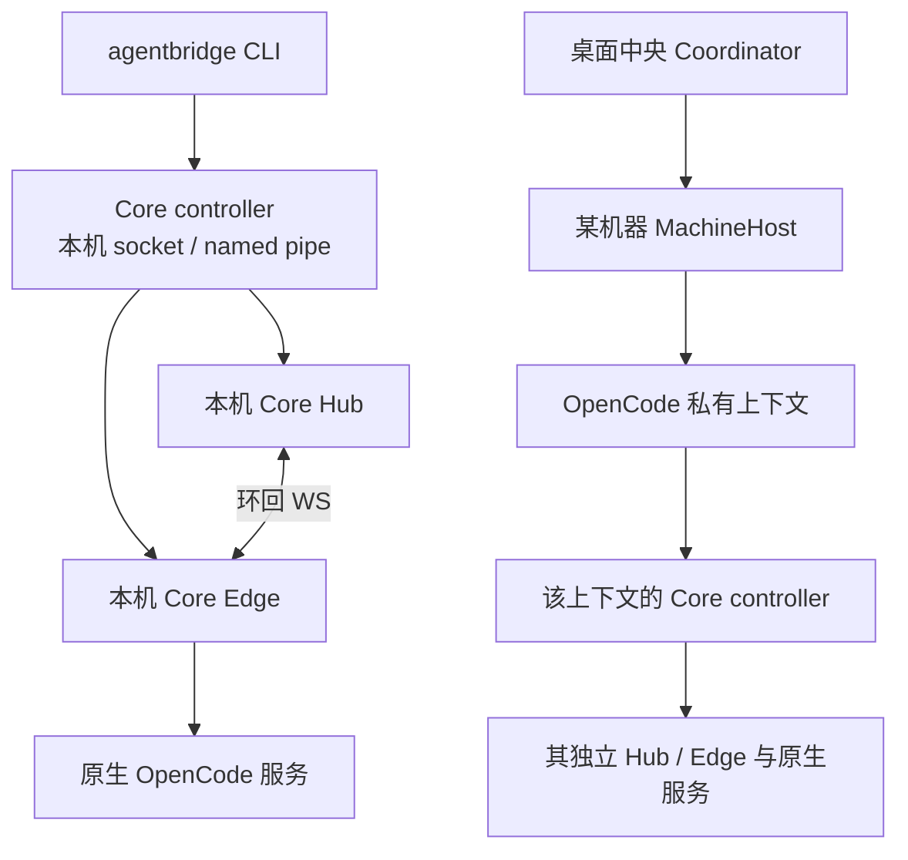
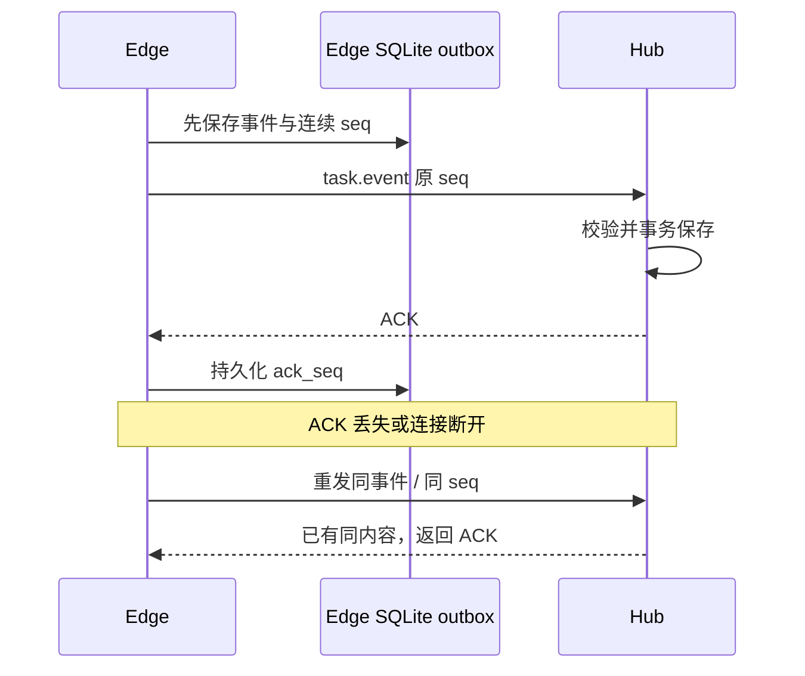

# M09 CLI、Core controller 与本机 Hub/Edge 设计

M09-F01：非GUI Linux发现复用Hermes专用安装目录，支持最小PATH与独立安装根；已有MCP管理CLI、原模型配置和原请求恢复契约不变，不把CLI可见性作为模型/权限可用证明。 [本轮实现、验证与限制](../../iterations/I08/alpha66-hermes-linux.md)。

M09-F01：非GUI入口复用同一Hermes发现、stream-json宿主和独立MCP适配，不增加任意命令、供应商API或账号层。Windows补原生bin发现，活动Hermes任务在原生会话停止，CLI取消不模拟网关终止。 [完整需求、源码和验证](../../iterations/I08/alpha65-hermes-windows.md)。

HostConnection关闭使用仅内存的启动代次和原子进程引用：枚举迟到不spawn，原请求不能落到新通道，未写关闭保留明确未派发、已写后失联仍按原ID查询。CLI/controller/Task/Session和持久协议均未改变。[关闭竞态修复](../../iterations/I08/wsl-close-and-graph-stability.md)。
M09：现有六项mcp方法统一支持Pi/Hermes；Hermes新增独立YAML导出文件，profile只读回显，CLI不用新参数猜Profile。原生列表用安全摘要保留失败原因，不能把plain list当连接；原JSON脱敏和原请求查询保持。 [最终实现、原始证据与范围](../../iterations/I08/hermes-mcp-config.md)。

M09：Core stdio入口仅在AGENTBRIDGE_HOST_READY=1时，行读取器安装后输出bridgeReady:1、protocol:agentbridge-host-v1；未设置标志的原生直连保持原回应流。并发或失败语义不改变原业务方法与CLI JSON脱敏契约。 [完整需求、实现、原始证据与限制](../../iterations/I08/wsl-host-readiness.md)。

M09-F01：mcp status显示DSH Desktop绑定Profile、原配置/当前配置路径和原生选择核对错误；MCP_NATIVE_TARGET_CHANGED是拒绝，MCP_DSH_DESKTOP_TARGET是原生目标不可核对，均不转换为成功或重放原操作。 [实现与分层验收](../../iterations/I08/dsh-desktop-mcp.md)。

## MCP02恢复与观测（2026-10-22）

非GUI新增nodes、attach和原操作查询operation；稳定operationId与桌面profile共享；打包manifest取真实版本、离线包随后台暂存。JSON保留授权状态枚举，隐藏凭据。 [实现、原始证据与未测项](../../iterations/I08/mcp-open-recovery.md)。

## OpenCode 1.x / 2.x 兼容修复

M09-F01：Core 接受可识别 1.x/2.x 并只读握手选择原生协议；Edge 使用统一 reply/interrupt 客户端分派，operationId 仍先持久且控制不重试。V1 permission/question 映射复用原表单校验；禁工具验证入口仍仅核验过 2.0.24。 [需求、实现、验证与未测边界](../../iterations/I07/opencode-v1-compatibility.md)。

Windows Core Controller 后台启动及显式版本检查使用 windowsHide；保留 detached、日志与原身份/任务归属，CLI 前台交互不变。[桌面空闲专项](../../iterations/I07/desktop-polling.md)。

CLI 是已交付的本机 OpenCode 使用和自动化入口；Core Hub/Edge 也是 OpenCode 桌面适配器内部使用的兼容执行链。它与当前桌面中央 Coordinator、SSH daemon 分属不同层，不应混称一个公网中央 server。

## 1. 功能定位与当前范围

直接运行 `agentbridge` 进入中文向导/菜单，一个终端完成发现、接入、提交、观察、续聊、权限回复和取消。命令退出后后台可以保留；日常不需要用户常驻第二个控制终端。

| 功能 ID | 可验收功能 | 当前状态 |
| --- | --- | --- |
| M09-F01 | 首次自动发现 OpenCode，空格选择，回车后真实尝试连接 | 源码已实现；无模型调用的元数据和连接检查 |
| M09-F02 | 菜单和命令共用会话/任务台账，支持 JSON 与稳定请求 ID | 源码已实现；CLI/OpenCode 历史真实验收 |
| M09-F03 | 按状态目录启动或复用独立 Core controller，查询/显式停止 | 源码已实现；并发启动与外来 IPC 拒绝测试 |
| M09-F04 | 本机 HTTP 用户 API、WS Edge 注册与任务/事件通信 | 源码已实现；仅环回 HTTP/WS，没有当前公网 WSS 服务 |
| M09-F05 | Edge 事件先落盘再补传，Hub 重启只读恢复原执行 | 源码已实现；受控故障与历史真实进程验证 |
| M09-F06 | 凭据文件、owner/allowlist、配置修订、旧数据原位导入 | 源码已实现；有限授权不被导入扩大 |

CLI 当前快速向导仍创建绑定当前工作目录的 OpenCode 连接，只自动发现 OpenCode。桌面“机器 → 多工具节点 → 任务时目录”的新产品流程见 [M03](../03-machine-network/design.md)；不能宣称 CLI 已提供 Claude/Codex/SSH 拓扑管理。

## 2. 一张图理解两个后台



Coordinator 管理多机器、节点和桌面台账；Core controller 管理一个状态目录中的 OpenCode 连接和 Hub/Edge 生命周期。SSH daemon 在远端持有 MachineHost，上层通过 SSH relay 通信，不要求公网 Hub，不要求用户额外录入 Hub Token。

## 3. 默认进入与快速接入

1. TTY 中无子命令时进入交互菜单；非 TTY 默认调用只显示帮助，不启动服务或调用模型。
2. 首次初始化私有状态目录和内部凭据，启动或复用 Core controller。
3. 通过共享 tool-discovery 扫描当前平台安装位置，复用 Windows exe/cmd/npm 解析及 Linux 用户目录规则，跳过损坏版本；OpenCode Core 当前支持 1.x/2.x 各自原生协议。
4. 显示发现的工具，空格选择，回车后记录并启用当前目录的连接。
5. 自动调用 start 和只读 check；失败显示原生启动原因，不把保存草稿当成已连接。
6. 已配置启用连接再次进入时自动连接；高级路径/服务/历史配置单独入口。

快速向导不逐项确认名称、模型或供应商。继承的原生设置如何选择，取决于对应入口和适配器版本；桌面节点的 CLI 最近模型偏好继承修复不能自动推导为所有旧 CLI 配置都相同。

明确选择“验证真实回复”才产生随机标记模型任务。Core 目前只对已经核验的 OpenCode `2.0.24` 工具禁止契约开放该验证；其他版本返回 `VERIFICATION_CONTRACT`，不假装已验证。该限制属于此兼容验证入口，不等于其他版本普通任务都不支持。

## 4. 日常命令与自动化

| 命令 | 用途 | 是否改变原执行 |
| --- | --- | --- |
| `agentbridge agents --json` | 已配置连接、健康、忙碌和当前任务 | 只读查询 |
| `agentbridge run "需求" --watch` | 向默认连接新建任务并观察 | 新需求，一次执行 |
| `agentbridge conversations` / `conversation ID` | 会话列表 / 轮次历史 | 只读 |
| `agentbridge continue ID "追问" --watch` | 同会话新增一轮 | 新需求，保持原 Session |
| `agentbridge request ID` | 用原 requestId 核对原任务 | 只读，不重发 |
| `agentbridge cancel TASK_ID --operation-id ID` | 请求取消原任务 | 有副作用，回执与终态分开 |
| `agentbridge operation TASK_ID OPERATION_ID` | 查询原控制回执 | 只读 |
| `agentbridge reconcile TASK_ID` | 核验原绑定并恢复观察 | 不提交新的 Prompt |
| `agentbridge service status` / `service stop` | Core 后台状态 / 显式停止 | stop 停止所拥有服务，可能影响执行 |

这些本机命令使用默认状态目录，可显式 `--dir PATH`。`--request-id` 固定一次提交，`--operation-id` 固定一次取消；脚本遇到未知时用原 ID 查询。`--watch` 是观察，不是循环重发。

```bash
agentbridge run "只读分析项目结构" --request-id review-20261012-001 --watch
agentbridge request review-20261012-001 --json
agentbridge conversation CONVERSATION_ID --json
```

`run` 可以指定连接 ID；低层 `--config FILE` 模式保留旧命令和 HTTP 客户端入口。旧 `init` / `hub start` / `connect` / `up` 可用于开发兼容，可能仍展示两终端说明或高级模型覆盖，不是当前日常使用的推荐主流程。

## 5. Core controller 的生命周期

Core IPC 在 Linux 用私有 Unix socket，在 Windows 用基于状态路径摘要的 named pipe。状态握手验证 kind、protocolVersion、PID 形状和规范状态目录；不能只看到 PID 或同名 socket 就接管。

| 行为 | 结果 |
| --- | --- |
| 多个 CLI 同时进入同目录 | 生命周期 SQLite 锁决定唯一后台，其余复用 |
| Ctrl+C / EOF 退出菜单 | 关闭当前交互，不停止既有后台 |
| Ctrl+C / 超时退出 watch | 仅结束观察，返回对应退出码，任务继续 |
| `service stop` | 关闭拥有的 Edge、Hub、托管原生服务；不是单纯断开观察 |
| 外来活 socket 或普通文件占据 IPC 路径 | 拒绝采用、停止或删除 |
| SIGKILL 后重新进入 | OS 释放生命周期锁；核验受保护原生身份后才复用自己拥有的服务 |

长 Linux 状态目录使用 `/tmp` 下当前用户私有的摘要 socket 路径回退，逐级检查目录不是符号链接且归属当前 UID。不能凭端口可连接就认定原生服务属于 Bridge。

## 6. 当前 HTTP/WS 协议

Core `config.ts` 的 Hub bind 仅接受 `127.0.0.1`、localhost、`::1`，Hub URL 仅接受环回 `http://`，配置要求 `devInsecure: true`。Edge 连接的是环回 `ws://.../v1/connectors/ws`。TLS/WSS 和直接公网服务不在当前实现范围。

| HTTP 接口 | 功能 |
| --- | --- |
| `GET /healthz` | 存储可用性，不包含任务内容 |
| `GET /v1/agents` | allowedAgents 范围内的连接状态 |
| `POST /v1/tasks` | targetAgent、requestId、message，可选 conversationId |
| `GET /v1/requests/:id` | 当前 owner 的原请求 |
| `GET /v1/tasks` / `/v1/tasks/:id` | owner 范围任务，分页或单项 |
| `GET /v1/conversations` / `/:id` | owner 范围会话与轮次 |
| 任务下 `/pending`、`/reply`、`/cancel`、`/reconcile`、`/operations/:id` | 原 task/execution 的查询和控制 |

WS v1 消息包含 protocolVersion、messageId、timestamp，按方向区分 agent.register、agent.heartbeat、task.submit、task.event、interaction.request/result、message.ack、protocol.error。

注册先核对 connectorId、内部凭据和 allowedAgents，后续 task.event 再检查登记的节点、connector 所有权与 executionId。重复同 connector 的活连接拒绝，过期心跳导致非终态任务传输未知。

ACK 只是相应消息处理/持久化确认，不表示任务 succeeded。传输 ACK 不改变任务状态，业务状态来自被校验的 task.event。

## 7. 持久化、补传与故障



Core 默认 Edge 心跳约 1 秒，Hub 心跳过期约 4 秒、注册握手约 5 秒；实际可配置。Edge 重连退避由约 250 毫秒增长至 2 秒，不能和 SSH 模块的独立退避参数混用。

Hub 重启将已尝试派发但未确认终态的任务置为传输 unknown；Edge 恢复原输入快照和原 native binding，只读核对并重新观察。已证实未调用驱动的准备记录可以明确失败；缺少历史绑定继续占用，禁止重放输入。

写盘失败停止接受相关写入，不返回虚假成功；读取健康任务和失败来源隔离由上层模块负责。任务状态细节见 [M07](../07-task-session/design.md)。

## 8. 配置、凭据和导入

默认目录为 `AGENTBRIDGE_HOME` 或 `XDG_STATE_HOME/agentbridge`，通常 `~/.local/state/agentbridge`；`--dir` 指定隔离实例。目录已有时规范化真实路径。

| 文件 | 作用 |
| --- | --- |
| `settings.json` | version=1、revision、deviceId、OpenCode 连接、默认目标及检查记录 |
| `user.token` / `edge.token` | 自动生成的内部本机协议凭据；配置只存路径 |
| `controller.sqlite` / `.lock` | 服务生命周期互斥，不靠 PID 文件删除竞争 |
| `controller.log` | 后台诊断，已知内部凭据脱敏 |
| `hub-data/hub.sqlite` / `edge-data/edge.sqlite` | 任务/会话事实与执行端日志 |
| `requests/<id>.json` / `operations/<id>.json` | CLI 在有副作用前保留的原输入 |

设置保存要求 expectedRevision，临时文件用可写句柄 fsync 后原子替换；Linux 随后同步目录，Windows 不调用不受支持的目录 fsync。文件写入/刷新失败仍报告失败，不吞异常，也不改变修订锁或格式。Windows 实际完整配置/旧修订拒绝证据见 [专项](../../iterations/I06/opencode-discovery.md)。导入旧 hub/edge/client 配置必须原位进行，不复制正在运行的数据库；保留历史 owner 和有限 allowlist，不能把导入当作授权扩大。

内部凭据不用于当前 Linux SSH 的用户接入流程。SSH 密码/密钥/agent 与本机 HTTP 用户 token 是不同层的身份。

## 9. 输出、退出码与限制

输出默认中文状态或易读表格；JSON 适合脚本。终端清洗控制字符，不能让 Agent 输出中的 ANSI/终端序列改写显示。观察逐事件/回答与查询状态有区别，不能把内部碎片日志默认当成人类完整回答。

| 退出码 | 含义 |
| --- | --- |
| 0 | 命令成功，或观察成功任务 |
| 1 | 观察到真实失败/取消等非成功终态 |
| 2 | 输入、配置或认证错误 |
| 3 | unknown / 观察超时 |
| 4 | 忙碌、冲突等业务拒绝 |
| 5 | 网络、服务或找不到对象 |
| 130 | 用户中断观察 |

资源锁限同一实例/Hub 派发，不约束其他 `--dir` 或用户直接运行原工具；绑定项目目录也不等于新增文件系统沙箱。通用 Webhook、任意 JSONL Agent、外部 Harness 和远端公网 Hub/WSS 尚未交付。

## 10. 代码入口与共同维护

入口：[cli.ts](../../../src/cli.ts)、[terminal.ts](../../../src/terminal.ts)；控制：[controller.ts](../../../src/controller.ts)、[settings.ts](../../../src/settings.ts)；本机协议：[hub.ts](../../../src/hub.ts)、[edge.ts](../../../src/edge.ts)、[protocol.ts](../../../src/protocol.ts)、[config.ts](../../../src/config.ts)。

改命令、向导、配置、认证或 Core 协议时，同步本文、[测试报告](test-report.md)和迭代设计/验收；兼容模式必须明确，不把高级旧配置要求重新暴露到默认节点产品流程。

历史依据：[I03A CLI 修复](../../iterations/I03A/cli-fix.md)、[I03B 最终交付](../../iterations/I03B/report.md)。
