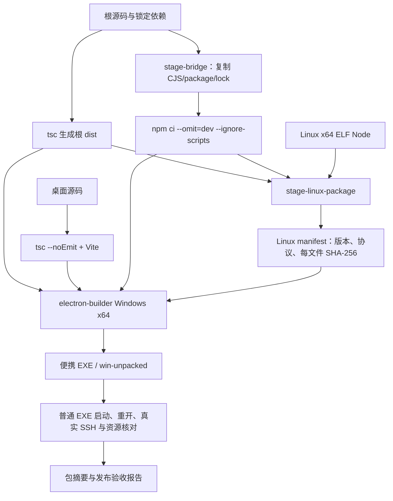

# M10 构建、发布与持久运行资源设计

M10-F01/F02/F03：alpha.67仅调整WSL握手预算，收录alpha.66原Linux manifest兼容pin；Windows挂载盘冻结入口47秒超过旧30秒，必须核对真实包与Linux执行证据。 [本轮设计与证据](../../iterations/I08/alpha67-hermes-linux-live.md)。

M10-F01/F02/F03：alpha.66包含Linux Hermes专用发现与alpha.65原daemon兼容pin；新增GitHub Ubuntu只读权限验证流程，固定官方0.22.5，不配置模型或SSH凭据。构建/发布状态按本轮证据登记，不以Windows受控测试替代Linux原生验证。 [本轮实现、验证与限制](../../iterations/I08/alpha66-hermes-linux.md)。

M10-F01/F02/F03：alpha.65包含Windows Hermes发现、原生网关CLI兼容、保守unknown与心跳替换重试；加入原alpha.64 Linux manifest兼容pin，运行时沿用已核验原包。Windows包包含相同后台与离线Linux资源，不自动切换日常后台或部署SSH。 [完整需求、源码和验证](../../iterations/I08/alpha65-hermes-windows.md)。

## alpha.65 Windows Hermes交付记录

M10-F01/F02/F03/F05/F06：公开alpha.65冻结47cba61，58后台/84Core/1721Linux资源、44份原兼容pin；原alpha.64 pin与原EXE载荷相同。Windows EXE、ASAR和全部资源逐文件SHA/字节一致，210个产品输入保持；源码/EXE/SHA文件已公开且匿名完整下载核验通过。Hermes31/31、冻结包正式Hermes MCP五组、真实两轮及普通EXE原profile补验通过，模型和取消边界分别保留；未签名、不切日常后台/部署SSH。[完整发布与原失败](../../iterations/I08/alpha65-hermes-windows.md)。

## CT-05原包传递候选

M10-F01/F02/F03：本地alpha.63继承62配置/审计，新增同工作原包传递与接收收据、57后台模块和只读审计前端。alpha.61/62原EXE保留，公开仍60；新包须独立验证原包/接收收据在普通窗口与中央重启后保持，不能以历史包结果替代。180个产品/依赖文件构建前冻结，ASAR/前端/84Core/1715Linux逐项核对；不部署SSH、不切换日常后台。[交付、摘要与证据](../../iterations/I07/context-delivery.md)。

普通窗口验收绑定同一已观察的Process/主窗口，发送前核对窗口归属和标题；回执与原进程退出分别判断，不能用新对象误选辅助窗或只凭CloseMainWindow=true准出。产品运行代码不因测试脚本修复而改变，[当前证据](../../iterations/I08/window-lifecycle-verifier.md)。

## 配置与审计控制台

M10-F01/F02/F03：本地alpha.62承接alpha.61失败清理和alpha.60连接策略，包含配置/审计前端与team.operation证明投影。普通EXE五组已补验：绑定原主窗口、正常关闭/重开和完整中央重启后原资料/收据保持，仍未自动切换日常后台。独立文件名保留原alpha.61 EXE，不将新前端视为旧EXE已经更新；冻结源码、ASAR、56后台、Core、Linux离线包及前端逐项核对。公开仍alpha.60；未自动切换日常后台或部署SSH。新前端遇旧小队后台缺收据证明继续保留原意图。[本片完整流程与验证](../../iterations/I07/configuration-console.md)。

## 失败操作清理

M10-F01/F02/F03：本地alpha.61候选包含失败清理界面及中央历史接入拒绝核对；公开alpha.60与旧EXE保留。新增的alpha.60兼容pin逐字取自其原冻结Linux manifest，不部署SSH。打包时核对ASAR、Windows中央、Core、前端和Linux离线资源；切换前必须在旧版停止后台并退出，候选本身不会替换已运行后台。 [需求、证据与未测边界](../../iterations/I08/failed-operation-cleanup.md)。

历史alpha.60交付：CT-08-A3连接工具/预授权/用户确认与策略页面，41份原daemon清单；EXE130212267字节，SHA-256 `d74c711b8475e84834519c8509a12a63351c1864a5ed4c01559588dc1fdc9cf6`。56后台/84Core/1713Linux及ASAR/前端/bootstrap一致；源码900/900、Windows包内37/37和实际中央管道/重启、兼容26/26与9,665,523字节输入、生产页面4组、普通EXE4组及Downloads完整SHA通过，模型0。发布前142个产品/依赖文件与构建时冻结摘要逐项复核一致，EXE与校验附件已上传并经匿名完整下载核验；未签名、未切换日常后台/部署SSH；真实原生多主/图100ms/WSL和完整SSH仍未准出。[发布证据](../../iterations/I08/alpha60-release.md)、[完整交付与原始失败](../../iterations/I07/connection-policy.md)。

## 当前 OpenCode 协议修复候选

M10-F01/F02/F03：alpha.53 公开预发布承接 alpha.52，加入有界协议发现、原安装绑定与一致状态。核对 Windows 冻结 Core、ASAR、后台、Linux 离线资源和生产前端；最终普通EXE6组与包一致性通过，保留旧 EXE。使用新候选前显式停止旧后台再重开；客户端不会替换 SSH daemon。本轮已公开EXE和校验文件，匿名完整下载核验通过；未切换日常后台或部署SSH。[交付与包证据](../../iterations/I08/opencode-bounded-probe.md).

## 当前 OpenDesk 生命周期与关系作用域

M10-F01/F02/F03：alpha.52公开版包含新增 opendesk-lifecycle.cjs、关系作用域中央能力和 OpenDesk 安全写入能力；Windows 后台、ASAR、Linux离线资源及生产前端必须与冻结源码一致。旧中央需显式停止重开，SSH仅对 OpenDesk 原生增删要求 opendesk-mcp-lifecycle-v1，不因该标记统一阻断读取/撤权或其他产品；本轮不部署远端。 [需求、流程与失败边界](../../iterations/I08/opendesk-lifecycle-relation-scope.md)。

M10-F01/F02/F03：连接恢复候选从当前工作区冻结到独立source目录，仅在快照修改候选版本，保留原alpha.50/51功能。核对53后台、84Core、1701Linux资源、ASAR/前端/bootstrap与冻结源码一致；旧公开alpha.46中央必须停止后重开才能满足scoped-node-management-v1，不自动切换日常后台或远端。[源码清单、字节与验收](../../iterations/I08/connection-identity-node-scope.md)。

M10-F01/F02/F03：alpha.50同时包含Pi/Hermes目标解析模块、配置/原生探测与前端提示，两个新增CJS须进入后台/ASAR/Linux离线包；53后台/84Core/1701Linux及bootstrap源码一致性均核对。普通Windows EXE、实际原生组件与Windows前端分层，未签名/未公开/未部署远端。 [最终实现、原始证据与范围](../../iterations/I08/hermes-mcp-config.md)。

M10-F01/F02/F03：alpha.49包含WSL HostConnection/Core就绪握手，Windows bridge/bootstrap.sh及Linux离线desktop/electron/bootstrap.sh必须与源码SHA一致，包核验新增bootstrapMatches。ASAR仍核对实际收录的CJS/Core/前端；普通EXE与真实WSL分别验收，不提升独立SSH结论。 [完整需求、实现、原始证据与限制](../../iterations/I08/wsl-host-readiness.md)。

M10-F01/F02/F03：alpha.48候选承接alpha.47，并加入DSH Desktop目标解析模块、原生补丁适配、绑定与前端展示；须核对新增模块同时进入Windows后台/ASAR及Linux离线包。旧alpha.46公开附件和alpha.47候选保留。 [实现与分层验收](../../iterations/I08/dsh-desktop-mcp.md)。

alpha.47历史候选包含 OpenDesk MCP 默认字段归属兼容；后台、窗口 ASAR、Core、Linux离线包与生产前端必须一致。Windows隔离验收、文件摘要与切换步骤见[本轮交付](../../iterations/I08/opendesk-mcp-defaults.md)。公开alpha.46的标签和附件保留；客户端候选不自动升级日常后台或SSH。

历史公开预发布0.6.0-alpha.51.recovery.2，标签冻结 `905b792`；源码、EXE与校验文件已公开，匿名完整下载130196014字节与SHA-256一致。包源码一致，未签名、未部署SSH；[当前完整交付](../../iterations/I08/alpha51-recovery2-release.md)。

## MCP02恢复与观测（2026-10-22）

alpha.46最终包冻结、SHA-256及Windows隔离验收见本轮交付记录。已公开、未签名、未部署SSH。 [实现、原始证据与未测项](../../iterations/I08/mcp-open-recovery.md)。

此前本地候选 **alpha.45**（OpenDesk 原生 MCP 可见性修复：stdio 服务补 `server/discover` 响应、OpenDesk 条目优先真实 Node 启动器并报告 `launcher`、界面提示必须完全重开）：产物 130177443 字节、SHA-256 `35674f6c…`，包核验 `status: passed`（50 后台模块/84 核心/1698 Linux 文件、四类源码一致性 true、linuxManifestDigest `195081305a…`），构建方式与 alpha.44 相同（WSL/Linux 交叉构建、`signExecutable:false` 未签名），未公开、未部署、未在真实 Windows 启动。证据 `artifacts/mcp-open-integration/evidence/package-verify-alpha45.json`。见[本轮§14](../../iterations/I08/mcp-open-integration.md#14-opendesk-原生-mcp-可见性修复2026-10-22alpha45)。

前一候选 **alpha.44**（I08-MCP02 第一片 + 真实原生探测后的收敛）：`desktop` 版本位由 alpha.43 递增，源码与依赖未变；构建改为在 **WSL/Linux** 上交叉构建 Windows x64 便携包（`npm run desktop:dist`：根 `tsc` → 桌面 `tsc --noEmit`+`vite build` → `stage-bridge`（`npm ci` 到 `.bridge-runtime`、`stage-linux-package`）→ `electron-builder --win portable --x64` → `verify-package --portable`；node v22.23.1、electron-builder 26.15.3、Electron 44.7.0）。构建缓存放在工作区 `.cache-electron*`/`.npm-cache-build` 并已 gitignore。产物 130186782 字节、SHA-256 `b78a2bcf…`，包核验 `status: passed`（后台50模块、核心84文件、Linux离线包1698文件，`coreBuildMatches`/`appAsarSourceMatches`/`frontendMatches`/`linuxBackendMatches` 均 true，linuxManifestDigest `8e47ae3b…`）；按 `win.signExecutable:false` **跳过签名**，未公开、未部署、未打标签，**未在真实 Windows 启动**（会与日常 alpha.43 后台共用 `%APPDATA%/AgentBridge`）。见[本轮打包记录](../../iterations/I08/mcp-open-integration.md#13-打包与候选交付记录2026-10-22)。

此前本地alpha.43包含OpenDesk CLI/Desktop前端能力门禁修复；窗口可复用满足现有合约的alpha.42后台，本次修复无需重启后台。最终EXE、ASAR和后台源码分别核验；实际包内调试窗口与普通无调试EXE分层记录，见[历史交付](../../iterations/I08/opendesk-ui-admission.md)。

OpenDesk连接、worker和注册随Bridge Windows/后台/Linux离线包交付，worker复制新增依赖。使用用户正常安装的OpenDesk原有接口，不构建、打包、要求安装定制原生CLI或桌面程序；包核验、普通EXE运行与原生模型分别验收。 [实现与证据边界](../../iterations/I08/opendesk-existing-interfaces.md)。

此前本地候选 **alpha.40**：包含原上下文服务恢复与接入拒绝持久收据修复，48 CJS/81 Core/1460 Linux 资源与源码一致；普通便携 EXE 130035302 字节，SHA-256 `fd24294c…`，包校验与EXE载荷解包对比通过。原alpha.36–39 EXE保留，未签名、未公开，现场仍运行alpha.37后台，未部署新daemon。[完整证据与限制](../../iterations/I08/opencode-oom-recovery.md)。

## alpha.38 本地候选包

M10-F01/F03/F06：`0.6.0-alpha.38` 整合用户已批准的“显式确认后越过未确认收据”契约变更、两个只读门禁 RPC 与维护对话框三区块后本地构建，未公开 GitHub；公开 alpha.36 的字节/标签/附件与 alpha.37 本地候选均未被覆盖。包内 48 个后台 CJS、81 个核心文件、**1460** 个 Linux 资源（1459 + 新增 alpha.37 pin 文件），核心 dist、窗口 ASAR、生产前端与 Linux 后台全部与源码一致，`linuxManifestDigest` = `451aba34…`。新增两份兼容 pin：`0.6.0-alpha.36.json`（从已公开 alpha.36 EXE 内原样提取，1458 文件，digest `4f14b5f5…`）与 `0.6.0-alpha.37.json`（取自 alpha.37 候选包的 `linux-package/manifest.json`，1459 文件，digest `3fff4ab3…`）；包内 `compatibleDaemons` 索引共 **32** 条，摘要口径为 `sha256(JSON.stringify(manifest))`（非 pin 文件字节 sha256），只允许识别并复用已安装的对应后台，不安装旧清单、不自动升级远端。EXE 130038728 字节、SHA-256 `296260f2…`，包报告 `artifacts/package-check/0.6.0-alpha.38/package.json`（`status: passed`）。未在 Windows 真机运行、未签名、无真实用户远端，`windows-*.cjs` Edge 套件本机未跑。[交付、指纹与未测边界](../../iterations/I08/alpha38-delivery.md)。

## alpha.36整合边界

M10-F01/F03：alpha.36整合基线含公开alpha.35执行资源级保护/原查询反馈与所有工作区增量；OpenCode宿主和原管理拒绝恢复并存，原身份/Session/unknown不迁移。精确收录alpha.34/35 daemon清单，客户端升级不自动替换远端。[完整交付](../../iterations/I07/alpha36-delivery.md)。

## alpha.37 本地候选包

M10-F01/F03/F06：`0.6.0-alpha.37`从工作源码整合alpha.36之后的两批修复（维护被拒后的离线恢复、切片A的未决行回收与维护进度可见）后本地构建，未公开GitHub，公开alpha.36字节/标签/附件未改动。包内48个后台CJS、81个核心文件、1459个Linux资源，核心dist、窗口ASAR与生产前端、Linux后台均与源码一致。新增`desktop/compatible-daemons/0.6.0-alpha.36.json`：从已公开alpha.36 EXE内`linux-package/manifest.json`原样提取，1458个文件逐项sha256校验通过，`manifestDigest`为`4f14b5f5…`（`sha256(JSON.stringify(manifest))`，非pin文件字节sha256）；包内`compatibleDaemons`索引共31条含该pin，只允许识别并复用已安装的alpha.36后台，不安装旧清单、不自动升级远端。EXE 130034719字节、SHA-256 `76e30b1e…`，包报告`artifacts/package-check/0.6.0-alpha.37/package.json`（`status: passed`）。未在Windows真机运行、未签名、无真实用户远端，windows-*.cjs Edge套件本机未跑。[交付、指纹与未测边界](../../iterations/I08/alpha37-delivery.md)。

## 子任务上下文资源

M10-F01/F02：delegation-context.cjs由中央AgentNetwork引用，随既有electron CJS收集，无新依赖或MCP运行端require。未来候选须包含一致helper/中央及原v1文本，核对上下文版本与子请求指纹；本片不生成EXE，其他配置/恢复候选不自动纳入本片。[完整输入、恢复与证据](../../iterations/I07/delegation-context.md)。

## Agent 行配置候选边界

M10-F01/F02/F03/F05：配置入口候选从当前alpha.34派生工作源码独立冻结，包含AgentConfigurationDialog、单目标MCP/DSH组件、行/关系图入口及OpenCode专用发现adapter过滤。须核对窗口ASAR/前端、Core、后台和Linux资源一致；首版缺共存修复的.config.1不交付，最终文件与摘要见[专项](../../iterations/I07/agent-row-configuration.md)。不改公开alpha.35附件或独立SSH。

## 连接视图源码资源

M10-F01/F02：新agent-connections.cjs仅由中央AgentNetwork引用，随现有electron CJS收集；mcp-client运行副本只改工具说明，无新依赖。未来候选须冻结两者和完整后台；当前recovery.1及公开alpha.35不因源码修改自动含本片，本轮没有新包或后台切换。[完整字段、流程与范围](../../iterations/I07/agent-connections.md)。

## 扫描恢复本地候选边界

M10-F01/F02/F03/F05：恢复候选从alpha.34派生工作源码独立冻结，包含当前DSH、只读委派列表与扫描/管理恢复增量；公开alpha.35独立修复未合入，不将候选视为该公开版本的源码复现。窗口ASAR、生产前端/后台、核心与Linux离线资源须逐项核验。旧后台须显式停止后才运行新代码，独立SSH另行升级。[最终候选与限制](../../iterations/I07/agent-management-recovery.md)。

## 委派列表运行资源边界

未来候选须同时冻结中央AgentNetwork/delegation-list.cjs、MCP运行副本及Claude/Codex允许项；helper沿既有electron CJS收集，mcp-client只需自身/team-tools，无新依赖。本片只有冻结源码受控验证，没有构建EXE或改公开标签；打包前还需整合公开alpha.35独立修复与当前脏工作区。[源码/发布边界](../../iterations/I07/delegation-list.md)。

## 当前DSH本地候选

M10-F01/F02/F03/F05：`0.6.0-alpha.35.dsh.3`从独立冻结副本构建，含DSH Desktop/Web发现、认证/命名参数、worker与设置；保留公开alpha.34原字节。候选EXE、窗口ASAR、生产后台及Linux离线包一起核验；不向原生DSH新增模型层。新Windows程序不会自动升级独立SSH daemon。[交付、真实连接与包验证](../../iterations/I07/dsh-exe-delivery.md)。

M10-F01/F03/F05：发布包采用已验证候选字节并绑定合并源码，按后台 CJS、core 文件、Linux 资源与冻结文件清单逐项匹配；主工作区未发布功能不纳入。当前发布状态见[迭代发布记录](../../iterations/release-ledger.md)。[交付、校验与升级边界](../../iterations/I07/maintenance-persistence.md)。

## 当前维护进度与持久化边界

M10-F01/F03/F05：发布包从已公开版本加修复补丁构建，收入上一版精确 manifest，窗口/中央/Linux 同源冻结；主工作区未提交增量不纳入，已发布的 EXE 不被改写。 [完整设计、实测与边界](../../iterations/I07/maintenance-persistence.md)。

CT-05桌面新增React组件与验证/输出模块，仅Vite/TypeScript源码构建，不改生产依赖、资源收集或发布版本；未产生新EXE/Linux包，未来候选须同时冻结CT-05后端/前端再验包。[源码/程序范围](../../iterations/I07/context-packet-ui.md)。

team-context-packet.cjs沿现有electron CJS收集规则进入未来冻结副本，无新依赖/资源布局或发布协议；该增量尚未打包，后续须独立版本、冻结与包校验，保留原附件摘要。[当前源码增量与未测边界](../../iterations/I07/context-packet.md)。

## 当前版本准入与管理作用域

M10-F01/F03/F05：发布包同时冻结窗口/中央/Linux修复，收入上一版精确原manifest。新前台拒绝旧中央管理/版本语义，设置显式停止仍可用；普通EXE及完整公开下载验证分开，未提交工作不入包。 [完整规则与证据](../../iterations/I07/version-management-recovery.md)。

## 当前历史详情读取与错误作用域

M10-F01/F03/F05：修复从已发布版本隔离构建，未提交内容不入包。Windows窗口、冻结后台及Linux资源同时包含详情归属/错误隔离；收录上一版原manifest精确摘要保持原远端维护路径，不自动升级远端。[设计、兼容与实际证据](../../iterations/I07/history-detail-recovery.md)。

## 独立 MCP 配置与运行契约

M10-F01/F02：独立MCP实现需要根生产依赖jsonc-parser与smol-toml。现有stage-bridge/stage-linux-package及Coordinator运行时收集根生产依赖并复制electron实现，未修改发布版本和冻结资源。三份MCP文件在目标机器运行时生成，不含Token，不能跨机器直接复用。该增量未构建EXE或Linux发布包，包内验证保持未测。[配置/数据/失败流程与源码](../../iterations/I07/mcp-installation.md)。

桌面空闲修复使用独立冻结源码与候选版本构建，已公开版本字节不被覆盖；资源一致性、普通EXE和黑窗观察分层报告。[候选与实际验证](../../iterations/I07/desktop-polling.md)。

原生扩展的新注册表、契约、NativeCliHost 与协议解析均为 electron 下 `.cjs`，沿用窗口包、持久后台与 Linux 包的模块集合打包；各工具本地图标通过 Vite 资源和桌面 assets 随包保存。Codex 独立 worker 冻结发现器时还需复制发现器依赖的注册表和契约，避免新旧资源混合。该增量未构建新 EXE 或公开发布。[扩展交付边界](../../iterations/I07/native-agent-expansion.md)。

## 桌面 UI 候选包校验

M10-F01/F02/F03/F05/F06：UI 重构及原生会话/业务验收保护增量从独立工作区快照构建为本地候选；主工作区 `desktop/package.json` 与 lock 保持原版本元数据，已公开的冻结标签、EXE 和校验文件不变，候选不发布到 GitHub。功能范围与交付见[界面重构](../../iterations/I07/ui-redesign.md)，浏览器各层证据见[视觉与交互验收](../../iterations/I07/ui-visual-acceptance.md)。

构建从独立快照进行，快照内只调整桌面版本元数据并新增已验证旧版的可信 Linux manifest，不会把重新构建的不同字节标成同一版本。候选按后台 CJS、core 文件、Linux 条目、窗口 ASAR 和前端逐项匹配，[包校验](../../../artifacts/ui-redesign/2026-10-18/package-ui2.json)为 passed。

[本地候选 EXE](../../../artifacts/ui-redesign/2026-10-18/AgentBridge-0.6.0-alpha.28.ui.2-Windows-x64.exe)已生成。[普通无 debug EXE](../../../artifacts/ui-redesign/2026-10-18/portable-ui2.json)完成 4 项验证：实际启动版本、真实 IPC/SQLite 公共记录、关闭/重开复用原后台、全后台重启后原记录保留；模型 0，原 nativeRequests 无新增或重放。观察到的 10 条只读历史作为基线保留，不把“没有新执行”写成“没有历史”。没有使用用户 profile 或连接用户 SSH；清单收入不等于远端升级验收。

## SSH持久拒绝恢复

M10-F01/F03/F05：发布包包含SSH持久拒绝读取、可信证明、原意图持久化和中央恢复。收录已发布版本的冻结manifest以保持上一版复用；不重写旧附件或扩大未知版本信任。[完整需求、状态与验证](../../iterations/I06/daemon-rejection-recovery.md)。

## Windows未派发与持久化恢复

M10-F01/F03/F05：发布包将窗口、冻结后台及Linux离线资源同时包含Codex恢复、共享原子写入及NETWORK_PERSIST判定。收录上一版原manifest（精确摘要核验）以保持SSH复用；不改旧EXE或放宽未知版本信任。[需求、状态图、验证与交付](../../iterations/I06/windows-start-persistence.md)。
## 旧 Linux 后台兼容清单

M10-F02/F03/F04/F06：发布包收录原可信 manifest，版本分别绑定历史冻结包摘要，随 Windows EXE 内的 Linux 资源再次打包。新客户端先连接旧后台，用户确认维护才上传升级；不会自动信任任意旧版。候选从独立冻结源码构建，未包含工作区续接增量。另生成同资源的Linux x64 daemon tar.gz供离线分发，逐文件核验；它不是Linux桌面版或一键升级器。[来源、候选、升级和验收](../../iterations/I06/ssh-alpha24-upgrade.md)。

## Windows原请求上下文恢复

M10-F01/F03/F05：发布包纳入未完成上下文原请求查询修复及先前不完整任务回应保护。便携EXE与SHA256SUMS.txt分发前核对大小、摘要及源码一致性；旧附件保持原文件。用户停止旧后台后重开新EXE加载修复，Windows恢复无须升级SSH后台。[完整修复、分发与证据](../../iterations/I06/windows-context-recovery.md)。

## 停止协调打包

team-stop随窗口、冻结后台与Linux离线资源打包。普通EXE核对实际IPC/SQLite及外部访问撤销/重开恢复，Windows原生取消仍由真实适配专项另证。发布包按后台CJS、core文件、Linux条目与源码逐项匹配；摘要、普通包结果和未测项见[停止专项报告](../../iterations/I07/native-stop.md)。不覆盖用户默认后台或原发布附件。

## 首批小队自动化打包

便携程序的窗口/冻结后台/Linux离线包包含team-automation及格式3SQLite逻辑，MCP客户端运行副本仍包含team-tools。发布包按CJS、core文件、Linux清单条目、app.asar及前端逐项匹配，[发布记录](../../iterations/I07/github-release.md)。普通EXE生命周期、摘要、分发和未测项见[首批报告](../../iterations/I07/automation.md)；源码测试不替代普通包验证，Windows无模型包流程不替代真实WSL主协调。本批保留原Codex终态及daemon bind权限修复，已核验GitHub附件和完整公开下载；没有升级用户后台。

发布检查覆盖源码、窗口/后台、前端和 Linux 离线资源；逐文件核对核心 dist 与 Windows bridge/dist、Linux package/dist，并检查 Linux 后台 CJS 与源码一致。稳定历史版本为 0.5.0；完整 I06C 原生准出仍未完成，当前发布状态见[迭代发布记录](../../iterations/release-ledger.md)。

## 1. 功能范围

M10-F01/F02/F03/F05/F06：本地候选从独立源码/配置/测试/素材清单冻结，按后台CJS、核心文件、Linux条目及窗口ASAR/前端摘要一致校验，含smol-toml1.9.1与精确兼容pin。旧候选保留各自源码/摘要；Git未提交。 [源码/候选/实际证据](../../iterations/I07/integrated-source.md)。

| 功能 ID | 交付目标 | 当前状态 |
| --- | --- | --- |
| M10-F01 | 编译、类型检查、构建、自动化回归入口 | 源码已实现；alpha.64源码定向155/155及类型/lint/构建通过，全量Windows存在已复现的基线平台失败；共享计数不跨模块相加，模型与正式准出独立 |
| M10-F02 | Windows x64 便携 EXE 包含前端、后台、生产依赖和 Linux 离线包 | alpha.64公开包包含58后台/84Core/1720Linux资源，ASAR/前端/bootstrap及实际EXE载荷一致；图12组/控制台6组通过，普通EXE见[当前交付](../../iterations/I08/alpha64-release.md) |
| M10-F03 | Linux x64 离线包包含真实 Linux Node、后台/依赖及每文件摘要清单 | alpha.64公开包含1720项、Linux Node22.23.1与43份原版本兼容清单；兼容29/29，原实际服务器证据不刷新；本轮未部署/升级SSH，WSL服务不可用 |
| M10-F04 | 发布包坏路径/坏摘要拒绝安装，远端校验后原子激活版本 | 源码已实现；校验实现，受控安全检查及真实正常安装通过；破坏性故障矩阵未完成（部分验证） |
| M10-F05 | 便携启动器清理临时文件后，后台/worker 使用用户目录持久副本 | 源码已实现并已发布；alpha.64原窗口关闭/重开复用中央、同一profile完整中央重启补验通过，后台使用持久自有副本；[当前证据](../../iterations/I08/window-lifecycle-verifier.md) |
| M10-F06 | 发布报告记录版本、EXE 大小/SHA-256、实际验证环境和未测项 | alpha.64公开包版本、EXE字节/SHA与分层证据集中记录；服务端digest与匿名完整下载已匹配；[当前交付](../../iterations/I08/alpha64-release.md) |
| M10-F07 | 升级、回滚、旧配置迁移和安全删除有用户流程 | 源码已实现；部分历史配置兼容；可信升级/回滚/停止/卸载；旧中央直接降级仍不支持 |

M10 管理可执行材料和一致性，不管理模型/账号，也不把远端原生 CLI 打进包。用户机器或 Linux 上仍须已有可用 OpenCode/Claude/Codex 及其原生认证。缺少这些时，安装 Bridge 成功不代表 Agent 能回答。

## 2. 三种版本与构建物

| 名称 | 当前值/位置 | 含义 |
| --- | --- | --- |
| 根 CLI 包版本 | `package.json` = `0.1.0` | 本地 CLI 工程包版本；不代表当前桌面功能发布版 |
| 主工作区桌面元数据 | `desktop/package.json`及lock = `0.6.0-alpha.34` | 工作区另有未发布增量（DSH Desktop/Web 服务入口）；元数据相同不等于旧 EXE 已经包含 |
| GitHub 预发布 Windows EXE | `AgentBridge-0.6.0-alpha.34-Windows-x64.exe` | 对应冻结源码与附件；稳定历史为0.5.0，完整I06C/I07C尚未准出 |
| 根编译物 | `dist/` | TypeScript core/CLI/DesktopHost，供桌面与 daemon 共用 |
| 前端编译物 | `desktop/dist/` | Vite 静态资源，Electron 窗口加载 |
| 后台暂存物 | `desktop/.bridge-runtime/` | CJS 后台与根生产依赖闭包 |
| Linux 离线资源 | `desktop/.linux-package/` | manifest + Linux 后台/依赖/runtime/node |
| 解包目录 | `desktop/release/win-unpacked/` | 构建中间物，不是保证最新的发布事实 |

打包会同时核对窗口 CJS、冻结后台、Linux 离线资源与最终源码，可信的旧清单先与已交付 digest 核对再收入。客户端与原远端后台版本分别显示，旧版本继续可信复用、不自动升级；SSH 发现修复须用户维护原 daemon 后生效。历史包的清单、摘要与分层证据见 [Linux CLI 发现](../../iterations/I06/linux-cli-discovery.md)、[OpenCode 二次发现](../../iterations/I06/opencode-discovery.md)。

## 3. 构建流程

CT-04 桌面材料入口只做 TypeScript/Vite 生产构建，新增 TeamMaterials/版本核对代码进入该 dist；没有新 EXE、verify-package 或 Linux 打包。发布候选必须先整合已验证的修复再冻结，不能把工作区未发布增量标成已发布版本，也不沿用旧包的验收结论。[核对元数据与源码边界](../../iterations/I07/public-materials-ui.md)。

CT-04新增 `electron/team-materials.cjs` 沿既有顶层CJS收集规则进入未来窗口/持久后台/Linux包；仍需新冻结版本的完整构建与verify-package，不能因源码测试通过就声称已收录。该增量尚未打包/发布或修改可信清单。[源码增量边界](../../iterations/I07/public-materials.md)。



现有入口（仓库根目录，Node ≥22.13，npm 依赖已安装）：

```bash
npm run lint
npm run typecheck
npm test
npm test --prefix desktop
npm run desktop:build
npm run desktop:pack
npm run desktop:dist
```

`desktop:pack` 生成 Windows 解包目录，`desktop:dist` 生成 portable EXE；两者都先根编译和前端构建，再执行 staging。环境必须具备 electron-builder Windows 构建条件和已准备的 Linux Node 资源。运行这些命令会改写 `dist`、staging、release，不连接真实服务器，也不自动发布到外部站点。

已有同版本公开包时，先冻结包括未跟踪源码的独立快照，再在快照内使用独立候选版本和报告路径；不能直接重建同名公开 EXE，或只换文件名而保留内部相同版本。当前校验器读取 `desktop/release/win-unpacked`，并核对桌面元数据、Linux manifest 和 portable 名称；单独改 electron-builder 输出目录或窗口版本不能替代一致的候选版本。版本变更后需要精确收录可复用的旧 daemon 清单，保持原 digest、归属和路径校验。

`stage-bridge.cjs` 通过 npm 的实际执行路径运行 `ci --omit=dev --ignore-scripts`。这样从锁文件安装生产依赖，不执行依赖安装脚本；依赖下载仍可能访问注册表。SSH `ssh2` 属于根生产依赖，必须随 Bridge 后台复制，不能只在开发机 node_modules 存在。

## 4. Windows 包资源布局

electron-builder 把桌面前端/窗口主进程放进应用 asar，把需要独立进程和远端安装的材料放在 `extraResources`：

```text
resources/
  app.asar                         # desktop/dist + electron 主窗口模块
  bridge/
    dist/                          # 根编译后 DesktopHost/core
    desktop/electron/*.cjs         # 独立 Coordinator 和原生/SSH 模块
    node_modules/                  # 根生产依赖，包括 ssh2
    package.json
    bootstrap.sh                   # 保持 WSL 启动兼容
  linux-package/
    manifest.json
    dist/
    desktop/electron/
    node_modules/
    runtime/node                   # 真实 Linux x64 二进制
```

`extraResources` 的 CJS 来源是 `.bridge-runtime/desktop/electron`，而应用自身仍保留 `electron/**/*`。不能用改写打包文件集合的方式遗漏窗口入口，也不能只把新后台放在开发源码目录。

包参数在 [desktop/package.json](../../../desktop/package.json)：Windows x64 portable、`artifactName=AgentBridge-${version}-Windows-x64.exe`、asar 启用、当前不签 executable。用户获取程序后应以该包的实际版本和摘要为准。

## 5. Linux 离线包与可信清单

`stageLinuxPackage({repo,runtime,destination,nodeExecutable?,version})` 的真实接口由 [stage-linux-package.cjs](../../../desktop/scripts/stage-linux-package.cjs)导出。

Linux 构建默认使用当前 `process.execPath`；可通过 `AGENTBRIDGE_LINUX_NODE` 指定真实 Linux Node。检查 ELF 魔数、64 位和 x86_64 machine 字段，禁止把 Windows node.exe 当远端运行时。Windows 侧构建若未显式提供，复用已准备的 `.linux-package/runtime/node` 和原 manifest 版本信息，不能在 Windows 运行该 ELF 来探测版本，因此发布时应核对它来自已验证 Linux 包。

复制根 `dist`、生产 node_modules、后台 CJS；生成 Linux `package.json` 时使用桌面候选版本并移除 scripts/devDependencies。资源遍历不保留符号链接，只收普通文件；每文件记录相对路径、字节数和 SHA-256，排序后写 manifest。清单示意：

```json
{
  "version": "0.6.0-alpha.14",
  "protocolVersion": 2,
  "platform": "linux",
  "arch": "x64",
  "glibcMinimum": "2.28",
  "runtime": {"path": "runtime/node", "version": "v22.23.1"},
  "files": [{"path":"desktop/electron/machine-daemon.cjs","sha256":"<64位摘要>","size":12345}]
}
```

清单是随可信客户端构建物携带的安装期校验依据，不是独立签名发布系统。客户端验证所有清单文件实际类型、大小和摘要后，构建 ustar+gzip 归档。私有 Node 总是在包中，远端已有 Node ≥22.13 时优先用系统 Node，无 Node 时使用版本目录中的 `runtime/node`；不修改系统 PATH、npm 或 Node 安装。

当前自动安装要求 Linux x64/glibc ≥2.28。没有 ARM64/musl 支持，也不能把一个 ELF 检查等同于在所有兼容发行版验证过运行。安装步骤和原子激活见 [M04 SSH 设计](../04-ssh-access/design.md)，运行身份与数据见 [M05](../05-linux-daemon/design.md)。

## 6. 便携运行资源为何要持久化

便携 EXE 的窗口关闭后，启动器可删除临时解包目录。旧实现若从该目录启动 detached Claude worker，会因 ICU 文件缺失在执行前失败。当前把必要资源保存到用户配置目录：

| 持久层 | 内容 | 生命周期 |
| --- | --- | --- |
| `workerRuntime` | executable、ICU、V8 snapshot、同目录运行 DLL/许可证等普通文件 | 版本+架构目录，原子发布，正在使用的资源不覆盖 |
| `coordinatorRuntime` | 整套 root dist、后台 CJS、生产依赖、Linux 离线包 | 桌面版本+代码摘要目录，GUI 与临时解包目录无关 |
| Linux 版本目录 | daemon/依赖/私有 Node | SSH 断开不删除安装物；运行数据另存 |

`workerRuntime` 新清单为 version=2，逐文件检查 size/SHA-256、必需资源和文件名；不复制或追踪 runtime.json/日志。旧清单兼容 size 检查，仅忽略 alpha.9 的清单自引用项，不改旧文件。其他资源损坏时从完整来源构建并原子发布独立 repair 目录，后续可复用；不覆盖或删除可能仍被 detached worker 使用的旧资源。来源不完整时明确拒绝。Coordinator 缓存摘要仍未覆盖全部依赖与 Linux 包内容，运行缓存通过不能代替整包验收。原请求只读恢复规则见 [修复说明](../../iterations/I06/runtime-recovery.md)。

## 7. 发布准出与尚未实现

发布须同时满足：当前源码检查、所有必交功能测试、Windows 普通 EXE 启动/重开/后台资源生存、真实 SSH 接入和原任务恢复、实际发布包资源比对、包 SHA-256/大小及能力限制记录。前端构建成功、Node 自动化通过或旧 EXE 窗口能打开都不能替代这些准出条件。

本地 UI 候选已通过资源比对和普通 Windows EXE 验证，尚未发布。机器维护候选的资源比对与早期 Windows/SSH 主要验收保留为各自历史证据，正式 0.6.0 全量准出未完成。节点图和升级/故障交付不能由资源包推定完成。不自动升级远端；显式维护提供确认与原收据恢复，忙/unknown 拒绝切换。正式准出须当前真实测试满足门槛。

## 8. 代码与维护入口

构建：[根 package.json](../../../package.json)、[桌面 package.json](../../../desktop/package.json)、[stage-bridge.cjs](../../../desktop/scripts/stage-bridge.cjs)、[stage-linux-package.cjs](../../../desktop/scripts/stage-linux-package.cjs)。持久资源：[worker-runtime.cjs](../../../desktop/electron/worker-runtime.cjs)、[coordinator-runtime.cjs](../../../desktop/electron/coordinator-runtime.cjs)。

修改依赖、资源路径、版本或运行材料时，同步本设计、[测试报告](test-report.md)、操作说明、当期迭代发布记录和包证据。变更来源：[I06 开发 A01/A03/C05/C06](../../iterations/I06/development.md)、[I06 当前进度](../../iterations/I06/progress.md)；旧 `0.5.0` 证据保留为旧版本历史。

## 收尾行为

Linux 包的 node_modules 通过独立 extraResources 项复制。electron-builder 会过滤父资源内嵌的 node_modules，仅复制 .linux-package 父目录会丢失 1254 个 manifest 文件，导致 SSH 预检失败。

新增 [verify-package.cjs](../../../desktop/scripts/verify-package.cjs)，在 pack:win/dist:win 后强制执行。逐项校验 Linux manifest 的存在、大小和 SHA-256，比较窗口 app.asar 和冻结后台的全部 CJS、前端构建输出与版本，便携包记录大小/SHA-256。缺文件或代码过期直接让构建失败，不降低完整性标准。

## Codex 修复的打包资源

发布包把修复后的 Codex worker 打入窗口 app.asar、冻结后台与 Linux 离线包。以新版本/摘要冻结，不覆盖运行中的旧目录；普通关闭窗口不会替换旧 Coordinator；可以直接用新 EXE 的设置页停止同一配置内的旧后台，再次打开新 EXE 加载新代码，无需旧程序。发布校验支持 `AGENTBRIDGE_PACKAGE_REPORT` 指定独立输出路径，未设置时维持原输出位置，并已改为按版本隔离输出。新版本用独立报告保留旧包的历史证据，详见 [交付](../../iterations/I06/codex-discovery-fix.md)。

## 已安装 daemon 的兼容清单

发布包将 `desktop/compatible-daemons/` 内已验证旧发布 manifest 复制到新 Linux 包并纳入逐文件 SHA-256 清单；manifest 新增可选 `compatibleDaemons` 索引，含 version/manifestPath/manifestDigest。旧协议 2 清单可没有该字段。包内包含旧版本的可信清单，仅允许匹配的已安装发布复用，不安装这些旧清单、不自动升级原 daemon。清单来源、校验与验收见 [兼容复用交付](../../iterations/I06/ssh-compatible-reuse.md)。

发布包另收录已交付旧版的 manifest；从先前已通过包报告的实际 Linux 离线 manifest 复制并核对摘要，保持客户端补丁后对已有后台的可信复用。[交付说明](../../iterations/I06/ssh-error-recovery.md)。

## 节点图打包变化

前端锁定 @xyflow/react 12.12.0；GraphLayoutStore/GraphOperationJournal 随全部后台 CJS 复制入窗口与冻结运行时。远端包的协议仍为 2，旧清单保持明确可信兼容；复用不升级旧 daemon。verify-package 的缺省报告为 `artifacts/package-check/<version>/package.json`，也可用 AGENTBRIDGE_PACKAGE_REPORT 定向输出，避免覆盖历史 I06A 报告。当前源码与最终包对应情况见 [节点管理报告](../../iterations/I06/node-management.md)。

## 当前机器管理与观察恢复

发布包包含机器管理、私有历史和事件补偿的当前源码/前端；收录历史 manifest 前与实际已交付 digest 核对。现有可信 daemon 只复用、不升级。窗口 app.asar、冻结后台、Linux 离线资源和 portable 均逐项校验。新数据含管理状态，直接旧后台回退不支持；完整升级/回滚/卸载仍待后续。 完整接口、事务、实际证据与未完成范围见 [6C 首批](../../iterations/I06/machine-management.md)。

## GitHub EXE 分发（M10-F06）

Windows x64 EXE 已作为 GitHub 预发布附件提供，例如[下载程序](https://github.com/wsjq5477/MA-Relay/releases/download/v0.6.0-alpha.9/AgentBridge-0.6.0-alpha.9-Windows-x64.exe)、[发布页](https://github.com/wsjq5477/MA-Relay/releases/tag/v0.6.0-alpha.9)。用户无需自行编译或安装 WSL/Node.js 来运行 AgentBridge。稳定历史版本仍为 0.5.0；单个预发布不代表完整 I06C 或正式 0.6.0 准出。

程序通过 GitHub Release 附件分发，Git 源码仓库不保存 EXE。发布草稿绑定相应源码提交；先检查本地 EXE 大小和 SHA-256，上传 EXE 与校验文件，核对服务器返回的 state/size/digest 后发布为 prerelease。回应不明时查询同一 release/asset，不删附件重传或另建发布。候选包不能标为稳定版；过程不打包私有运行状态、不改变原生配置。具体事实见 [发布记录](../../iterations/I06/github-release.md)。

## 当前维护与原操作恢复

发布包收录已构建并校验的旧版清单（原实机权限失败证据保留）。Linux 增加静态 owned-stop、glibc 许可与重链接说明；从 C 源码编译并纳入逐文件摘要与 0700 归档权限；实际解包后核对可执行性。旧 daemon 的安全停机需要支持 pidfd 的 Linux 内核（5.3+）；不支持时明确拒绝，不退回仅 PID 停机。新 daemon 使用认证停机 RPC。verify-package 逐项比对窗口、冻结后台、前端及离线资源；新候选生成并不自动发布或修改原用户后台。

实现入口：[stage-linux-package.cjs](../../../desktop/scripts/stage-linux-package.cjs)。需求、分层证据及未测范围见 [I06C 收尾](../../iterations/I06/final-delivery.md)。

发布包将上传诊断、原安装恢复界面和当前后台源码同时打入 portable/离线包，收录已核对实际包摘要的兼容 manifest。分层验证与未测范围见 [上传修复交付](../../iterations/I06/ssh-upload-recovery.md)；普通 EXE 和原服务器安装证据必须分别判定。

## 一致性校验

发布包将维护原收据恢复修复打入窗口、冻结后台与 Linux 离线包；收录已核对实际包摘要的可信兼容清单，不自动升级用户服务器。构建与普通 EXE 分开核验，最终依据源码/包比对及真实窗口启动；并发构建中途的 EXE 大小/哈希不作为最终分发证据。见 [交付说明](../../iterations/I06/maintenance-launch-recovery.md)。

## 构建隔离

冻结服务器链使用原离线资源；候选版本用独立临时源码快照构建，再与主工作区 CJS/前端/离线清单和最终 EXE 比对。已核验旧版 manifest 固定摘要后收入兼容目录；不覆盖已发布版本，也不自动升级服务器。结果见 [交付说明](../../iterations/I06/maintenance-launch-recovery.md)。

## 资源范围修复打包

Windows x64 portable 已从修复源码重建，逐文件核对窗口/后台/核心和 Linux 离线资源。兼容清单先与原冻结发布摘要核对，不把 runtime 或依赖二进制提交为源码。原请求/资源保护与分层实际结果见[专项](../../iterations/I06/pending-isolation.md)，新包不代表完整I06C准出。

发布附件上传后核对公开下载可用且完整 EXE 摘要匹配。完整验证与升级说明见上述专项。
