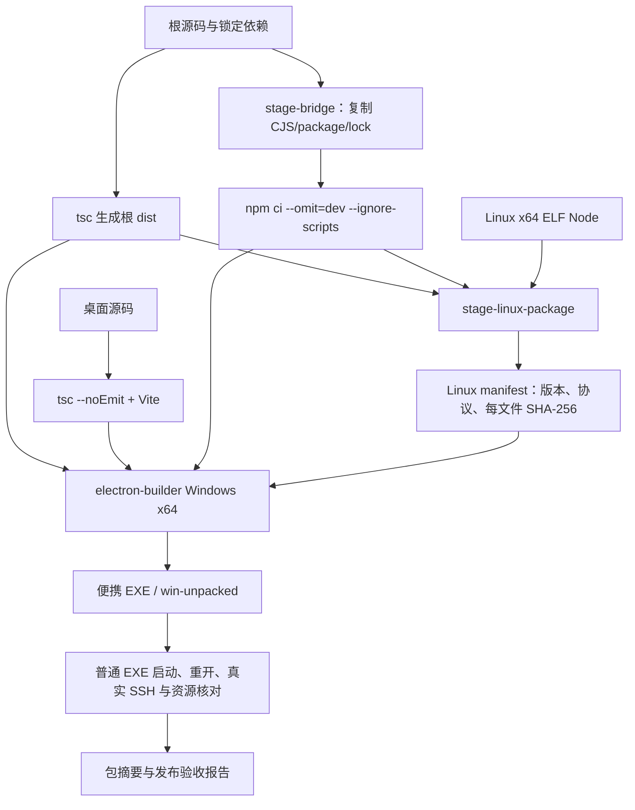

# M10 构建、发布与持久运行资源设计

2026-10-20当前准备 **0.6.0-alpha.34**：用户授权提交当前完整源码并发布Windows EXE，含OpenCode1.x/2.x、独立MCP、CT-04/CT-05与既有alpha.30–33整合，补alpha.33精确daemon清单。固定源码构建、普通EXE及公开完整下载结果完成后在[本轮交付](../../iterations/I07/alpha34-release.md)登记；当前仍在发布准备阶段，旧包/标签范围不变。

M10-F01/F03/F05：alpha.33已预发布，采用原已验证候选字节并绑定合并源码，39 CJS/78 core/1405 Linux资源及149冻结文件匹配；不纳入主工作区后续未发布功能。 [交付、校验与升级边界](../../iterations/I07/maintenance-persistence.md)。

## 当前维护进度与持久化边界

M10-F01/F03/F05：alpha.33仅公开alpha.32加issue10补丁，收入精确alpha.32 manifest，窗口/中央/Linux同源冻结。主工作区CT-04/CT-05未提交增量不纳入，旧integrated.3 EXE不被改写。 [完整设计、实测与边界](../../iterations/I07/maintenance-persistence.md)。

2026-10-20后续：CT-05桌面新增React组件与验证/输出模块，仅Vite/TypeScript源码构建，不改生产依赖、资源收集或发布版本。本片无新EXE/Linux包；integrated.3与公开alpha.32冻结字节保持，未来候选须同时冻结CT-05后端/前端再验包。[源码/程序范围](../../iterations/I07/context-packet-ui.md)。

2026-10-20包范围：新team-context-packet.cjs沿现有electron CJS收集规则进入未来冻结副本，无新依赖/资源布局或发布协议。本片没有打包；公开alpha.32及此前integrated.3 EXE均不含CT-05。package.json仍integrated.3不代表当前源码已封包，后续须独立版本、冻结与包校验，保留原附件摘要。[当前源码增量与未测边界](../../iterations/I07/context-packet.md)。

## 当前版本准入与管理作用域

M10-F01/F03/F05：alpha.32已预发布同时冻结窗口/中央/Linux修复，收入alpha.31精确原manifest。新前台拒绝旧中央管理/版本语义，设置显式停止仍可用；普通EXE及完整公开下载验证分开，原CT-04未提交工作不入包。 [完整规则与证据](../../iterations/I07/version-management-recovery.md)。

## 当前历史详情读取与错误作用域

M10-F01/F03/F05：alpha.30从已发布alpha.29隔离修复，CT-04未提交内容不入包。Windows窗口、冻结后台及Linux资源同时包含详情归属/错误隔离；收录alpha.29原manifest精确摘要保持原远端维护路径，不自动升级远端。 2026-10-19源码/GitHub预发布alpha.30，GitHub已预发布alpha.30；[设计、兼容与实际证据](../../iterations/I07/history-detail-recovery.md)。

2026-10-19：当前完整源码已发布为 **alpha.29 GitHub预发布**，新Tag、EXE与SHA-256校验附件均已上传；版本、包资源与实际发布状态统一见[alpha.29 交付](../../iterations/I07/alpha29-release.md)。历史专项保留原日期/冻结范围，完整 I06C/I07C 未准出。

## 独立 MCP 配置与运行契约（2026-10-19）

M10-F01/F02：独立MCP实现需要根生产依赖jsonc-parser与smol-toml。现有stage-bridge/stage-linux-package及Coordinator运行时收集根生产依赖并复制electron实现，未修改发布版本和冻结资源。三份MCP文件在目标机器运行时生成，不含Token，不能跨机器直接复用。本片未构建EXE或Linux发布包，包内验证保持未测。[配置/数据/失败流程与源码](../../iterations/I07/mcp-installation.md)。

2026-10-19较早：冻结源码23d256e已发布为 **alpha.29 GitHub预发布**，新Tag、EXE与SHA-256校验附件均已上传；版本、包资源与实际发布状态统一见[alpha.29 交付](../../iterations/I07/alpha29-release.md)。历史专项保留原日期/冻结范围，完整 I06C/I07C 未准出。

本次桌面空闲修复使用独立冻结源码与候选版本 `0.6.0-alpha.28.poll.4`，公开 alpha.28/ui.2 字节不被覆盖；资源一致性、普通EXE和黑窗观察分层报告。[候选与实际验证](../../iterations/I07/desktop-polling.md)。

2026-10-18 原生扩展未发布源码：新注册表、契约、NativeCliHost 与协议解析均为 electron 下 `.cjs`，沿用窗口包、持久后台与 Linux 包的模块集合打包；各工具本地图标通过 Vite 资源和桌面 assets 随包保存。Codex 独立 worker 冻结发现器时还需复制发现器依赖的注册表和契约，避免新旧资源混合。本次未为这些增量构建新 EXE 或公开发布；下述 ui.2 候选保持自己的冻结范围。[扩展交付边界](../../iterations/I07/native-agent-expansion.md)。

## 2026-10-18：桌面 UI 本地候选 alpha.28.ui.2

M10-F01/F02/F03/F05/F06：当前 UI 重构及原生会话/业务验收保护增量从独立工作区快照构建为 **0.6.0-alpha.28.ui.2 本地候选**。主工作区 `desktop/package.json` 与 lock 仍为 alpha.28；GitHub alpha.28 的冻结标签、EXE 和校验文件未改变，本候选没有发布到 GitHub。功能范围与交付见[界面重构](../../iterations/I07/ui-redesign.md)，浏览器各层证据见[视觉与交互验收](../../iterations/I07/ui-visual-acceptance.md)。

本节的381项工程、前端及包记录只绑定北京时间08:50冻结的UI交付源码。11:18以后共享目录出现的其他线程Agent适配、工具发现和图标增量未进入ui.2，也不属于本次已验证范围；候选不随共享目录后续变化重建。

构建快照为 `/tmp/agentbridge-ui-candidate-20261018-vVKZHc`，包含当次未发布源码；相对08:50冻结时的交付源码只在快照内调整桌面版本元数据，并新增原 alpha.28 的可信 Linux manifest。旧清单来自已验证 alpha.28 包，规范 JSON digest 为 `b06a14fe3716c2df46cb665e21f137d05aab6046a611cb0275c5cadbc365d00d`，不会将重新构建的不同字节继续标成同一 alpha.28。候选新 Linux manifest digest 为 `c0e1db13e63a1f7985f074afc5d9791b07b555b66f30566351b1d400251e2d83`；34 个后台 CJS、78 个 core 文件、1396 个 Linux 条目、窗口 ASAR 和前端逐项匹配，[包校验](../../../artifacts/ui-redesign/2026-10-18/package-ui2.json)为 passed。

[本地候选 EXE](../../../artifacts/ui-redesign/2026-10-18/AgentBridge-0.6.0-alpha.28.ui.2-Windows-x64.exe)为 **129899528 字节**，SHA-256 为 `20a84ce98380457e5520d6bb9fc941c666c299a67b216e862d8568b7b3d015a6`。[普通无 debug EXE](../../../artifacts/ui-redesign/2026-10-18/portable-ui2.json)完成 4 项验证：实际启动版本、真实 IPC/SQLite 公共记录、关闭/重开复用原后台、全后台重启后原记录保留；模型 0，原 nativeRequests 无新增或重放。观察到的 10 条只读历史作为基线保留，不把“没有新执行”写成“没有历史”。没有使用用户 profile 或连接用户 SSH；清单收入不等于远端升级验收。

以下各版本记录保留其原日期与交付范围；旧 alpha.28 包不包含本次 UI 增量。

## 2026-10-17：SSH持久拒绝恢复（alpha.28已预发布）

M10-F01/F03/F05：alpha.28新包包含SSH持久拒绝读取、可信证明、原意图持久化和中央恢复。收录已发布alpha.27冻结manifest（规范摘要e3862fdd030496218e69166fb3bb928277b41477003f68dac48a2a5db09945af）保持上一版复用；不重写旧附件或扩大未知版本信任。 当前源码/GitHub预发布alpha.28；[完整需求、状态与验证](../../iterations/I06/daemon-rejection-recovery.md)。

## 2026-10-17：Windows未派发与持久化恢复

M10-F01/F03/F05：alpha.27独立打包，窗口、冻结后台及Linux离线资源同时包含Codex恢复、共享原子写入及NETWORK_PERSIST判定。收录已发布alpha.26原manifest（精确摘要核验）以保持上一版SSH复用；不改旧EXE或放宽未知版本信任。 alpha.27当次源码与预发布；[需求、状态图、验证与交付](../../iterations/I06/windows-start-persistence.md)。
## 2026-10-17：alpha.26 旧 Linux 后台兼容预发布

M10-F02/F03/F04/F06：新增原 alpha.24/alpha.25 可信 manifest，版本分别绑定历史冻结包摘要，随 Windows EXE 内的 Linux 资源再次打包。新客户端先连接原 alpha.24，用户确认维护才上传升级；不会自动信任任意旧版。本地候选从独立冻结源码构建，未包含工作区 I07 续接增量；GitHub 已分发 alpha.26。本片另生成同资源的Linux x64 daemon tar.gz供离线分发，逐文件核验；它不是Linux桌面版或一键升级器。[来源、候选、升级和验收](../../iterations/I06/ssh-alpha24-upgrade.md)。

## 2026-10-17：Windows原请求上下文恢复

M10-F01/F03/F05：当前源码及GitHub预发布alpha.25纳入未完成上下文原请求查询修复及先前不完整任务回应保护。标签绑定产品源码2e957e3，便携EXE与SHA256SUMS.txt分发前核对大小、摘要及源码一致性；原alpha.24附件保持原文件。用户停止旧后台后重开新EXE加载修复，本次Windows恢复无须升级SSH后台。[完整修复、分发与证据](../../iterations/I06/windows-context-recovery.md)。

## alpha.24本地停止协调候选

源码/本地候选0.6.0-alpha.24，GitHub仍分发原alpha.23；新增team-stop随窗口、冻结后台与Linux离线资源打包。普通EXE核对实际IPC/SQLite及外部访问撤销/重开恢复，Windows原生取消仍由真实适配专项另证。最终包33个后台CJS、78个core文件、1390个Linux条目与源码匹配；摘要、普通包结果和未测项见[当片报告](../../iterations/I07/native-stop.md)。不覆盖用户默认后台或原发布附件。

## alpha.23 / I07C首批预发布

便携程序0.6.0-alpha.23已作为GitHub预发布分发，[发布记录](../../iterations/I07/github-release.md)。窗口/冻结后台/Linux离线包包含team-automation及格式3SQLite逻辑，MCP客户端运行副本仍包含team-tools。最终校验32个CJS、78个core文件、1389个Linux清单条目、app.asar及前端逐项匹配。普通EXE生命周期、摘要、分发和未测项见[I07C首批报告](../../iterations/I07/automation.md)；源码测试不替代普通包验证，Windows无模型包流程不替代真实WSL主协调。本批保留原Codex终态及daemon bind权限修复，已核验GitHub附件和完整公开下载；没有升级用户后台。

原功能基线说明（保留原日期/版本，以下原模式继续适用）：更新：2026-10-15。桌面当时源码与GitHub预发布 0.6.0-alpha.20、根 CLI 0.1.0；Windows x64 便携 EXE 已从当前源码重建并通过包一致性校验。稳定历史版本仍为 0.5.0；本候选的完整 I06C 原生准出仍未完成。发布检查覆盖源码、窗口/后台、前端和 Linux 离线资源；逐文件核对核心 dist 与 Windows bridge/dist、Linux package/dist，并检查 Linux 后台 CJS 与源码一致。

## 1. 功能范围

**当前整合实现（2026-10-19，M10-F01/F02/F03/F05/F06）**：当前本地候选0.6.0-alpha.32.integrated.3从独立358文件源码/配置/测试/素材清单冻结，42后台CJS、78核心文件、1446 Linux条目及窗口ASAR/前端摘要一致，含smol-toml1.9.1与精确alpha.32兼容pin。旧.1/.2候选保留各自源码/摘要；公开仍alpha.32，Git未提交。 [源码/候选/实际证据](../../iterations/I07/integrated-source.md)。

| 功能 ID | 交付目标 | 当前状态 |
| --- | --- | --- |
| M10-F01 | 编译、类型检查、构建、自动化回归入口 | 本轮核心51/51、桌面570/570及类型/lint/构建通过；跨模块共享计数，不含真实模型 |
| M10-F02 | Windows x64 便携 EXE 包含前端、后台、生产依赖和 Linux 离线包 | integrated.3本地候选42后台CJS/窗口ASAR/前端资源匹配；普通EXE五组通过，公开仍alpha.32 |
| M10-F03 | Linux x64 离线包包含真实 Linux Node、后台/依赖及每文件摘要清单 | integrated.3包含1446条目、Linux Node22.23.1和精确已发布alpha.32清单；未部署用户独立服务器 |
| M10-F04 | 发布包坏路径/坏摘要拒绝安装，远端校验后原子激活版本 | 校验实现，受控安全检查及真实正常安装通过；破坏性故障矩阵未完成 |
| M10-F05 | 便携启动器清理临时文件后，后台/worker 使用用户目录持久副本 | integrated.3持久副本与窗口/后台重开五组通过，原请求/unknown与同一MCP连接保留；不把旧ui.2或.2候选证据扩大 |
| M10-F06 | 发布报告记录版本、EXE 大小/SHA-256、实际验证环境和未测项 | 公开alpha.32保留原发布摘要；integrated.3仅本地候选，新大小/摘要/实际边界见整合专项，未公开发布 |
| M10-F07 | 升级、回滚、旧配置迁移和安全删除有用户流程 | 部分历史配置兼容；alpha.11 可信升级/回滚/停止/卸载已实现；旧中央直接降级仍不支持 |

M10 管理可执行材料和一致性，不管理模型/账号，也不把远端原生 CLI 打进包。用户机器或 Linux 上仍须已有可用 OpenCode/Claude/Codex 及其原生认证。缺少这些时，安装 Bridge 成功不代表 Agent 能回答。

## 2. 三种版本与构建物

| 名称 | 当前值/位置 | 含义 |
| --- | --- | --- |
| 根 CLI 包版本 | `package.json` = `0.1.0` | 本地 CLI 工程包版本；不代表当前桌面功能发布版 |
| 主工作区桌面元数据 | `desktop/package.json`及lock = `0.6.0-alpha.28` | 工作区另有未发布UI和原生会话/验收增量；元数据相同不等于旧EXE已经包含 |
| GitHub 预发布 Windows EXE | `AgentBridge-0.6.0-alpha.28-Windows-x64.exe` | 对应原冻结源码与附件；稳定历史为0.5.0，完整I06C/I07C尚未准出 |
| 当前本地 UI 候选 | `AgentBridge-0.6.0-alpha.28.ui.2-Windows-x64.exe` | 仅独立快照版本元数据使用ui.2，资源匹配和普通EXE4项通过；未发布，不覆盖原alpha.28 |
| 根编译物 | `dist/` | TypeScript core/CLI/DesktopHost，供桌面与 daemon 共用 |
| 前端编译物 | `desktop/dist/` | Vite 静态资源，Electron 窗口加载 |
| 后台暂存物 | `desktop/.bridge-runtime/` | CJS 后台与根生产依赖闭包 |
| Linux 离线资源 | `desktop/.linux-package/` | manifest + Linux 后台/依赖/runtime/node |
| 解包目录 | `desktop/release/win-unpacked/` | 构建中间物，不是保证最新的发布事实 |

历史 alpha.19 发布包已构建并通过资源一致性检查；普通 Windows EXE 启动、关闭、重开及受控旧原请求恢复 4 组通过，未执行模型任务；Linux 版本探测是本机隔离 SSH 链路，不是用户服务器。清单和摘要见 Linux 发现专项报告。

alpha.19 将同一 Linux CLI 发现修复打入窗口 CJS、冻结后台及 Linux 离线资源；可信 alpha.18 清单先与已交付 digest 核对再收入。客户端与原远端后台版本分别显示，旧版本继续可信复用，不自动升级；SSH 发现修复须用户维护原 daemon 后生效。[交付和分层证据](../../iterations/I06/linux-cli-discovery.md)。

alpha.19 合并 OpenCode 二次发现/Windows Core 配置刷新与 Linux CLI 发现两项修复；包内 bridge/dist、Linux dist 与共享 CJS 都必须匹配最终源码。原早先 alpha.19 Linux-only 包不能作为合并包的核验事实。[OpenCode 范围](../../iterations/I06/opencode-discovery.md)、[统一交付](../../iterations/I06/linux-cli-discovery.md)。

## 3. 构建流程

CT-04桌面材料入口当前只做TypeScript/Vite生产构建，新增TeamMaterials/版本核对代码进入该dist；没有新EXE、verify-package或Linux打包。当前公开alpha.31属于独立修复分支，本工作区仍alpha.29派生且保留MCP/材料未提交增量，必须先整合alpha.30/31修复再冻结候选；不能直接把本工作区标成alpha.31或沿用其包验收。[核对元数据与源码边界](../../iterations/I07/public-materials-ui.md)。

CT-04新增 `electron/team-materials.cjs` 沿既有顶层CJS收集规则进入未来窗口/持久后台/Linux包；仍需新冻结版本的完整构建与verify-package，不能因源码测试通过或package.json仍为alpha.29就声称已收录。当前公开alpha.29绑定23d256e、38后台CJS，未含本片；本次没有打包/发布或修改可信清单。[源码增量边界](../../iterations/I07/public-materials.md)。



现有入口（仓库根目录，Node ≥22.13，npm 依赖已安装）：

```bash
npm run lint
npm run typecheck
npm test
npm test --prefix desktop
npm run desktop:build
npm run desktop:pack
npm run desktop:dist
```

`desktop:pack` 生成 Windows 解包目录，`desktop:dist` 生成 portable EXE；两者都先根编译和前端构建，再执行 staging。环境必须具备 electron-builder Windows 构建条件和已准备的 Linux Node 资源。运行这些命令会改写 `dist`、staging、release，不连接真实服务器，也不自动发布到外部站点。

已有同版本公开包时，先冻结包括未跟踪源码的独立快照，再在快照内使用独立候选版本和报告路径；不能直接重建同名公开 EXE，或只换文件名而保留内部相同版本。当前校验器读取 `desktop/release/win-unpacked`，并核对桌面元数据、Linux manifest 和 portable 名称；单独改 electron-builder 输出目录或窗口版本不能替代一致的候选版本。版本变更后需要精确收录可复用的旧 daemon 清单，保持原 digest、归属和路径校验。

`stage-bridge.cjs` 通过 npm 的实际执行路径运行 `ci --omit=dev --ignore-scripts`。这样从锁文件安装生产依赖，不执行依赖安装脚本；依赖下载仍可能访问注册表。SSH `ssh2` 属于根生产依赖，必须随 Bridge 后台复制，不能只在开发机 node_modules 存在。

## 4. Windows 包资源布局

electron-builder 把桌面前端/窗口主进程放进应用 asar，把需要独立进程和远端安装的材料放在 `extraResources`：

```text
resources/
  app.asar                         # desktop/dist + electron 主窗口模块
  bridge/
    dist/                          # 根编译后 DesktopHost/core
    desktop/electron/*.cjs         # 独立 Coordinator 和原生/SSH 模块
    node_modules/                  # 根生产依赖，包括 ssh2
    package.json
    bootstrap.sh                   # 保持 WSL 启动兼容
  linux-package/
    manifest.json
    dist/
    desktop/electron/
    node_modules/
    runtime/node                   # 真实 Linux x64 二进制
```

`extraResources` 的 CJS 来源是 `.bridge-runtime/desktop/electron`，而应用自身仍保留 `electron/**/*`。不能用改写打包文件集合的方式遗漏窗口入口，也不能只把新后台放在开发源码目录。

包参数在 [desktop/package.json](../../../desktop/package.json)：Windows x64 portable、`artifactName=AgentBridge-${version}-Windows-x64.exe`、asar 启用、当前不签 executable。用户获取程序后应以该包的实际版本和摘要为准。

## 5. Linux 离线包与可信清单

`stageLinuxPackage({repo,runtime,destination,nodeExecutable?,version})` 的真实接口由 [stage-linux-package.cjs](../../../desktop/scripts/stage-linux-package.cjs)导出。

Linux 构建默认使用当前 `process.execPath`；可通过 `AGENTBRIDGE_LINUX_NODE` 指定真实 Linux Node。检查 ELF 魔数、64 位和 x86_64 machine 字段，禁止把 Windows node.exe 当远端运行时。Windows 侧构建若未显式提供，复用已准备的 `.linux-package/runtime/node` 和原 manifest 版本信息，不能在 Windows 运行该 ELF 来探测版本，因此发布时应核对它来自已验证 Linux 包。

复制根 `dist`、生产 node_modules、后台 CJS；生成 Linux `package.json` 时使用桌面候选版本并移除 scripts/devDependencies。资源遍历不保留符号链接，只收普通文件；每文件记录相对路径、字节数和 SHA-256，排序后写 manifest。清单示意：

```json
{
  "version": "0.6.0-alpha.14",
  "protocolVersion": 2,
  "platform": "linux",
  "arch": "x64",
  "glibcMinimum": "2.28",
  "runtime": {"path": "runtime/node", "version": "v22.23.1"},
  "files": [{"path":"desktop/electron/machine-daemon.cjs","sha256":"<64位摘要>","size":12345}]
}
```

清单是随可信客户端构建物携带的安装期校验依据，不是独立签名发布系统。客户端验证所有清单文件实际类型、大小和摘要后，构建 ustar+gzip 归档。私有 Node 总是在包中，远端已有 Node ≥22.13 时优先用系统 Node，无 Node 时使用版本目录中的 `runtime/node`；不修改系统 PATH、npm 或 Node 安装。

当前自动安装要求 Linux x64/glibc ≥2.28。没有 ARM64/musl 支持，也不能把一个 ELF 检查等同于在所有兼容发行版验证过运行。安装步骤和原子激活见 [M04 SSH 设计](../04-ssh-access/design.md)，运行身份与数据见 [M05](../05-linux-daemon/design.md)。

## 6. 便携运行资源为何要持久化

便携 EXE 的窗口关闭后，启动器可删除临时解包目录。旧实现若从该目录启动 detached Claude worker，会因 ICU 文件缺失在执行前失败。当前把必要资源保存到用户配置目录：

| 持久层 | 内容 | 生命周期 |
| --- | --- | --- |
| `workerRuntime` | executable、ICU、V8 snapshot、同目录运行 DLL/许可证等普通文件 | 版本+架构目录，原子发布，正在使用的资源不覆盖 |
| `coordinatorRuntime` | 整套 root dist、后台 CJS、生产依赖、Linux 离线包 | 桌面版本+代码摘要目录，GUI 与临时解包目录无关 |
| Linux 版本目录 | daemon/依赖/私有 Node | SSH 断开不删除安装物；运行数据另存 |

`workerRuntime` 新清单为 version=2，逐文件检查 size/SHA-256、必需资源和文件名；不复制或追踪 runtime.json/日志。旧清单兼容 size 检查，仅忽略 alpha.9 的清单自引用项，不改旧文件。其他资源损坏时从完整来源构建并原子发布独立 repair 目录，后续可复用；不覆盖或删除可能仍被 detached worker 使用的旧资源。来源不完整时明确拒绝。Coordinator 缓存摘要仍未覆盖全部依赖与 Linux 包内容，运行缓存通过不能代替整包验收。原请求只读恢复规则见 [本次修复](../../iterations/I06/runtime-recovery.md)。

## 7. 发布准出与尚未实现

发布须同时满足：当前源码检查、所有必交功能测试、Windows 普通 EXE 启动/重开/后台资源生存、真实 SSH 接入和原任务恢复、实际发布包资源比对、包 SHA-256/大小及能力限制记录。前端构建成功、Node 自动化通过或旧 EXE 窗口能打开都不能替代这些准出条件。

当前 alpha.28.ui.2 是已通过资源比对和普通 Windows EXE 验证的本地候选，尚未发布。alpha.13 机器维护候选的资源比对与 alpha.2 的 Windows/SSH 主要验收保留为各自历史证据，正式 0.6.0 全量准出未完成。I06B 节点图和 I06C 升级/故障交付不能由 I06A 资源包推定完成。不自动升级远端；alpha.11 提供显式维护确认与原收据恢复，忙/unknown 拒绝切换。正式准出须当前真实测试满足门槛。

## 8. 代码与维护入口

构建：[根 package.json](../../../package.json)、[桌面 package.json](../../../desktop/package.json)、[stage-bridge.cjs](../../../desktop/scripts/stage-bridge.cjs)、[stage-linux-package.cjs](../../../desktop/scripts/stage-linux-package.cjs)。持久资源：[worker-runtime.cjs](../../../desktop/electron/worker-runtime.cjs)、[coordinator-runtime.cjs](../../../desktop/electron/coordinator-runtime.cjs)。

修改依赖、资源路径、版本或运行材料时，同步本设计、[测试报告](test-report.md)、操作说明、当期迭代发布记录和包证据。变更来源：[I06 开发 A01/A03/C05/C06](../../iterations/I06/development.md)、[I06 当前进度](../../iterations/I06/progress.md)；旧 `0.5.0` 证据保留为旧版本历史。

## 2026-10-12：6A 收尾

Linux 包的 node_modules 通过独立 extraResources 项复制。electron-builder 会过滤父资源内嵌的 node_modules，仅复制 .linux-package 父目录会丢失 1254 个 manifest 文件，导致 SSH 预检失败。

新增 [verify-package.cjs](../../../desktop/scripts/verify-package.cjs)，在 pack:win/dist:win 后强制执行。逐项校验 Linux manifest 的存在、大小和 SHA-256，比较窗口 app.asar 和冻结后台的全部 CJS、前端构建输出与版本，便携包记录大小/SHA-256。缺文件或代码过期直接让构建失败，不降低完整性标准。

## Codex 修复候选资源

alpha.3 把修复后的 Codex worker 打入窗口 app.asar、冻结后台与 Linux 离线包。以新版本/摘要冻结，不覆盖运行中的 alpha.2 目录；普通关闭窗口不会替换旧 Coordinator；可以直接用新 EXE 的设置页停止同一配置内的旧后台，再次打开新 EXE 加载新代码，无需旧程序。发布校验支持 `AGENTBRIDGE_PACKAGE_REPORT` 指定独立输出路径，该历史版本未设置时维持原输出位置，alpha.8 已改为按版本隔离输出（见下方 I06B 记录）。新版本用独立报告保留旧包的历史证据，详见 [交付](../../iterations/I06/codex-discovery-fix.md)。

## 已安装 daemon 的兼容清单

alpha.4 将 `desktop/compatible-daemons/` 内已验证旧发布 manifest 复制到新 Linux 包并纳入逐文件 SHA-256 清单；manifest 新增可选 `compatibleDaemons` 索引，含 version/manifestPath/manifestDigest。旧协议 2 清单可没有该字段。alpha.4 包含 alpha.2、alpha.3 的可信清单，仅允许匹配的已安装发布复用，不安装这些旧清单、不自动升级原 daemon。清单来源、校验与验收见 [兼容复用交付](../../iterations/I06/ssh-compatible-reuse.md)。


历史 alpha.5 另收录已交付 alpha.4 的 manifest；从先前已通过包报告的实际 Linux 离线 manifest 复制并核对摘要，保持客户端补丁后对已有后台的可信复用。[本次交付](../../iterations/I06/ssh-error-recovery.md)。

## I06B 候选打包变化

alpha.9 前端锁定 @xyflow/react 12.12.0；GraphLayoutStore/GraphOperationJournal 随全部后台 CJS 复制入窗口与冻结运行时。远端包的协议仍为 2，旧 alpha.2–alpha.8 清单保持明确可信兼容；复用不升级旧 daemon。verify-package 的缺省报告改为 artifacts/package-check/<version>/package.json，也可用 AGENTBRIDGE_PACKAGE_REPORT 定向输出，避免覆盖历史 I06A 报告。当前源码与最终包对应情况见 [节点管理报告](../../iterations/I06/node-management.md)。

alpha.8 历史候选修复旧后台拖动与主居左；alpha.7 的 Linux 清单先与原交付 manifestDigest 核对一致，再收入可信兼容资源。允许复用旧 daemon，不自动升级用户远端；本次当前证据见 [alpha.8 拖动修复](../../iterations/I06/graph-drag-fix.md)。

alpha.9 收录的 alpha.8 Linux manifest 与原 alpha.8 包报告 manifestDigest 逐字节规范 JSON 摘要核对后保存；允许可信旧 daemon 复用，不自动升级远端。当前候选资源和实际验证见 [节点管理交付](../../iterations/I06/node-management.md)，SSH/原生任务沿用原版本证据，本次未重跑独立服务器。

## I06C 当前机器管理与观察恢复

alpha.10 包含机器管理、私有历史和事件补偿当前源码/前端；收录 alpha.9 历史 manifest 前与实际已交付 digest 核对。现有可信 daemon 只复用、不升级。窗口 app.asar、冻结后台、Linux 离线资源和 portable 均逐项校验。新数据含管理状态，直接旧后台回退不支持；完整升级/回滚/卸载仍待 6C 后续。 完整接口、事务、当次实际证据与未完成范围见 [6C 首批](../../iterations/I06/machine-management.md)。

2026-10-14：alpha.16 当前源码包从 WSL Ubuntu / Node 22.23.1 重建，`verify-package.cjs --portable` 通过；28 个后台模块、1381 个 Linux 离线文件、app.asar 与前端匹配。真实 Windows 用户流程未重跑，完整 I06C 仍未准出。发布记录见 [GitHub prerelease](https://github.com/wsjq5477/MA-Relay/releases/tag/v0.6.0-alpha.16)。

## GitHub EXE 分发（M10-F06）

2026-10-13：alpha.9 Windows x64 EXE 已作为 GitHub 预发布附件提供，[下载程序](https://github.com/wsjq5477/MA-Relay/releases/download/v0.6.0-alpha.9/AgentBridge-0.6.0-alpha.9-Windows-x64.exe)、[发布页](https://github.com/wsjq5477/MA-Relay/releases/tag/v0.6.0-alpha.9)。用户无需自行编译或安装 WSL/Node.js 来运行 AgentBridge。稳定历史版本仍为 0.5.0；这次发布不代表完整 I06C 或正式 0.6.0 准出，也没有将本地 alpha.10 源码/程序同步到该标签。

程序通过 GitHub Release 附件分发，Git 源码仓库不保存 EXE。发布草稿绑定相应源码提交；先检查本地 EXE 大小和 SHA-256，上传 EXE 与校验文件，核对服务器返回的 state/size/digest 后发布为 prerelease。回应不明时查询同一 release/asset，不删附件重传或另建发布。候选包不能标为稳定版；过程不打包私有运行状态、不改变原生配置。具体本次事实见 [发布记录](../../iterations/I06/github-release.md)。

## 当前维护与原操作恢复（alpha.13）

alpha.13 包含 28 个后台 CJS 和 1378 个 Linux 文件，收录已构建并校验的 alpha.11 清单（原实机权限失败证据保留）。Linux 增加静态 owned-stop、glibc 许可与重链接说明；从 C 源码编译并纳入逐文件摘要与 0700 归档权限；实际解包后核对可执行性。旧 daemon 的安全停机需要支持 pidfd 的 Linux 内核（5.3+）；不支持时明确拒绝，不退回仅 PID 停机。新 daemon 使用认证停机 RPC。verify-package 逐项比对窗口、冻结后台、前端及离线资源；新候选生成并不自动发布或修改原用户后台。

实现入口：[stage-linux-package.cjs](../../../desktop/scripts/stage-linux-package.cjs)。需求、分层证据及未测范围见 [I06C 收尾](../../iterations/I06/final-delivery.md)。

alpha.14 将上传诊断、原安装恢复界面和当前后台源码同时打入 portable/离线包，收录已核对实际 alpha.13 包摘要的兼容 manifest。当前分层验证与未测范围见 [上传修复交付](../../iterations/I06/ssh-upload-recovery.md)；普通 EXE 和原服务器安装证据必须分别判定。

## alpha.16 候选一致性

alpha.16 将维护原收据恢复修复打入窗口、冻结后台与 Linux 离线包；收录已核对 alpha.15 实际包摘要的可信兼容清单，不自动升级用户服务器。构建与普通 EXE 分开核验，最终依据源码/包比对及真实窗口启动；并发构建中途的 EXE 大小/哈希不作为最终分发证据。见 [本次交付](../../iterations/I06/maintenance-launch-recovery.md)。

## alpha.17 构建隔离

正在进行的冻结 alpha.16 服务器链使用原离线资源，alpha.17 用独立临时源码快照构建，再与主工作区 CJS/前端/离线清单和最终 EXE 比对。已核验 alpha.16 manifest 固定摘要后收入兼容目录；不覆盖已发布版本，也不自动升级服务器。结果见 [本次交付](../../iterations/I06/maintenance-launch-recovery.md)。

当前 alpha.18 已以 GitHub prerelease 分发：[Windows EXE](https://github.com/wsjq5477/MA-Relay/releases/download/v0.6.0-alpha.18/AgentBridge-0.6.0-alpha.18-Windows-x64.exe)、[校验文件](https://github.com/wsjq5477/MA-Relay/releases/download/v0.6.0-alpha.18/SHA256SUMS.txt)、[源码 PR #1](https://github.com/wsjq5477/MA-Relay/pull/1)。源码标签绑定 `1f0d9ef`，独立分支未合入 master；分发只证明对应附件核验，不扩大为完整 I06C 准出。详见 [发布记录](../../iterations/I06/github-release.md)。

当前 alpha.19 已以 GitHub prerelease 分发：[Windows EXE](https://github.com/wsjq5477/MA-Relay/releases/download/v0.6.0-alpha.19/AgentBridge-0.6.0-alpha.19-Windows-x64.exe)、[校验文件](https://github.com/wsjq5477/MA-Relay/releases/download/v0.6.0-alpha.19/SHA256SUMS.txt)、[源码PR #1](https://github.com/wsjq5477/MA-Relay/pull/1)。包含 Linux Codex 发现与 OpenCode 二次检查/Windows配置保存修复；源码标签绑定 `fce41be`，尚未合入master。远端需“后台维护→升级后台”后重扫。核心45/45、桌面181/181，包内Linux真实版本探测、Windows受控6组/普通EXE4组通过；未实测用户服务器/Windows原生推理，完整I06C未准出。


## alpha.20 资源范围修复候选

Windows x64 portable已从当前修复源码重建，逐文件核对窗口/后台/核心和Linux离线资源；28个CJS、78个核心文件、1385个Linux清单条目。alpha.19兼容清单先与原冻结发布摘要核对，不把runtime或依赖二进制提交为源码。原请求/资源保护与分层实际结果见[专项](../../iterations/I06/pending-isolation.md)，新包不代表完整I06C准出。

alpha.20已以GitHub prerelease分发，源码标签绑定9b2d5ea，附件uploaded、公开下载HTTP200且完整EXE摘要匹配。完整验证与升级说明见上述专项。
