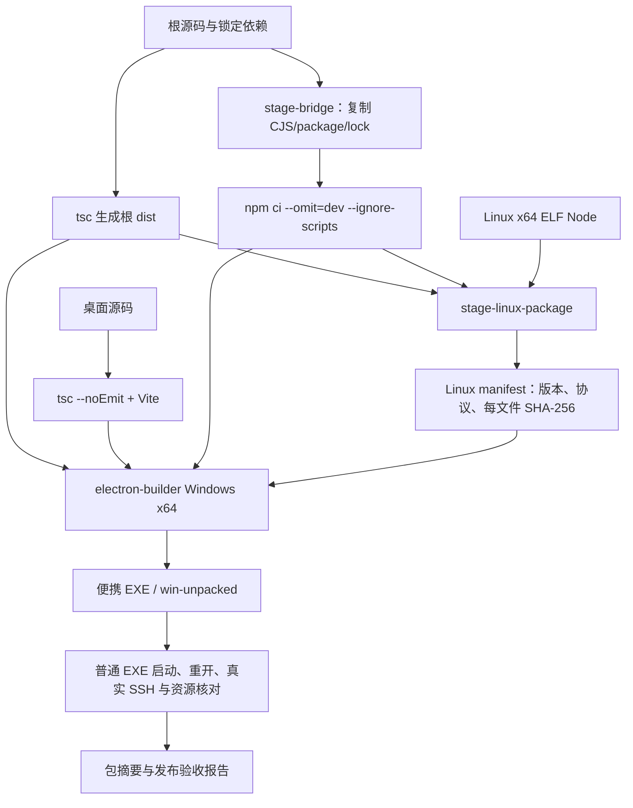

# M10 构建、发布与持久运行资源设计

更新：2026-10-13。桌面当前源码候选 0.6.0-alpha.9、根 CLI 0.1.0；新 Windows 候选包已构建并进行真实验收，稳定历史版本仍为 0.5.0。发布检查覆盖源码、窗口/后台、前端和 Linux 离线资源。

## 1. 功能范围

| 功能 ID | 交付目标 | 当前状态 |
| --- | --- | --- |
| M10-F01 | 编译、类型检查、构建、自动化回归入口 | alpha.9 桌面 125/125；根 43/43 是 alpha.6 未改动部分的历史基线；当前界面/发布检查见图优化报告 |
| M10-F02 | Windows x64 便携 EXE 包含前端、后台、生产依赖和 Linux 离线包 | 0.6.0-alpha.9 节点图候选包已构建并校验；普通启动/重开单独实测，状态见报告 |
| M10-F03 | Linux x64 离线包包含真实 Linux Node、后台/依赖及每文件摘要清单 | 已生成 `0.6.0-alpha.9` 资源及可信 alpha.2–alpha.8 manifest；当前真实远端范围见 I06B 报告，历史 alpha.2 证据保留 |
| M10-F04 | 发布包坏路径/坏摘要拒绝安装，远端校验后原子激活版本 | 校验实现，受控安全检查及真实正常安装通过；破坏性故障矩阵未完成 |
| M10-F05 | 便携启动器清理临时文件后，后台/worker 使用用户目录持久副本 | worker 受控测试通过；新 Coordinator 的 Windows 候选真实验收通过 |
| M10-F06 | 发布报告记录版本、EXE 大小/SHA-256、实际验证环境和未测项 | 0.5.0 有报告；6A 候选验收及包摘要已形成；正式 0.6.0 准出待后续 |
| M10-F07 | 升级、回滚、旧配置迁移和安全删除有用户流程 | 部分历史配置兼容；I06 升级/回滚/卸载产品流程未实现 |

M10 管理可执行材料和一致性，不管理模型/账号，也不把远端原生 CLI 打进包。用户机器或 Linux 上仍须已有可用 OpenCode/Claude/Codex 及其原生认证。缺少这些时，安装 Bridge 成功不代表 Agent 能回答。

## 2. 三种版本与构建物

| 名称 | 当前值/位置 | 含义 |
| --- | --- | --- |
| 根 CLI 包版本 | `package.json` = `0.1.0` | 本地 CLI 工程包版本；不代表当前桌面功能发布版 |
| 桌面源码版本 | `desktop/package.json` = `0.6.0-alpha.9` | 当前开发候选版本；也作为 Linux daemon 清单版本 |
| 已发布 Windows EXE | `AgentBridge-0.5.0-Windows-x64.exe` | 稳定历史程序；最新源码候选为 `AgentBridge-0.6.0-alpha.9-Windows-x64.exe`，范围见本次交付 |
| 根编译物 | `dist/` | TypeScript core/CLI/DesktopHost，供桌面与 daemon 共用 |
| 前端编译物 | `desktop/dist/` | Vite 静态资源，Electron 窗口加载 |
| 后台暂存物 | `desktop/.bridge-runtime/` | CJS 后台与根生产依赖闭包 |
| Linux 离线资源 | `desktop/.linux-package/` | manifest + Linux 后台/依赖/runtime/node |
| 解包目录 | `desktop/release/win-unpacked/` | 构建中间物，不是保证最新的发布事实 |

当前 `win-unpacked` 已重建为 alpha.9 并通过完整资源比对；普通 portable EXE 另行完成真实启动、关闭、重开与冻结后台核验。alpha.2 的历史 SSH/原生任务验收不冒充本次全量复测。

## 3. 构建流程



现有入口（仓库根目录，Node ≥22.13，npm 依赖已安装）：

```bash
npm run lint
npm run typecheck
npm test
npm test --prefix desktop
npm run desktop:build
npm run desktop:pack
npm run desktop:dist
```

`desktop:pack` 生成 Windows 解包目录，`desktop:dist` 生成 portable EXE；两者都先根编译和前端构建，再执行 staging。环境必须具备 electron-builder Windows 构建条件和已准备的 Linux Node 资源。运行这些命令会改写 `dist`、staging、release，不连接真实服务器，也不自动发布到外部站点。

`stage-bridge.cjs` 通过 npm 的实际执行路径运行 `ci --omit=dev --ignore-scripts`。这样从锁文件安装生产依赖，不执行依赖安装脚本；依赖下载仍可能访问注册表。SSH `ssh2` 属于根生产依赖，必须随 Bridge 后台复制，不能只在开发机 node_modules 存在。

## 4. Windows 包资源布局

electron-builder 把桌面前端/窗口主进程放进应用 asar，把需要独立进程和远端安装的材料放在 `extraResources`：

```text
resources/
  app.asar                         # desktop/dist + electron 主窗口模块
  bridge/
    dist/                          # 根编译后 DesktopHost/core
    desktop/electron/*.cjs         # 独立 Coordinator 和原生/SSH 模块
    node_modules/                  # 根生产依赖，包括 ssh2
    package.json
    bootstrap.sh                   # 保持 WSL 启动兼容
  linux-package/
    manifest.json
    dist/
    desktop/electron/
    node_modules/
    runtime/node                   # 真实 Linux x64 二进制
```

`extraResources` 的 CJS 来源是 `.bridge-runtime/desktop/electron`，而应用自身仍保留 `electron/**/*`。不能用改写打包文件集合的方式遗漏窗口入口，也不能只把新后台放在开发源码目录。

包参数在 [desktop/package.json](../../../desktop/package.json)：Windows x64 portable、`artifactName=AgentBridge-${version}-Windows-x64.exe`、asar 启用、当前不签 executable。用户获取程序后应以该包的实际版本和摘要为准。

## 5. Linux 离线包与可信清单

`stageLinuxPackage({repo,runtime,destination,nodeExecutable?,version})` 的真实接口由 [stage-linux-package.cjs](../../../desktop/scripts/stage-linux-package.cjs)导出。

Linux 构建默认使用当前 `process.execPath`；可通过 `AGENTBRIDGE_LINUX_NODE` 指定真实 Linux Node。检查 ELF 魔数、64 位和 x86_64 machine 字段，禁止把 Windows node.exe 当远端运行时。Windows 侧构建若未显式提供，复用已准备的 `.linux-package/runtime/node` 和原 manifest 版本信息，不能在 Windows 运行该 ELF 来探测版本，因此发布时应核对它来自已验证 Linux 包。

复制根 `dist`、生产 node_modules、后台 CJS；生成 Linux `package.json` 时使用桌面候选版本并移除 scripts/devDependencies。资源遍历不保留符号链接，只收普通文件；每文件记录相对路径、字节数和 SHA-256，排序后写 manifest。清单示意：

```json
{
  "version": "0.6.0-alpha.9",
  "protocolVersion": 2,
  "platform": "linux",
  "arch": "x64",
  "glibcMinimum": "2.28",
  "runtime": {"path": "runtime/node", "version": "v22.23.1"},
  "files": [{"path":"desktop/electron/machine-daemon.cjs","sha256":"<64位摘要>","size":12345}]
}
```

清单是随可信客户端构建物携带的安装期校验依据，不是独立签名发布系统。客户端验证所有清单文件实际类型、大小和摘要后，构建 ustar+gzip 归档。私有 Node 总是在包中，远端已有 Node ≥22.13 时优先用系统 Node，无 Node 时使用版本目录中的 `runtime/node`；不修改系统 PATH、npm 或 Node 安装。

当前自动安装要求 Linux x64/glibc ≥2.28。没有 ARM64/musl 支持，也不能把一个 ELF 检查等同于在所有兼容发行版验证过运行。安装步骤和原子激活见 [M04 SSH 设计](../04-ssh-access/design.md)，运行身份与数据见 [M05](../05-linux-daemon/design.md)。

## 6. 便携运行资源为何要持久化

便携 EXE 的窗口关闭后，启动器可删除临时解包目录。旧实现若从该目录启动 detached Claude worker，会因 ICU 文件缺失在执行前失败。当前把必要资源保存到用户配置目录：

| 持久层 | 内容 | 生命周期 |
| --- | --- | --- |
| `workerRuntime` | executable、ICU、V8 snapshot、同目录运行 DLL/许可证等普通文件 | 版本+架构目录，原子发布，正在使用的资源不覆盖 |
| `coordinatorRuntime` | 整套 root dist、后台 CJS、生产依赖、Linux 离线包 | 桌面版本+代码摘要目录，GUI 与临时解包目录无关 |
| Linux 版本目录 | daemon/依赖/私有 Node | SSH 断开不删除安装物；运行数据另存 |

`workerRuntime` 复用副本时检查文件大小，并未对该副本重新逐文件算 SHA-256；Coordinator 缓存摘要也未覆盖全部依赖与 Linux 包内容。这些是目前实现边界，发布时需实际核对资源，不能把缓存 manifest 存在视为整包已验收。

## 7. 发布准出与尚未实现

发布须同时满足：当前源码检查、所有必交功能测试、Windows 普通 EXE 启动/重开/后台资源生存、真实 SSH 接入和原任务恢复、实际发布包资源比对、包 SHA-256/大小及能力限制记录。前端构建成功、Node 自动化通过或旧 EXE 窗口能打开都不能替代这些准出条件。

当前 alpha.8 节点图候选 EXE 已生成并通过资源比对；alpha.2 的 Windows/SSH 主要验收保留为历史证据，正式 0.6.0 全量准出未完成。I06B 节点图和 I06C 升级/故障交付不能由 I06A 资源包推定完成。远端已有其他 daemon 版本时当前拒绝自动升级，忙时切换、失败回滚、安全卸载尚未实现。

## 8. 代码与维护入口

构建：[根 package.json](../../../package.json)、[桌面 package.json](../../../desktop/package.json)、[stage-bridge.cjs](../../../desktop/scripts/stage-bridge.cjs)、[stage-linux-package.cjs](../../../desktop/scripts/stage-linux-package.cjs)。持久资源：[worker-runtime.cjs](../../../desktop/electron/worker-runtime.cjs)、[coordinator-runtime.cjs](../../../desktop/electron/coordinator-runtime.cjs)。

修改依赖、资源路径、版本或运行材料时，同步本设计、[测试报告](test-report.md)、操作说明、当期迭代发布记录和包证据。变更来源：[I06 开发 A01/A03/C05/C06](../../iterations/I06/development.md)、[I06 当前进度](../../iterations/I06/progress.md)；旧 `0.5.0` 证据保留为旧版本历史。

## 2026-10-12：6A 收尾

Linux 包的 node_modules 通过独立 extraResources 项复制。electron-builder 会过滤父资源内嵌的 node_modules，仅复制 .linux-package 父目录会丢失 1254 个 manifest 文件，导致 SSH 预检失败。

新增 [verify-package.cjs](../../../desktop/scripts/verify-package.cjs)，在 pack:win/dist:win 后强制执行。逐项校验 Linux manifest 的存在、大小和 SHA-256，比较窗口 app.asar 和冻结后台的全部 CJS、前端构建输出与版本，便携包记录大小/SHA-256。缺文件或代码过期直接让构建失败，不降低完整性标准。

## Codex 修复候选资源

alpha.3 把修复后的 Codex worker 打入窗口 app.asar、冻结后台与 Linux 离线包。以新版本/摘要冻结，不覆盖运行中的 alpha.2 目录；普通关闭窗口不会替换旧 Coordinator；可以直接用新 EXE 的设置页停止同一配置内的旧后台，再次打开新 EXE 加载新代码，无需旧程序。发布校验支持 `AGENTBRIDGE_PACKAGE_REPORT` 指定独立输出路径，该历史版本未设置时维持原输出位置，alpha.8 已改为按版本隔离输出（见下方 I06B 记录）。新版本用独立报告保留旧包的历史证据，详见 [交付](../../iterations/I06/codex-discovery-fix.md)。

## 已安装 daemon 的兼容清单

alpha.4 将 `desktop/compatible-daemons/` 内已验证旧发布 manifest 复制到新 Linux 包并纳入逐文件 SHA-256 清单；manifest 新增可选 `compatibleDaemons` 索引，含 version/manifestPath/manifestDigest。旧协议 2 清单可没有该字段。alpha.4 包含 alpha.2、alpha.3 的可信清单，仅允许匹配的已安装发布复用，不安装这些旧清单、不自动升级原 daemon。清单来源、校验与验收见 [兼容复用交付](../../iterations/I06/ssh-compatible-reuse.md)。


历史 alpha.5 另收录已交付 alpha.4 的 manifest；从先前已通过包报告的实际 Linux 离线 manifest 复制并核对摘要，保持客户端补丁后对已有后台的可信复用。[本次交付](../../iterations/I06/ssh-error-recovery.md)。

## I06B 候选打包变化

alpha.9 前端锁定 @xyflow/react 12.12.0；GraphLayoutStore/GraphOperationJournal 随全部后台 CJS 复制入窗口与冻结运行时。远端包的协议仍为 2，旧 alpha.2–alpha.8 清单保持明确可信兼容；复用不升级旧 daemon。verify-package 的缺省报告改为 artifacts/package-check/<version>/package.json，也可用 AGENTBRIDGE_PACKAGE_REPORT 定向输出，避免覆盖历史 I06A 报告。当前源码与最终包对应情况见 [节点管理报告](../../iterations/I06/node-management.md)。

alpha.8 历史候选修复旧后台拖动与主居左；alpha.7 的 Linux 清单先与原交付 manifestDigest 核对一致，再收入可信兼容资源。允许复用旧 daemon，不自动升级用户远端；本次当前证据见 [alpha.8 拖动修复](../../iterations/I06/graph-drag-fix.md)。

alpha.9 收录的 alpha.8 Linux manifest 与原 alpha.8 包报告 manifestDigest 逐字节规范 JSON 摘要核对后保存；允许可信旧 daemon 复用，不自动升级远端。当前候选资源和实际验证见 [节点管理交付](../../iterations/I06/node-management.md)，SSH/原生任务沿用原版本证据，本次未重跑独立服务器。

## GitHub EXE 分发（M10-F06）

2026-10-13：alpha.9 Windows x64 EXE 已作为 GitHub 预发布附件提供，[下载程序](https://github.com/wsjq5477/MA-Relay/releases/download/v0.6.0-alpha.9/AgentBridge-0.6.0-alpha.9-Windows-x64.exe)、[发布页](https://github.com/wsjq5477/MA-Relay/releases/tag/v0.6.0-alpha.9)。用户无需自行编译或安装 WSL/Node.js 来运行 AgentBridge。稳定历史版本仍为 0.5.0；这次发布不代表完整 I06C 或正式 0.6.0 准出，也没有将本地 alpha.10 源码/程序同步到该标签。

程序通过 GitHub Release 附件分发，Git 源码仓库不保存 EXE。发布草稿绑定相应源码提交；先检查本地 EXE 大小和 SHA-256，上传 EXE 与校验文件，核对服务器返回的 state/size/digest 后发布为 prerelease。回应不明时查询同一 release/asset，不删附件重传或另建发布。候选包不能标为稳定版；过程不打包私有运行状态、不改变原生配置。具体本次事实见 [发布记录](../../iterations/I06/github-release.md)。
