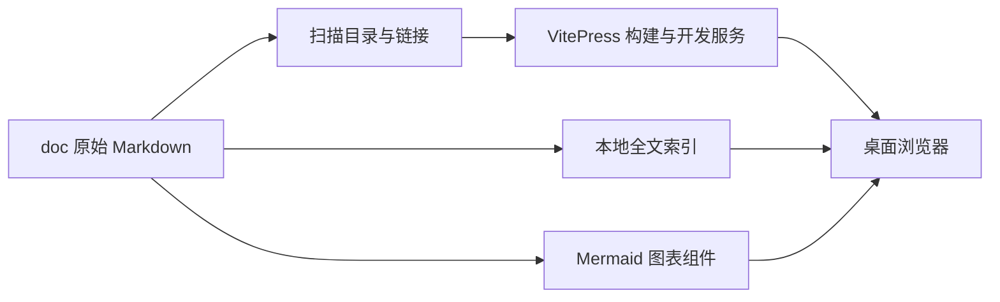

# M11 文档网页入口设计

更新：2026-10-12。该模块为仓库资料提供桌面网页阅读入口，不调用模型或控制 Agent。正文直接使用 `doc/`，与人类和 Agent 编辑的材料保持同源。

## 功能与范围

| 编号 | 功能 | 行为 |
| --- | --- | --- |
| M11-F01 | 同源 Markdown 阅读 | 文档首页、整体功能、架构、模块与报告直接生成页面，不维护网页正文副本 |
| M11-F02 | 分组目录与路由 | 顶部分类、左侧整体/模块/迭代目录、右侧二三级章节锚点；模块和迭代目录按文件自动生成 |
| M11-F03 | 本地全文搜索 | 浏览器索引检索当前文档；历史综合快照排除搜索，迭代历史保留 |
| M11-F04 | 桌面主题与图表 | 深浅主题、代码高亮、表格、Mermaid SVG；主题切换重绘图表 |
| M11-F05 | 文件引用阅读 | 文档内链正常跳转；显式引用的源码/脱敏证据新标签阅读或下载 |
| M11-F06 | 本地构建与运行 | 开发热更新、静态完整构建与本机预览；不自动发布到公网 |

用户已明确不考虑手机网页。本轮只验收桌面阅读、导航、搜索和图表，框架默认窄屏行为不作为本轮交付承诺。

## 结构与数据流



`index.md` 引用 README，不复制其正文。默认目录分为项目概览、模块设计与测试、验收与维护、迭代历史和历史资料。每个模块同时提供设计与测试报告，原生适配下继续分 OpenCode、Claude、Codex。

配置扫描实际模块和迭代文件，新目录加入后重启服务即可更新导航。现有页面内容变更直接热更新，静态构建则需重新生成。增加模块仍须按项目规范登记整体功能与测试，不以自动目录替代资料维护。

## 页面与交互

参考中文 Obsidian 文档站的三栏阅读结构：左侧折叠分组，中间正文，右侧当前页章节。顶部提供主要分类、搜索与主题切换。使用现有 AgentBridge 图标与紫色链接强调。

搜索由浏览器本地索引实现，不需要账号、外部搜索服务或模型。Markdown 中的 Mermaid 围栏转换为专用 Vue 组件，客户端按当前主题生成 SVG；失败时展示可读错误，不把源码静默当成渲染成功。

## 文件下载范围

`scripts/prepare-doc-site.mjs` 从文档中收集显式引用，导出允许扩展名的源码、图片、脱敏报告和日志。只复制仓库内实际文件；隐藏目录、凭据和 EXE 不导出。仓库外与隐藏开发材料转到网页说明页。

引用的 Markdown 和源码作为原扩展名加 `.txt` 导出（如 `.md.txt`、`.ts.txt`），避免资源被误认作文档路由或网站配置。图片、JSON 和日志保留原格式。引用资源链接使用新标签；普通文档链接保持站内导航。更新证据或源码后重新启动/构建以刷新资源副本。

## 启动和构建

```bash
npm run docs:dev
npm run docs:check
npm run docs:build
npm run docs:preview
```

开发/预览默认监听本机 4188，用户打开 `http://localhost:4188`。构建输出为 `doc/.vitepress/dist`，没有复制用户运行状态，也不安装远端 daemon。

文档工具采用 VitePress 2.0.0-alpha.20、Vue 3.5.43、Mermaid 12.1.0，版本由 lockfile 固定。VitePress 当前采用预发布版本，升级时需复验构建、搜索、链接和图表，不把版本更新当作无影响变更。

## 代码与维护

- [配置与目录](../../.vitepress/config.mts)。
- [主题](../../.vitepress/theme/index.ts)、[样式](../../.vitepress/theme/custom.css)。
- [Mermaid 组件](../../.vitepress/theme/MermaidDiagram.vue)。
- [引用资源准备](../../../scripts/prepare-doc-site.mjs)。
- [桌面浏览器验证](../../../desktop/tests/windows-doc-site.cjs)。
- [用户使用说明](../../web-reading.md)、[测试报告](test-report.md)。

本轮挂在 I06 的资料维护记录，不改变 Agent 的连接/执行范围。相关材料同时更新整体功能设计、模块目录、整体验证与迭代开发记录。
