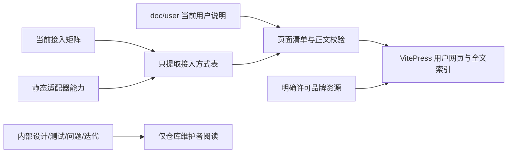

# M11 文档网页入口设计

M11-F01/F05：OpenDesk用户页明确原生退出检查、断开原节点可添加、真实Node必需和无法自动核验原生列表；协作页说明独立节点unknown的资源边界。仅更新用户正文，不将内部迭代/测试证据发布到网站。[行为来源](../../iterations/I08/opendesk-lifecycle-relation-scope.md)。

M11-F01/F05：用户Pi/Hermes页与方式表按alpha.50本地候选说明原生管理、禁用/目录切换和重载；公开alpha.46只导出边界保留。调用方与托管scope分开；内部迭代/证据不发布。 [最终实现、原始证据与范围](../../iterations/I08/hermes-mcp-config.md)。

M11-F01/F05：用户方式表继续从接入矩阵生成，DSH三入口按当前原生MCP配置实现标为已接入；HTTP执行、独立MCP与托管scope分开，OpenDesk CLI仍明确仅片段导出。不得把当前候选当作公开alpha.46能力。 [本轮证据](../../iterations/I08/wsl-host-readiness.md)。

## MCP02当前使用说明同步（2026-10-22）

补齐非GUI首次接入/原操作查询、同profile、60秒观测有效期和OpenDesk同名诊断条目冲突处理；更新当前alpha.46候选与真实验证边界。用户站测试6/6、构建/边界审计通过；内部专项与证据不发布。[本轮交付](../../iterations/I08/mcp-open-recovery.md)。

用户页新增OpenDesk独立章节与导航，接入/能力表由十个静态入口和当前矩阵共同生成，区分CLI HTTP、Desktop WebSocket和独立MCP。网页继续只发布doc/user，不含内部实现、编号或验证记录。 [实现与证据边界](../../iterations/I08/opendesk-existing-interfaces.md)。

## alpha.36整合边界

M11-F01：alpha.36整合基线含公开alpha.35执行资源级保护/原查询反馈与所有工作区增量；OpenCode宿主和原管理拒绝恢复并存，原身份/Session/unknown不迁移。精确收录alpha.34/35 daemon清单，客户端升级不自动替换远端。[完整交付](../../iterations/I07/alpha36-delivery.md)。

## 子任务说明的用户文档

用户协作页同步新普通子任务的简短说明、结果交回和不新增权限边界，并说明历史输入保持及超限不截断；不公开内部版本/日志/验收过程。网页清单、资源和导航保持。[行为来源](../../iterations/I07/delegation-context.md)。

## 当前 Agent 配置说明

M11-F01/F05：机器/MCP/DSH及各原生Agent用户页统一说明“机器与 Agent → 对应节点 → 配置”，区分固定目标的接入弹窗与全局应用设置。内部验证/打包材料仅保留在迭代和模块目录。[变更来源](../../iterations/I07/agent-row-configuration.md)。

## 当前连接说明

用户协作页区分当前主/成员/未分配角色、获准连接与目标状态，以及原父unknown不可新委派；只说明可用后台的操作，不公开内部编号/日志。页面清单、导航及网页发布范围保持。[行为来源](../../iterations/I07/agent-connections.md)。

## 当前管理恢复说明

M11-F01/F05：用户机器页说明原操作查看入口、设置台账与只读核对，DSH页区分服务待配置与真实错误。内部拒绝证明、测试过程和候选核验仍仅在内部迭代/模块材料，网页不暴露。[实现来源](../../iterations/I07/agent-management-recovery.md)。

本模块提供用户可见的当前功能、系统设计与使用文档，不调用模型或控制 Agent。公开网页使用 `doc/user/` 的 Markdown；仓库内部设计、测试报告、问题与迭代仍保留在原目录，供维护者追踪，不进入网页。

## 功能与范围

| 编号 | 功能 | 行为 |
| --- | --- | --- |
| M11-F01 | 用户 Markdown 阅读 | 发布当前产品、系统设计、操作说明和原生 Agent 章节，不维护 HTML 正文副本 |
| M11-F02 | 分组目录与路由 | 明确登记用户页；开始使用、功能设计、六种 Agent 和接入方式分组；DSH 单页覆盖三入口 |
| M11-F03 | 本地全文搜索 | 仅索引公开用户页；内部编号、报告、开发过程与历史均不参与 |
| M11-F04 | 桌面主题与图表 | 深浅主题、表格、代码高亮、Mermaid SVG；切换主题重绘图表 |
| M11-F05 | 公开链接与资源边界 | 正文链接只允许登记用户页；静态资源仅品牌图片，不导出源码、日志或验收材料 |
| M11-F06 | 本地构建与运行 | 开发热更新、静态构建与本机预览；构建执行发布范围审计，不自动部署公网 |

关系与协作用户页同时说明可用后台的只读委派列表、当前调用方归属和原任务查询，不混入内部迭代或验收材料。

当前验收范围是桌面阅读。页面说明当前能力与必要版本限制，不嵌入功能/测试编号、修复经过、验收流水账、问题列表或未来迭代计划。

## 内容归属与数据流



公开正文的权威来源为 `doc/user/`，内部模块设计仍承载实现契约与追踪编号。同一用户行为变化时应同步两类读者所需内容；不把内部设计全文复制为公开页，也不以过滤编号替代编辑正文。

`scripts/doc-site-content.mjs` 明确登记17个公开页面、两份生成表格和一个品牌资源。VitePress 的 `srcDir` 指向 `user`，生成表格不独立输出路由。配置拒绝任何未登记页面，导航不扫描内部模块或迭代目录。

## 用户阅读结构

首页直接给出原生CLI、原生API、MCP、ACP、插件、SDK六列接入总结；原生Agent总览增加功能对照。两表分别从当前接入矩阵与静态注册表生成，核对八个执行入口，避免人工维护多个状态副本。

原生适配导航列出 Claude Code、Codex、OpenCode、Hermes、Pi 和 DSH。DSH 专章包含 CLI / Windows Desktop / Linux-WSL Web 的区别、服务配置步骤、原生API选择原因、功能与限制。版本可用性仍如实标注，不把源码入口描述为公开alpha.34已有功能。

接入方式页解释六种方式的优点、代价、功能条件、逐场景选择和快速连接；公开网页不链接开发过程。内部的[接入指南](../../agent-integration-guide.md)继续提供开发实现与证据细节。

## 发布与资源边界

准备脚本仅生成两张表并复制许可品牌图到 `doc/user/public/`，不再从全仓库收集引用，也不生成源码/证据下载。旧自动生成的 `doc/public/references/` 会清理，原始证据仍留在 `artifacts/`。

正文检查拒绝内部编号、过程类文本、指向未许可材料的本地链接与include；原始HTML链接和引用式链接不作为绕过路径。最终构建审计另行检查页面集合、所有HTML/JS/JSON（含搜索索引）、内部路由与资源集合，覆盖隐藏导航后仍能访问或搜索内部材料的情况。

## 界面与构建

桌面三栏布局：左侧用户目录、中间正文、右侧二三级章节。搜索在本地浏览器执行；Mermaid由主题组件生成SVG并随主题重绘。保留原有品牌和主题，不依赖外部搜索或模型服务。

```bash
npm run docs:dev
npm run docs:check
npm run docs:test
npm run docs:build
npm run docs:preview
```

开发/预览默认本机4188；输出 `doc/.vitepress/dist`。本地运行不等于已经部署公网，不改变桌面EXE、原生Agent、SSH后台或模型能力。

## 维护与代码

- [公开页面与发布校验](../../../scripts/doc-site-content.mjs)、[准备资源](../../../scripts/prepare-doc-site.mjs)、[构建审计](../../../scripts/check-doc-site.mjs)。
- [站点配置](../../.vitepress/config.mts)、[主题](../../.vitepress/theme/index.ts)、[Mermaid组件](../../.vitepress/theme/MermaidDiagram.vue)。
- [发布边界测试](../../../tests/doc-site.test.mjs)、[Windows浏览器验证](../../../desktop/tests/windows-doc-site.cjs)。
- [网页维护说明](../../web-reading.md)、[测试报告](test-report.md)、[本轮变更](../../iterations/I07/user-documentation.md)。
