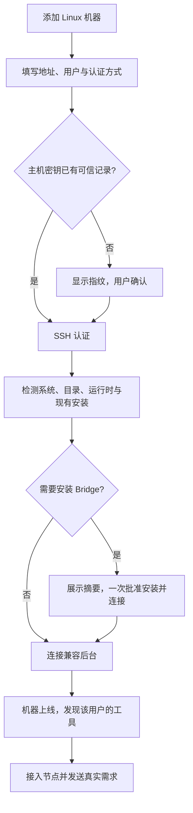

# AgentBridge 整体功能设计

## alpha.30候选：历史详情读取恢复

AB-F08/F10/F11/F17：历史详情由实际backend读取，明确未找到才按同机器同ID回历史；详情错误只影响本面板，不触发全局同步锁。仅顶层snapshot/pending失败保留全局锁，不重发原需求。 [需求、实现、逐项证据与边界](iterations/I07/history-detail-recovery.md)。

2026-10-19：当前完整源码已发布为 **alpha.29 GitHub预发布**，新Tag、EXE与SHA-256校验附件均已上传；版本、包资源与实际发布状态统一见[alpha.29 交付](iterations/I07/alpha29-release.md)。历史专项保留原日期/冻结范围，完整 I06C/I07C 未准出。

2026-10-19 / AB-F07/F09/F11/F12/F13：当前未发布源码上的Claude/Codex/OpenCode三主节点真实生产MCP发现→委派→读结果→汇总均通过，共六个有向组合、9个成功原生Task；重开只查原请求，无重放。新增可恢复验收工具及7项保护测试，产品接口/存储/权限/模型配置未改。[CT-02真实MCP委派](iterations/I07/connection-delegation.md)。

2026-10-19[Projects / Dots / Grok Bot研究](iterations/I07/projects-dots-bots-research.md)补充Agent名片、公共工作索引、产物目录、可见交接与显式上下文建议。已有登记/文档/任务仍按当前实现；建议未变成新API或已实现能力，自动续接/多用户仍不列为目标。Grok Build有公开ACP入口，只列候选，不计入当前六种适配器。

2026-10-19 / AB-F07/F08/F10/F11验证补齐：Claude/OpenCode/Codex当前WSL版本真实直接生命周期通过，Codex本版本原thread续聊回忆原标记通过，历史版本/Windows失败保留。新验收脚本在首发前持久意图，重开仅查询原ID；产品行为、协议和数据结构无变更。[CT-02首批真实验证](iterations/I07/connection-native.md)；不是CT-02六工具/双向协作全部完成。

2026-10-19 / AB-F02/F07/F10/F11/F12/F13：CT-01未发布源码将执行、被委派与调用Bridge MCP分开声明，节点概览/关系源与目标/需求表单及后台准入一致。Hermes/Pi/DSH可直接执行和接收普通委派，不能作MCP主节点；历史关系保留。确定的原关系拒绝可按原operationId恢复草稿等待，外来收据和裸同码异常仍unknown。[CT-01实际交付](iterations/I07/connection-capabilities.md)，受控与真实/包证据分别验收。

2026-10-18用户明确以“Agent发现和操控其他Agent的通路”为核心目标；自动续接、多用户不作为本轮后续目标，已有扩展与历史证据保留。当前能力与后续CT-01至CT-05统一见[接入矩阵](agent-integration-matrix.md)，ACP为拟议可选通用驱动，公共MD/可移植上下文为现有公共材料上的后续契约，均未新增实现。[本轮研究与边界](iterations/I07/connectivity-research.md)。

2026-10-18 / AB-F08/11/19/20/21/22：已实测同WSL三个独立Claude宿主的公共文档交付、独立复核、原主会话持续协调及原生终态后验收，五个自动原生回合且恢复不重放。这是未发布源码的限定真实证据，代码编译返修、独立SSH和完整I07C/I06C继续待验。[实际范围](iterations/I07/native-members.md)。

2026-10-18未发布源码：AB-F10/11/19/20/22 补齐仅直接会话工具的小队准入与原 operationId 核对恢复。新登记/新执行能力不足时在保存尝试/认领之前拒绝；核对收据持久、跨任务/控制类型冲突，unknown 只查原任务。当前 poll.4 与 GitHub alpha.28 不含本片。[需求与验证](iterations/I07/native-integration-guards.md)。

2026-10-18 桌面空闲优化（本地候选）：AB-F01/F02/F07/F17，机器状态仍实时更新，安装扫描改为后台首次使用与手动扫描；关系图去掉跳秒文字，列表保留展开/位置，Windows后台启动补隐藏窗口参数。全桌面424/424、核心45/45、Windows受控界面3组通过；普通EXE与现场边界见[专项](iterations/I07/desktop-polling.md)。

2026-10-18 / AB-F01/02/08/11，M01/M03/M05/M06：当前未发布源码按目标用户当前命令入口报告版本，每机器每种工具显示一个节点，升级沿用原节点/角色；旧安装保留历史归属并共享unknown占用，不重发原请求。PATH当前入口异常时报告原异常，不切换旧版本。真实WSL Claude 2.1.302发现与隔离历史合流已验证；EXE/独立SSH边界及工程证据见[专项](iterations/I07/current-agent-discovery.md)。

## alpha.28已预发布：SSH持久拒绝恢复

AB-F08/F10/F11/F17：只读原daemon持久拒绝，经认证身份、原节点意图和参数摘要核对后结算rejected，释放对应占位。裸NOT_CONFIGURED或缺证据保持unknown；不重发、不改原任务终态。 [设计、需求、开发、验收与边界](iterations/I06/daemon-rejection-recovery.md)。

## alpha.27已预发布：Windows未派发与持久化恢复

AB-F08/F10/F11/F14/F17：Codex准备失败保留原failed终态，原任务核对仅凭完整未派发证据释放；本地台账分享锁有界重试，原NETWORK_PERSIST/严格历史EPERM且确定未派发才拒绝结算；原生或结果未知不放行。对应Windows EXE与校验文件已公开分发；新EXE/验证/升级以[当次交付](iterations/I06/windows-start-persistence.md)为准。
## 2026-10-17：alpha.24 Linux 后台连接恢复候选

AB-F05/F06/F17，M04/M10：alpha.26 预发布补收原 alpha.24/alpha.25 可信清单，解决 alpha.25 拒绝连接原 alpha.24 且无法进入在线维护的问题；仍逐文件校验并保留原机器/请求，确认维护后才升级。GitHub已为alpha.26，用户故障服务器未复测。候选不含另有的 I07 续接增量；另提供同资源的Linux x64 daemon归档（非Linux桌面版/一键升级器）。[完整专项](iterations/I06/ssh-alpha24-upgrade.md)。

2026-10-17 / alpha.25源码与GitHub预发布：AB-F08/F10/F11，M02/M03/M06/M07/M10修复未完成执行上下文缺少Agent身份时截获原请求/任务查询的问题；仅匹配原回执结算，缺收据继续unknown。包含先前不完整任务回应保护；AB-F17已分发对应Windows EXE和校验文件。见[需求、实现、发布与证据](iterations/I06/windows-context-recovery.md)。

更新：2026-10-16。适用：Windows0.5.0稳定历史功能，以及0.6.0-alpha.23预发布的小队协作与持续协调首批（包含此前未确认资源范围、配置拒绝恢复及发现修复）。每项明确区分实现、发布和验收状态。

2026-10-16发布前交付记录：alpha.24补齐小队停止与原生终态核对；当时GitHub预发布alpha.23包含I07A/B及I07C首批持续协调；[发布及下载](iterations/I07/github-release.md)。[I07C首批交付](iterations/I07/automation.md)明确真实/受控证据，完整I07C未准出。

## 1. 产品解决什么问题

用户已经在不同机器上安装并配置了自己的 Agent。当前源码接入 Claude Code、OpenCode、Codex、Nous Research Hermes、Pi Coding Agent 和 DeepSeek Harness（DSH）；后三种为 alpha.28 后新增的直接会话适配，尚未进入已发布 EXE。AgentBridge 把这些工具呈现为可观察的 Agent 节点，用户在一个客户端中发需求、看进度和读取结果；权限与协作能力按工具分别声明。

中央后台管理连接与消息，不作为主 Agent 推理。主 Agent 是用户从已接入工具节点中指定的真实 Claude Code、OpenCode 或 Codex；它只能通过受限协作接口发现、委派和查询获准的子 Agent。

用户不用在 AgentBridge 重新配置模型、供应商或模型 API Key。账号、模型、工具权限与原生运行环境由各 Agent 自己管理。

## 2. 用户面对的对象

| 对象 | 用普通话解释 | 示例 |
| --- | --- | --- |
| 机器 / 执行环境 | 能访问某个用户安装工具与文件的地方 | Windows、Windows 下的 WSL Ubuntu、SSH 接入的 Linux 用户环境 |
| Agent 节点 | 某个环境中的一个受支持工具安装 | Windows 上的 Claude Code、Linux 上的 OpenCode |
| 执行上下文 | 为具体任务保存目录、运行配置与执行记录的内部实例 | 本轮在 Linux 的 `/srv/project` 执行 |
| 会话 | 与同一个 Agent 连续讨论同一项需求 | 分析 → 修改 → 解释测试结果 |
| 任务 | 会话中的一次请求与执行 | “分析当前目录”这一轮 |
| 协作关系 | 当前主节点及它获准连接的子节点 | Claude 为主，OpenCode 为子 |

节点不绑定文件夹，不绑定模型。目录在发送具体需求时才指定；不需要操作已有文件时可以留空，后台使用该节点的默认执行目录。同一节点、目录与模式会复用上下文，新会话不保证文件目录相互隔离。

WSL 是单独的执行环境，但属于同一台物理 Windows 宿主。SSH 机器身份按远端登录用户与 Bridge profile 绑定，不能把两个不同用户误合并为同一个可授权身份。完整对象定义见 [数据模型](data-model.md)。

## 3. 完整功能目录

`AB-Fxx` 是整体功能编号；模块内使用 `Mxx-Fxx` 等细化编号，测试报告再映射实际用例。整体状态不能代替具体工具能力与环境验证。

| 功能 | 用户得到什么 | 当前状态 | 模块与验收 |
| --- | --- | --- | --- |
| AB-F01 机器概览 | 首先看到机器，再看到机器上的工具；没有项目也能查看 | 本机 Windows/WSL 已发布；alpha.10 SSH 编辑/断开/移除/恢复专项通过，历史和身份保留 | [M03](modules/03-machine-network/design.md) / [报告](modules/03-machine-network/test-report.md) |
| AB-F02 自动发现工具 | 扫描受支持安装位置，显示名称、版本、健康与安装位置 | 当前源码注册六种工具，含 Hermes/Pi/DSH 与 Windows npm 入口；扫描不调用模型，SSH 须更新实际远端 daemon | [M03](modules/03-machine-network/design.md) / [报告](modules/03-machine-network/test-report.md) |
| AB-F03 接入节点 | 图节点动作接入；不要求项目、模型和供应商 | 0.5.0 多选已发布；alpha.9 支持按机器添加、断开、移除及原身份恢复 | [M01](modules/01-desktop/design.md) / [报告](modules/01-desktop/test-report.md) |
| AB-F04 SSH 添加 Linux | 输入地址、端口、用户名和已有 SSH 登录方式 | 源码已实现；Windows 密码与真实 Linux 接入通过；其他认证专项范围见 M04 报告 | [M04](modules/04-ssh-access/design.md) / [报告](modules/04-ssh-access/test-report.md) |
| AB-F05 主机信任与凭据 | 首次确认指纹；默认不保存秘密；可选 Windows 系统加密保存 | 源码与受控测试存在；Windows 密码/DPAPI 及加密私钥/隔离 agent 有实际证据；系统服务兼容专项保留 | [M04](modules/04-ssh-access/design.md) / [报告](modules/04-ssh-access/test-report.md) |
| AB-F06 远端后台部署 | 用户确认安装摘要后自动部署用户态 daemon；无需第二终端 | 历史真实 Linux 验收保留；alpha.14 提供上传阶段/错误类别和明确失败后的重新检测入口，保持原安装 ID；原服务器本次未实测 | [M04](modules/04-ssh-access/design.md)、[M05](modules/05-linux-daemon/design.md) |
| AB-F07 原生工具执行 | 沿用工具原有账号与配置，执行真实需求 | OpenCode/Claude 有历史真实证据，Codex 有环境限制；当前源码新增 Hermes/Pi/DSH 直接会话，验证层级见专项 | [M06](modules/06-native-adapters/design.md) / [报告](modules/06-native-adapters/test-report.md) |
| AB-F08 新会话与续聊 | 发起需求，原会话追问，每轮独立记录 | 已发布；能力取决于原生适配；SSH 同会话两轮已记录 | [M07](modules/07-task-session/design.md) / [报告](modules/07-task-session/test-report.md) |
| AB-F09 进度、回答与看板 | 看来源、状态、本轮回答、工具过程与最终结果 | 已发布；窗口通过轮询刷新，不是直接订阅原生 token | [M01](modules/01-desktop/design.md)、[M06](modules/06-native-adapters/design.md) |
| AB-F10 权限、输入与取消 | 通过原任务处理原生等待；取消结果以原生确认判断 | alpha.12 严格核对原控制收据、表单遮罩及恢复台账脱敏；原生支持范围分别记录 | [M06](modules/06-native-adapters/design.md)、[M07](modules/07-task-session/design.md) |
| AB-F11 未确认请求与恢复 | 原 ID 查询，不重发 Prompt；保留历史和占位 | alpha.18 修复 Windows OpenCode 未派发资源错误的原记录恢复，显示查询结果与原因；历史功能已发布；alpha.10 已观察历史跨重开保留，cursorGap 全量快照/分页补偿通过隔离 TCP SSH 验证 | [M07](modules/07-task-session/design.md) / [报告](modules/07-task-session/test-report.md) |
| AB-F12 指定主从关系 | 用户指定主 Agent 及允许的子节点 | 一个默认组已发布；alpha.6 图编辑及稳定保存已实现，换主后活跃原父权限已修复 | [M08](modules/08-collaboration/design.md) / [报告](modules/08-collaboration/test-report.md) |
| AB-F13 原生 Agent 协作 | 主 Agent 实际调用工具委派，读取子结果并汇总 | 当前未发布源码：WSL Claude/Codex/OpenCode六个委派方向真实通过；历史Windows/WSL与独立SSH双向证据保留原日期，本片不覆盖新EXE/独立SSH | [M08](modules/08-collaboration/design.md) / [报告](modules/08-collaboration/test-report.md)、[CT-02](iterations/I07/connection-delegation.md) |
| AB-F14 常驻中央后台 | 关闭窗口继续协调，重开复用历史与连接 | I06A 源码已实现；0.6.0-alpha.2 候选 Windows 关闭/停止/重开已验收 | [M02](modules/02-coordinator/design.md) / [报告](modules/02-coordinator/test-report.md) |
| AB-F15 CLI 兼容入口 | 单终端自动发现、提交、续聊、查看和控制 OpenCode | 已实现；不等同于桌面节点网络的全部入口 | [M09](modules/09-cli-hub-edge/design.md) / [报告](modules/09-cli-hub-edge/test-report.md) |
| AB-F16 节点图 | 机器分组、拖动节点、拖拽端点授权连线 | alpha.8 支持旧后台下本机拖动、整组背景拖动及主居左；主角色/方向/避让保留；alpha.10 保留原图交互并加入机器维护，当前首批证据见 6C 报告，原生链保留 alpha.6 证据 | [M01](modules/01-desktop/design.md)、[M08](modules/08-collaboration/design.md) |
| AB-F17 发布与安装维护 | 源码、离线包、Windows EXE 一致，版本可验证 | 0.5.0 历史稳定；6A 候选已验收，alpha.12 可信升级/回滚/停止/卸载源码与受控验证通过；正式 0.6.0 准出见当前报告 | [M10](modules/10-packaging/design.md) / [报告](modules/10-packaging/test-report.md) |
| AB-F18 网页资料入口 | 桌面分组目录、同源 Markdown、章节导航、全文搜索、主题和图表 | 已实现；独立于 Agent 控制界面 | [M11 设计](modules/11-documentation-portal/design.md) / [报告](modules/11-documentation-portal/test-report.md) |
| AB-F19 智能体登记与小队 | 登记外部已有功能的智能体、说明职责/边界，组成小队和独立工作 | alpha.23预发布已包含；不实现Skill/模型/目录或业务能力 | [M03](modules/03-machine-network/design.md)、[M08](modules/08-collaboration/design.md) |
| AB-F20 小队公共空间 | 共享约定/文档/群消息、成员通知、按权限写入与手动原生执行 | alpha.23预发布包含I07A基础；任务交接见AB-F21，自动持续协调首批见AB-F22，完整I07C未准出 | [M01](modules/01-desktop/design.md)、[M08](modules/08-collaboration/design.md)、[本次交付](iterations/I07/delivery.md) |
| AB-F21 小队任务与授权交接 | 分配/接手、依赖、精确产物版本、限额交接、返修历史与业务验收 | alpha.23预发布包含I07B基础；未授权自动成员保持手动，交接本身不等于原生已启动 | [M07](modules/07-task-session/design.md)、[M08](modules/08-collaboration/design.md)、[I07B任务交接交付](iterations/I07/task-handoff.md) |
| AB-F22 持续协调首批 | 用户授权自动成员与预算，重要事件激活、原会话续接、原生终态后验收 | alpha.23已分发；alpha.24本地候选新增停止/撤权与原生终态核对，真实Claude取消通过；其他接入/多原生角色/完整故障矩阵未准出 | [M02](modules/02-coordinator/design.md)、[M06](modules/06-native-adapters/design.md)、[I07C首批交付](iterations/I07/automation.md) |

## 4. 用户的完整操作路径

### 4.1 本机与 WSL

打开程序 → 识别机器和工具 → 点击节点接入 → 开始会话 → 输入需求与可选目录 → 查看回答与过程。需要协作时先保存主从关系，再从主节点创建允许协作的会话。

安装探测通过只说明工具能被找到、调用与检查；“模型真实回复验证”是另一项执行。账号拒绝或默认模型不可用应在原工具中修复，不自动替换供应商。

### 4.2 独立 Linux 服务器

首次主机指纹和安装决定有实际意义。除这些步骤及已有 SSH 认证外，不要求用户再复制设备 Token 或配置中央公网地址。主机密钥改变必须停止连接，不能提供忽略身份检查的捷径。

服务器项目必须在服务器上存在；AgentBridge 不自动同步本机代码，也不把 Windows 路径转换为远端 `/mnt/c`。

### 4.3 新会话与续聊

每次发送生成稳定的 `requestId`。新会话创建或选择属于目标节点的上下文，提交后返回 Task 与 Conversation。后续追问携带原 `conversationId`，保持原节点、上下文目录与原生 Session；已保存的配置按各适配器核验，原生全局配置仍由工具管理。当前没有对三种工具统一拍摄全局配置指纹。

界面在上一轮结束且后端 `canContinue` 为真时允许发送。该字段不保证每个原生版本都能成功续接：当前 Codex 有 thread 绑定时仍可能显示输入，原生 resume 失败后在本轮显示错误，尚未把该限制完整转为禁用入口。连接验证记录有专用标识，不用它继续实际需求。

### 4.4 协作

用户指定主节点和子节点 → 保存关系 → 发送允许协作的主任务 → 主 Agent 通过 MCP 查询允许的子节点 → 委派子任务 → 读取真实子结果 → 在主会话总结。

“允许协作”不保证模型一定委派；验收必须有真实协作工具调用、子任务和父结果，不能把主 Agent 自己回答或人工复制结果算作协作。

alpha.8 节点图编辑同一套权限。拖动位置只是布局变更；端点连线先成为草稿，只有后台稳定收据确认后生效。轮询不吞草稿，冲突显式处理，回应未知只查询原 ID；换主不转交旧父的子任务。

## 5. 关闭、断开、取消的区别

| 操作 | 预期行为与当前边界 |
| --- | --- |
| 关闭 I06A 窗口 | 退出窗口客户端，独立 Coordinator 继续运行；候选 Windows 包已实测 |
| 断开 SSH 机器 | 关闭通信并关闭自动重连，不停止 daemon 已接收任务 |
| 网络中断 | 无口令私钥、可用 agent 或已保存的凭据可尝试重连；未保存密码/加密私钥口令时仍需输入；不重发任务 |
| 停止中央后台 | 协作与聚合暂不可用，远端 daemon 保留已接收任务；后台接口存在，设置页已提供明确停止入口 |
| 取消某个任务 | 只控制原任务；确认收到请求与实际取消是两个不同事实 |
| 旧 CLI 的 `service stop` | 停止该 CLI 实例及核验归属的托管服务，语义不能套用于“关闭窗口” |

中央机器关机、睡眠或停止全部后台时，不承诺协作仍可进行。Linux 的注销清理政策可能影响 detached 进程，需按实际服务器验收。

## 6. 必须向用户解释清楚的状态

- “已发现”：找到受支持工具，尚未接入网络。
- “已接入”：节点已允许使用；不代表模型已真实回复。
- “机器离线”：当前无法通信，历史结果不删除。
- “正在工作”：原任务尚未结束；等待原生权限也可能显示此状态。
- “执行待核对”：调用或结果不明，只查原 ID，不换 ID 重做。
- “不支持”：本适配器或原生版本没有该能力，不假成功。

一次请求的回答和执行过程分别显示。Claude 的文本 delta 在呈现层合并，不能把一个 token 一条过程记录作为面向用户的默认阅读体验。

## 7. 产品边界与后续候选

AgentBridge 不重写 Agent，不负责模型供应商配置，不调度编译机或实验室设备，不提供任意远程 shell，不创建通用工作流引擎。SSH 只用于 Bridge 部署、身份验证与受控消息传输。

自研 Agent 可按 I07A/B 的本机 MCP 成员契约接入公共空间和任务板；当前另有[原生适配开发接口与指南](custom-agent-development.md)，开发者实现宿主、测试后静态注册并随包部署。它不是任意命令或 MCP 地址的自动执行器。Hermes/Pi/DSH 首批直接会话实现与六种本地图标见[扩展专项](iterations/I07/native-agent-expansion.md)，新增三种不声明 Bridge 权限表单或小队成员MCP注入；经典普通子任务的源码路径与真实未测边界见[矩阵](agent-integration-matrix.md)。通用执行接入方式由ACP试点评估；企业IM/Webhook、中央云端部署、多用户、文件同步与多层协作图保留历史候选记录，未纳入本轮后续目标。

I07已获准开发，I07A实现登记、小队、共享文档与群消息；I07B进一步实现工作项、依赖、版本化报告、直接授权交接、受限返修/重试及主角色/用户逐项验收。原生执行终态、业务报告和总工作验收分开；任务交接、授权次数及通知原子提交。真实Claude两轮开发和独立实际Node语法检查验证X失败到Y通过，界面受控流程通过。I07C首批增加授权事件激活和Claude原主会话自动续接；真实主角色3轮和后台重启通过。其他接入、多原生执行成员链及完整停止未验收，完整I07C与I06C未准出，实际见[I07C首批交付](iterations/I07/automation.md)。实际证据、首次失败和Windows候选见[I07B任务交接交付](iterations/I07/task-handoff.md)。

当前验收结论见 [整体验证报告](testing.md)；具体版本和进度见 [迭代路线](project-plan.md)。后续修改本功能目录时，按 [同步维护规则](development-guide.md)同时更新模块与迭代材料。

## 2026-10-12：6A 收尾

本节为 alpha.2 的历史收尾：当时源码与候选包为 0.6.0-alpha.2，稳定历史发布版为 0.5.0。本次已补齐后台停止入口、Windows 实际密码/DPAPI、加密私钥/命名管道 agent 分支、私有 Linux Node 实际启动和发布资源校验；修复 OpenCode 会话 API 缺少可续聊字段。真实 Windows 安装、两轮 Session、生命周期与普通便携程序均通过；具体证据与覆盖限制见 [6A 报告](iterations/I06/acceptance.md)，不提前标整个 I06 完成。

## 2026-10-12：Codex 自然语言发现修复

AB-F07/09/13、M01-F06、M06-CX-F01、M08-F02/F05：Codex 带协作 MCP 的原生回合增加明确的 Bridge 发现/委派指引，新会话与续聊均适用；不再以 CLI 内部 `/root` 列表判断 Bridge 连接为空。MCP 过程显示服务器与工具名；原始消息、请求去重、原生配置和授权边界不变。桌面 89/89 通过，真实 Codex → Claude 在受控隔离关系下完成发现、委派、回读和连接图。完整范围见 [Codex 报告](modules/06-native-adapters/codex/test-report.md)、[本次交付记录](iterations/I06/codex-discovery-fix.md)。

## 2026-10-12：已安装 SSH 后台兼容复用

AB-F05/06/11/17、M04/M05/M10：alpha.4 客户端可复用清单明确收录的 alpha.2/alpha.3 Linux 后台；核对可信文件摘要、原版本路径、owner/profile/UID/daemonId，保留原进程和任务，不自动升级。未知版本、同版本摘要不符或目录别名拒绝。probe 区分客户端离线包与实际后台版本。桌面 93/93、用户原 alpha.2 服务器的文件核验、真实握手/重连/OpenCode 发现及新包资源比对通过；[完整交付](iterations/I06/ssh-compatible-reuse.md)。旧 daemon 原生适配代码不因复用而更新，升级/回滚仍归 I06C。

## 新程序管理旧后台的操作说明

AB-F14：新 EXE 的设置页可以停止同一 profile 中通过认证的旧 Coordinator，旧窗口不是前提；再次打开新 EXE 才加载新后台代码。现有代码未修改，相关使用指引已校正，实际窗口验证见 [说明与证据](iterations/I06/client-background-operation.md)。这不是自动升级、回滚或任意进程管理能力。

## 2026-10-12：SSH 恢复后旧错误撤销

AB-F01/05/11/17，M01/M02/M03/M04/M10：alpha.5 成功恢复会清除机器目录的旧版本/连接报错并持久化；新的 SSH 拒绝/RPC 失败继续显示，任务失败和 unknown 不被恢复改写。95/95 桌面回归、Windows 受控卡片渲染与包资源校验通过；原用户状态只读核验，新远端重连未冒充实测。可信复用延续至 alpha.4，[完整交付](iterations/I06/ssh-error-recovery.md)。

## 2026-10-12：I06B 图编辑与原父权限

AB-F01/08/09/11/12/13/16/17，M01/M02/M03/M07/M08/M10：机器分组节点图、标签/节点目标、鼠标与键盘授权、独立布局和稳定保存收据已落地并完成主要验收；中央图意图与任务台账分开，提交前后进程中断按原 ID 核对。换主后活跃旧父可读控原子，新主不能接管。Windows 20 组/60 节点反馈已测，完整 UI、包、独立物理设备双向链与限制见 [实施与验收](iterations/I06/graph-implementation.md)。正式 0.6.0 仍需 I06C，原生 Codex 限制保留。

2026-10-13 6B 收尾：AB-F07/11/13，M02/M03/M05/M06/M07，OpenCode 新上下文等待健康元数据，确定执行前拒绝按原收据核对；缺收据/传输未知仍占位。最终独立双向链在原服务恢复后用原请求完成，用户原生配置保持；原生服务退出后的完整自动恢复未宣称完成。[交付及限制](iterations/I06/graph-implementation.md)。

## 2026-10-13：图方向与平移优化

AB-F16、M01/M10：alpha.7 主节点用皇冠和强调色突出，只显示主右侧输出/普通或子左侧输入；授权边绕过卡片。中键在节点、按钮、端点、机器组和空白处平移，视口保存/重开与授权分离；unknown 保持原操作锁定。卡片尺寸/原有坐标不随切主改变。[完整交付](iterations/I06/graph-usability.md)。

## 2026-10-13：旧后台拖动与主居左

AB-F16、M01/M10：原用户后台 alpha.5 不支持布局方法，alpha.7 因加载失败锁定全部拖动。alpha.8 改为明确本机布局模式，读取失败不妨碍节点/组/画布移动，保留所有原 pending ID，禁止旧式授权写入；支持恢复后以正常修订同步。机器背景可拖动，中键出界释放可靠，初始及自动整理将主节点所在组排最左侧；手动/保存坐标不被轮询重排。[实际窗口与证据](iterations/I06/graph-drag-fix.md)。

## 2026-10-13：单一机器图与节点生命周期

AB-F01/03/11/12/16，M01/M02/M03/M08/M10：alpha.9 将重复的机器/关系页合并，保留图授权、主需求和委派记录；添加从机器发现安装中选择，断开和移除以中央元数据原子撤权，保留原身份/任务/会话/安装。忙碌、等待、未知与离线拒绝变更；原 IPC 同样限制接入，丢 ACK 只查原 node operationId。完整范围及证据见 [alpha.9 节点管理](iterations/I06/node-management.md)。这不是机器移除、任务取消或原生卸载，也不完成 I06C。

## 当前 I06C 首批机器管理

2026-10-13 / alpha.10：机器 SSH 连接编辑、确认断开/移除、原身份恢复、已观察历史持久化/阅读及事件游标缺口分页补偿已实现；桌面 136/136、真实本机 TCP SSH/生产 daemon 隔离恢复和 Windows 界面分别通过。完整 I06C、升级回滚和正式 0.6.0 未准出。 本次完整交付与限制见 [I06C 首批](iterations/I06/machine-management.md)，不覆盖历史原生证据。

## AB-F17：GitHub 候选 EXE 分发

2026-10-13：alpha.9 Windows x64 EXE 已作为 GitHub 预发布附件提供，[下载程序](https://github.com/wsjq5477/MA-Relay/releases/download/v0.6.0-alpha.9/AgentBridge-0.6.0-alpha.9-Windows-x64.exe)、[发布页](https://github.com/wsjq5477/MA-Relay/releases/tag/v0.6.0-alpha.9)。用户无需自行编译或安装 WSL/Node.js 来运行 AgentBridge。稳定历史版本仍为 0.5.0；这次发布不代表完整 I06C 或正式 0.6.0 准出，也没有将本地 alpha.10 源码/程序同步到该标签。

M10 将已有 EXE 作为预发布附件分发，并提供大小和 SHA-256；下载分发与稳定版本准出分开。范围与实际结果见 [本次发布](iterations/I06/github-release.md)。没有改变产品协议、身份、数据或运行行为。

## 当前 alpha.13 收尾状态

alpha.13 已实现后台可信升级/回滚/停止/卸载、原维护恢复、控制收据校验与敏感表单脱敏。桌面 150/150、维护 7 项与源码/包一致性通过；独立 Linux 原生链和最终准出仍按 [I06C 收尾](iterations/I06/final-delivery.md) 的实际证据更新。 历史发布和各次原生证据保留原日期，候选包构建不等于正式发布。

## 2026-10-14：SSH 上传失败诊断与安装入口恢复

AB-F06/F17，M01/M04/M10：alpha.14 区分安全的 SFTP 失败类别、按实际 ACK 字节计进度并等待关闭确认；明确上传失败后可重新检测和批准原安装，unknown 不显示重装入口。桌面 155/155、上传专项 5/5（含本机真实 TCP SSH/SFTP）和 Windows 受控响应界面 2 组通过。用户另一台机器到原服务器未重测；本次不自动改变 GitHub alpha.9 附件或完整 I06C 准出。包与 EXE 的分层实际结果见 [alpha.14 上传诊断与恢复](iterations/I06/ssh-upload-recovery.md)。

## 2026-10-14：维护入口会话拒绝恢复

AB-F17，M04：alpha.15 针对独立服务器维护入口复查稳定 SSH_EXEC_FAILED 的实际失败（同连接先成功后失败、新连接恒成功，指向 sshd 会话预算类通道拒绝，根因待实机原因码确认），维护入口恢复为：只读预检复用单 SFTP 会话并将通道拒绝以"同连接延迟重试一次 + 新连接重试一次"恢复，语义拒绝不重试；凭据缺口呈现 needs_credentials；维护启动区分"通道打开被拒（可证明未发出）"与"可能已发出"——前者换新连接重试一次不算二次发送，再次未发出收据记 rejected（DAEMON_NOT_STARTED），不留查询永远 not_found 的 unknown 死角，其余启动失败保持原 unknown 仅原 ID 查询；原 ID 查询自身通道拒绝同样一次新连接重试；错误消息携带通道原因码/退出码。桌面 159/159（含 3 项真实 TCP 恢复用例）、根 43/43 通过；独立服务器维护专项需以 alpha.15 重验，结果另计，完整 I06C 未准出。见 [I06C 收尾 alpha.15](iterations/I06/final-delivery.md)。

## 2026-10-14：维护未发送边界持久化（alpha.16）

AB-F17 / M04：维护 SSH 通道在 open 阶段失败可证明原输入未发送。切换连接或重新认证前持久化该事实，仅在重新认证成功、即将发送前将操作标为已启动；认证失败或明确语义拒绝形成确定 rejected 状态，查询原 operationId 时同步台账和机器状态。stream/timeout 等可能已发送失败仍保持 unknown，只允许查询原 ID。alpha.16 自动回归：根 43/43、桌面 163/163、SSH 本机 TCP 集成 7/7；包校验通过，真实 Windows 流程及独立服务器重验未执行，完整 I06C 未准出。见 [I06C 收尾 alpha.16](iterations/I06/final-delivery.md)。

## 2026-10-14 alpha.16 维护发送边界

AB-F17、M04/M10：维护通道未发送证明在新登录前持久化；认证失败/再次打开拒绝为 DAEMON_NOT_STARTED，可能发送的失败仍 unknown；重开查询原收据同步对应机器维护占位，凭据/信任错误保留。当前桌面 163/163、SSH 7/7 受控通过。实机、程序与未准出项见 [完整增量](iterations/I06/maintenance-launch-recovery.md)。

## alpha.17 维护等待优化

AB-F17、M04/M10：原维护输入构造的当前整包校验结果仅在本次构造复用，兼容清单逐份摘要、暂存及远端校验保留；减少 Windows/WSL 路径重复读取。工程 164/164，实测范围见 [当前交付](iterations/I06/maintenance-launch-recovery.md)。

## alpha.18 运行缓存与原提交恢复

AB-F07/11/17：修复 Coordinator→Windows 缓存复制的清单自引用，兼容旧缓存并保留损坏资源；仅严格匹配的原未派发提交可记明确拒绝，查询显示脱敏原因。工程、真实 Windows 运行资源、受控界面及候选包按 [当次分层证据](iterations/I06/runtime-recovery.md) 判定；未重跑用户新电脑或完整 I06C。

当前 alpha.18 已以 GitHub prerelease 分发：[Windows EXE](https://github.com/wsjq5477/MA-Relay/releases/download/v0.6.0-alpha.18/AgentBridge-0.6.0-alpha.18-Windows-x64.exe)、[校验文件](https://github.com/wsjq5477/MA-Relay/releases/download/v0.6.0-alpha.18/SHA256SUMS.txt)、[源码 PR #1](https://github.com/wsjq5477/MA-Relay/pull/1)。源码标签绑定 `1f0d9ef`，独立分支未合入 master；分发只证明对应附件核验，不扩大为完整 I06C 准出。详见 [发布记录](iterations/I06/github-release.md)。

## alpha.19 Linux CLI 发现

AB-F02/07/17：补齐非交互 Linux 后台的用户态版本管理器/包管理器目录扫描，保留原 PATH 优先、realpath 身份和原生配置；不 source rc 或发模型需求。Windows 新包包含更新后的 Linux 后台，SSH 原机器需显式升级后重扫，客户端换包不自动更新远端。实际检查与边界见 [专项](iterations/I06/linux-cli-discovery.md)。

## alpha.19 OpenCode 二次发现与 Windows 配置写入

AB-F02/07/17，M03/M06/M09/M10：Core 与节点复用共享安装扫描，创建上下文只核验原 executable；修复 Windows 只读句柄/目录 fsync 导致的配置写入失败，保留修订锁、原子替换与原请求占位。受控工程和 Windows PE/进程证据通过，不将安装版本或启动失败检查冒充真实模型可用；最终与 Linux CLI 修复合并交付。见 [需求、实测和限制](iterations/I06/opencode-discovery.md)。

2026-10-15 alpha.19 合并包复验：核心45/45、桌面181/181、lint/类型/构建通过；发布资源真实 Linux Codex0.162.1发现、Windows受控扫描/配置6组、普通EXE4组通过。最终包摘要和未测边界统一见 [Linux/合并包专项](iterations/I06/linux-cli-discovery.md)；未实测用户服务器或真实模型任务。

当前 alpha.19 已以 GitHub prerelease 分发：[Windows EXE](https://github.com/wsjq5477/MA-Relay/releases/download/v0.6.0-alpha.19/AgentBridge-0.6.0-alpha.19-Windows-x64.exe)、[校验文件](https://github.com/wsjq5477/MA-Relay/releases/download/v0.6.0-alpha.19/SHA256SUMS.txt)、[源码PR #1](https://github.com/wsjq5477/MA-Relay/pull/1)。包含 Linux Codex 发现与 OpenCode 二次检查/Windows配置保存修复；源码标签绑定 `fce41be`，尚未合入master。远端需“后台维护→升级后台”后重扫。核心45/45、桌面181/181，包内Linux真实版本探测、Windows受控6组/普通EXE4组通过；未实测用户服务器/Windows原生推理，完整I06C未准出。

## 未确认请求不再阻断独立节点（alpha.20 已预发布）

2026-10-15 / AB-F08/F10/F11 / M01/M02/M03/M07：准备阶段的明确失败保存未派发拒绝证据，原记录严格匹配后解除占位；已派发或只有本次查询 NOT_CONFIGURED 的记录继续核对。同节点/共享目录保留保护，同机器独立节点可新建和续聊；旧后台或缺来源记录保持保守限制。GitHub alpha.19 EXE保持原文件，修复以alpha.20独立预发布。需求、工程及 Windows 受控界面证据见 [专项](iterations/I06/pending-isolation.md)。

alpha.20已公开分发，下载与原始核验见[专项](iterations/I06/pending-isolation.md)；完整I06C未准出。

## 2026-10-16：Linux后台启动权限窗口

AB-F05/11，M05-F01/F02：源码在Unix socket创建时即限制为0600，避免并发检查看到监听后chmod前的宽权限。未改变协议、身份和收据；未重新打包或发布，原I07B候选与GitHub附件保持原证据。实际回归及限制见[启动专项](iterations/I07/daemon-bind.md)。

## 2026-10-16：Codex错误终态保护

AB-F07/08/11，M06-CX-F01：源码修复Codex明确原生错误被同轮完成事件/退出码0覆盖的问题，保持failed及原请求记录，防止错误执行进入成功验收。未自动续接、未更新EXE或发布；[专项证据](iterations/I07/codex-terminal.md)。

## 2026-10-16：小队原生等待可见性

AB-F09/10/11/20/22，M01/M02/M07/M08：源码在小队原执行中显示权限/输入等待类别与数量，系统通知不重复、不启动模型、不替用户批准；unknown保留上次等待并明确其未核对性质。当前alpha.23发布附件未更新，真实原生权限链和Windows界面待专项验证。[实际增量](iterations/I07/native-waiting.md)。

## 2026-10-16：停止小队工作与原执行终态核对

AB-F10/11/20/22，M01-F13/M02-F11/M07-F11/M08-F10：仅用户确认停止整项工作，先关新调度并撤销访问，再沿原机器/task取消和查询。取消confirmed不改写任务；原生真实终态齐备才归档，不等于业务验收。停止/原请求unknown不重放，外部MCP运行由原入口负责。Windows等待脱敏/旧后台能力和停止界面、真实WSL Claude取消分别有证据；[当片结果](iterations/I07/native-stop.md)。GitHub仍alpha.23，完整I07C/I06C未准出。

## 2026-10-16：小队真实权限证据补齐

AB-F07/09/10/11/20/22：本机WSL真实Claude2.1.299在手动小队回合的权限等待、观察重启、允许隔离Write及拒绝后failed已实测，完成场景重查不重复执行。只补验证脚本/证据，无产品协议或包变化；自动权限链、Windows真实模型及独立SSH仍未验收。[完整证据](iterations/I07/native-permission.md)。

## 2026-10-16：自动主角色首轮真实权限补验

AB-F07/09/10/11/20/22：本机Claude2.1.299经事件自动启动后实际等待权限，观察重启保留原等待，允许隔离Write成功、拒绝则failed且文件未写。没有手动原生启动；每项工作仅一个已消费启动事件，没有因通知/阅读回执新增事件。仅新增验收脚本与证据，不修改产品协议或发布包；执行成员交接/续接、Windows及独立SSH仍待验。[实际结果及首次断言失败](iterations/I07/auto-native-permission.md)。

## 2026-10-17：原会话后续轮真实权限补验

AB-F07/08/09/10/11/20/22：本机真实Claude自动主角色在明确新阶段事件后沿同Conversation/原生Session继续，再次产生独立权限等待；观察后台重启后精确Write允许成功，未重复首阶段。累计两次自动回合及两次权限控制，未增加产品接口或重建包；执行成员交接、Windows及独立SSH仍待验。[证据](iterations/I07/resume-native-permission.md)。

## 2026-10-17：不完整原生回应保护

AB-F08/11/20/22，M02/M07/M08：源码补强原任务完整身份校验，缺失/空白/无效taskId或Conversation的succeeded不能使小队执行假成功或解除占用；仅查询原请求恢复。未重建包，原alpha.24本地候选与GitHub alpha.23不含本补丁。[实际回归](iterations/I07/incomplete-receipt.md)。

## 2026-10-17：续接意图绑定保护

AB-F08/11/22，M02/M07/M08：源码在首条续接回应前核对持久保存的原Conversation；错误Conversation即使携带相同native Session也不能被接纳为运行/成功，只查原请求恢复。受控相关48/48通过，未重建EXE，GitHub alpha.25冻结附件不含本次补丁。[证据](iterations/I07/intended-conversation.md)。

## 2026-10-17：空白原生Session边界

AB-F08/11/22，M02/M06/M07/M08：源码不再用空白Session开放自动续接，后续空值也不清除已观察的有效原Session；真正身份变化保护保持。受控专项51/51通过，未重建EXE或更新GitHub alpha.28附件。[完整交付](iterations/I07/blank-native-session.md)。

## 2026-10-17：桌面界面整体重构（未发布源码）

AB-F01/02/03/08/09/10/11/16/20/21/22，M01-F14：基于 CC Switch v4.0.14 冻结源码和官方界面图调研，统一桌面壳层、机器分组概览与关系图切换、任务搜索/状态、会话双栏和设置恢复分组，小队增加统一页内导航及接入指引。原图保持挂载，概览继承原关系保存/断连执行锁，unknown、原身份、canContinue、权限和取消收据逻辑保留。现有GitHub alpha.28不包含本界面；当次实际检查、可运行隔离预览与未测边界见[界面重构](iterations/I07/ui-redesign.md)，设计依据见[CC Switch 深度调研](iterations/I07/cc-switch-ui-research.md)。

## 2026-10-18：会话异常的业务验收保护

AB-F08/11/21/22，M02/M07/M08：当前有效原生执行有会话异常时，即使succeeded也不能逐项/直接总验收或使延后提议生效；旧轮次和被正常后续执行取代的异常不永久阻塞。原生事实和历史保持，相关受控53/53通过；未更新EXE或GitHub alpha.28附件。[交付](iterations/I07/acceptance-native-binding.md)。

## 2026-10-18：当前源码工程基线刷新

本轮没有产品行为/协议变更；M01/M02/M06/M07/M08共享当前工作区核心45/45、串行桌面375/375及类型/lint/前端构建通过的受控证据。新UI浏览器、当前EXE和真实多Agent链未因此验收，GitHub alpha.28附件保持原版本。[集成记录](iterations/I07/integration-baseline.md)。

## 2026-10-18：UI继续开发与Windows验收

用户批准后补齐菜单/焦点/长名、会话发送可见性、后台断连和迟到详情保护，以及会话异常可见提示。UI冻结源码桌面381/381、Windows页面5组/12图、状态10组/8图、小队状态3组/3图和原图鼠标键盘10组通过，模型0；本地Windows候选与普通EXE字节/边界以[交付专项](iterations/I07/ui-redesign.md)为准。旧alpha.28发布附件保持，未扩大完整I06C/I07C或独立SSH/真实模型验收。

本片最终本地候选alpha.28.ui.2的包一致性及普通Windows EXE 4项通过，未发布GitHub。08:50冻结后的并行原生适配器/图标开发不包含在此候选和测试结论中，具体源码边界见上述交付专项。
