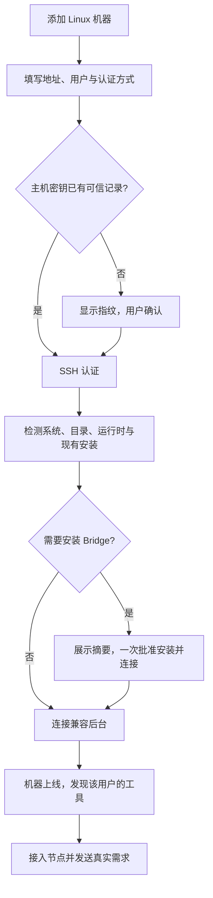

# AgentBridge 整体功能设计

alpha.66候选已完成本轮验证，当前公开仍alpha.65：Linux Hermes安装发现支持独立HERMES_INSTALL_DIR、原生数据Home/Profile根、后缀与路径展开，专用运行时目录不再提供其他Agent。Windows原生发现、stream-json、精确Session续聊、模型/账号配置和unknown恢复契约保持。Windows受控39/39，独立Ubuntu适配100/100及Core71/71，本机WSL和独立Ubuntu正式Hermes0.22.5原生MCP五组/十工具分别通过，模型0。普通EXE七组通过。网关取消、真实Linux模型/自主父模型、完整矩阵、图100ms与冷启动继续未准出；未切换日常后台或部署SSH。[本轮交付与分层证据](iterations/I08/alpha66-hermes-linux.md)。

关系缩权与清空不重新准入旧节点；新增/换主仅检查新目标，无关unknown不全局阻塞。未确认执行继续按原ID查询；“清理已失败操作”只结算有完整证据的确定失败，保留历史。MCP配置、原生加载、连接、工具、授权和归属分别展示；直接配置与托管scope能力独立，桌面保留配置/审计及原执行恢复，日常协作由原生Agent发起。模块与[接入矩阵](agent-integration-matrix.md)限定各入口实际能力，历史见[迭代目录](iterations/README.md)。

## 1. 产品解决什么问题

用户已经在不同机器上安装并配置了自己的 Agent。当前源码接入七种产品、十个执行入口：Claude Code、OpenCode、Codex、Hermes、Pi、DSH CLI（原生 CLI），以及DSH Windows Desktop与Linux/WSL Web、OpenDesk CLI HTTP与Windows Desktop设备网关。Hermes/Pi/DSH 为源码已实现，真实工具执行验收以[接入矩阵](agent-integration-matrix.md)为准。AgentBridge 把这些工具呈现为可观察的 Agent 节点，用户从原生Agent提出需求，在Bridge配置接入与授权、看进度和读取结果；权限与协作能力按工具分别声明。

中央后台管理连接与消息，不作为主 Agent 推理。主 Agent 是用户从已接入工具节点中指定的真实 Claude Code、OpenCode 或 Codex；它只能通过受限协作接口发现、委派和查询获准的子 Agent。

用户不用在 AgentBridge 重新配置模型、供应商或模型 API Key。账号、模型、工具权限与原生运行环境由各 Agent 自己管理。

## 2. 用户面对的对象

| 对象 | 用普通话解释 | 示例 |
| --- | --- | --- |
| 机器 / 执行环境 | 能访问某个用户安装工具与文件的地方 | Windows、Windows 下的 WSL Ubuntu、SSH 接入的 Linux 用户环境 |
| Agent 节点 | 某个环境中的一个受支持工具安装 | Windows 上的 Claude Code、Linux 上的 OpenCode |
| 执行上下文 | 为具体任务保存目录、运行配置与执行记录的内部实例 | 本轮在 Linux 的 `/srv/project` 执行 |
| 会话 | 与同一个 Agent 连续讨论同一项需求 | 分析 → 修改 → 解释测试结果 |
| 任务 | 会话中的一次请求与执行 | “分析当前目录”这一轮 |
| 协作关系 | 每个主节点及其获准出站成员，旧图显示selected关系 | Claude 为主，OpenCode 为子 |

节点不绑定文件夹，不绑定模型。目录在发送具体需求时才指定；不需要操作已有文件时可以留空，后台使用该节点的默认执行目录。同一节点、目录与模式会复用上下文，新会话不保证文件目录相互隔离。

WSL 是单独的执行环境，但属于同一台物理 Windows 宿主。SSH 机器身份按远端登录用户与 Bridge profile 绑定，不能把两个不同用户误合并为同一个可授权身份。完整对象定义见 [数据模型](data-model.md)。

## 3. 完整功能目录

`AB-Fxx` 是整体功能编号；模块内使用 `Mxx-Fxx` 等细化编号，测试报告再映射实际用例。整体状态不能代替具体工具能力与环境验证。

| 功能 | 用户得到什么 | 当前状态 | 模块与验收 |
| --- | --- | --- | --- |
| AB-F01 机器概览 | 首先看到机器，再看到机器上的工具；没有项目也能查看 | 本机 Windows/WSL 已发布；SSH 编辑/断开/移除/恢复专项通过，历史和身份保留；维护被拒的离线机器直接显示远端原因与重连入口 | [M03](modules/03-machine-network/design.md) / [报告](modules/03-machine-network/test-report.md) |
| AB-F02 自动发现工具 | 扫描受支持安装位置，显示名称、版本、健康与安装位置 | 当前源码注册七种产品十个入口；排除同名 Distributed Shell，DSH Desktop 安装与 Linux Web profile 未配置时显示服务连接提示；扫描不调用模型，SSH 须更新实际远端 daemon；每个入口分别声明“可执行/可被委派/可调用MCP/可管理原生MCP配置/可注入托管scope”，不再用单一`teamCollaboration`代替 | [M03](modules/03-machine-network/design.md) / [报告](modules/03-machine-network/test-report.md) |
| AB-F03 接入节点 | 图节点动作接入；不要求项目、模型和供应商 | 0.5.0 多选已发布；支持按机器添加、断开、移除及原身份恢复 | [M01](modules/01-desktop/design.md) / [报告](modules/01-desktop/test-report.md) |
| AB-F04 SSH 添加 Linux | 输入地址、端口、用户名和已有 SSH 登录方式 | 源码已实现；Windows 密码与真实 Linux 接入通过；其他认证专项范围见 M04 报告 | [M04](modules/04-ssh-access/design.md) / [报告](modules/04-ssh-access/test-report.md) |
| AB-F05 主机信任与凭据 | 首次确认指纹；默认不保存秘密；可选 Windows 系统加密保存 | 源码与受控测试存在；Windows 密码/DPAPI 及加密私钥/隔离 agent 有实际证据；系统服务兼容专项保留 | [M04](modules/04-ssh-access/design.md) / [报告](modules/04-ssh-access/test-report.md) |
| AB-F06 远端后台部署 | 用户确认安装摘要后自动部署用户态 daemon；无需第二终端 | 历史真实 Linux 验收保留；上传阶段/错误类别和明确失败后的重新检测入口已实现，保持原安装 ID；维护被拒但原后台仍在运行/已恢复时不再留置离线；新增**显式确认后越过未确认收据**（任务/Agent 门禁永不可越过，越过记录写入终态收据） | [M04](modules/04-ssh-access/design.md)、[M05](modules/05-linux-daemon/design.md) |
| AB-F07 原生工具执行 | 沿用工具原有账号与配置，执行真实需求 | Windows Hermes0.22.5已验首轮与原Session续聊；网关取消未适配、失联保留unknown。OpenCode/Claude/Codex及Pi/DSH的其他入口按[矩阵](agent-integration-matrix.md)分层核对，安装/配置不等于模型可用 | [M06](modules/06-native-adapters/design.md) / [报告](modules/06-native-adapters/test-report.md) |
| AB-F08 新会话与续聊 | 从原生Agent发起需求与续聊，每轮独立记录 | alpha.62桌面只读审计；原生/CLI适配能力与旧Task/Session保留，公开alpha.60仍有旧日常表单 | [M07](modules/07-task-session/design.md) / [报告](modules/07-task-session/test-report.md) |
| AB-F09 进度、回答与看板 | 看来源、状态、本轮回答、工具过程与最终结果 | 已发布；窗口通过轮询刷新，不是直接订阅原生 token | [M01](modules/01-desktop/design.md)、[M06](modules/06-native-adapters/design.md) |
| AB-F10 权限、输入与取消 | 通过原任务处理原生等待；取消结果以原生确认判断 | 严格核对原控制收据、表单遮罩及恢复台账脱敏；原生支持范围分别记录 | [M06](modules/06-native-adapters/design.md)、[M07](modules/07-task-session/design.md) |
| AB-F11 未确认请求与恢复 | 原 ID 查询，不重发 Prompt；保留历史和占位 | 历史功能已发布；Windows OpenCode 原记录恢复已修复；已观察历史跨重开保留，cursorGap 补偿通过验证；MCP配置操作丢失回应时同样先查原状态，配置重启恢复只重建私有端点、不写原生配置、不恢复已撤销授权 | [M07](modules/07-task-session/design.md) / [报告](modules/07-task-session/test-report.md) |
| AB-F12 指定主从关系 | 用户指定主 Agent 及允许的子节点 | 按身份维护多主与预授权/确认策略已发布，旧图仍编辑selected；Agent连接在预授权内，范围外须用户确认，各父读控交集/原ID与撤权保持；主角色准入只看MCP调用能力（`mcpClient`），托管scope注入`hostManagedTask`是独立维度，有MCP客户端但未适配托管注入的入口可以作主并单独注明“托管任务绑定未适配” | [M08](modules/08-collaboration/design.md) / [报告](modules/08-collaboration/test-report.md) |
| AB-F13 原生 Agent 协作 | 主 Agent 实际调用工具委派，读取子结果并汇总；源码可列原父/独立连接的委派ID | 独立MCP接入与Bridge托管scope分开：托管任务保留原父作用域，独立会话以connectionId归属、不伪造父Task。WSL三工具六个委派方向保留原真实证据；list_delegations、当前调用方list_agents及普通子任务最小上下文为源码/受控验证；当前角色与目标状态分开，查询等待中的撤权不返回旧目标，非实时委派台账不扩权；子任务附简短角色/结果交回说明，历史原输入保持，不授新工具/权限；不能等同新EXE模型或独立SSH验收 | [M08](modules/08-collaboration/design.md) / [报告](modules/08-collaboration/test-report.md)、[CT-02](iterations/I07/connection-delegation.md) |
| AB-F14 常驻中央后台 | 关闭窗口继续协调，重开复用历史与连接 | I06A 源码已实现；候选 Windows 关闭/停止/重开已验收 | [M02](modules/02-coordinator/design.md) / [报告](modules/02-coordinator/test-report.md) |
| AB-F15 CLI 兼容入口 | 单终端自动发现、提交、续聊、查看和控制 OpenCode | 已实现；不等同于桌面节点网络的全部入口 | [M09](modules/09-cli-hub-edge/design.md) / [报告](modules/09-cli-hub-edge/test-report.md) |
| AB-F16 节点图 | 机器分组、拖动节点、拖拽端点授权连线 | 支持旧后台下本机拖动、整组背景拖动及主居左；撤权按关系自身门禁、新授权按目标准入，布局接口独立；主角色/方向/避让保留；机器维护并入图页 | [M01](modules/01-desktop/design.md)、[M08](modules/08-collaboration/design.md) |
| AB-F17 发布与安装维护 | 源码、离线包、Windows EXE 一致，版本可验证 | 0.5.0 历史稳定；可信升级/回滚/停止/卸载源码与受控验证通过；维护收据新增 stopped/phase，停机未确认恢复保持 unknown 由原 ID 恢复；alpha.46已公开，包含越过未确认收据契约与两个只读门禁 RPC（历史指纹见[交付记录](iterations/I08/alpha38-delivery.md)，当前分发见[发布记录](iterations/I08/alpha46-release.md)）；正式 0.6.0 准出见当前报告 | [M10](modules/10-packaging/design.md) / [报告](modules/10-packaging/test-report.md) |
| AB-F18 网页资料入口 | 当前用户功能/设计/使用页、六Agent章节与六方式/能力对照；搜索、主题和图表 | 源码已实现；仅发布doc/user许可页面，排除内部编号、测试、问题、过程与历史；独立于Agent控制 | [M11 设计](modules/11-documentation-portal/design.md) / [报告](modules/11-documentation-portal/test-report.md) |
| AB-F19 智能体登记与小队 | 登记外部已有功能的智能体、说明职责/边界，组成小队和独立工作 | 已发布；不实现Skill/模型/目录或业务能力 | [M03](modules/03-machine-network/design.md)、[M08](modules/08-collaboration/design.md) |
| AB-F20 小队公共空间 | 共享约定/文档/群消息、成员通知、按权限写入与手动原生执行 | CT-04 索引/旧修订/桌面MD和CT-05 选材/导出保留；原包持久传递、目标接入确认和桌面只读审计已随公开alpha.63交付；Pi/Hermes跨客户端组件已验；真实父模型消费及实体同步未准出，完整 I07C 未准出 | [M01](modules/01-desktop/design.md)、[M08](modules/08-collaboration/design.md)、[CT-04](iterations/I07/public-materials.md)、[CT-05](iterations/I07/context-packet.md)、[桌面选材](iterations/I07/context-packet-ui.md)、[原包传递](iterations/I07/context-delivery.md) |
| AB-F21 小队任务与授权交接 | 分配/接手、依赖、精确产物版本、限额交接、返修历史与业务验收 | I07B 任务/授权交接基础保留；CT-05 桌面可选任务/历史产物生成核对副本，观察到任务/成员变化会使旧导出失效；不改变交接授权；新增[原包接收声明](iterations/I07/context-delivery.md)与业务验收分开 | [M07](modules/07-task-session/design.md)、[M08](modules/08-collaboration/design.md)、[I07B任务交接交付](iterations/I07/task-handoff.md) |
| AB-F22 持续协调首批 | 用户授权自动成员与预算，重要事件激活、原会话续接、原生终态后验收 | 已随 alpha.23 分发；停止/撤权与原生终态核对已实现，真实 Claude 取消通过；其他接入/多原生角色/完整故障矩阵未准出 | [M02](modules/02-coordinator/design.md)、[M06](modules/06-native-adapters/design.md)、[I07C首批交付](iterations/I07/automation.md) |

## 4. 用户的完整操作路径

### 4.1 本机与 WSL

打开程序 → 识别机器和工具 → 点击节点接入 → 开始会话 → 输入需求与可选目录 → 查看回答与过程。需要协作时先保存主从关系，再从主节点创建允许协作的会话。

安装探测通过只说明工具能被找到、调用与检查；“模型真实回复验证”是另一项执行。账号拒绝或默认模型不可用应在原工具中修复，不自动替换供应商。

### 4.2 独立 Linux 服务器

首次主机指纹和安装决定有实际意义。除这些步骤及已有 SSH 认证外，不要求用户再复制设备 Token 或配置中央公网地址。主机密钥改变必须停止连接，不能提供忽略身份检查的捷径。

服务器项目必须在服务器上存在；AgentBridge 不自动同步本机代码，也不把 Windows 路径转换为远端 `/mnt/c`。

### 4.3 新会话与续聊

每次发送生成稳定的 `requestId`。新会话创建或选择属于目标节点的上下文，提交后返回 Task 与 Conversation。后续追问携带原 `conversationId`，保持原节点、上下文目录与原生 Session；已保存的配置按各适配器核验，原生全局配置仍由工具管理。当前没有对三种工具统一拍摄全局配置指纹。

界面在上一轮结束且后端 `canContinue` 为真时允许发送。该字段不保证每个原生版本都能成功续接：当前 Codex 有 thread 绑定时仍可能显示输入，原生 resume 失败后在本轮显示错误，尚未把该限制完整转为禁用入口。连接验证记录有专用标识，不用它继续实际需求。

### 4.4 协作

用户指定主节点和子节点 → 保存关系 → 发送允许协作的主任务 → 主 Agent 通过 MCP 查询允许的子节点 → 委派子任务 → 读取真实子结果 → 在主会话总结。

“允许协作”不保证模型一定委派；验收必须有真实协作工具调用、子任务和父结果，不能把主 Agent 自己回答或人工复制结果算作协作。

节点图编辑同一套权限。拖动位置只是布局变更；端点连线先成为草稿，只有后台稳定收据确认后生效。轮询不吞草稿，冲突显式处理，回应未知只查询原 ID；换主不转交旧父的子任务。

## 5. 关闭、断开、取消的区别

| 操作 | 预期行为与当前边界 |
| --- | --- |
| 关闭 I06A 窗口 | 退出窗口客户端，独立 Coordinator 继续运行；候选 Windows 包已实测 |
| 断开 SSH 机器 | 关闭通信并关闭自动重连，不停止 daemon 已接收任务 |
| 网络中断 | 无口令私钥、可用 agent 或已保存的凭据可尝试重连；未保存密码/加密私钥口令时仍需输入；不重发任务 |
| 停止中央后台 | 协作与聚合暂不可用，远端 daemon 保留已接收任务；后台接口存在，设置页已提供明确停止入口 |
| 取消某个任务 | 只控制原任务；确认收到请求与实际取消是两个不同事实 |
| 旧 CLI 的 `service stop` | 停止该 CLI 实例及核验归属的托管服务，语义不能套用于“关闭窗口” |

中央机器关机、睡眠或停止全部后台时，不承诺协作仍可进行。Linux 的注销清理政策可能影响 detached 进程，需按实际服务器验收。

## 6. 必须向用户解释清楚的状态

- “已发现”：找到受支持工具，尚未接入网络。
- “已接入”：节点已允许使用；不代表模型已真实回复。
- “机器离线”：当前无法通信，历史结果不删除。
- “正在工作”：原任务尚未结束；等待原生权限也可能显示此状态。
- “执行待核对”：调用或结果不明，只查原 ID，不换 ID 重做。
- “维护前置门禁”：维护前的实时只读阻塞项（任务、Agent 或未确认收据）。任务/Agent **永不可越过**；未确认收据只有在用户显式确认“这些操作不会再运行”后才可越过，且越过内容会记入维护结果，收据本身不删除。
- “不支持”：本适配器或原生版本没有该能力，不假成功。

一次请求的回答和执行过程分别显示。Claude 的文本 delta 在呈现层合并，不能把一个 token 一条过程记录作为面向用户的默认阅读体验。

## 7. 产品边界与后续候选

AgentBridge 不重写 Agent，不负责模型供应商配置，不调度编译机或实验室设备，不提供任意远程 shell，不创建通用工作流引擎。SSH 只用于 Bridge 部署、身份验证与受控消息传输。

自研 Agent 可按 I07A/B 的本机 MCP 成员契约接入公共空间和任务板；当前另有[原生适配开发接口与指南](custom-agent-development.md)，开发者实现宿主、测试后静态注册并随包部署。它不是任意命令或 MCP 地址的自动执行器。Hermes/Pi/DSH 直接会话实现见[扩展专项](iterations/I07/native-agent-expansion.md)，新增三种不声明 Bridge 权限表单或小队成员 MCP 注入；各入口实际能力与真实未测边界见[接入矩阵](agent-integration-matrix.md)。通用执行接入方式由 CT-03 ACP 试点评估；调用方通用化与 Agent 侧连接操作按 [CT-06/07/08 规划](iterations/I07/agent-centric-operations.md) 推进。企业IM/Webhook、中央云端部署、多用户、文件同步与多层协作图保留历史候选记录，未纳入本轮后续目标。

当前验收结论见 [整体验证报告](testing.md)；具体版本和进度见 [迭代路线](project-plan.md)。后续修改本功能目录时，按 [同步维护规则](development-guide.md) 同时更新模块与迭代材料。
