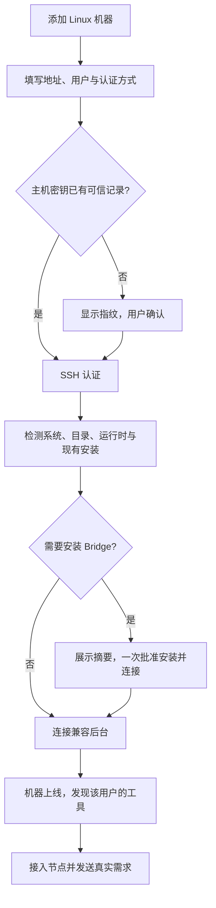

# AgentBridge 整体功能设计

更新：2026-10-13。适用：Windows 0.5.0 已发布功能，以及 0.6.0-alpha.9 的 I06B 当前源码候选。每项明确区分实现、发布和验收状态。

## 1. 产品解决什么问题

用户已经在不同机器上安装并配置了 Claude Code、OpenCode 或 Codex。AgentBridge 把这些工具呈现为一个可观察、可授权协作的 Agent 网络，让用户在一个客户端中发需求、看进度、处理原生权限请求并读取结果。

中央后台管理连接与消息，不作为主 Agent 推理。主 Agent 是用户从已接入工具节点中指定的真实 Claude Code、OpenCode 或 Codex；它只能通过受限协作接口发现、委派和查询获准的子 Agent。

用户不用在 AgentBridge 重新配置模型、供应商或模型 API Key。账号、模型、工具权限与原生运行环境由各 Agent 自己管理。

## 2. 用户面对的对象

| 对象 | 用普通话解释 | 示例 |
| --- | --- | --- |
| 机器 / 执行环境 | 能访问某个用户安装工具与文件的地方 | Windows、Windows 下的 WSL Ubuntu、SSH 接入的 Linux 用户环境 |
| Agent 节点 | 某个环境中的一个受支持工具安装 | Windows 上的 Claude Code、Linux 上的 OpenCode |
| 执行上下文 | 为具体任务保存目录、运行配置与执行记录的内部实例 | 本轮在 Linux 的 `/srv/project` 执行 |
| 会话 | 与同一个 Agent 连续讨论同一项需求 | 分析 → 修改 → 解释测试结果 |
| 任务 | 会话中的一次请求与执行 | “分析当前目录”这一轮 |
| 协作关系 | 当前主节点及它获准连接的子节点 | Claude 为主，OpenCode 为子 |

节点不绑定文件夹，不绑定模型。目录在发送具体需求时才指定；不需要操作已有文件时可以留空，后台使用该节点的默认执行目录。同一节点、目录与模式会复用上下文，新会话不保证文件目录相互隔离。

WSL 是单独的执行环境，但属于同一台物理 Windows 宿主。SSH 机器身份按远端登录用户与 Bridge profile 绑定，不能把两个不同用户误合并为同一个可授权身份。完整对象定义见 [数据模型](data-model.md)。

## 3. 完整功能目录

`AB-Fxx` 是整体功能编号；模块内使用 `Mxx-Fxx` 等细化编号，测试报告再映射实际用例。整体状态不能代替具体工具能力与环境验证。

| 功能 | 用户得到什么 | 当前状态 | 模块与验收 |
| --- | --- | --- | --- |
| AB-F01 机器概览 | 首先看到机器，再看到机器上的工具；没有项目也能查看 | 本机 Windows/WSL 已发布；SSH 候选接入与节点实测通过 | [M03](modules/03-machine-network/design.md) / [报告](modules/03-machine-network/test-report.md) |
| AB-F02 自动发现工具 | 扫描受支持安装位置，显示名称、版本、健康与安装位置 | 已发布；扫描不调用模型 | [M03](modules/03-machine-network/design.md) / [报告](modules/03-machine-network/test-report.md) |
| AB-F03 接入节点 | 图节点动作接入；不要求项目、模型和供应商 | 0.5.0 多选已发布；alpha.9 支持按机器添加、断开、移除及原身份恢复 | [M01](modules/01-desktop/design.md) / [报告](modules/01-desktop/test-report.md) |
| AB-F04 SSH 添加 Linux | 输入地址、端口、用户名和已有 SSH 登录方式 | 源码已实现；Windows 密码与真实 Linux 接入通过；其他认证专项范围见 M04 报告 | [M04](modules/04-ssh-access/design.md) / [报告](modules/04-ssh-access/test-report.md) |
| AB-F05 主机信任与凭据 | 首次确认指纹；默认不保存秘密；可选 Windows 系统加密保存 | 源码与受控测试存在；Windows 密码/DPAPI 及加密私钥/隔离 agent 有实际证据；系统服务兼容专项保留 | [M04](modules/04-ssh-access/design.md) / [报告](modules/04-ssh-access/test-report.md) |
| AB-F06 远端后台部署 | 用户确认安装摘要后自动部署用户态 daemon；无需第二终端 | 真实 Linux 已验证；alpha.2 主要验收保留；alpha.6 可校验并复用可信 alpha.2–alpha.5 后台，成功恢复清理旧连接错误 | [M04](modules/04-ssh-access/design.md)、[M05](modules/05-linux-daemon/design.md) |
| AB-F07 原生工具执行 | 沿用工具原有账号与配置，执行真实需求 | OpenCode/Claude 有真实证据；Codex 存在已记录环境限制 | [M06](modules/06-native-adapters/design.md) / [报告](modules/06-native-adapters/test-report.md) |
| AB-F08 新会话与续聊 | 发起需求，原会话追问，每轮独立记录 | 已发布；能力取决于原生适配；SSH 同会话两轮已记录 | [M07](modules/07-task-session/design.md) / [报告](modules/07-task-session/test-report.md) |
| AB-F09 进度、回答与看板 | 看来源、状态、本轮回答、工具过程与最终结果 | 已发布；窗口通过轮询刷新，不是直接订阅原生 token | [M01](modules/01-desktop/design.md)、[M06](modules/06-native-adapters/design.md) |
| AB-F10 权限、输入与取消 | 通过原任务处理原生等待；取消结果以原生确认判断 | 部分工具支持，不能对全部 Agent 统一宣称 | [M06](modules/06-native-adapters/design.md)、[M07](modules/07-task-session/design.md) |
| AB-F11 未确认请求与恢复 | 原 ID 查询，不重发 Prompt；保留历史和占位 | 已发布；SSH 重连/中央重启有开发环境证据 | [M07](modules/07-task-session/design.md) / [报告](modules/07-task-session/test-report.md) |
| AB-F12 指定主从关系 | 用户指定主 Agent 及允许的子节点 | 一个默认组已发布；alpha.6 图编辑及稳定保存已实现，换主后活跃原父权限已修复 | [M08](modules/08-collaboration/design.md) / [报告](modules/08-collaboration/test-report.md) |
| AB-F13 原生 Agent 协作 | 主 Agent 实际调用工具委派，读取子结果并汇总 | Windows/WSL 四条真实链已有证据；alpha.3 源码修复 Codex 自然语言发现入口，真实 MCP/主子回复通过；alpha.6 独立 SSH Linux OpenCode ↔ Windows Claude 双向核心链通过，完整故障/控制矩阵留待 I06C | [M08](modules/08-collaboration/design.md) / [报告](modules/08-collaboration/test-report.md) |
| AB-F14 常驻中央后台 | 关闭窗口继续协调，重开复用历史与连接 | I06A 源码已实现；0.6.0-alpha.2 候选 Windows 关闭/停止/重开已验收 | [M02](modules/02-coordinator/design.md) / [报告](modules/02-coordinator/test-report.md) |
| AB-F15 CLI 兼容入口 | 单终端自动发现、提交、续聊、查看和控制 OpenCode | 已实现；不等同于桌面节点网络的全部入口 | [M09](modules/09-cli-hub-edge/design.md) / [报告](modules/09-cli-hub-edge/test-report.md) |
| AB-F16 节点图 | 机器分组、拖动节点、拖拽端点授权连线 | alpha.8 支持旧后台下本机拖动、整组背景拖动及主居左；主角色/方向/避让保留；当前证据见拖动修复，原生链保留 alpha.6 证据 | [M01](modules/01-desktop/design.md)、[M08](modules/08-collaboration/design.md) |
| AB-F17 发布与安装维护 | 源码、离线包、Windows EXE 一致，版本可验证 | 0.5.0 历史稳定；6A 候选已验收，正式 0.6.0 及升级/回滚待后续 | [M10](modules/10-packaging/design.md) / [报告](modules/10-packaging/test-report.md) |

| AB-F18 网页资料入口 | 桌面分组目录、同源 Markdown、章节导航、全文搜索、主题和图表 | 已实现；独立于 Agent 控制界面 | [M11 设计](modules/11-documentation-portal/design.md) / [报告](modules/11-documentation-portal/test-report.md) |

## 4. 用户的完整操作路径

### 4.1 本机与 WSL

打开程序 → 识别机器和工具 → 点击节点接入 → 开始会话 → 输入需求与可选目录 → 查看回答与过程。需要协作时先保存主从关系，再从主节点创建允许协作的会话。

安装探测通过只说明工具能被找到、调用与检查；“模型真实回复验证”是另一项执行。账号拒绝或默认模型不可用应在原工具中修复，不自动替换供应商。

### 4.2 独立 Linux 服务器

首次主机指纹和安装决定有实际意义。除这些步骤及已有 SSH 认证外，不要求用户再复制设备 Token 或配置中央公网地址。主机密钥改变必须停止连接，不能提供忽略身份检查的捷径。

服务器项目必须在服务器上存在；AgentBridge 不自动同步本机代码，也不把 Windows 路径转换为远端 `/mnt/c`。

### 4.3 新会话与续聊

每次发送生成稳定的 `requestId`。新会话创建或选择属于目标节点的上下文，提交后返回 Task 与 Conversation。后续追问携带原 `conversationId`，保持原节点、上下文目录与原生 Session；已保存的配置按各适配器核验，原生全局配置仍由工具管理。当前没有对三种工具统一拍摄全局配置指纹。

界面在上一轮结束且后端 `canContinue` 为真时允许发送。该字段不保证每个原生版本都能成功续接：当前 Codex 有 thread 绑定时仍可能显示输入，原生 resume 失败后在本轮显示错误，尚未把该限制完整转为禁用入口。连接验证记录有专用标识，不用它继续实际需求。

### 4.4 协作

用户指定主节点和子节点 → 保存关系 → 发送允许协作的主任务 → 主 Agent 通过 MCP 查询允许的子节点 → 委派子任务 → 读取真实子结果 → 在主会话总结。

“允许协作”不保证模型一定委派；验收必须有真实协作工具调用、子任务和父结果，不能把主 Agent 自己回答或人工复制结果算作协作。

alpha.8 节点图编辑同一套权限。拖动位置只是布局变更；端点连线先成为草稿，只有后台稳定收据确认后生效。轮询不吞草稿，冲突显式处理，回应未知只查询原 ID；换主不转交旧父的子任务。

## 5. 关闭、断开、取消的区别

| 操作 | 预期行为与当前边界 |
| --- | --- |
| 关闭 I06A 窗口 | 退出窗口客户端，独立 Coordinator 继续运行；候选 Windows 包已实测 |
| 断开 SSH 机器 | 关闭通信并关闭自动重连，不停止 daemon 已接收任务 |
| 网络中断 | 无口令私钥、可用 agent 或已保存的凭据可尝试重连；未保存密码/加密私钥口令时仍需输入；不重发任务 |
| 停止中央后台 | 协作与聚合暂不可用，远端 daemon 保留已接收任务；后台接口存在，设置页已提供明确停止入口 |
| 取消某个任务 | 只控制原任务；确认收到请求与实际取消是两个不同事实 |
| 旧 CLI 的 `service stop` | 停止该 CLI 实例及核验归属的托管服务，语义不能套用于“关闭窗口” |

中央机器关机、睡眠或停止全部后台时，不承诺协作仍可进行。Linux 的注销清理政策可能影响 detached 进程，需按实际服务器验收。

## 6. 必须向用户解释清楚的状态

- “已发现”：找到受支持工具，尚未接入网络。
- “已接入”：节点已允许使用；不代表模型已真实回复。
- “机器离线”：当前无法通信，历史结果不删除。
- “正在工作”：原任务尚未结束；等待原生权限也可能显示此状态。
- “执行待核对”：调用或结果不明，只查原 ID，不换 ID 重做。
- “不支持”：本适配器或原生版本没有该能力，不假成功。

一次请求的回答和执行过程分别显示。Claude 的文本 delta 在呈现层合并，不能把一个 token 一条过程记录作为面向用户的默认阅读体验。

## 7. 产品边界与后续候选

AgentBridge 不重写 Agent，不负责模型供应商配置，不调度编译机或实验室设备，不提供任意远程 shell，不创建通用工作流引擎。SSH 只用于 Bridge 部署、身份验证与受控消息传输。

Harmes、自研 Agent、通用 HTTP/JSONL Adapter、企业 IM/Webhook、中央云端部署、多用户团队、文件同步与多层协作图均不是当前已交付能力。涉及它们时需先确认原生接口与用户范围，登记迭代和模块设计。

当前验收结论见 [整体验证报告](testing.md)；具体版本和进度见 [迭代路线](project-plan.md)。后续修改本功能目录时，按 [同步维护规则](development-guide.md)同时更新模块与迭代材料。

## 2026-10-12：6A 收尾

本节为 alpha.2 的历史收尾：当时源码与候选包为 0.6.0-alpha.2，稳定历史发布版为 0.5.0。本次已补齐后台停止入口、Windows 实际密码/DPAPI、加密私钥/命名管道 agent 分支、私有 Linux Node 实际启动和发布资源校验；修复 OpenCode 会话 API 缺少可续聊字段。真实 Windows 安装、两轮 Session、生命周期与普通便携程序均通过；具体证据与覆盖限制见 [6A 报告](iterations/I06/acceptance.md)，不提前标整个 I06 完成。

## 2026-10-12：Codex 自然语言发现修复

AB-F07/09/13、M01-F06、M06-CX-F01、M08-F02/F05：Codex 带协作 MCP 的原生回合增加明确的 Bridge 发现/委派指引，新会话与续聊均适用；不再以 CLI 内部 `/root` 列表判断 Bridge 连接为空。MCP 过程显示服务器与工具名；原始消息、请求去重、原生配置和授权边界不变。桌面 89/89 通过，真实 Codex → Claude 在受控隔离关系下完成发现、委派、回读和连接图。完整范围见 [Codex 报告](modules/06-native-adapters/codex/test-report.md)、[本次交付记录](iterations/I06/codex-discovery-fix.md)。

## 2026-10-12：已安装 SSH 后台兼容复用

AB-F05/06/11/17、M04/M05/M10：alpha.4 客户端可复用清单明确收录的 alpha.2/alpha.3 Linux 后台；核对可信文件摘要、原版本路径、owner/profile/UID/daemonId，保留原进程和任务，不自动升级。未知版本、同版本摘要不符或目录别名拒绝。probe 区分客户端离线包与实际后台版本。桌面 93/93、用户原 alpha.2 服务器的文件核验、真实握手/重连/OpenCode 发现及新包资源比对通过；[完整交付](iterations/I06/ssh-compatible-reuse.md)。旧 daemon 原生适配代码不因复用而更新，升级/回滚仍归 I06C。

## 新程序管理旧后台的操作说明

AB-F14：新 EXE 的设置页可以停止同一 profile 中通过认证的旧 Coordinator，旧窗口不是前提；再次打开新 EXE 才加载新后台代码。现有代码未修改，相关使用指引已校正，实际窗口验证见 [说明与证据](iterations/I06/client-background-operation.md)。这不是自动升级、回滚或任意进程管理能力。

## 2026-10-12：SSH 恢复后旧错误撤销

AB-F01/05/11/17，M01/M02/M03/M04/M10：alpha.5 成功恢复会清除机器目录的旧版本/连接报错并持久化；新的 SSH 拒绝/RPC 失败继续显示，任务失败和 unknown 不被恢复改写。95/95 桌面回归、Windows 受控卡片渲染与包资源校验通过；原用户状态只读核验，新远端重连未冒充实测。可信复用延续至 alpha.4，[完整交付](iterations/I06/ssh-error-recovery.md)。

## 2026-10-12：I06B 图编辑与原父权限

AB-F01/08/09/11/12/13/16/17，M01/M02/M03/M07/M08/M10：机器分组节点图、标签/节点目标、鼠标与键盘授权、独立布局和稳定保存收据已落地并完成主要验收；中央图意图与任务台账分开，提交前后进程中断按原 ID 核对。换主后活跃旧父可读控原子，新主不能接管。Windows 20 组/60 节点反馈已测，完整 UI、包、独立物理设备双向链与限制见 [实施与验收](iterations/I06/graph-implementation.md)。正式 0.6.0 仍需 I06C，原生 Codex 限制保留。

2026-10-13 6B 收尾：AB-F07/11/13，M02/M03/M05/M06/M07，OpenCode 新上下文等待健康元数据，确定执行前拒绝按原收据核对；缺收据/传输未知仍占位。最终独立双向链在原服务恢复后用原请求完成，用户原生配置保持；原生服务退出后的完整自动恢复未宣称完成。[交付及限制](iterations/I06/graph-implementation.md)。

## 2026-10-13：图方向与平移优化

AB-F16、M01/M10：alpha.7 主节点用皇冠和强调色突出，只显示主右侧输出/普通或子左侧输入；授权边绕过卡片。中键在节点、按钮、端点、机器组和空白处平移，视口保存/重开与授权分离；unknown 保持原操作锁定。卡片尺寸/原有坐标不随切主改变。[完整交付](iterations/I06/graph-usability.md)。

## 2026-10-13：旧后台拖动与主居左

AB-F16、M01/M10：原用户后台 alpha.5 不支持布局方法，alpha.7 因加载失败锁定全部拖动。alpha.8 改为明确本机布局模式，读取失败不妨碍节点/组/画布移动，保留所有原 pending ID，禁止旧式授权写入；支持恢复后以正常修订同步。机器背景可拖动，中键出界释放可靠，初始及自动整理将主节点所在组排最左侧；手动/保存坐标不被轮询重排。[实际窗口与证据](iterations/I06/graph-drag-fix.md)。

## 2026-10-13：单一机器图与节点生命周期

AB-F01/03/11/12/16，M01/M02/M03/M08/M10：alpha.9 将重复的机器/关系页合并，保留图授权、主需求和委派记录；添加从机器发现安装中选择，断开和移除以中央元数据原子撤权，保留原身份/任务/会话/安装。忙碌、等待、未知与离线拒绝变更；原 IPC 同样限制接入，丢 ACK 只查原 node operationId。完整范围及证据见 [alpha.9 节点管理](iterations/I06/node-management.md)。这不是机器移除、任务取消或原生卸载，也不完成 I06C。

## AB-F17：GitHub 候选 EXE 分发

2026-10-13：alpha.9 Windows x64 EXE 已作为 GitHub 预发布附件提供，[下载程序](https://github.com/wsjq5477/MA-Relay/releases/download/v0.6.0-alpha.9/AgentBridge-0.6.0-alpha.9-Windows-x64.exe)、[发布页](https://github.com/wsjq5477/MA-Relay/releases/tag/v0.6.0-alpha.9)。用户无需自行编译或安装 WSL/Node.js 来运行 AgentBridge。稳定历史版本仍为 0.5.0；这次发布不代表完整 I06C 或正式 0.6.0 准出，也没有将本地 alpha.10 源码/程序同步到该标签。

M10 将已有 EXE 作为预发布附件分发，并提供大小和 SHA-256；下载分发与稳定版本准出分开。范围与实际结果见 [本次发布](iterations/I06/github-release.md)。没有改变产品协议、身份、数据或运行行为。
