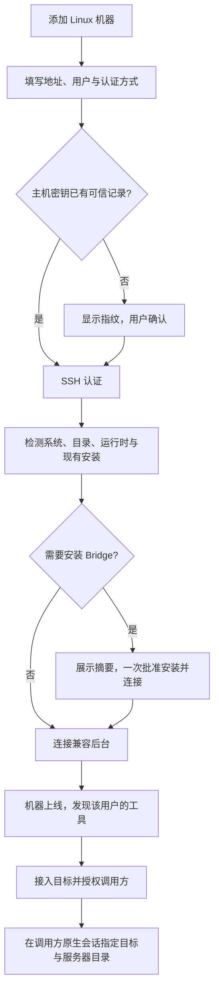

# AgentBridge 整体功能设计

产品范围以[产品约束](product-constraints.md)为准。当前公开预发布为 **0.6.0-alpha.76.local.20261123.acp**，冻结源码 8b69f71。[发布与验证](iterations/I08/acp-stdio-runtimes.md#公开预发布)

Windows DSH NEXT 新增独立的 DSH ACP 入口，使用包内原生 ACP v1 stdio。支持直接会话、普通被委派、流式正文、原会话续聊及取消；恢复绑定沿用原工作目录和原生账号配置。[DSH ACP 实现与验收](iterations/I08/dsh-acp.md)

「添加 Agent → 自定义运行时」支持注册目标机上的 ACP v1 stdio Agent。注册只握手，执行由原生 Agent 和原生账号负责。文字流和普通委派沿用原任务，取消以原请求终态为准，续聊按原生握手能力开放。[接入方式](user/agents/index.md#连接其他-acp-agent)

公开预发布 `8b69f71` 收到 ACP 工具权限询问时返回取消。本地 `master` 的 `ac393cf` 增加原任务上的拒绝与单次允许，可按原操作 ID 查询答复。受控链路已通过，Windows DSH 实机尚未出现可验证的权限询问与任务终态。[ACP 工具权限](iterations/I08/acp-permission-reply.md)

Windows 上保存 DSH Desktop 或 Web 服务连接时会异步核验私有目录，再保存连接。后台在等待期间可响应其他请求。[本机实测](iterations/I08/current-scope-audit.md#显式交接到独立-dsh-web-会话)

可选 Markdown 结果笔记在现行源码可用。调用方使用原授权导出明确终态，笔记保留原请求和有界事件。用户编辑后的笔记受到版本冲突保护，普通委派无需启用笔记功能。[用法与验收](iterations/I08/current-scope-audit.md#可选-markdown-结果笔记)

AB-F14：Windows 打包桌面在新版首次启动时替换同一 profile 中已认证的旧 Coordinator，继续读取原身份、设置和待确认记录。[覆盖升级](iterations/I08/windows-coordinator-profile-startup.md#覆盖升级)

AB-F14：Windows 常驻协调后台在连接前异步验证已有 profile 的私有目录。等待、私有目录错误、版本未读和已确认空数据可区分；失败保留此前读到的历史，恢复后刷新快照与未读版本。[issue #33 实现与验收](iterations/I08/windows-coordinator-profile-startup.md)

Windows 安装版 DSH NEXT 通过包内原生入口自动发现。在「接入配置」点「接入」即可，首次接入可为当前原生 Profile 准备 MCP。接受委派时由 headless 路由提供模型认证。缺少 Key 的原任务显示原生环境配置指引，桌面登录默认不会传入 headless。用户在原生 Profile 显式启用账号后，现行源码已验证本机模型回复、原 Session 续聊、在途重开、原事件恢复和原任务取消。DSH 主动调用其他 Agent 需明确授权。[DSH NEXT 交付](iterations/I08/alpha76-dsh-release.md) · [本机验收](iterations/I08/current-scope-audit.md#本机-dsh-next-实测)

M04/M01：维护原操作 not_found 保持 unknown；用户明确确认后可核对原版本与安装身份并结算本机原收据，原 ID 同步恢复 graph。[设计与验证](iterations/I08/maintenance-unstarted-cleanup.md)

issue #31 已合入源码：维护控制器按原可信目标清单暂存完整运行资源，逐文件验证后限制模块解析在暂存树内并检查加载。启动非零退出的安全错误保留在原 unknown 操作；原 ID 查询仅在依赖缺失时按原版本/摘要修复控制器后查询，不重发维护、不更换 ID。not_found 不足以证明终态，继续保留 unknown。[本次实现、实测与限制](iterations/I08/maintenance-controller-recovery.md)

AB-F07 / M06-CX-F01：alpha.74 已修复 Windows worker 运行时目录发布。完整复制和校验后，对瞬时目录锁在 5 秒预算内重试；并发目标须验证完整，损坏目录保留并使用独立 repair 目录。清理错误不覆盖主错误，非空临时目录保留。运行准备失败仍结束原 Task，不启动原生 CLI、不重发原请求。[issue #30 实现与验证](iterations/I08/codex-runtime-publish-recovery.md)

本机、WSL 和 SSH Linux 的「添加 Agent」可配置 Hermes、Pi 和 ACP 自定义运行时。用户点击协议图标，填写显示名、命令和可选描述，由目标机器完成版本探测并保存后可添加并接入。运行时身份与内置 Hermes 独立，仍需既有授权。[自定义运行时记录](iterations/I08/custom-runtime-pi.md)

生命周期边界按实际入口区分：关闭调用方/观察门面不自动取消Task；明确停止Core Controller可停止经核验的自有托管服务，外部服务及用户原生Session不因此转归Bridge。IPC/PID消失不结算终态或释放unknown。[资源归属表](iterations/I08/interconnect-caller-contract.md#资源归属与停止范围)已与源码核对，真实在途/服务完整链/升级仍待验证，[完整决策审计](iterations/I08/interconnect-development.md#16-当前源码与完整决策的完成审计)。

M06-OC-F01 / M09-F01：OpenCode连接check复用同次协议握手的Agent信息；执行使用独立客户端，原任务观察及回复/取消按原nativeProtocol绑定客户端，健康检查不能改写其API选择。失败发现使缓存失效，协议不匹配仍拒绝；控制收据与任务终态保持分层。managed=false已有服务仍归外部操作者，低层原Controller/Client有真实1.2.10只读连接和关闭/重开证据；互联登记完整链仍待。[当前开发与验证](iterations/I08/interconnect-development.md#15-原任务协议与健康检查并发停止后的资源释放)。

调用方缺少 `taskId` 时，可由 `list_delegations` 找到原委派，再用 `task_result` 沿原机器和原请求核对。查询使用当前结果读取权限。缺少原记录时保留 `unknown`。旧后台需要支持 `task.original-request-v1`。[调用方契约](iterations/I08/interconnect-caller-contract.md)

## 产品职责与当前后续范围

AgentBridge 管理谁能调用哪个 Agent，以及一次调用如何可靠交付和核对。核心是身份/获准发现、授权/寻址、明确目标调用、消息/状态/结果关联、交互控制、资源准入与原 ID 恢复。任务拆分、目标选择、业务规划和业务验收由用户或上层 Agent 决定；原生 Runtime 拥有 Session 内部行为、Agent Loop、工具、模型与执行权限。

AB-F19 的身份/职责登记继续保留；其小队/工作容器及 AB-F20/21/22 的公共空间、依赖/复验/返修/业务验收、事件激活与自动续接定位为可选上层，暂停扩张，不作为基础发现/委派或外部 Super-agent 接入前提。已有接口、数据、授权和在途执行保持，不因定位调整删除或迁移。MachineHost、daemon、必要 worker、SSH 受控部署维护、Session/取消控制及配置/审计属于互联基础设施，继续保留。

独立登记第一片已源码实现：复用原Agent登记/SQLite收据及固定端点，不要求小队；经典仍十工具，停用不释放unknown、不重绑原任务。调用方/上下文/凭据、原事件与原delegationId恢复已有源码与受控证据。Windows Codex主对话经真实stdio MCP调用WSL Codex0.166.0，继承用户明确选择的原生默认gpt-6.1-sol；原主CallerContext/Conversation/Native Session保持。真实正文、无工具回忆续聊及执行中观察器关闭/重开后的原结果均通过，另验原取消unknown→原操作confirmed→Task实际cancelled。独立上下文执行中撤销后读权立即拒绝，管理员观察原生任务仍成功完成。本轮仅调整经用户授权的本机原生模型及CLI安装、扩展真实验收夹具，不增加Bridge模型API或修改持久协议。完整已有服务登记/升级链、真实丢提交回应、原生权限/问题转交、产物实体交付、完整适配器/跨机/性能、生产SSH与EXE仍未准出。[本轮真实证据与限制](iterations/I08/interconnect-development.md#17-原生登录恢复后的真实调用与模型退役门禁)。

桌面在接入配置中管理连接策略和原生 MCP 配置，可查看授权、重新读取原配置和核对接入状态。小队工作表单按前置条件显示。[整体界面整理](iterations/I08/ui-cleanup.md) · [原生配置弹窗](iterations/I08/mcp-configuration-ui.md)

历史本地 Windows 体验包 0.6.0-alpha.71.browser.3，包含当前ChatGPT-only 19文件扩展及最新后台，源码/实际EXE载荷/ASAR核验和包内Node契约72/72通过；普通GUI、包内真实Web与原生父模型仍未准出。仅用户体验交付。[产物、非C盘启动及完整证据](iterations/I08/web-agent-browser3-preview.md)。

当前Web范围仅ChatGPT：真实匿名ChatGPT经原MCP/Registry/Router/认证MV3同会话四轮通过，第四轮8次输出/2295字符；父模型是受控夹具。新版DOM及只读原结束失败结算已实现，原第二轮失败与恢复边界保留；DOM39/39、IndexedDB69/69、Host/打包63/63，网络回归44通过/1平台跳过。原生父模型、账号/权限同意、跨设备及当前包内Web链路仍待，Kimi不开发不验收。[当前实现、产物与原始证据](iterations/I08/web-agent-live-chatgpt.md)。

Browser Agent正在开发：AB-F03/F07/F08/F09/F10/F11复用原Registry/机器/节点、认证配对、原MCP续聊、配置/修订UI、只读核对、空闲关闭、原会话健康、未授权页面内容的安全取消、MCP原取消只读恢复、可见对话证明/同锚点冲突门禁及取消后缺请求行的原健康/关闭恢复。取消须原持久封存证明和事件齐备，普通ACK不够；旧后台未证明queryOnly支持时拒绝发送，已提交Stop仍不支持。健康不证明账号或放行unknown；人工新轮在发送前拒绝。Windows MV3/IndexedDB/DOM及Linux Node分层受控，扩大集的快照截止失败保留。真实账号/权限同意/父模型/Browser跨设备/完整控制及真实包内Web链路仍待。[当前证据与余项](iterations/I08/web-agent-development.md)。

alpha.71的SSH维护只读入口始终可打开查看；具体替换/升级仍核对原操作与远端门禁。[入口与实际EXE验证](iterations/I08/issue29-maintenance-entry.md)。

alpha.71已修复#29的维护入口闭锁：未登记后台仍不直接复用，但版本拒绝的离线机器可以打开维护，明确确认后替换为客户端自带的已校验后台。原身份、状态、收据与旧目录保留；不自动运行未校验旧版本回滚。[行为、实际验证与边界](iterations/I08/issue29-explicit-daemon-replacement.md)。

关系缩权与清空不重新准入旧节点；新增/换主仅检查新目标，无关unknown不全局阻塞。未确认执行继续按原ID查询；“清理已失败操作”只结算有完整证据的确定失败，保留历史。MCP配置、原生加载、连接、工具、授权和归属分别展示；直接配置与托管scope能力独立，桌面保留配置/审计及原执行恢复，日常协作由原生Agent发起。模块与[接入矩阵](agent-integration-matrix.md)限定各入口实际能力，历史见[迭代目录](iterations/README.md)。

当前源码的桌面外观按Taste/Impeccable采用浅色框架、白色工作面板及中性深色主题；统计为数字栏，机器/工具信息优先，设置按说明与操作分段，字体本地离线加载。关联AB-F01/09/16及M01-F14，已进入公开alpha.68的EXE；原生接入、授权、原ID恢复与业务状态口径保持。[当前设计、验收与源码](iterations/I08/taste-impeccable-ui.md)。

源码界面预览新增仓库根双击启动器和 `npm run desktop:preview`：先构建再提供本机合成预览，终端保持开启才可访问。该开发入口未修改公开alpha.68的包或业务协议。[启动与验证](iterations/I08/taste-impeccable-ui.md#预览入口修复2026-10-28)。

## 1. 产品解决什么问题

用户在原生 Agent 中明确指定目标和任务，在 Bridge 配置谁能调用谁、查看运行进度并读取原结果。现有 8 种产品、13 个专用入口，包含 12 个原生入口和 ChatGPT Web 浏览器扩展。兼容 ACP v1 stdio 的程序还可另行注册。各入口的启动方式、能力与实机证据见[接入矩阵](agent-integration-matrix.md)。

中央后台负责授权、路由和记录。日常调用由具备 MCP 能力且获准的原生 Agent 发起。只充当调用方的外部程序也可登记独立主体，通过获准的上下文调用和查询原任务。[独立调用方契约](iterations/I08/interconnect-caller-contract.md)

用户不用在 AgentBridge 重新配置模型、供应商或模型 API Key。账号、模型、工具权限与原生运行环境由各 Agent 自己管理。

## 2. 用户面对的对象

| 对象 | 用普通话解释 | 示例 |
| --- | --- | --- |
| 机器 / 执行环境 | 能访问某个用户安装工具与文件的地方 | Windows、Windows 下的 WSL Ubuntu、SSH 接入的 Linux 用户环境 |
| Agent 节点 | 某个环境中的一个受支持工具安装 | Windows 上的 Claude Code、Linux 上的 OpenCode |
| 执行上下文 | 为具体任务保存目录、运行配置与执行记录的内部实例 | 本轮在 Linux 的 `/srv/project` 执行 |
| 会话 | 与同一个 Agent 连续讨论同一项需求 | 分析 → 修改 → 解释测试结果 |
| 任务 | 会话中的一次请求与执行 | “分析当前目录”这一轮 |
| 协作关系 | 每个主节点及其获准出站成员，旧图显示selected关系 | Claude 为主，OpenCode 为子 |

节点不绑定文件夹，不绑定模型。目录在发送具体需求时才指定；不需要操作已有文件时可以留空，后台使用该节点的默认执行目录。同一节点、目录与模式会复用上下文，新会话不保证文件目录相互隔离。

WSL 是单独的执行环境，但属于同一台物理 Windows 宿主。SSH 机器身份按远端登录用户与 Bridge profile 绑定，不能把两个不同用户误合并为同一个可授权身份。完整对象定义见 [数据模型](data-model.md)。

## 3. 完整功能目录

自 alpha.68 起已交付的原生保护：

| 功能 | 当前行为 | 设计与证据 |
| --- | --- | --- |
| AB-F07/F10/F11 启动失败 | Hermes/Pi/DSH所选启动进程明确未启动时，以失败结束原请求，控制收据注明nativeExited=false；已启动失联/历史unknown不据此清理 | [启动边界](iterations/I08/native-start-boundary.md) |
| AB-F08/F11 Pi续聊 | 唯一原Session文件cwd与原上下文须为同一可用真实目录，否则意图/派发前拒绝；历史与unknown保持 | [目录绑定](iterations/I08/pi-session-workspace.md) |
| AB-F10/F11 Hermes分离 | 查看器退出3/130保持原unknown与占用；原生等待回复、网关恢复与取消仍未适配 | [分离保护](iterations/I08/hermes-detached-input.md) |

`AB-Fxx` 是整体功能编号；模块内使用 `Mxx-Fxx` 等细化编号，测试报告再映射实际用例。整体状态不能代替具体工具能力与环境验证。

| 功能 | 用户得到什么 | 当前状态 | 模块与验收 |
| --- | --- | --- | --- |
| AB-F01 机器概览 | 首先看到机器，再看到机器上的工具；没有项目也能查看 | 本机 Windows/WSL 已发布；SSH 编辑/断开/移除/恢复专项通过，历史和身份保留；维护被拒的离线机器直接显示远端原因与重连入口 | [M03](modules/03-machine-network/design.md) / [报告](modules/03-machine-network/test-report.md) |
| AB-F02 自动发现工具 | 扫描目标机器上受支持的安装或运行服务，显示版本与接入状态 | 12 个专用原生入口按各自的平台与探测条件发现，DSH NEXT 的 headless 与 ACP 分列。ChatGPT Web 通过扩展配对，自定义 ACP 使用已登记命令。扫描不调用模型，各入口能力见[接入矩阵](agent-integration-matrix.md) | [M03](modules/03-machine-network/design.md) / [报告](modules/03-machine-network/test-report.md) |
| AB-F03 接入节点 | 图节点动作接入；不要求项目、模型和供应商 | 0.5.0 多选已发布；支持按机器添加、断开、移除及原身份恢复 | [M01](modules/01-desktop/design.md) / [报告](modules/01-desktop/test-report.md) |
| AB-F04 SSH 添加 Linux | 输入地址、端口、用户名和已有 SSH 登录方式 | 源码已实现；Windows 密码与真实 Linux 接入通过；其他认证专项范围见 M04 报告 | [M04](modules/04-ssh-access/design.md) / [报告](modules/04-ssh-access/test-report.md) |
| AB-F05 主机信任与凭据 | 首次确认指纹；默认不保存秘密；可选 Windows 系统加密保存 | 源码与受控测试存在；Windows 密码/DPAPI 及加密私钥/隔离 agent 有实际证据；系统服务兼容专项保留 | [M04](modules/04-ssh-access/design.md) / [报告](modules/04-ssh-access/test-report.md) |
| AB-F06 远端后台部署 | 用户确认安装摘要后自动部署用户态 daemon；无需第二终端 | 历史真实 Linux 验收保留；上传阶段/错误类别和明确失败后的重新检测入口已实现，保持原安装 ID；维护被拒但原后台仍在运行/已恢复时不再留置离线；新增**显式确认后越过未确认收据**（任务/Agent 门禁永不可越过，越过记录写入终态收据） | [M04](modules/04-ssh-access/design.md)、[M05](modules/05-linux-daemon/design.md) |
| AB-F07 原生工具执行 | 沿用工具原有账号与配置，执行真实需求 | Windows Hermes0.22.5已验首轮与原Session续聊；网关取消未适配、失联保留unknown。OpenCode/Claude/Codex及Pi/DSH的其他入口按[矩阵](agent-integration-matrix.md)分层核对，安装/配置不等于模型可用 | [M06](modules/06-native-adapters/design.md) / [报告](modules/06-native-adapters/test-report.md) |
| AB-F08 新会话与续聊 | 从原生 Agent 发起需求与续聊，每轮独立记录 | 已实现新建和固定原绑定续聊。桌面配置连接并观察原执行；原生支持范围与真实证据按入口登记 | [M07](modules/07-task-session/design.md) / [报告](modules/07-task-session/test-report.md) |
| AB-F09 进度、回答与看板 | 看来源、状态、本轮回答、工具过程与最终结果 | 已发布；窗口通过轮询刷新，不是直接订阅原生 token | [M01](modules/01-desktop/design.md)、[M06](modules/06-native-adapters/design.md) |
| AB-F10 权限、输入与取消 | 通过原任务处理原生等待，按原操作 ID 查询不确定的答复收据 | 当前源码支持 MCP `reply_task(queryOnly=true)`，仅返回原答复状态。任务结局仍读取原 Task。原生交互支持范围见接入矩阵 | [M06](modules/06-native-adapters/design.md)、[M07](modules/07-task-session/design.md)、[M08](modules/08-collaboration/design.md) |
| AB-F11 未确认请求与恢复 | 原 ID 查询，不重发 Prompt；保留历史和占位 | 历史功能已发布；Windows OpenCode 原记录恢复已修复；已观察历史跨重开保留，cursorGap 补偿通过验证；MCP配置操作丢失回应时同样先查原状态，配置重启恢复只重建私有端点、不写原生配置、不恢复已撤销授权 | [M07](modules/07-task-session/design.md) / [报告](modules/07-task-session/test-report.md) |
| AB-F12 指定主从关系 | 用户指定主 Agent 及允许的子节点 | 按身份维护多主与预授权/确认策略已发布，旧图仍编辑selected；Agent连接在预授权内，范围外须用户确认，各父读控交集/原ID与撤权保持；主角色准入只看MCP调用能力（`mcpClient`），托管scope注入`hostManagedTask`是独立维度，有MCP客户端但未适配托管注入的入口可以作主并单独注明“托管任务绑定未适配” | [M08](modules/08-collaboration/design.md) / [报告](modules/08-collaboration/test-report.md) |
| AB-F13 原生 Agent 协作 | 主 Agent 实际调用工具委派，读取子结果并汇总；源码可列原父/独立连接的委派ID | 独立MCP接入与Bridge托管scope分开：托管任务保留原父作用域，独立会话以connectionId归属、不伪造父Task。WSL三工具六个委派方向保留原真实证据；list_delegations、当前调用方list_agents及普通子任务最小上下文为源码/受控验证；当前角色与目标状态分开，查询等待中的撤权不返回旧目标，非实时委派台账不扩权；子任务附简短角色/结果交回说明，历史原输入保持，不授新工具/权限；不能等同新EXE模型或独立SSH验收 | [M08](modules/08-collaboration/design.md) / [报告](modules/08-collaboration/test-report.md)、[CT-02](iterations/I07/connection-delegation.md) |
| AB-F14 常驻中央后台 | 关闭窗口继续协调，重开复用历史与连接 | I06A 源码已实现；候选 Windows 关闭/停止/重开已验收 | [M02](modules/02-coordinator/design.md) / [报告](modules/02-coordinator/test-report.md) |
| AB-F15 CLI 兼容入口 | 单终端自动发现、提交、续聊、查看和控制 OpenCode | 已实现；不等同于桌面节点网络的全部入口 | [M09](modules/09-cli-hub-edge/design.md) / [报告](modules/09-cli-hub-edge/test-report.md) |
| AB-F16 节点图 | 机器分组、拖动节点、拖拽端点授权连线 | 支持旧后台下本机拖动、整组背景拖动及主居左；撤权按关系自身门禁、新授权按目标准入，布局接口独立；主角色/方向/避让保留；机器维护并入图页 | [M01](modules/01-desktop/design.md)、[M08](modules/08-collaboration/design.md) |
| AB-F17 发布与安装维护 | 取得具体版本的 Windows EXE，核对来源与校验值；按原安装身份维护后台 | 当前 ACP 预发布提供 Windows x64 便携 EXE 和 SHA-256，分发已核对，日常配置启动与首次使用待验。早期安装器和各版本维护证据分列于[发布登记](iterations/release-ledger.md) | [M10](modules/10-packaging/design.md) / [报告](modules/10-packaging/test-report.md) |
| AB-F18 网页资料入口 | 用户功能、使用步骤、接入方式和能力对照 | 原生接入表含 DSH NEXT，能力表同时显示 ChatGPT Web；站点只发布许可的用户文档 | [M11 设计](modules/11-documentation-portal/design.md) / [报告](modules/11-documentation-portal/test-report.md) |
| AB-F19 智能体登记与小队 | 登记外部已有功能的智能体、说明职责/边界，组成小队和独立工作 | 已发布；职责登记保留，小队/工作容器定位为可选上层、暂停扩张；不实现Skill/模型/目录或业务能力，独立登记/固定端点及独立调用方/上下文/凭据源码已实现，真实原生与完整生命周期仍待验 | [M03](modules/03-machine-network/design.md)、[M08](modules/08-collaboration/design.md) |
| AB-F20 小队公共空间 | 共享约定/文档/群消息、成员通知、按权限写入与手动原生执行 | 可选上层，保留兼容、暂停扩张。CT-04 索引/旧修订/桌面MD和CT-05 选材/导出保留；原包持久传递、目标接入确认和桌面只读审计已随公开alpha.63交付；Pi/Hermes跨客户端组件已验；真实父模型消费及实体同步未准出，完整 I07C 未准出 | [M01](modules/01-desktop/design.md)、[M08](modules/08-collaboration/design.md)、[CT-04](iterations/I07/public-materials.md)、[CT-05](iterations/I07/context-packet.md)、[桌面选材](iterations/I07/context-packet-ui.md)、[原包传递](iterations/I07/context-delivery.md) |
| AB-F21 小队任务与授权交接 | 分配/接手、依赖、精确产物版本、限额交接、返修历史与业务验收 | 可选上层，保留兼容、暂停扩张，不作为通用调用状态机。I07B 任务/授权交接基础保留；CT-05 桌面可选任务/历史产物生成核对副本，观察到任务/成员变化会使旧导出失效；不改变交接授权；新增[原包接收声明](iterations/I07/context-delivery.md)与业务验收分开 | [M07](modules/07-task-session/design.md)、[M08](modules/08-collaboration/design.md)、[I07B任务交接交付](iterations/I07/task-handoff.md) |
| AB-F22 持续协调首批 | 用户授权自动成员与预算，重要事件激活、原会话续接、原生终态后验收 | 可选上层，保留兼容、暂停扩张，不作为互联核心完成条件。已随 alpha.23 分发；停止/撤权与原生终态核对已实现，真实 Claude 取消通过；其他接入/多原生角色/完整故障矩阵未准出 | [M02](modules/02-coordinator/design.md)、[M06](modules/06-native-adapters/design.md)、[I07C首批交付](iterations/I07/automation.md) |

## 4. 用户的完整操作路径

### 4.1 本机与 WSL

在「接入配置」选择 Windows 本机或 WSL，扫描并接入目标 Agent。为调用方保存到目标的关系，按原生工具要求加载 Bridge MCP。回到调用方的原生会话，指定目标、任务和目标机器上的工作目录。调用方读取原任务结果，桌面的「执行审计」和「会话审计」可查看同一执行。[快速开始](user/quickstart.md)

安装探测通过只说明工具能被找到、调用与检查；“模型真实回复验证”是另一项执行。账号拒绝或默认模型不可用应在原工具中修复，不自动替换供应商。

### 4.2 独立 Linux 服务器

首次主机指纹和安装决定有实际意义。除这些步骤及已有 SSH 认证外，不要求用户再复制设备 Token 或配置中央公网地址。主机密钥改变必须停止连接，不能提供忽略身份检查的捷径。

服务器项目必须在服务器上存在；AgentBridge 不自动同步本机代码，也不把 Windows 路径转换为远端 `/mnt/c`。

### 4.3 新会话与续聊

同一调用意图保留原 `requestId`。首次委派在目标创建会话，原请求关联 Task、Conversation 和原生 Session。上一轮达到已知终态且目标支持续聊时，调用方在原生会话发起下一轮，携带原 `conversationId`。Bridge 核对当前授权、调用归属、原节点与目录。

运行中或结果待核对时，调用方按原 ID 查询状态和事件。需要处理原生等待时，用户可在「执行审计」打开原任务，选择「处理这条原执行」。可用的权限、表单与取消操作由原生入口和所用版本决定。[任务与会话](user/sessions.md)

### 4.4 协作

用户保存从调用方到目标的授权后，在调用方自己的原生会话提出任务。主 Agent 通过 MCP 发现获准目标、向指定目标委派、读取原结果，再在原会话汇总。普通委派无需建立小队。

验收一次真实协作时，应能查到主 Agent 的工具调用、目标执行和返回主会话的子结果。仅保存关系可验证授权配置。

节点图编辑同一套权限。拖动位置只是布局变更；端点连线先成为草稿，只有后台稳定收据确认后生效。轮询不吞草稿，冲突显式处理，回应未知只查询原 ID；换主不转交旧父的子任务。

## 5. 关闭、断开、取消的区别

| 操作 | 预期行为与当前边界 |
| --- | --- |
| 关闭 I06A 窗口 | 退出窗口客户端，独立 Coordinator 继续运行；候选 Windows 包已实测 |
| 断开 SSH 机器 | 关闭通信并关闭自动重连，不停止 daemon 已接收任务 |
| 网络中断 | 无口令私钥、可用 agent 或已保存的凭据可尝试重连；未保存密码/加密私钥口令时仍需输入；不重发任务 |
| 停止中央后台 | 协作与聚合暂不可用，远端 daemon 保留已接收任务；后台接口存在，设置页已提供明确停止入口 |
| 取消某个任务 | 只控制原任务；确认收到请求与实际取消是两个不同事实 |
| 旧 CLI 的 `service stop` | 停止该 CLI 实例及核验归属的托管服务，语义不能套用于“关闭窗口” |

中央机器关机、睡眠或停止全部后台时，不承诺协作仍可进行。Linux 的注销清理政策可能影响 detached 进程，需按实际服务器验收。

## 6. 必须向用户解释清楚的状态

- “已发现”：找到受支持工具，尚未接入网络。
- “已接入”：节点已允许使用；不代表模型已真实回复。
- “机器离线”：当前无法通信，历史结果不删除。
- “正在工作”：原任务尚未结束；等待原生权限也可能显示此状态。
- “执行待核对”：调用或结果不明，只查原 ID，不换 ID 重做。
- “维护前置门禁”：维护前的实时只读阻塞项（任务、Agent 或未确认收据）。任务/Agent **永不可越过**；未确认收据只有在用户显式确认“这些操作不会再运行”后才可越过，且越过内容会记入维护结果，收据本身不删除。
- “不支持”：本适配器或原生版本没有该能力，不假成功。

一次请求的回答和执行过程分别显示。Claude 的文本 delta 在呈现层合并，不能把一个 token 一条过程记录作为面向用户的默认阅读体验。

## 7. 产品边界与后续候选

AgentBridge 不重写 Agent，不负责模型供应商配置，不调度编译机或实验室设备，不提供任意远程 shell，不创建通用工作流引擎。SSH 只用于 Bridge 部署、身份验证与受控消息传输。

自研 Agent 可通过获准的 MCP 身份调用 Bridge。要作为执行目标，兼容 ACP v1 stdio 的程序可注册为自定义 ACP，其他执行协议可按[原生适配开发指南](custom-agent-development.md)实现。Hermes、Pi、DSH 的专用 CLI、DSH ACP 及其他运行时各有自己的交互和 MCP 能力。[接入矩阵](agent-integration-matrix.md) · [连接操作规划](iterations/I07/agent-centric-operations.md)

当前验收结论见 [整体验证报告](testing.md)；具体版本和进度见 [迭代路线](project-plan.md)。后续修改本功能目录时，按 [同步维护规则](development-guide.md) 同时更新模块与迭代材料。

AB-F02/F12/F13/F16：alpha.68支持关系冲突只读检查、唯一原收据提案与用户明确确认后的备份/原子恢复；未知及缺来源保持只读，旧后台自动启动/复用须索引同步能力。[完整规则与验证](iterations/I08/relation-conflict-diagnostic.md)。

## 当前源码：关系恢复与 SSH 当前观察

AB-F02/F12/F13/F16：关系恢复区分已核对的原关系变更和节点观察，丢回应只查询准确原持久收据，不改写 unknown。SSH 失败清除旧 probe，阶段与错误按当前中央投影显示；未登记版本稳定拒绝并停止自动重试，公共兼容范围不变。已随alpha.70发布，验证与剩余项见[本轮记录](iterations/I08/issues27-28-current-state.md)。
