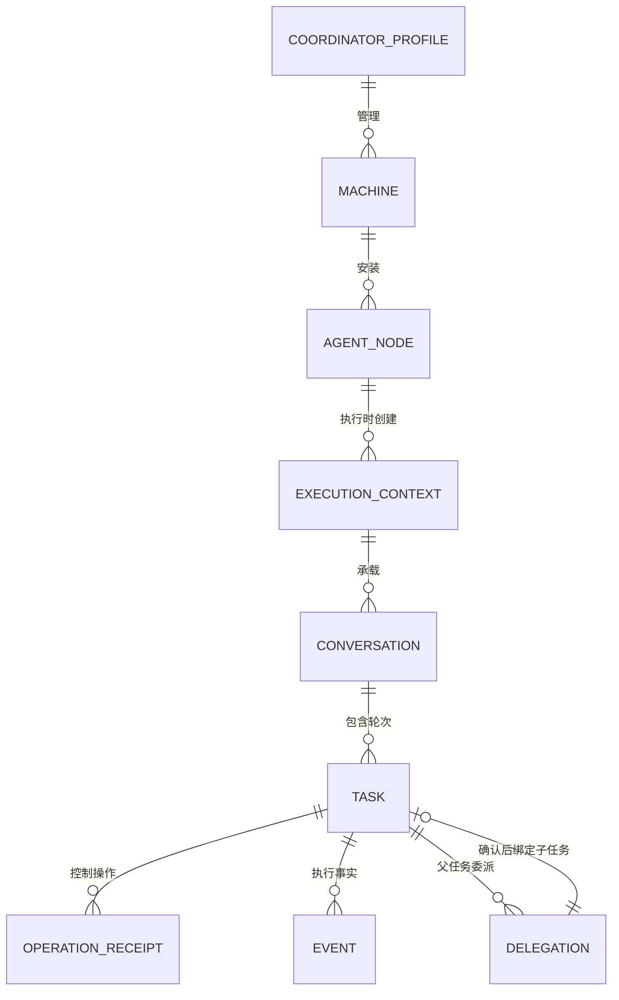

# 通信协议与接口

## OpenCode 协议协商时限

GET /global/health（700ms）有效 1.x → 完整 V1 元数据；否则 GET /api/info（700ms）及原 2.x 元数据。整次探测含响应体限 4000ms；已监听但两个契约均不可确认返回 OPENCODE_API_UNSUPPORTED，认证拒绝保持 OPENCODE_HTTP_401/403。两个候选均连接不可达保持 NATIVE_UNAVAILABLE，由托管启动在原 20 秒预算内重试。业务请求仍限 15 秒；无新增 RPC 或持久字段，不以探测成功/失败结算原 operationId。[流程与验证](iterations/I08/opencode-bounded-probe.md).

OpenDesk Desktop mcp.install/mcp.remove 在来源后台检查退出与配置写回，新增 MCP_NATIVE_RUNNING / MCP_NATIVE_STATE_UNKNOWN / MCP_NATIVE_EXIT_PENDING / MCP_OPENDESK_NODE_REQUIRED；remove 已先撤权时以 revoked_config_pending+cleanupError 返回。mcp.probe 只读返回 unsupported，不探测 Bridge 端点冒充原生列表。hello 新增 scoped-relation-management-v1（中央必需）与 opendesk-mcp-lifecycle-v1（OpenDesk远端原生增删必需）；旧远端仍可读状态/撤权，未修改帧版本。saveCollaboration 的 relation/node 冲突由中央解析旧/新关系资源并集，原关系/机器及缺来源保守阻塞；无ID兼容调用同样经过日志准入，确认返回原关系数据。[完整合约](iterations/I08/opendesk-lifecycle-relation-scope.md)。

## DSH 选择与节点管理能力

`dsh.status({machineId,nodeId?})` 与 `dsh.configure({machineId,nodeId?,adapter,url,token?,enabled?})` 在提供 nodeId 时校验原节点归属；adapter 只能是原 DSH 入口。items 增加可选 connectionId，保存/查询可返回 selectedConnectionId；旧远端缺 ID 时仅兼容精确返回的 executable，不按 adapter 或时间选取。DSH_BINDING_MISMATCH 拒绝错源回应；DSH_BINDING_PERSIST 表示私有配置已写而中央绑定未保存，不能显示完整成功或自动重试。

中央 hello 增加 `scoped-node-management-v1`，新客户端遇旧中央要求显式停止并重开，保留设置/运行信息/停止入口。graphPending 的可选 blockedNodeIds 由可信中央资源判断投影；缺失时保留机器范围保护。机器、关系和原查询/终态契约不变；daemon 协议仍为 2，远端 supportsRecovery 不因此放宽。[契约与验证](iterations/I08/connection-identity-node-scope.md)。

当前源码已随公开 0.6.0-alpha.51.recovery.2 分发，冻结提交 `905b792`；本轮发布只同步状态，数据归属、线协议和恢复边界不变。[发布与核验](iterations/I08/alpha51-recovery2-release.md)。

非GUI新增mcp nodes（无node参数）、mcp attach/operation --node ID --operation-id ID。分别复用snapshot、manageNode(action=attach)、nodeOperation；不新增RPC或模型提交。管理收据confirmed退出0、rejected退出4、unknown/not_found/不匹配退出3，查询失败不视为结束，不重放attach。status增加evidence.observation时间/有效性；配置变化或超过60秒的连接/工具观测不再用于当前事实。JSON保留authorization状态枚举，其他凭据类字段仍脱敏。 [本轮实现与验证](iterations/I08/mcp-open-recovery.md)。

当前OpenDesk接入只在Bridge侧适配现有CLI HTTP和桌面设备网关，不修改或构建OpenDesk。Bridge保存去重、派发围栏和原回应；断线证据不足保留unknown，Desktop原连接丢失后不可续聊。独立MCP支持增删与撤权，托管scope/小队及Bridge权限表单未开放。[实现与证据边界](iterations/I08/opendesk-existing-interfaces.md)。

OpenDesk执行复用既有接口：CLI的`POST /session`、`POST /session/:id/message`、`GET /session/:id/message`与`POST /session/:id/abort`；Desktop的`connect`、`gateway.identity.get`、`chat.send/history/abort`。CLI随机Basic密码仅保存在目标Bridge私有目录，通过环境变量传入原CLI。桌面核对已有网关身份，不宣称新增了原生认证协议。Bridge的requestId在本地去重；桌面idempotencyKey仅关联runId，不能推定原生去重。原会话恢复、取消及终态规则见[OpenDesk完整契约](modules/06-native-adapters/opendesk/design.md)。

OpenCode显式context准备可以复用既有ipc.start恢复已退出的原服务；snapshot/原请求读取不进入本次新增恢复路径。nodeOperation按原operationId返回持久attach拒绝收据；该拒绝仅表示本地接入授权未提交，不表示原任务成功/取消，也不保证远端未生成上下文。RPC与协议版本不变。详见[OpenCode OOM 恢复与接入拒绝收据](iterations/I08/opencode-oom-recovery.md)。

## alpha.36整合基线

公开alpha.35的managementBlocks与前端executionRecoveryReason按原节点/安装/共享目录限制执行，管理写入保持同机保护；graphPending只读投影可选blockedNodeIds。原收据须匹配已提供来源与内容指纹，原ADAPTER_HOST严格持久拒绝恢复保留。scoped-management-execution-v1与dsh-web-desktop-v1共同要求中央升级；Task/Session身份、未知不重放及线协议版本不变。[整合与实际验证](iterations/I07/alpha36-delivery.md)。

## 普通delegate输入说明

经典delegate外部参数/派生requestId不变，调用方不能指定上下文版本。仅新普通委派按持久v1给原message附固定子任务说明，下游仍使用原message字符串；无新daemon字段/能力或MCP工具。说明+需求总大小≤65536 UTF-8字节，超限INVALID_INPUT且不截断/不建新委派；未知版本DELEGATION_CONTEXT_UNSUPPORTED保留原记录。历史无版本同ID继续原文，准备拒绝须严格匹配同版本渲染后的原输入，不能用裸错误清未知。[完整契约](iterations/I07/delegation-context.md)。

## 配置入口移动的兼容性

本轮仅将MCP/DSH接入表单移至Agent行的绑定目标弹窗。继续使用mcp.status/install/remove/export({nodeId})、dsh.status({machineId,nodeId?})、dsh.configure({machineId,nodeId?,adapter,url,token?,enabled?})；不新增方法；可选节点选择字段见本页“DSH 选择与节点管理能力”，daemon协议不变。旧EXE保留原设置入口，新界面需新客户端；仅此呈现调整不要求独立SSH升级，但远端仍须具备原方法。DSH诊断文字改指向对应Agent配置，不改变错误码。[流程与验证](iterations/I07/agent-row-configuration.md)。

## list_agents调用方连接视图

经典MCP list_agents仅接受空对象或缺省arguments；AgentNetwork路由收到身份/筛选参数、null/数组/非对象返回INVALID_INPUT；既有stdio/broker把缺省或falsy arguments归一为{}的行为保持。成功响应保留items并增加schema/readOnly/view、relationRevision和caller的安全角色/委派授权说明。原父请求查询返回后新委派使用当前关系，当前主snapshot完成后再按当前关系筛选，非主items为空；失败/缺工具不能解释为空关系，旧后台缺新字段不可推定已部署。原父终态/独立连接撤权仍拒绝，新委派再核对当前授权。MCP工具数量及daemon/JSON/SQLite版本不变。[字段、错误与例外](iterations/I07/agent-connections.md)。

## 服务配置提示与原管理拒绝

discover的DSH安装提示可携带errorCode=DSH_CONNECTION_REQUIRED，节点snapshot对应status=configuration_required。仅为可选错误分类/投影状态，不更改daemon协议号或工具执行方法。原nodeOperation查询可依据中央持久且完整匹配的attach/ADAPTER_HOST拒绝证明返回原operationId的rejected；需原method/lane/action/机器/节点/参数摘要匹配，并优先核对原业务收据。裸查询ADAPTER_HOST、not_found、外来ID或超时均不能单独结算。原任务/会话/权限/取消状态不受影响。见[条件与反例](iterations/I07/agent-management-recovery.md)。

## CT-07只读委派列表

未发布源码经典MCP由六项扩为七项，新增list_delegations({limit?,after?})，readOnlyHint=true；小队18项不变，已公开alpha.34/35仍六项。limit安全整数1–50/默认20，after为本作用域原delegationId（非空≤128）；只接受两个参数，额外身份参数/外来游标报INVALID_INPUT。响应schema1/readOnly/source=delegation-ledger/liveTaskStatus=false及items/total/hasMore/next，每项仅原委派/请求/目标/已有任务会话ID、ledgerState、创建时间/规范错误码和taskQueryable。

身份来自原broker与来源机器校验。原生须同时匹配leader和原parentRequest/Task/Conversation，父终态拒绝、unknown仅只读；独立接入须enabled及原connectionId，parentTaskId必须明确null，缺/空身份不匹配。台账状态不是实时任务结果，已有taskId再调task_result；无taskId保留原requestId，不重发或换ID。无新中央/daemon帧、无迁移/连接管理或权限扩张，旧工具表缺工具时明确不可用。[完整字段、失败与验证](iterations/I07/delegation-list.md)。

## DSH Desktop/Web RPC

原生认证接受附Cookie的302/303，始终不跟随跳转；HTTP RPC外层payload.args遵循Typert命名参数，session/list使用`{_request:{}}`，其余已支持Session方法使用`{request:原请求对象}`。中央/daemon RPC格式不变。真实服务验证与打包交付见[本地DSH候选](iterations/I07/dsh-exe-delivery.md)。

新增机器方法dsh.status({machineId,nodeId?})、dsh.configure({machineId,nodeId?,adapter,url,token?,enabled?})，adapter限定dsh-desktop/dsh-web。status返回脱敏items，保存回应也不带token；配置方法不进入通用执行台账，未知保存读原状态核对，daemon维护期间拒绝配置。运行能力新增dsh-web-desktop-v1。原生侧使用根token换内存Cookie，同源session/list/create/prompt/projections/page/cancel RPC严格关联rpcId；page解析event封装并按原requestId和turn结算，回应丢失不重发。完整schema/限制/身份语义见[DSH Desktop/Web 接入](iterations/I07/dsh-desktop-web.md)。

alpha.34发布门禁：中央hello增加`opencode-dual-api-v1`与`team-context-mcp-v1`语义能力，新前台遇到仍运行的alpha.33后台时要求显式停止并重开，设置/停止入口保留。避免新EXE复用旧2.x独占后台后仍拒绝1.x或缺MCP/材料方法；原任务、收据和unknown不改。

## OpenCode 1.x / 2.x 兼容修复

机器主协议仍为 2；Core 原生引用的 snapshot.nativeProtocol 为可选字段，旧数据缺省 v2。新增 V1 /global/health、/session、prompt_async、permission/question 与 abort 映射，不与 /api/* 混用。204 或 abort=true 只是原生接收/控制响应；终态仍核对原输入、助手 parentID/完成时间与会话状态。 [需求、实现、验证与未测边界](iterations/I07/opencode-v1-compatibility.md)。

## 维护上传进度与持久化修复（issue #10）

协议仍2；中央capabilities新增maintenance-persistence-v1，新前台需要原三项加此项，缺失只保留设置/运行信息/显式停止。SSH旧路由要求不变。DAEMON_PERSIST_FAILED明确本地发送前失败；SSH_UPLOAD_FAILED及安全details不再泛化为暂存错误。 [完整设计、实测与边界](iterations/I07/maintenance-persistence.md)。

## CT-05桌面消费约定

不新增RPC/参数/schema；桌面用户复用team.contextPacket与team.messages。除原服务授权外，M01检查原工作/目标、精确引用与原材料、报告来源/状态、白名单及规范packetId，重算文档正文摘要；旧后台/损坏/过期响应拒绝且移除旧导出，不回退最新文档或旧包。Markdown不在packetId覆盖内，因此本机副本从核对后的结构化字段重新生成，JSON同存该本地视图。无自动投递/执行/收件合约，协议2及18项小队工具保持。[现行消费者规则](iterations/I07/context-packet-ui.md)。

## CT-05明确选择接口

用户 `team.contextPacket({runId,targetAgentId,selections})`；成员MCP `team_context_packet({targetAgentId,selections})`，工作只取原scope。selections的documents为documentId/revision，tasks为workItemId/revision/round，messages为messageId/seq，artifacts为artifactId/version；每类最多8项，至少1项。数字为正安全整数，字符串非空/≤150；嵌套额外字段及重复ID拒绝。输出schema1结构化包、确定摘要和Markdown，整个UTF-8 JSON≤256 KiB；具体白名单见[字段与失败表](iterations/I07/context-packet.md)。

先授权，再核对目标及本工作原引用：TEAM_CONTEXT_TARGET/REFERENCE/STALE/CAPACITY分别表示无效目标、无效引用、任务过期、包超限；非法选择TEAM_INPUT，缺文档修订TEAM_DOCUMENT_REVISION，scope失效TEAM_FORBIDDEN。不回退最新版，不发送、不执行、不确认已读或授予权限。小队tools/list现18项，经典6项不变；旧工具表/后台不支持时明确失败，没有替代包或自动降级。原daemon帧/IPC版本2与TeamSpace格式3不变。

当前整合保留alpha.32三项中央能力和SSH原对象路由能力；Classic MCP工具、小队18工具、独立MCP四方法及精确修订读取共存。没有新wire版本或跨厂家Session协议；旧后台不支持新方法时返回实际错误，不因版本名或manifest信任就扩大业务授权。[最终合约与实际边界](iterations/I07/integrated-source.md)。

## 按机器管理与版本准入

协议仍2；hello.capabilities新增scoped-management-v1与opencode-v2-admission-v1，新前台要求中央与owned-object-controls-v1同时具备，缺项COORDINATOR_UPGRADE_REQUIRED。NATIVE_VERSION表示原生主版本不可识别或不在支持范围（当前接受可识别的OpenCode 1.x与2.x，其他主版本启动前拒绝）；401/403与API契约错误快速独立返回，裸远端错误不作未发送证明。 [需求、实现、验证与边界](iterations/I07/version-management-recovery.md)。

## 协作兼容修复

wire protocol仍2；中央及daemon hello新增capabilities中的owned-object-controls-v1。旧中央仅保留preferences/runtimes/shutdown；旧SSH仍可snapshot/discover/request和daemon原收据/维护，对context/scope及task/conversation/pending/reply/cancel/operation/continue/reconcile/submit/verify返回DAEMON_UPGRADE_REQUIRED。新增OPENCODE_API_UNSUPPORTED、COORDINATOR_UPGRADE_REQUIRED；既有NOT_FOUND与OBJECT_SOURCE_CONFLICT继续适用。 [需求、实现、实测与边界](iterations/I07/collaboration-compatibility.md)。

## 历史详情读取恢复

协议2和ipc请求形状不变。task/conversation按实际backend读取，明确NOT_FOUND/TASK_NOT_FOUND/CONVERSATION_NOT_FOUND可回原机器保留历史；historical=true/canContinue=false。OBJECT_SOURCE_CONFLICT表示多后台同ID，RECEIPT_MISMATCH表示响应ID不符；两者及真实NOT_CONFIGURED不假装历史成功。request/operation/submit/continue/reply/cancel不受此回退影响。 [需求、实现、逐项证据与边界](iterations/I07/history-detail-recovery.md)。

CT-04桌面消费者不新增RPC/参数/daemon帧。team.document返回须匹配请求的runId/documentId/revision，并有有效currentRevision/contentSha256；浏览器重新计算正文摘要，索引指定修订还核对索引摘要。旧后台忽略revision/不支持索引时明确报错，不能把最新正文冒充旧版；clipboard/浏览器MD下载没有网络同步合约。[实际流程与测试](iterations/I07/public-materials-ui.md)。

## 开放MCP接入：方法、状态事实与能力标记

用户入口仍以nodeId为准、由后台派生adapter与机器，客户端不能指定文件或可执行命令；本轮在此之上新增两个方法并扩展status的观测面：

| 方法 | 参数 | 语义 |
| --- | --- | --- |
| `mcp.status` | `{nodeId}` | 只读；返回`state`（`absent`/`exported`/`installed`/`conflict`/`revoked_config_pending`/`unsupported`）、`facts`（`config`/`nativeLoad`/`connection`/`tools`/`authorization`/`ownership`）、`evidence`（`configPath`/`nativeProbe`/`toolsProbe`/`configError`）、`nativeSupport`/`nativeSupportCode`/`nativeSupportReason`，并保留`enabled`/`installed`/`conflict`/`configPath`/可选`connectionId`/`files` |
| `mcp.install` | `{nodeId}` | 写Bridge自己拥有的原生条目；已存在外部条目返回`MCP_CONFIG_CONFLICT`并保留 |
| `mcp.export` | `{nodeId}` | 只登记身份并生成标准片段（JSON/TOML/JSONC/OpenDesk JSON/DSH补丁YAML），不写原生配置 |
| `mcp.remove` | `{nodeId}` | 先撤权再删可核对归属条目；仅 OpenDesk STDIO 空 `headers:{}` 与缺省等价，其他修改仍保留；清理失败返回`state:'revoked_config_pending'`与`cleanupError`，不恢复授权 |
| `mcp.revoke` | `{nodeId}` | **只**持久撤销授权，绝不修改原生条目 |
| `mcp.probe` | `{nodeId}` | 只读探测：该产品自身的MCP列表（仅`claude`/`codex`/`opencode`有）+ Bridge stdio工具目录；不写配置、不重装、不启动模型 |

机器路由：Windows本机与SSH机器经`MachineHost`；**Linux本机**在协调器进程内由本地MCP宿主处理上述六个方法（其他方法仍走原执行宿主，MCP失败不回落到执行）；WSL经HostConnection→Core stdio完整MachineHost，在原发行版处理同一六项`mcp.*`，不回落Windows本机。

WSL启动：bootstrap设置`AGENTBRIDGE_HOST_READY=1`，Core安装stdin读取器后输出`{bridgeReady:1,protocol:'agentbridge-host-v1'}`，Windows收到后才发送业务帧；并发首次调用等待同一启动。close使内存启动代次失效；发行版枚举迟到返回时不得spawn或派发。新调用有独立启动Promise，原调用发送前绑定并复核原子进程；就绪后但尚未写入请求即关闭仍返回严格未派发证明，已写入请求仍保持未知语义。30秒无握手、就绪前退出/无效帧/关闭返回`WSL_HOST_NOT_READY`与`executionNotDispatched:true`。旧Core没有握手时有界拒绝，原生直连/旧启动器未设置该标志仍使用原回应流。请求已写入后断线/回应超时保持`DESKTOP_TRANSPORT`/`DESKTOP_TIMEOUT`未知结果，不携带未派发证明、不重发。无新增持久字段或SSH协议变化；[实现与当前实测限制](iterations/I08/wsl-host-readiness.md)。

Pi（alpha.51.recovery.2公开版）：同一六项方法管理用户`mcp.json`，路径来自`PI_CODING_AGENT_DIR`或`~/.pi/agent`；`nativeTarget`固定原目录，切换返回`nativeTargetChanged/currentConfigPath`并拒绝新写入。原生仅布尔enabled变化时保留归属，false投影config=disabled、installed=false，安装拒绝`MCP_NATIVE_DISABLED`；移除仍先撤权只清原目标。相对/损坏/链接目录`MCP_PI_TARGET`，未核对版本`NATIVE_VERSION`，当前安装准入1.4+的1.x正式版；导出/撤权/清理不因版本改变失效。原生探测用`pi mcp list --json`精确身份/用户scope/无项目覆盖及connected状态，输出安全摘要，项目覆盖保留未知、不写项目配置。[源码与实际验收边界](iterations/I08/pi-mcp-config.md)。

Hermes（alpha.51.recovery.2公开版）：六项方法管理原生Home当前Profile的YAML `mcp_servers.agentbridge`；保存Hermes nativeTarget分支，profile为只读回显，不接受由客户端代替原生选择。`MCP_HERMES_TARGET`拒绝不可核对/已删除目标，`MCP_NATIVE_TARGET_CHANGED`拒绝在切换后新写入；清理仍按原绑定。已核对bool-like enabled控制不改变归属，禁用拒绝`MCP_NATIVE_DISABLED`。`hermes mcp list`只证明加载，不映射连接成功；原生列表错误保留安全原因，过期观测不复用。导出files新增hermes YAML路径；没有新增RPC/Task状态/SSH帧，[实现与实际原生证据](iterations/I08/hermes-mcp-config.md)。

新增能力标记`mcp-open-access-v1`（中央与daemon hello同时公布）。缺该标记时：`mcp.status`/`mcp.revoke`/`mcp.probe`返回`MCP_BACKEND_UPGRADE_REQUIRED`（不静默降级），`mcp.install`/`mcp.export`/`mcp.remove`在旧“当前版本”后台仍可用。维护期间：撤权与安装/导出/移除同属配置变更被拒，只读探测与状态允许。错误码新增`MCP_PROFILE_MISSING`（DSH Web profile目录不存在，安装前拒绝，不创建文件）与`MCP_DSH_PROFILE_REQUIRED`（DSH CLI 未指定或非法的原生 profile 名称）。

**DSH Desktop原生目标**：后端读取稳定版原生数据目录/Profile选择并保存`nativeTarget:{home,profile}`。状态可返回`profile`、`nativeTargetChanged`、`currentConfigPath`与`evidence.configError`；选择变化时安装拒绝`MCP_NATIVE_TARGET_CHANGED`，原生选择/目录不可核对拒绝`MCP_DSH_DESKTOP_TARGET`，不回落其他目录。移除仍先撤权并仅清理原绑定，清理失败保留原文件；旧远端能力声明不能由新前端放宽。[完整契约](iterations/I08/dsh-desktop-mcp.md)。

**DSH 的 `profile` 参数**：`mcp.status|export|install|remove|revoke|probe` 均接受可选 `profile`，仅 `dsh` 适配器使用，其余适配器忽略；DSH Web 固定 `web` 且不暴露该参数。原生目标是 `$DSH_HOME/profiles/<profile>/cordis.patch.yml`（`DSH_HOME` 缺省 `~/.dsh`），写入仍是单一 `insert:` 行 + `@deepseek-ai/dsh-mcp-client`。名称必须匹配 `^[a-z0-9][a-z0-9-]{0,63}$`（`../escape`、`a/b`、空串、大写、前导 `-` 一律拒绝，不拼接逃逸路径）。未指定时 `mcp.status` 返回 `nativeSupport:false`+`MCP_DSH_PROFILE_REQUIRED`+`profile:null`，`mcp.install`/`mcp.remove` 同码拒绝，`mcp.export` 仍出片段；`status` 回显 `profile`，省略参数时使用登记值，`mcp.remove` 只清理登记的那个 profile。安装后事实为 `nativeLoad:'reload_required'`，不宣布已连接。[接口与未测项](iterations/I08/mcp-open-integration.md#125-dsh-cli-显式-profile-原生配置2026-10-22-晚补)。

Bridge 作为 stdio MCP 服务端的握手：对协议修订 2026-07-28 的 `server/discover` 探测返回 `{supportedVersions:['2024-11-05','2025-03-26','2025-06-18','2025-11-25'], capabilities:{tools:{}}}`，不再返回 JSON-RPC 错误（严格客户端此前会因此判定连接失败）；`initialize`/`tools/list`/`tools/call` 与工具集合不变。`mcp.status` 对 OpenDesk 两个入口额外返回 `launcher:'node'|'electron'`，表示写入的原生条目用哪个启动器：OpenDesk 的 mcpmgr 无法启动 Bridge 的 Electron 运行时，因此优先使用 PATH 中真实存在的 Node，未找到时回退 Electron 并在界面明确提示。

非GUI入口：`agentbridge mcp status|export|install|remove|revoke|probe --node NODE_ID [--adapter ADAPTER] [--json] [--profile-dir DIR]`，经运行中协调器的私有socket调用同一批方法，解`{ok,result}`信封；`--adapter`省略时从`snapshot`的`nodes`解析（0/>1匹配退出码2，不猜），`--json`对`token/secret/bearer/authorization/password/privatekey/apikey/credential/configuration`类键与疑似令牌脱敏。响应仍不含Token或endpoint内容。[完整契约、证据与未测项](iterations/I08/mcp-open-integration.md)。

## 独立 MCP 配置管理

用户入口mcp.status / mcp.install / mcp.export / mcp.remove均传nodeId，Coordinator检查机器归属，AgentNetwork从节点派生adapter/机器；客户端不能指定文件或可执行命令。目标MachineHost内部方法接收nodeId/adapter。status只读返回state=absent/exported/installed/conflict、enabled/installed/conflict、configPath、可选connectionId/files；安装/导出另含不带Token的configuration。导出激活接入但不写原生配置。删除先撤权，再删除原样归属条目。回应丢失刷新status核对，配置操作不会执行模型任务。

旧daemon未声明四方法时返回原方法错误；新daemon维护期间拒绝安装/导出/移除，允许只读状态。配置错误包括MCP_UNSUPPORTED、MCP_CONFIG_INVALID、MCP_CONFIG_CONFLICT、MCP_REVOKED；普通MCP的工具名和stdio协议不变。外部scope增加externalConnectionId，身份由broker登记提供，工具参数不可修改。Token/endpoint内容不在用户API响应内。[完整接口与验收](iterations/I07/mcp-installation.md)。

## CT-04只读材料API

| 入口 | 参数与响应 |
| --- | --- |
| 用户team.materials | runId；可选limit整数1–50（默认20）、documentAfter非空字符串≤150；返回schema1只读材料索引和markdown |
| MCP team_materials | 可选limit/documentAfter，runId由原scope提供；tools/list声明readOnlyHint |
| team.document / team_document | 原documentId和可选正整数revision；用户仍需runId。指定revision严格返回对应历史title/content/authorId/time、revision/currentRevision/contentSha256，不含history；无revision维持旧结构 |

非法limit/游标格式/revision报TEAM_INPUT；当前工作无该文档游标报TEAM_DOCUMENT；不存在的文档修订报TEAM_DOCUMENT_REVISION，不能回退最新版。所有读取先经原成员/工作/有效原生尝试权限检查，外来ID不扩权。索引snapshotId仅校验返回页内容；状态/消息/收据无副作用，产物引用不证明可达。

CT-04 冻结范围为17项小队MCP工具，经典主从六工具不变；当前工具数以上方CT-05为准。新服务schema可发现；旧后台可能没有新工具或忽略revision，调用方须核对响应revision/摘要，不能仅据版本名宣称精确历史读取；可回原context/tasks/document通路并明确只读当前版本。原IPC/daemon帧版本保持2，没有MD同步/上下文包协议。[完整契约与证据](iterations/I07/public-materials.md)。

通信内容与ACP研究见[连接研究](iterations/I07/connectivity-research.md)及[接入矩阵](agent-integration-matrix.md)。当前源码使用七工具主从MCP/已有小队工具和原IPC/SSH帧；没有ACP RPC、新上下文包接口或MD同步协议。后续建议不构成当前已实现合约。

原生接入补强：snapshot 节点可选 teamCollaboration；team.registerAgent/team.execute 新操作对不支持小队的原生节点返回 TEAM_CAPABILITY，拒绝发生在工作项认领/意图/派发前。原收据重放仍可查询。Codex/NativeCliHost 的 ipc reconcile/operation 保留原方法和 operationId/state/data，收据新增 kind/taskId 并持久保存；跨控制种类/任务复用同 ID 为 REQUEST_CONFLICT，历史无 kind 取消兼容。无新 RPC 或 daemon 帧版本。[专项](iterations/I07/native-integration-guards.md)。

discover 的原方法/参数/返回结构不变，明确扫描同时重新枚举执行环境；snapshot 保留实时状态读取，不再按15/30秒触发安装发现。lastSyncedAt、请求/操作身份和 unknown 语义保持。[触发时机与兼容边界](iterations/I07/desktop-polling.md)。

当前alpha.46源码：snapshot.connections 可选 current，snapshot.nodes 可选 supersededBy；前端仅展示当前节点，历史对象仍返回供原身份查询。历史节点的新 submit/attach 返回 NODE_SUPERSEDED，原 request 查询、continue 及收据语义保留；当前/历史安装共享占用。daemon 仍为协议2，未新增模型或远程命令接口。[发现修复](iterations/I07/current-agent-discovery.md)。

## 原生适配扩展（alpha.46）

不增加远程任意命令、模块加载 RPC 或新的模型接口，daemon 线格式仍为协议 2。discover/context/snapshot 沿用原方法，adapter 新增 `hermes`、`pi`、`dsh`，发现的安装可调用性与执行/协作能力分开。MachineHost 用静态注册工厂创建宿主，未知类型返回 ADAPTER_UNSUPPORTED；新增三种不支持 Bridge MCP scope/权限/表单/连接验证时明确拒绝。宿主通过原 ipc submit/continue/request/task/conversation/cancel/operation/reconcile 接口返回原任务与独立收据。原生内部协议分别为 Hermes stream-json、Pi json print、DSH headless json，不混用帧格式。[原生设计](modules/06-native-adapters/design.md)、[开发接口](custom-agent-development.md)。

## SSH持久拒绝恢复

SSH协议2和daemon.receiptRead线格式不变。客户端ipc/request裸NOT_CONFIGURED后只读同ID收据；同认证代次匹配持久rejected产生内部DAEMON_REQUEST_REJECTED能力，公开同码JSON/错误没有该能力。中央普通request可返回{state:rejected,requestId,machineId,error:{code:NOT_CONFIGURED,message},reconciliation}，没有taskId，禁止当成功任务；mutation仍报错。verify/控制语义不变。 [设计、需求、开发、验收与边界](iterations/I06/daemon-rejection-recovery.md)。

## 本地恢复语义

不改变RPC方法、daemon帧版本或数据版本。Codex ipc reconcile沿用operationId/state/data收据，并持久task.reconciliation；终态或严格未派发证明可confirmed，任务为failed，其他查询返回unknown并保留占用。新增内部NETWORK_PERSIST仅表示本地AgentNetwork原子保存失败，保留原OS错误；不进入全局拒绝白名单，只有原未派发意图证据允许中央拒绝结算，NOT_FOUND/远端EPERM不允许。见[专项](iterations/I06/windows-start-persistence.md)。
## 停止接口与兼容

team.context/team.refresh新增stopSupported=true和可选stop汇总（requestedAt/completedAt/total/unresolved/externalCount），attempt新增stop.state；停止中仍只能查询原请求和原取消操作，收到匹配原执行终态才归档。成员MCP工具集合保持16项，没有停止权限。旧后台缺stopSupported时新版界面禁用整项停止，提示升级中央后台。底层cancel/operation与daemon帧版本不变，原生终态不能由取消回执替代。Coordinator对原请求/机器、控制operationId及返回的可选task身份严格校验，NOT_FOUND/unknown/身份不符不结算原台账。[详细设计](iterations/I07/native-stop.md)。

## 小队协作通信契约

当前本地Coordinator方法；底层IPC/SSH协议仍为2，旧模式原父scope规则不变。公共方法不接受外部自报teamScope，原生小队身份仅后台内部派生。操作写前需稳定operationId，回应不明查询team.operation；返回confirmed不代表原生业务成功。[实现](../desktop/electron/coordinator-service.cjs)、[细节](iterations/I07/task-handoff.md)。

| 方法 | 输入/输出与边界 |
| --- | --- |
| team.snapshot / team.context / team.messages / team.document | 登记/小队/工作概览，按runId读本次公共材料，按after分页100条消息；文档带revision/history；不返回令牌/私有session身份 |
| team.registerAgent / team.disableAgent | native node或外部mcp实例及职责描述；停用撤销工作访问，有运行/unknown时拒绝停用 |
| team.createTeam / team.createRun | 指定主角色、成员/约定，建立目标及完成标准；小队长期编辑/自动移交暂未提供 |
| team.postMessage / team.writeDocument | 消息/回复/通知，或按expectedRevision更新文档；owner/editor权限与真实发送者由后台核验 |
| team.stopRun | 仅用户，runId/expectedRevision/operationId；同事务停止新调度/撤权及保存各原尝试取消意图，confirmed收据不代表任务已取消 |
| team.revokeMember / team.pause / team.closeRun | 撤权需工作原revision；暂停仅停新执行，归档须所有原尝试有明确终态 |
| team.connect | 按工作成员生成本机MCP接入配置，不含明文令牌；撤权/归档即失效；不是启动外部Agent |
| team.execute / team.refresh | 用户手动执行原生成员一轮/查询原请求；可选workItemId/expectedRevision绑定负责人及业务轮次；旧MachineHost缺teamCollaboration能力时拒绝本轮派发，不切换其他节点 |
| team.operation | 查询原操作；执行返回原attempt；连接查询可恢复同一私有配置，不重复创建任务 |

任务接口仍绑定runId；写入均需operationId，工作项变更需expectedRevision。授权/交接不能靠正文生效。

| 新接口 | 当前契约 |
| --- | --- |
| team.tasks | 读取workItems、handoffGrants、handoffs、固定maxTasks=50/maxRounds=5和总验收记录 |
| team.createTask | 用户/主角色；title/description/ownerId/kind，dependsOn只引用既有项；verification需sourceTaskId且由另一成员负责 |
| team.claimTask | 负责人接手ready；workItemId/expectedRevision；复验绑定当前不可变产物，同成员未核对原执行阻止认领 |
| team.reportTask | 本人running项；outcome/summary；交付submitted需version/reference；复验需artifactId，通过还需accessConfirmed=true/evidenceReference；可附handoffTaskId/targetRevision，目标修订取报告前读值 |
| team.handoffTask | workItemId/expectedRevision/toTaskId/targetRevision；交付→关联复验或失败复验→原交付；队员须有效用户授权，原生尝试先结束；返回executionStarted=false |
| team.configureHandoff | 仅用户；具体任务路径/expectedRevision、maxUses为1至20、enabled布尔；不会启动执行 |
| team.retryTask | 用户/主角色；受阻任务增加一轮、清除当前报告引用、保留历史；unknown/预算上限拒绝 |
| team.acceptTask | 用户/主角色；summary及原修订；复验精确对应产物，交付须所有当前版本复验已验收，绑定本轮原生尝试无unknown且最后尝试成功 |
| team.acceptRun | 用户/主角色；工作原修订/summary；任务全验收且尝试全终态后记录completed并撤销成员接入；若仅原生主角色本轮仍在运行，则先记录awaiting_leader_terminal/accepted=false，待真实成功、修订和新事件核验后生效 |

小队MCP共16项工具，新增team_request_attention明确请求主角色协调（需用户已启用，主角色不得自我唤醒）；其余15项为：team_context、team_messages、team_post_message、team_document、team_update_document、team_acknowledge，以及team_tasks、team_operation、team_create_task、team_claim_task、team_report_task、team_handoff_task、team_retry_task、team_accept_task、team_accept_run。职责介绍与实时权限分开；成员/交接/自动执行配置工具不向成员开放。team_operation查询当前成员自己的原收据，不能查询其他成员或用户的操作。team_context返回当前绑定身份、成员职责、任务、授权及公共材料。

身份从私有通道绑定，不能指定另一runId或冒充发送者。external连接由中央本机broker提供；native回调核对原来源机器/节点/request/Task和绑定工作项，不复用旧主从父scope。原生宿主通过job配置传指引/工具名，独立worker不依赖未复制模块。旧MCP工具集合及IPC/SSH帧版本2保持不变。

报告、交接、授权消耗与通知同事务；交接本身不等于启动；仅用户已启用且在授权成员/能力/预算内的新事件可由激活器后续执行。普通群发言/@不启动。首批Claude支持原会话续接，运行中收信不支持、事项排队；其他接入和完整停止仍待后续。

I07C首批用户方法：`team.configureAutomation`输入runId/expectedRevision/enabled，启用还需agentIds（含获准原生主角色）/maxActivations/maxMinutes/idleMinutes；只允许用户设置。`team.wake`输入operationId/runId/reason，保存明确协调事件；成员入口team_request_attention不接受伪造sender/目标身份。主角色不能自我唤醒，ordinary消息和阅读回执不形成激活。预算累计，不通过重新启用或重启清零。

MachineHost.scope返回teamContinuation=true表示能重绑小队身份；原节点续接在能力缺失时派发前拒绝。原Conversation的最新小队轮不能被普通未带新teamScope的接口接管；teamScope仍仅由中央私有调用派生。新轮使用独立scope和原请求，原生Session私有校验失败后停止新激活，不回退到新会话。[实际流程](iterations/I07/automation.md)。

## 当前本地原请求核对结果

本地 Coordinator 的 recoverPending 保留 resolved，增加 remaining 和 items；每项只含原 id、machineId、op、固定 code/reason，不返回 Prompt 或任意远端错误正文。旧窗口可忽略新字段，新窗口兼容只有 resolved 的旧后台并明确提示。内部 undispatchedRejection 不新增远端 RPC，只核对严格匹配的原 Windows OpenCode submit、明确资源错误与 dispatched===false 意图；落盘前复核无在途 job。原生任务/控制及 SSH daemon 协议 2 不变。[运行缓存与未派发恢复](iterations/I06/runtime-recovery.md)。

## Linux CLI 发现边界

discover 的输入和 items 响应、SSH 协议 2、原请求/任务/控制接口均不变；只有新版 daemon 的本地扫描目录变化。旧 daemon 可信复用继续按实际握手版本，不因客户端版本变化就声明具备新扫描能力。 见 [专项](iterations/I06/linux-cli-discovery.md)。

## 1. 对象关系

这是产品逻辑关系，不是声称所有对象都在一张中央数据库中。中央、daemon、Hub/Edge、原生宿主各自保存所属记录。委派在 pending/rejected/unknown 初期可能还没有可确认的子 Task ID，确认后绑定对应子任务。

## 2. 需要分开的 ID

| 字段 | 含义 | 不能替代的字段 |
| --- | --- | --- |
| coordinatorId | 当前中央 profile 的持久身份 | 不是用户手输的设备凭据 |
| profileId | 远端安装/状态所属的中央 profile | 不是服务器主机密钥 |
| connectionId | 一条 SSH 连接配置，或旧工具连接记录；命名空间不同 | 不是机器硬件编号，也不是节点 |
| machineId | Windows、WSL 或已验证远端用户环境身份 | IP、显示名称和目录 |
| daemonId | 远端所属 profile 的持久 UUID | 不提供硬件级不可复制证明 |
| nodeId | 机器中一个工具安装的网络身份 | agentId、项目目录、模型 |
| contextId | 节点在某目录/协作模式下的执行上下文 | 原生 Session ID |
| agentId / instanceId | 后端执行实例；中央聚合会加机器前缀 | 用户面对的节点 |
| requestId | 一次需求的稳定幂等 ID | RPC id、taskId |
| taskId / executionId | 一轮任务与其执行归属 | Conversation ID |
| conversationId | Bridge 的多轮会话 | 原生 Session ID |
| native.sessionId / messageId | 原生会话与本轮关联；OpenCode 是原生 Message，Claude 可能没有消息 ID，Codex 当前以 Bridge requestId 关联 | 不同适配器不保证相同原生 Message 语义 |
| operationId | 权限回复或取消等控制操作的稳定 ID | 原生权限 requestId |
| delegationId | 父子委派关联记录 | 子任务 requestId |

RPC `id` 只把一条通道响应与请求配对。重连后换 RPC id 是正常通信行为；同一需求的 requestId 不能因此改变。

## 3. 身份如何生成与路由

Windows 本机目录初始化时保存随机 `local-...` machineId。WSL 按发行版名称生成稳定 ID，并记录 Windows 宿主。SSH 完成认证、daemon 检查与协议握手后使用 `ssh-<daemonId>`；不同用户/profile 各有自己 daemon 状态。

节点通常由机器 ID、adapter 和可执行位置生成。若后端报告解析后的实际 launcher 路径，保留已有权威 nodeId，避免同一工具被分成两个节点。

后端 Task、Conversation、实例 ID 聚合到中央时用 `machineId::原ID` 定位来源。下发原机器时还原原 ID。原生 Session/Message ID 不加此前缀。请求或控制响应只能解除相同来源机器的未确认记录。

显示名称可变，不能参与任务所属判断。SSH 地址别名只有在主机密钥、daemon 身份及用户归属核实后才能归并，不能只按相同 IP 合并。

## 4. 状态是不同维度

### CT-01可选能力与关系拒绝收据

现有snapshot节点和经典MCP `list_agents`条目可增加 `connectionCapabilities`（八项boolean|null）及 `capabilitySource`（`{kind:"static-adapter",adapterId,driver?}` / `{kind:"unknown"}`）；字段与静态上限见[CT-01](iterations/I07/connection-capabilities.md)。不增加工具方法、RPC帧或ACP/SDK协议，不将本机声明冒充远端握手/账号推理能力。

新关系主节点要求execution和bridgeMcp，子节点要求delegation；新协作执行核验调用方，普通delegate子任务使用collaboration:false。原ID查询先于新准入。`collaborationOperation`可返回匹配原operationId的 `state:"rejected"` / `error.code:"COLLABORATION_CAPABILITY"` 持久收据。仅本机标记且在关系保存前确定的拒绝可产生该结算，裸RPC同码不是未执行证明；缺失/外来收据与not_found继续unknown。前端只解除原pending，草稿/原关系不被改写。

| 对象 | 当前字段 / 状态 | 阅读方式 |
| --- | --- | --- |
| 机器 | online、error；SSH 另有 connectionState | 是否能联系此执行环境 |
| 节点 | discovered、connected、offline、tool_error、unsupported；busy、unconfirmed | 是否接入、工具是否可用、是否有占位 |
| 任务 | queued、accepted、running、succeeded、failed、cancelled、unknown | 这一轮执行的事实 |
| 原生等待 | Task.waiting 的 permission/input 与原 requestIds | 任务可能仍是 running，但需要用户回复 |
| 控制收据 | pending / unknown / confirmed / rejected 等所属实现状态 | 控制请求是否获得明确回应 |
| 协作关系 | leaderId、memberIds、revision | 获准委派的新任务范围 |

`waiting_input`、`cancel_requested` 出现在早期初稿，但不是当前统一 Task.status 的值。不能把取消收据 confirmed 显示为任务 cancelled；不能把机器离线显示为已完成任务失败。

SSH 状态合并时 error/connectionError 缺失表示当前无连接错误，删除 machines.json 中旧值；文件与对外 JSON 字段结构不变。快照 RPC 的本次失败独立于 SSH 通道状态；恢复不改写 Task.error、Task.status 或 pending 台账。

## 5. 持久文件与拥有者

路径以下用 `<desktop-profile>`、`<remote-profile>` 和 `<context>` 表示，避免把某个人的电脑目录当成部署默认值。

| 所属位置 | 文件 / 数据 | 负责写入者 |
| --- | --- | --- |
| desktop profile | `desktop.json` | Coordinator 的设置入口 |
| desktop profile | `coordinator-identity.json`、`coordinator-status.json` | 所属 Coordinator；身份包含内部秘密，不能复制到共享文档 |
| desktop profile | `machines.json`、`agent-network.json` | 机器目录与网络台账 |
| desktop profile | `pending.json` | 中央未确认请求与控制记录 |
| desktop profile | `graph-layout.json`、`graph-pending.json` | 中央独立布局/收据与图写入意图 |
| desktop profile | `ssh-connections.json`、`ssh-known-hosts.json` | SSH Manager 与主机信任管理 |
| desktop profile | `ssh-credentials/*.json` | Windows DPAPI 密文；连接配置只保存引用 |
| desktop profile | `coordinator/versions/*`、`coordinator/runtime/*` | 冻结的代码/依赖/运行资源 |
| remote install | `install.json`、`current.json`、`versions/<version>/*` | 所属 SSH 安装器 |
| remote state | `machine.json`、`daemon.lock`、socket 与 PID 记录 | 所属 Linux daemon |
| remote state | `daemon-receipts.json`、`daemon-events.jsonl` | daemon；事件 cursor 持久化 |
| MachineHost state | `node-contexts.json`、`node-contexts/<contextId>` | 执行上下文宿主 |
| context / CLI instance | settings、Hub SQLite、Edge journal、operations 与 native identity | 所属 controller/Hub/Edge |
| 原生工具目录 | 账号、供应商、模型偏好与原生历史 | 原生工具；Bridge 没有全局配置写入职责 |

Claude/Codex 还保存其宿主 JSON/worker 状态，具体字段和文件见各 [原生模块](modules/06-native-adapters/design.md)。数据库格式、锁和迁移规则见 [任务模块](modules/07-task-session/design.md)。

## 6. 路径与目录占位

Windows `C:\project` 与同一宿主 WSL `/mnt/c/project` 可对应同一物理目录，共享任务占位。WSL UNC 路径必须属于所选发行版。真实目录解析后的别名也不能绕过占位。

SSH 的 `/mnt/c/project` 属于远端独立文件系统，不能与本机 Windows/WSL 混同。远端路径按远端 Linux 的 realpath 校验，不自动同步文件。

运行、等待、unknown 都可能占用节点/目录。只读查询能明确原任务终态后才解除，缺少原收据不够。具体占位与锁的持久性边界以 [M03](modules/03-machine-network/design.md) 和 [M07](modules/07-task-session/design.md) 为准，不能宣称多个独立 Bridge 中央具备全局分布式锁。

## 7. 修订、迁移与备份

关系 revision 防止两个界面覆盖授权。图布局 layoutRevision 与授权 revision 分开；graph-layout.json 和 graph-pending.json 的实际格式见下方。

机器目录、网络、安装清单、协议和 SQLite 各有独立版本；不能用桌面 app 版本替代它们。读取未知格式或归属不明时停止接管，保留数据。旧模型覆盖只能作为历史实例绑定，不能迁移为新节点的模型设置。

停机备份整份所属状态与安装记录，并保护凭据；活动 SQLite 不能只复制主文件而忽略 WAL。复制 daemon 状态到另一服务器不会自动授予新机器同一身份；主机密钥/身份冲突必须核对。

## 当前会话续接字段验收结果

OpenCode/Core 会话响应额外携带 canContinue/kind，均从持久原生绑定、上一轮状态、验证标志及配置/资源归属计算，不新增持久列。Conversation/native Session 的真实两轮与重开保留见 [6A 验收](iterations/I06/acceptance.md)。

## Linux 发布兼容数据

离线 manifest 可选 `compatibleDaemons: [{version,manifestPath,manifestDigest}]`。路径仅能是清单内 `compatible-daemons/<version>.json`，其文件 SHA-256 和内容 manifestDigest 均校验，版本不能重复。旧协议 2 manifest 不要求有该字段。当前 alpha.11 明确收录 alpha.2–alpha.10；未知或未来版本不按协议相同自动接受。

SSH probe 的 `daemonVersion` 是实际选中后台版本，`clientDaemonVersion` 是客户端新安装包版本，`reuseCompatible` 是展示信息，`installNeeded=false` 表示旧安装可复用。执行分支按实际可信清单选择结果判定，不能凭缓存展示标志绕过校验。旧 current.json、daemon 身份和任务数据无需迁移。

## 关系、布局与图操作

agent-network.json 增加 relationOperations，每项含 operationId、state=confirmed、内容 fingerprint 和 data（提交时的 collaboration）。现有 version=1、节点、请求、委派与 ID 不迁移或重建。图权威边仍来自 leaderId/memberIds；成员顺序不改变权限。

graph-layout.json 是 version=1 容器：layout 包含独立 layoutRevision、groups[machineId] 与 nodes[nodeId] 的 x/y、viewport 的 x/y/zoom；operations 为同类稳定收据。节点坐标相对于机器组，几何 parent 不代替 parentMachineId。损坏文件先复制为 graph-layout.json.corrupt-*，恢复默认位置不重置关系。

graph-pending.json 保存 operationId、lane=relation/layout/node/machine、完整允许的 params、内容摘要、pending/unknown/confirmed/rejected 与时间。未知原 ID 不因另一个 ID 或窗口而解除；原业务收据确认后对账。浏览器本机缓存 base/draft/layout、图两个 pending 原操作和独立的节点/机器原操作意图；机器参数含地址/认证方式但没有密码/口令，秘密不存入本机缓存。

机器 lastSyncedAt 标记成功快照时间；节点 uncertain、waiting、lastError 分别投影原任务的 unknown、等待与最近失败。原 Task 七种状态与控制收据语义不变。

AGENT_UNHEALTHY 的原执行前拒绝使用现有 daemon-receipts 的 rejected/error 与中央 pending 的 rejected/result，不新增版本或字段。旧 unknown 记录只在原查询依据其保存的确定拒绝核对，其他 unknown 原样保留；Task 状态未因此改变。

布局读取可用状态是前端临时状态，不改变 GraphLayout 或收据格式。本机模式保留浏览器 State 中坐标、视口、layoutDirty 与所有原 pending ID，不创建后台确认记录。仅在图接口恢复支持且对应 lane 无 pending、修订可校验时同步。

## 节点管理事务

AgentNode 新增可选 managed/removed，缺省兼容旧目录；显式管理后 connected 不被扫描或原生上下文报告覆盖。移除为可恢复标记，快照保留历史身份，UI 隐藏卡片，新需求受中央接入状态约束。agent-network.json 新增 nodeOperations，原子提交节点、授权和收据；版本仍为 1。GraphOperationJournal 新增 node lane，与 relation 未确认意图互锁，布局独立。旧版本不会理解显式移除语义，含此状态的配置不支持直接回退旧中央；保留数据/备份，不靠清空节点或原请求恢复。

`manageNode` 参数 `{operationId,nodeId,machineId?,action}`，action 为 attach/disconnect/remove；返回 `{operationId,state:"confirmed",fingerprint,data:{node,collaboration}}`。`nodeOperation` 以原 operationId 返回 confirmed、确定拒绝的 rejected 或 not_found；not_found 不证明未执行。断开/移除撤销相关权限，有变更才增关系修订。来源校验、离线/忙碌/原生 pending、节点/授权 pending 拦截，接入锁避免并发新任务。snapshot.nodeManagement=true 声明中央能力；新界面在旧中央禁写，原本机布局模式保留。完整语义、错误与验证见 [节点管理](iterations/I06/node-management.md)。

## 当前机器管理接口

以下为受保护本地 Coordinator 调用；不向 Agent 授予机器管理权限。operationId 持久后发送；回应未知只查原 machine.operation。

| 方法 | 参数 / 返回 |
| --- | --- |
| machine.updateSsh | operationId, connectionId, expectedRevision, machineId?，config={name?,host,port?,username,authKind,keyPath?}；只接受这些字段，秘密仅走 credential.provide |
| machine.remove / machine.restore / machine.disconnect / machine.reconnect | operationId,connectionId,expectedRevision,machineId?；本地管理收据 {operationId,state,fingerprint,data:{action,machineId,connectionId,revision}} |
| machine.operation | {operationId}，confirmed 原收据 / rejected 原错误 / not_found；not_found 不证明未发生，不能换 ID 重新提交 |
| snapshot.machineManagement | true 表示当前中央支持此机器生命周期；没有该能力时新 UI 禁用编辑/移除并提示更新后台 |
| snapshot.machines[].removed,revision,busy | 可见性、配置修订及来源任务/原 pending 占用；快照仍保留 removed 机器，UI 隐藏图组/目标，设置提供恢复 |
| ipc task/conversation 历史读取 | 来源离线/移除允许返回已观察 historical=true 快照，非终态 unknown、canContinue=false；request/operation 收据不从历史确认 |

旧 machine.disconnect/reconnect 无 operationId 时中央生成一次原管理 ID，仍使用相同守卫；新 UI 必须先本机持久原 ID。断开/编辑/移除来源在线且无运行/等待/unknown，重连允许未知任务但只恢复观察；reconnect confirmed 不是 online 或任务成功证明。原 reconnect 收据只在匹配当前连接修订时安排观察，不覆盖之后的手动断开。机器、节点、授权未知共享屏障，布局独立。

SSH 客户端接收 daemon.eventRead 的 items,nextCursor,hasMore,cursorGap,earliestCursor；cursorGap/cursorExpired 后完整 snapshot 再 drain 页，不猜 latestCursor，不重复 Prompt。配置/网络两阶段提交的原收据恢复边界见 [6C 首批](iterations/I06/machine-management.md)。

## 后台维护与控制确认

snapshot.daemonManagement=true 表示中央支持 SSH 后台维护；旧中央缺失时 UI 禁写。

| 方法 | 参数与结果 |
| --- | --- |
| machine.daemonPreview | 原 machineId/connectionId；返回实际 daemonVersion、targetVersion、rollbackVersion、previewId 及现有安装摘要 |
| machine.maintainDaemon | `{operationId,machineId,connectionId,expectedRevision,config:{action,previewId,expectedVersion,targetVersion?}}`；action 为 upgrade/rollback/stop/uninstall；先返回原 unknown 收据 |
| machine.operation | 原 operationId；查已保存原维护，不重复启动；confirmed/rejected/unknown/not_found 保持原含义 |
| daemon.quiesce | `{operationId}`；同一持久租约、空闲及无未确认收据才允许 |
| daemon.releaseMaintenance | 仅原 operationId 可释放租约 |
| daemon.shutdown | 仅持有原租约且无在途任务，完成认证回应后优雅退出 |

版本维护通过 SSH 固定私有控制器 stdin（上限 8 MiB，可容纳多份已知发布清单），不放入常规 1 MiB RPC 帧；不是扩大用户消息/公开接口限制。四字节帧、协议号 2、64 KiB 需求限制均不变。

native reply/cancel 返回须对应原 operationId、Task/execution 目标和明确 state；unknown 或外来 ID 不确认。confirmed 只说明接收，Task cancelled/succeeded 仍需原生事实。旧 confirmed 外壳内的 native unknown 在恢复时保留 unknown，明确拒绝可按原操作读取。维护失去回应仅查原 ID；无证据不换 ID/别名释放占位。见 [I06C 收尾](iterations/I06/final-delivery.md)。

## 安装上传失败的明确边界

`ssh-connections.json.operations[operationId]` 的安装 status 保留 pending/confirmed/unknown，并以 rejected 标记上传器明确 `SSH_UPLOAD_FAILED`：该错误只从打开/写入/关闭归档阶段产生，尚未进入解包/激活。safe error 含类别、阶段及 ACK 字节数，不含服务器原始文字或秘密；SFTP 数值状态可保留。此错误暂停自动重连。界面补录凭据、重新 testSsh、查看摘要并批准 connectSsh，未变化摘要沿原 connectionId/operationId。其他已发送步骤失败仍是 unknown，不显示新安装入口，也不从该安装状态推定原生任务或控制结果。没有新增 RPC 或 daemon 协议版本。见 [迭代证据](iterations/I06/ssh-upload-recovery.md)。

## 维护原查询语义

公开方法/参数和 daemon 协议号不变。原 machine.operation 可用持久的 remoteLaunched=false 确认未启动并同步对应机器维护占位；认证失败显示 needs_credentials，忙碌/冲突语义原样返回。输入可能已发送的流中断/超时仍 unknown，只查原 ID。见 [增量](iterations/I06/maintenance-launch-recovery.md)。

## 本地未确认操作投影

CoordinatorClient 的 pending 响应行新增可选 blockedNodeIds: string[]，用于图卡片、提交、续聊及任务控制的可用性投影；缺该字段时客户端沿用原机器限制。机器/节点管理仍用整机限制。该字段不证明原请求已完成，不新增远端 RPC，不改变 daemon 协议 2。

recoverPending 保留 resolved/remaining/items；items 中 NOT_CONFIGURED 的固定说明为原后台执行配置未就绪。它不能单独将原记录置 rejected；必须另核对已保存的原错误和原未派发意图。已拒绝的同 requestId 返回原拒绝，不补发 Prompt。[专项](iterations/I06/pending-isolation.md)。

小队`team.context/team.refresh`的attempt新增可选`waiting:{kind:permission|input,requestCount:number}`；仅说明观察到的原生等待，不是授权接口。unknown时该字段为上次已观察信息。原生请求ID/正文/工具参数及私有去重摘要不返回公共空间，权限回应继续走原节点原任务。未新增RPC或帧版本，缺字段兼容旧记录。[专项](iterations/I07/native-waiting.md)。

小队消费原生Task观测前要求`taskId`及`conversationId`为非空白字符串，并匹配原requestId和既有绑定；即使status为succeeded，缺身份也不结算。首次派发后不完整回应保持unknown，后续只查原请求；不新增Task状态、RPC或帧版本。见[完整性专项](iterations/I07/incomplete-receipt.md)。

自动续接任务的首次观测在尚无attempt.conversationId时，仍必须匹配已持久保存的resumeConversationId；requestId与native Session相同不能使外来Conversation有效。校验失败只保留原请求待核对，不绑定、不结算或重发。无新增字段/RPC/帧版本。[专项](iterations/I07/intended-conversation.md)。

原生Task.native.sessionId为空/纯空白不构成小队会话绑定证据，不能开放自动续接，也不覆盖先前有效绑定；真实非空身份变化继续触发既有会话保护。Task终态与Session绑定能力分开，无RPC/帧版本变化。[专项](iterations/I07/blank-native-session.md)。

小队业务验收须核对当前有效原生尝试的continuationError：工作项以当前轮最后一次执行为准，独立协调以每成员最后一次执行为准。原生succeeded不是身份异常报告的业务通过证明；直接验收和延后提议生效前都检查。历史轮次和被后续执行取代的异常保留，不永久阻塞。无新增接口/帧字段。[专项](iterations/I07/acceptance-native-binding.md)。
