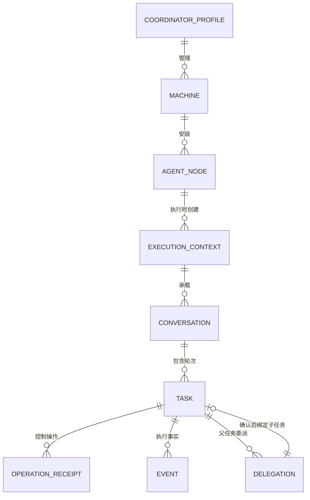

# 对象、身份与持久数据

更新：2026-10-12。这里解释整个系统的对象关系；具体读写接口见 [协议](protocol.md)，状态与恢复责任见 [M07](modules/07-task-session/design.md)。

## 当前本地原请求核对结果

本地 Coordinator 的 recoverPending 保留 resolved，增加 remaining 和 items；每项只含原 id、machineId、op、固定 code/reason，不返回 Prompt 或任意远端错误正文。旧窗口可忽略新字段，新窗口兼容只有 resolved 的旧后台并明确提示。内部 undispatchedRejection 不新增远端 RPC，只核对严格匹配的原 Windows OpenCode submit、明确资源错误与 dispatched===false 意图；落盘前复核无在途 job。原生任务/控制及 SSH daemon 协议 2 不变。[alpha.18](iterations/I06/runtime-recovery.md)。

## alpha.19 Linux CLI 发现边界

discover 的输入和 items 响应、SSH 协议 2、原请求/任务/控制接口均不变；只有新版 daemon 的本地扫描目录变化。旧 daemon 可信复用继续按实际握手版本，不因客户端版本变化就声明具备新扫描能力。 见 [专项](iterations/I06/linux-cli-discovery.md)。

## 1. 对象关系

这是产品逻辑关系，不是声称所有对象都在一张中央数据库中。中央、daemon、Hub/Edge、原生宿主各自保存所属记录。委派在 pending/rejected/unknown 初期可能还没有可确认的子 Task ID，确认后绑定对应子任务。

## 2. 需要分开的 ID

| 字段 | 含义 | 不能替代的字段 |
| --- | --- | --- |
| coordinatorId | 当前中央 profile 的持久身份 | 不是用户手输的设备凭据 |
| profileId | 远端安装/状态所属的中央 profile | 不是服务器主机密钥 |
| connectionId | 一条 SSH 连接配置，或旧工具连接记录；命名空间不同 | 不是机器硬件编号，也不是节点 |
| machineId | Windows、WSL 或已验证远端用户环境身份 | IP、显示名称和目录 |
| daemonId | 远端所属 profile 的持久 UUID | 不提供硬件级不可复制证明 |
| nodeId | 机器中一个工具安装的网络身份 | agentId、项目目录、模型 |
| contextId | 节点在某目录/协作模式下的执行上下文 | 原生 Session ID |
| agentId / instanceId | 后端执行实例；中央聚合会加机器前缀 | 用户面对的节点 |
| requestId | 一次需求的稳定幂等 ID | RPC id、taskId |
| taskId / executionId | 一轮任务与其执行归属 | Conversation ID |
| conversationId | Bridge 的多轮会话 | 原生 Session ID |
| native.sessionId / messageId | 原生会话与本轮关联；OpenCode 是原生 Message，Claude 可能没有消息 ID，Codex 当前以 Bridge requestId 关联 | 不同适配器不保证相同原生 Message 语义 |
| operationId | 权限回复或取消等控制操作的稳定 ID | 原生权限 requestId |
| delegationId | 父子委派关联记录 | 子任务 requestId |

RPC `id` 只把一条通道响应与请求配对。重连后换 RPC id 是正常通信行为；同一需求的 requestId 不能因此改变。

## 3. 身份如何生成与路由

Windows 本机目录初始化时保存随机 `local-...` machineId。WSL 按发行版名称生成稳定 ID，并记录 Windows 宿主。SSH 完成认证、daemon 检查与协议握手后使用 `ssh-<daemonId>`；不同用户/profile 各有自己 daemon 状态。

节点通常由机器 ID、adapter 和可执行位置生成。若后端报告解析后的实际 launcher 路径，保留已有权威 nodeId，避免同一工具被分成两个节点。

后端 Task、Conversation、实例 ID 聚合到中央时用 `machineId::原ID` 定位来源。下发原机器时还原原 ID。原生 Session/Message ID 不加此前缀。请求或控制响应只能解除相同来源机器的未确认记录。

显示名称可变，不能参与任务所属判断。SSH 地址别名只有在主机密钥、daemon 身份及用户归属核实后才能归并，不能只按相同 IP 合并。

## 4. 状态是不同维度

| 对象 | 当前字段 / 状态 | 阅读方式 |
| --- | --- | --- |
| 机器 | online、error；SSH 另有 connectionState | 是否能联系此执行环境 |
| 节点 | discovered、connected、offline、tool_error、unsupported；busy、unconfirmed | 是否接入、工具是否可用、是否有占位 |
| 任务 | queued、accepted、running、succeeded、failed、cancelled、unknown | 这一轮执行的事实 |
| 原生等待 | Task.waiting 的 permission/input 与原 requestIds | 任务可能仍是 running，但需要用户回复 |
| 控制收据 | pending / unknown / confirmed / rejected 等所属实现状态 | 控制请求是否获得明确回应 |
| 协作关系 | leaderId、memberIds、revision | 获准委派的新任务范围 |

`waiting_input`、`cancel_requested` 出现在早期初稿，但不是当前统一 Task.status 的值。不能把取消收据 confirmed 显示为任务 cancelled；不能把机器离线显示为已完成任务失败。

SSH 状态合并时 error/connectionError 缺失表示当前无连接错误，删除 machines.json 中旧值；文件与对外 JSON 字段结构不变。快照 RPC 的本次失败独立于 SSH 通道状态；恢复不改写 Task.error、Task.status 或 pending 台账。

## 5. 持久文件与拥有者

路径以下用 `<desktop-profile>`、`<remote-profile>` 和 `<context>` 表示，避免把某个人的电脑目录当成部署默认值。

| 所属位置 | 文件 / 数据 | 负责写入者 |
| --- | --- | --- |
| desktop profile | `desktop.json` | Coordinator 的设置入口 |
| desktop profile | `coordinator-identity.json`、`coordinator-status.json` | 所属 Coordinator；身份包含内部秘密，不能复制到共享文档 |
| desktop profile | `machines.json`、`agent-network.json` | 机器目录与网络台账 |
| desktop profile | `pending.json` | 中央未确认请求与控制记录 |
| desktop profile | `graph-layout.json`、`graph-pending.json` | 中央独立布局/收据与图写入意图 |
| desktop profile | `ssh-connections.json`、`ssh-known-hosts.json` | SSH Manager 与主机信任管理 |
| desktop profile | `ssh-credentials/*.json` | Windows DPAPI 密文；连接配置只保存引用 |
| desktop profile | `coordinator/versions/*`、`coordinator/runtime/*` | 冻结的代码/依赖/运行资源 |
| remote install | `install.json`、`current.json`、`versions/<version>/*` | 所属 SSH 安装器 |
| remote state | `machine.json`、`daemon.lock`、socket 与 PID 记录 | 所属 Linux daemon |
| remote state | `daemon-receipts.json`、`daemon-events.jsonl` | daemon；事件 cursor 持久化 |
| MachineHost state | `node-contexts.json`、`node-contexts/<contextId>` | 执行上下文宿主 |
| context / CLI instance | settings、Hub SQLite、Edge journal、operations 与 native identity | 所属 controller/Hub/Edge |
| 原生工具目录 | 账号、供应商、模型偏好与原生历史 | 原生工具；Bridge 没有全局配置写入职责 |

Claude/Codex 还保存其宿主 JSON/worker 状态，具体字段和文件见各 [原生模块](modules/06-native-adapters/design.md)。数据库格式、锁和迁移规则见 [任务模块](modules/07-task-session/design.md)。

## 6. 路径与目录占位

Windows `C:\project` 与同一宿主 WSL `/mnt/c/project` 可对应同一物理目录，共享任务占位。WSL UNC 路径必须属于所选发行版。真实目录解析后的别名也不能绕过占位。

SSH 的 `/mnt/c/project` 属于远端独立文件系统，不能与本机 Windows/WSL 混同。远端路径按远端 Linux 的 realpath 校验，不自动同步文件。

运行、等待、unknown 都可能占用节点/目录。只读查询能明确原任务终态后才解除，缺少原收据不够。具体占位与锁的持久性边界以 [M03](modules/03-machine-network/design.md) 和 [M07](modules/07-task-session/design.md) 为准，不能宣称多个独立 Bridge 中央具备全局分布式锁。

## 7. 修订、迁移与备份

关系 revision 防止两个界面覆盖授权。alpha.6 图布局 layoutRevision 与授权 revision 分开；graph-layout.json 和 graph-pending.json 的实际格式见下方。

机器目录、网络、安装清单、协议和 SQLite 各有独立版本；不能用桌面 app 版本替代它们。读取未知格式或归属不明时停止接管，保留数据。旧模型覆盖只能作为历史实例绑定，不能迁移为新节点的模型设置。

停机备份整份所属状态与安装记录，并保护凭据；活动 SQLite 不能只复制主文件而忽略 WAL。复制 daemon 状态到另一服务器不会自动授予新机器同一身份；主机密钥/身份冲突必须核对。

## 当前 6A 候选验收结果

OpenCode/Core 会话响应额外携带 canContinue/kind，均从持久原生绑定、上一轮状态、验证标志及配置/资源归属计算，不新增持久列。Conversation/native Session 的真实两轮与重开保留见 [6A 验收](iterations/I06/acceptance.md)。

## Linux 发布兼容数据

alpha.4 的离线 manifest 新增可选 `compatibleDaemons: [{version,manifestPath,manifestDigest}]`。路径仅能是清单内 `compatible-daemons/<version>.json`，其文件 SHA-256 和内容 manifestDigest 均校验，版本不能重复。旧协议 2 manifest 不要求有该字段。当前 alpha.11 明确收录 alpha.2–alpha.10；未知或未来版本不按协议相同自动接受。

SSH probe 的 `daemonVersion` 是实际选中后台版本，`clientDaemonVersion` 是客户端新安装包版本，`reuseCompatible` 是展示信息，`installNeeded=false` 表示旧安装可复用。执行分支按实际可信清单选择结果判定，不能凭缓存展示标志绕过校验。旧 current.json、daemon 身份和任务数据无需迁移。

## I06B 关系、布局与图操作

agent-network.json 增加 relationOperations，每项含 operationId、state=confirmed、内容 fingerprint 和 data（提交时的 collaboration）。现有 version=1、节点、请求、委派与 ID 不迁移或重建。图权威边仍来自 leaderId/memberIds；成员顺序不改变权限。

graph-layout.json 是 version=1 容器：layout 包含独立 layoutRevision、groups[machineId] 与 nodes[nodeId] 的 x/y、viewport 的 x/y/zoom；operations 为同类稳定收据。节点坐标相对于机器组，几何 parent 不代替 parentMachineId。损坏文件先复制为 graph-layout.json.corrupt-*，恢复默认位置不重置关系。

graph-pending.json 保存 operationId、lane=relation/layout/node/machine、完整允许的 params、内容摘要、pending/unknown/confirmed/rejected 与时间。未知原 ID 不因另一个 ID 或窗口而解除；原业务收据确认后对账。浏览器本机缓存 base/draft/layout、图两个 pending 原操作和独立的节点/机器原操作意图；机器参数含地址/认证方式但没有密码/口令，秘密不存入本机缓存。

机器 lastSyncedAt 标记成功快照时间；节点 uncertain、waiting、lastError 分别投影原任务的 unknown、等待与最近失败。原 Task 七种状态与控制收据语义不变。

AGENT_UNHEALTHY 的原执行前拒绝使用现有 daemon-receipts 的 rejected/error 与中央 pending 的 rejected/result，不新增版本或字段。旧 unknown 记录只在原查询依据其保存的确定拒绝核对，其他 unknown 原样保留；Task 状态未因此改变。

alpha.8 的布局读取可用状态是前端临时状态，不改变 GraphLayout 或收据格式。本机模式保留浏览器 State 中坐标、视口、layoutDirty 与所有原 pending ID，不创建后台确认记录。仅在图接口恢复支持且对应 lane 无 pending、修订可校验时同步。

## alpha.9 节点管理事务

AgentNode 新增可选 managed/removed，缺省兼容旧目录；显式管理后 connected 不被扫描或原生上下文报告覆盖。移除为可恢复标记，快照保留历史身份，UI 隐藏卡片，新需求受中央接入状态约束。agent-network.json 新增 nodeOperations，原子提交节点、授权和收据；版本仍为 1。GraphOperationJournal 新增 node lane，与 relation 未确认意图互锁，布局独立。旧版本不会理解显式移除语义，含此状态的配置不支持直接回退旧中央；保留数据/备份，不靠清空节点或原请求恢复。

`manageNode` 参数 `{operationId,nodeId,machineId?,action}`，action 为 attach/disconnect/remove；返回 `{operationId,state:"confirmed",fingerprint,data:{node,collaboration}}`。`nodeOperation` 以原 operationId 返回 confirmed、确定拒绝的 rejected 或 not_found；not_found 不证明未执行。断开/移除撤销相关权限，有变更才增关系修订。来源校验、离线/忙碌/原生 pending、节点/授权 pending 拦截，接入锁避免并发新任务。snapshot.nodeManagement=true 声明中央能力；新界面在旧中央禁写，原本机布局模式保留。完整语义、错误与验证见 [alpha.9 节点管理](iterations/I06/node-management.md)。

## I06C 当前机器管理接口

以下为受保护本地 Coordinator 调用；不向 Agent 授予机器管理权限。operationId 持久后发送；回应未知只查原 machine.operation。

| 方法 | 参数 / 返回 |
| --- | --- |
| machine.updateSsh | operationId, connectionId, expectedRevision, machineId?，config={name?,host,port?,username,authKind,keyPath?}；只接受这些字段，秘密仅走 credential.provide |
| machine.remove / machine.restore / machine.disconnect / machine.reconnect | operationId,connectionId,expectedRevision,machineId?；本地管理收据 {operationId,state,fingerprint,data:{action,machineId,connectionId,revision}} |
| machine.operation | {operationId}，confirmed 原收据 / rejected 原错误 / not_found；not_found 不证明未发生，不能换 ID 重新提交 |
| snapshot.machineManagement | true 表示当前中央支持此机器生命周期；没有该能力时新 UI 禁用编辑/移除并提示更新后台 |
| snapshot.machines[].removed,revision,busy | 可见性、配置修订及来源任务/原 pending 占用；快照仍保留 removed 机器，UI 隐藏图组/目标，设置提供恢复 |
| ipc task/conversation 历史读取 | 来源离线/移除允许返回已观察 historical=true 快照，非终态 unknown、canContinue=false；request/operation 收据不从历史确认 |

旧 machine.disconnect/reconnect 无 operationId 时中央生成一次原管理 ID，仍使用相同守卫；新 UI 必须先本机持久原 ID。断开/编辑/移除来源在线且无运行/等待/unknown，重连允许未知任务但只恢复观察；reconnect confirmed 不是 online 或任务成功证明。原 reconnect 收据只在匹配当前连接修订时安排观察，不覆盖之后的手动断开。机器、节点、授权未知共享屏障，布局独立。

SSH 客户端接收 daemon.eventRead 的 items,nextCursor,hasMore,cursorGap,earliestCursor；cursorGap/cursorExpired 后完整 snapshot 再 drain 页，不猜 latestCursor，不重复 Prompt。配置/网络两阶段提交的原收据恢复边界见 [6C 首批](iterations/I06/machine-management.md)。

## alpha.11 后台维护与控制确认

snapshot.daemonManagement=true 表示中央支持 SSH 后台维护；旧中央缺失时 UI 禁写。

| 方法 | 参数与结果 |
| --- | --- |
| machine.daemonPreview | 原 machineId/connectionId；返回实际 daemonVersion、targetVersion、rollbackVersion、previewId 及现有安装摘要 |
| machine.maintainDaemon | `{operationId,machineId,connectionId,expectedRevision,config:{action,previewId,expectedVersion,targetVersion?}}`；action 为 upgrade/rollback/stop/uninstall；先返回原 unknown 收据 |
| machine.operation | 原 operationId；查已保存原维护，不重复启动；confirmed/rejected/unknown/not_found 保持原含义 |
| daemon.quiesce | `{operationId}`；同一持久租约、空闲及无未确认收据才允许 |
| daemon.releaseMaintenance | 仅原 operationId 可释放租约 |
| daemon.shutdown | 仅持有原租约且无在途任务，完成认证回应后优雅退出 |

版本维护通过 SSH 固定私有控制器 stdin（上限 8 MiB，可容纳多份已知发布清单），不放入常规 1 MiB RPC 帧；不是扩大用户消息/公开接口限制。四字节帧、协议号 2、64 KiB 需求限制均不变。

native reply/cancel 返回须对应原 operationId、Task/execution 目标和明确 state；unknown 或外来 ID 不确认。confirmed 只说明接收，Task cancelled/succeeded 仍需原生事实。旧 confirmed 外壳内的 native unknown 在恢复时保留 unknown，明确拒绝可按原操作读取。维护失去回应仅查原 ID；无证据不换 ID/别名释放占位。见 [I06C 收尾](iterations/I06/final-delivery.md)。

## alpha.14 安装上传失败的明确边界

`ssh-connections.json.operations[operationId]` 的安装 status 保留 pending/confirmed/unknown，并以 rejected 标记上传器明确 `SSH_UPLOAD_FAILED`：该错误只从打开/写入/关闭归档阶段产生，尚未进入解包/激活。safe error 含类别、阶段及 ACK 字节数，不含服务器原始文字或秘密；SFTP 数值状态可保留。此错误暂停自动重连。界面补录凭据、重新 testSsh、查看摘要并批准 connectSsh，未变化摘要沿原 connectionId/operationId。其他已发送步骤失败仍是 unknown，不显示新安装入口，也不从该安装状态推定原生任务或控制结果。没有新增 RPC 或 daemon 协议版本。见 [迭代证据](iterations/I06/ssh-upload-recovery.md)。

## alpha.16 维护原查询语义

公开方法/参数和 daemon 协议号不变。原 machine.operation 可用持久的 remoteLaunched=false 确认未启动并同步对应机器维护占位；认证失败显示 needs_credentials，忙碌/冲突语义原样返回。输入可能已发送的流中断/超时仍 unknown，只查原 ID。见 [增量](iterations/I06/maintenance-launch-recovery.md)。

## 本地未确认操作投影（alpha.20 候选）

CoordinatorClient 的 pending 响应行新增可选 blockedNodeIds: string[]，用于图卡片、提交、续聊及任务控制的可用性投影；缺该字段时客户端沿用原机器限制。机器/节点管理仍用整机限制。该字段不证明原请求已完成，不新增远端 RPC，不改变 daemon 协议 2。

recoverPending 保留 resolved/remaining/items；items 中 NOT_CONFIGURED 的固定说明为原后台执行配置未就绪。它不能单独将原记录置 rejected；必须另核对已保存的原错误和原未派发意图。已拒绝的同 requestId 返回原拒绝，不补发 Prompt。[专项](iterations/I06/pending-isolation.md)。
