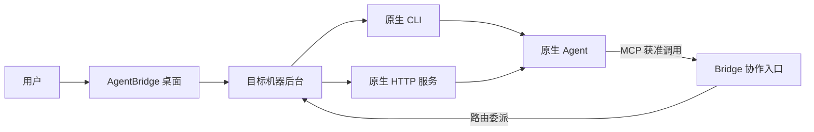

# 系统设计

AgentBridge 桌面提供统一操作入口；各机器的后台在本地调用原生 Agent。这样用户可以跨机器工作，而原生程序、凭据和目录仍留在执行环境中。

## 执行与协作的方向

CLI 和 API 是 Bridge 驱动原生 Agent 的路径。MCP 是原生 Agent 使用 Bridge 协作工具的路径，两者分别建立能力，不能互相推断。[接入方式比较](integration-methods.md)解释各方式的用途。

## 机器之间如何连接

本机由桌面与本机后台通信；WSL 连接通过 Windows 与对应发行版之间的通道；SSH 连接通过远端后台路由请求和结果。Agent 无须互相开放网络端口。

DSH Desktop / Web 需要目标机器后台能够访问其服务。应在[DSH 连接设置](agents/dsh.md)中选择服务所属机器，不能把一个环境的 localhost 误作另一个环境。

## 会话与任务如何保持对应

每次提交关联原生会话与原请求。后续输出、取消和查询都继续指向它。未知结果保留原任务占位，通过查询核实，不用新建请求绕过不确定状态。

各个原生工具保留自己的私有会话。公共工作材料是共享视图，不会把所有工具的对话自动合并。[任务与会话](sessions.md)和[关系与协作](collaboration.md)说明操作规则。

## 授权边界

连接在线不等于获准调用。关系、MCP 连接身份与工具权限共同约束协作范围；撤销授权后，不能继续用原连接发起新的获准操作。Bridge 权限也不替代原生 Agent 的文件访问或工具执行权限。
