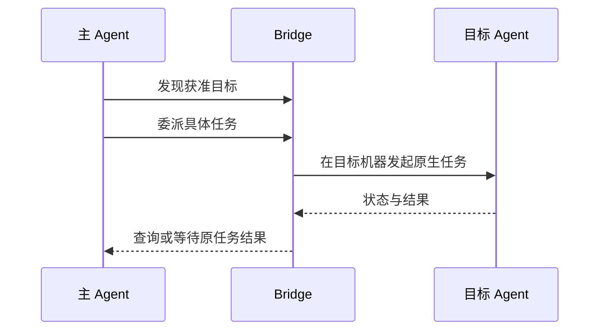

# 关系与协作

本页说明当前协作流程，具体功能以正在运行的后台为准。日常需求从原生Agent会话发起，Bridge提供配置、审计和原执行恢复。

关系决定一个 Agent 可以把任务交给哪些目标。关系保存后只建立授权，实际执行仍由用户需求或 Agent 的获准调用触发。

## 设置调用关系

在“接入配置”的关系图选择主Agent与允许接收任务的目标，保存授权；“连接策略与确认”可分别配置各主的预授权范围。随后为原生Agent配置Bridge MCP，从原生会话发起协作。设为主Agent只改变主角色，不会自动授权其余节点。

选中已保存连线，点击“删除这条授权”，连线先显示“待移除”；点击“保存授权”后生效。成员离线或自身接入待核对时仍可撤销授权；新增成员和换主会检查新目标的状态与能力。撤权不会取消既有任务。

关系自身保存待核对时查询原授权操作；管理台账无法安全读取时先恢复读取。修订冲突会保留草稿，可选择载入后台关系或保留草稿后重新校验。本机无法保存草稿时检查存储并重开。布局接口不可用不影响授权编辑；旧后台若仍拒绝撤权，应更新桌面程序并通过“停止后台并退出”完整重启后台。

独立MCP调用能力、Bridge托管scope和原生小队注入分别判断。支持独立MCP的入口可按已保存授权主动调用；Hermes、Pi、DSH等的独立配置不表示已适配托管小队注入。以[各入口说明](agents/index.md)和实际工具目录为准。

## 查看当前连接

支持该视图的 Bridge 后台会通过 `list_agents` 返回当前调用方的角色及获准目标。当前主 Agent 能看到用户允许的子节点；成员或未分配角色没有可委派目标。无需向工具提供自己的身份或其他节点身份。

“有委派授权”与目标在线、空闲是两件事。原父任务状态未知时可以查看连接，但不能发起新委派；需要先核对原请求。查询期间发生换主或撤销目标时，以返回视图里的当前关系为准。工具缺失或查询失败表示通道未就绪，不能当作没有连接。

## 一次委派如何执行

主 Agent 通过 MCP 调用 Bridge，Bridge 使用目标的原生 CLI 或 API 执行。目标不需要支持 MCP 才能被委派；反过来，接入 MCP 也不自动让 Bridge 获得启动该外部 Agent 的能力。

## 查找已委派任务

支持该工具的 Bridge 后台可向主 Agent 提供 `list_delegations`，分页查找当前父任务或当前独立 MCP 连接自己的委派记录。它不显示其他调用方的记录，也不返回需求和结果正文。

列表显示最后保存的状态；需要当前进度或回答时，再用记录里的任务 ID 查询原任务。若记录只有原请求 ID、尚无任务 ID，应保留原请求并核对，不能重复发送。后台未提供此工具时，仍按原任务记录查询。

## 上下文与公共材料

普通委派新建子会话，不复制主 Agent 的完整私有对话。需求中应包含明确目标、可访问目录、预期产物与必要材料。

支持该能力的后台会为新委派附加简短说明：子 Agent 完成本项需求，在当前会话报告结果、证据和未完成事项，由 Bridge 交回主 Agent；需要额外信息或授权时说明并交回。说明不授予新工具、继续委派或修改关系的权限，不代替原生权限确认。历史委派保留原输入；过长的新需求会明确拒绝，不截断内容。

公共工作材料可以帮助成员阅读同一份文档和任务信息，但不等于所有原生 Agent 共用内部记忆。只读选材包的导出也不表示已经发送或被目标读取。[工作材料](materials.md)说明具体范围。

## 小队与独立工作

小队用于围绕一个工作目标组织成员、公共文档、群消息与任务板。登记智能体时描述其职责和能力边界；Bridge 不在登记时给它新增模型或 Skill。

在“小队设置”登记成员、建立小队和工作作用域，设置目标/完成标准，再生成各成员的工作MCP配置。建立作用域不会执行模型。成员从自己的原生会话读取材料、分工、接手、报告、编辑正文与验收；桌面只读展示任务板、消息、报告和版本历史。用户继续配置成员访问、文档编辑者、预算和直接交接授权，以及暂停/停止/归档。保存文档编辑权限保持原标题与正文。

配置回应未知时只用“查询原小队操作”；旧后台未提供完整原操作证明、记录损坏或被其他窗口改动时保留原记录并暂停新配置，不能换ID重发。确认配置收据不代表业务执行完成。

| 角色 | 可以做什么 | 授权边界 |
| --- | --- | --- |
| 用户 | 选择成员、批准访问、配置自动成员和预算、停止工作 | 自动执行和预算由用户决定 |
| 主角色 | 在当前工作目标内分工、核对结果、验收与安排返修 | 不能自行扩大授权或给自己增加执行预算 |
| 成员 | 按获准范围读写公共材料，执行本人任务，报告结果或交接 | 交接和读取材料都需要对应权限 |

任务板分别表示分配、接手、执行、报告和业务验收。产物按明确版本引用，返修与交接应指向对应任务和版本。原生 Agent 返回成功只说明本次执行结束，不代替主角色的业务验收。

支持小队注入的原生工具可以按成员身份执行回合；外部 Agent 也可通过获准的 MCP 连接参与。Hermes、Pi 和 DSH 当前不支持原生小队注入，普通被委派能力不等于小队成员能力。

## 授权的自动跟进

用户可以为支持的原生成员启用自动执行与预算。重要任务事件满足授权和预算条件后，系统才安排对应回合；普通群消息或已读状态不会直接触发执行。

主角色自动续接当前仅适配 Claude Code 的原会话，其他工具不能据此推断支持同样的自动跟进。存在执行中或未知的原任务时，先核对原请求，不重复唤起。

## 授权与停止

只有获准的关系与连接才能调用对应工具。撤销授权与取消正在运行的原任务是两个操作；需要停止任务时应对原任务取消，并等待状态核对。

保存更多关系不会自动发起任务，也不会给 Agent 授予修改原生模型、账号或供应商配置的权限。

停止整项小队工作会关闭自动授权并撤销成员协作访问，公共材料继续保留；仍需核对正在运行的原生任务。外部成员访问被撤销不表示外部程序已被取消。

原节点有待核对管理操作时，同机资源独立的其他节点仍可设为主 Agent。点击只修改草稿，保存授权后生效；涉及原节点、同安装、共享目录或旧关系中的受影响节点时仍会拒绝。关系或机器操作待核对、来源无法确认时请先查询原操作，不要换节点或目录重做。

## 预授权连接与用户确认

本节适用于公开 **alpha.60**；更早的公开版本尚无这三个连接工具。以实际后台版本及原生工具目录为准。

打开“连接策略与确认”，选择主Agent，并勾选允许它自行连接的目标。列表以“机器 / Agent”区分同名入口。保存范围只授予连接资格，不会立即建立连接或启动任务；各主可有自己的出站关系，也可同时是其他主的成员。

主Agent使用 `list_connectable` 查看自己的预授权目标，使用 `connect_agent` 连接或 `disconnect_agent` 断开。范围外请求只进入“待用户确认”，由你明确允许或拒绝。Agent断开保留预授权；要阻止它重新连接，请在页面中移除该目标并保存范围。撤销连接不会取消或转移原任务。

如果保存回应丢失，页面重开后使用“查询原策略操作”。未查到或回应不匹配时，页面继续保留原记录；不要换ID重发。Agent连接操作也应保留原 `operationId` 和目标，通过 `queryOnly:true` 查询原结果。授权操作已确认不代表任务已成功或取消。
